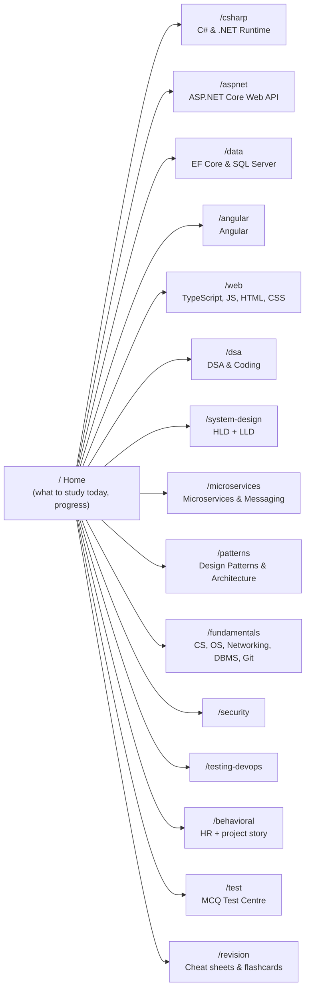

# Interview Prep Hub – Project Plan

> Personal, self-hosted interview preparation website for a **3–4 year SDE (.NET + Angular)**.
> Status: **IN EXECUTION.** Phases 1–2 done and committed (site skeleton, MCQ engine, tests, deploy workflow). Phase 3–5 content is being written. See §17 for the implementation log.
> Created: 2026-11-02 · Last updated: 2026-11-02

**Scope rule:** the *content* is laser-focused on .NET + Angular (plus the stack-agnostic basics every SDE interview asks). The *website itself* is built with whatever is fastest to author, cheapest to host and easiest to maintain for one person. It does not need to be .NET or Angular.

---

## 1. Goals

| # | Goal | Notes |
|---|------|-------|
| G1 | One place to study every topic that shows up in a 3–4 yr .NET/Angular SDE interview loop | Content first; UI second |
| G2 | Every topic page has: concise explanation, diagram where it helps, code, "interview Q&A", and a "common pitfalls" box | Consistent template |
| G3 | MCQ test mode per section + mixed mock test, with explanations and progress tracking | Static site, progress in localStorage |
| G4 | Free hosting from a Git repo (GitHub Pages) with automatic deploy on push | Zero server cost, zero ops |
| G5 | Adding a topic = adding a Markdown file; adding questions = adding to a JSON file | No DB, no backend, no framework ceremony |
| G6 | Fast to build: skeleton live in a day, so time goes into content, not plumbing | |

Non-goals (v1): user accounts, server-side anything, comments, multi-user features.

---

## 2. Research Summary (what interviews actually ask at 3–4 yrs)

Pulled from 2026 prep guides, Glassdoor loops (Infosys etc.), interviewing.io and ByteByteGo material.

**.NET side (most frequent):**
- C# fundamentals: OOP, abstract vs interface, boxing/unboxing, value vs reference, `IDisposable`/finalizers, generics, delegates/events, LINQ (deferred execution, IEnumerable vs IQueryable), async/await internals, `Task` vs `ValueTask`, threads vs tasks, `ConfigureAwait`, `lock`/`SemaphoreSlim`, GC generations, `Span<T>`, records, pattern matching, nullable reference types, newer C# features (primary constructors, collection expressions, extension members, and C# 15 union types shipping with .NET 11 in Nov 2026).
- ASP.NET Core: request pipeline + middleware order, DI lifetimes (and captive dependency bugs), filters vs middleware, model binding/validation, minimal APIs vs controllers, authentication/authorization (JWT, cookies, policies), configuration/options pattern, logging, caching (in-memory, distributed, output cache, HybridCache), API versioning, rate limiting, health checks, `BackgroundService`, SignalR, gRPC basics.
- EF Core: change tracking, `AsNoTracking`, eager/lazy/explicit loading, N+1, migrations, transactions, optimistic concurrency, raw SQL, compiled queries, bulk ops, split queries.
- SQL Server: joins, indexes (clustered/non-clustered/covering), execution plans, CTEs, window functions, isolation levels & locking, stored procs vs ORM, normalization, performance troubleshooting.
- SOLID, Repository/UoW, CQRS, Mediator, Clean Architecture; project walkthrough; "how did you debug X in prod".

**Angular side (most frequent):**
- Standalone components (default since v17), lifecycle hooks, `@Input`/`@Output` vs `input()`/`output()` signals, change detection (Default vs OnPush, zoneless, how signals mark views dirty), Signals API (`signal`, `computed`, `effect`, `linkedSignal`, `toSignal`/`toObservable`), `httpResource`/`rxResource`, Signal Forms (stable in v22) vs Reactive Forms vs Template forms, routing (lazy loading, functional guards, resolvers), DI (providers, `inject()`, injection tokens, hierarchical injectors), RxJS (switchMap vs mergeMap vs concatMap vs exhaustMap, Subjects, unsubscribe strategies, `takeUntilDestroyed`), interceptors, state management (signal stores vs NgRx), performance (`@for track`, `@defer`, SSR + hydration), testing (Vitest default since v21, TestBed, harnesses).

**General SDE (asked regardless of stack):**
- DSA: arrays, strings, hashing, two pointers, sliding window, stack/queue, linked list, trees/BST, BFS/DFS, heaps, binary search, recursion/backtracking, basic DP, sorting, Big-O.
- System design at 3–4 yrs: fundamentals + one medium design (URL shortener, notification system, chat, rate limiter, file upload, e-commerce order flow), trade-off reasoning (SQL vs NoSQL, cache invalidation, CAP), low-level OOP design (parking lot, elevator, library) with class diagrams.
- CS fundamentals: HTTP/HTTPS/TCP, REST, OS basics (process vs thread, deadlock), DBMS (ACID, indexing), OOP, Git.
- Security: OWASP top 10, JWT vs cookies, OAuth2/OIDC, CORS, CSRF, XSS, SQLi.
- Testing/DevOps: xUnit/Moq, integration tests with `WebApplicationFactory`, Docker, CI/CD, Azure basics.
- Behavioral: STAR stories, project deep-dive, conflict, failure, "why leaving", salary/negotiation.

---

## 3. Tech Stack Decision (optimised for a one-person static site)

### Recommended: **Astro + Starlight** → GitHub Pages

Starlight is Astro's documentation theme. It gives, out of the box and with zero custom code: sidebar navigation generated from folders, built-in tabs component, table of contents, full-text search (Pagefind, runs client-side, no service), dark/light mode, mobile layout, code blocks with syntax highlighting + copy button (Expressive Code; C#, TS, SQL, bash all supported), callout/aside boxes, and ships zero JavaScript unless a page needs it. The MCQ engine is the only custom part and is added as a small interactive "island" component.

| Concern | Choice | Why |
|---------|--------|-----|
| Site generator | **Astro (latest) + Starlight theme** | Content-first, Markdown/MDX, fastest path to a polished docs-style site; framework-agnostic |
| Content | Markdown / MDX files under `src/content/docs/**` | One file per topic; front matter for title/order/tags |
| Tabs | Starlight `<Tabs>/<TabItem>` in MDX | Needed for "C# / TypeScript" side-by-side code and sub-topic tabs |
| Diagrams | **Mermaid** via `astro-mermaid` (client-side render, light/dark aware; no Playwright needed) + hand-made SVGs in `public/diagrams/`. Diagram syntax is checked in CI by `scripts/check-content.mjs` | Diagrams stay as text in the repo |
| Code highlighting | Built-in Expressive Code (Shiki) with copy button, line highlight, file-name titles | No setup |
| Search | Built-in Pagefind | No setup |
| MCQ engine | Small **Preact** (or vanilla TS) island component `<Quiz>` loaded with `client:visible`; data from JSON files | Preact is ~3 KB, Astro supports it natively; keeps the quiz interactive on a static site |
| Progress storage | `localStorage` + Export/Import JSON button | No backend |
| Styling | Starlight theme + CSS custom properties override | Minimal custom CSS |
| Testing | Vitest for quiz logic + question-JSON validator script | Light |
| Build/deploy | GitHub Actions: validate → content check → tests → `astro build` → `upload-pages-artifact` → `deploy-pages`. Site URL and base path derived from the repo owner/name | No username hard-coded |
| Package manager | npm (Node 22 already installed) | |

### Alternatives considered

| Option | Verdict |
|--------|---------|
| **Docusaurus** (React) | Equally capable: built-in Tabs, Mermaid plugin, local-search plugin, GitHub Pages deploy command. Heavier runtime (ships React to every page), config is more verbose. Good fallback if Starlight limits are hit. |
| **MkDocs Material** (Python) | Fastest pure-content authoring (tabs, admonitions, Mermaid, search all built in), but interactive MCQ engine would be bolted-on JS with no component model; Python toolchain on Windows is an extra moving part. |
| **VitePress** (Vue) | Fine, but smaller docs-feature set than Starlight/Docusaurus (no built-in tabs without plugin). |
| **Angular SPA** (original idea) | Most work for least gain here: must build nav, markdown rendering, search, TOC, theming by hand. Rejected because the site doesn't need to be Angular; the content does. |
| **Plain HTML/JS** | No build step, but no content pipeline; 150+ pages become unmaintainable. |

Local toolchain available: Node 22.23, npm 10.9, Git 2.53. (.NET SDK 10 is present and useful for *verifying* C# snippets in content, not for the site.)

---

## 4. Site Structure (Sections → Tabs → Topics)



**Layout (Starlight default):** top bar (title, search, theme toggle) → left sidebar with one collapsible group per section → topic page with right-hand "On this page" TOC → prev/next links.
**Tabs** are used inside pages: (a) sub-topic tabs where a concept has several facets (e.g. "Eager | Lazy | Explicit" loading), (b) language tabs (C# | TypeScript | SQL), (c) "Explanation | Code | Interview Q&A | Pitfalls" when a page is long.

Every topic page ends with the same blocks: **Interview Q&A** (collapsible), **Pitfalls** (aside), **Quick quiz** (5 MCQs inline via `<Quiz topic="..." count={5} />`), **Mark as done**.

Routes: `/csharp/async-await/`, `/test/`, `/test/csharp/`, `/test/mock/`, `/revision/`.

---

## 5. Content Outline (per section → topics)

Each bullet is one markdown page. **(D)** = diagram needed, **(C)** = code samples needed.

### 5.1 C# & .NET Runtime
- .NET platform overview: CLR, JIT/AOT, IL, BCL, .NET Framework vs .NET (Core) vs .NET 10/11 **(D)**
- Value vs reference types, stack/heap, boxing/unboxing, `struct` vs `class`, `record`/`record struct` **(D)(C)**
- OOP in C#: encapsulation, inheritance, polymorphism, abstract vs interface, default interface methods, sealed, virtual/override/new **(C)**
- Memory & GC: generations, LOH, finalizers, `IDisposable`/`using`, `IAsyncDisposable`, weak refs, leaks (events, statics, timers) **(D)(C)**
- Collections & generics: List/Dictionary/HashSet/Queue/Stack/LinkedList/Sorted*, concurrent & immutable collections, `IEnumerable` vs `ICollection` vs `IList`, covariance/contravariance, constraints **(C)**
- LINQ: deferred vs immediate execution, `IEnumerable` vs `IQueryable`, expression trees, operators, performance traps **(C)**
- Delegates, events, `Func/Action/Predicate`, lambdas, closures **(C)**
- Async/await deep dive: state machine, `Task`/`ValueTask`, `ConfigureAwait`, deadlocks, `async void`, cancellation, `WhenAll`, `Parallel`, `IAsyncEnumerable` **(D)(C)**
- Threading & synchronization: Thread vs Task vs ThreadPool, `lock`, `Monitor`, `SemaphoreSlim`, `Interlocked`, `ReaderWriterLockSlim`, `Channel<T>`, race conditions **(D)(C)**
- Exceptions: hierarchy, filters, custom exceptions, cost, global handlers **(C)**
- Strings: immutability, `StringBuilder`, interning, `Span<T>`/`Memory<T>`, comparison & culture **(C)**
- Modern C# (9 → 15): records, init, pattern matching, switch expressions, file-scoped namespaces, required members, primary constructors, collection expressions, `params` collections, extension members, `field` keyword, union types & closed hierarchies (C# 15) **(C)**
- Reflection, attributes, source generators (what/when) **(C)**
- Serialization: `System.Text.Json` vs Newtonsoft **(C)**

### 5.2 ASP.NET Core Web API
- Hosting model, `Program.cs`, Kestrel, environments **(D)**
- Request pipeline & middleware: order, `Use/Run/Map`, custom middleware, short-circuiting **(D)(C)**
- Dependency injection: lifetimes, captive dependencies, keyed services, `IServiceScopeFactory`, anti-patterns **(D)(C)**
- Controllers vs Minimal APIs, routing, model binding, validation, `ProblemDetails` **(C)**
- Filters vs middleware **(D)(C)**
- Configuration & Options pattern, secrets **(C)**
- Logging (ILogger, Serilog, structured), OpenTelemetry basics **(C)**
- Authentication & authorization: JWT bearer flow, refresh tokens, cookies, policies/roles/claims, Identity overview **(D)(C)**
- Error handling: `IExceptionHandler`, global problem details **(C)**
- Caching: in-memory, distributed (Redis), output caching, `HybridCache`, ETags **(D)(C)**
- Performance: async all the way, `IHttpClientFactory`, Polly resilience, compression, pagination, streaming **(C)**
- API versioning, OpenAPI, CORS **(C)**
- Rate limiting, health checks **(C)**
- Background work: `BackgroundService`, queues, Hangfire/Quartz overview **(C)**
- Real-time & RPC: SignalR, gRPC vs REST vs GraphQL **(D)**
- REST API design conventions
- Scenario Qs: "request comes in → what happens?", "scoped in singleton?", "secure this API", "10k req/s"

### 5.3 EF Core & SQL Server
- EF Core architecture: `DbContext` lifetime, change tracker, `SaveChanges` flow **(D)(C)**
- Modelling: conventions, Fluent API, relationships, owned types, value conversions **(C)**
- Querying: translation, client vs server eval, projections, `AsNoTracking`, `Include`, split queries, N+1 **(C)**
- Loading strategies: eager/lazy/explicit **(D)(C)**
- Migrations & seeding **(C)**
- Transactions, `ExecuteUpdate/Delete`, bulk ops, raw SQL, stored procs **(C)**
- Concurrency: optimistic (`RowVersion`) vs pessimistic **(C)**
- Performance: compiled queries, context pooling, logging SQL **(C)**
- Repository/UoW with EF: when it helps, when it's ceremony
- SQL: joins (visual), set ops, GROUP BY/HAVING, subqueries, CTEs, window functions **(D)(C)**
- Indexes: clustered vs non-clustered, covering, filtered, seek vs scan **(D)**
- Execution plans, SARGability, parameter sniffing **(C)**
- Transactions & isolation levels, locks, deadlocks **(D)**
- Stored procs, functions, triggers, views, temp tables vs table variables **(C)**
- Normalization, keys, constraints **(D)**
- Classic SQL problems: nth highest salary, duplicates, running totals, gaps & islands, hierarchies **(C)**
- NoSQL contrast: when Cosmos/Mongo/Redis instead

### 5.4 Angular
- Architecture & bootstrapping: standalone, `bootstrapApplication`, zoneless **(D)**
- Components: templates, control flow (`@if/@for/@switch`), `@defer`, inputs/outputs (decorator vs signal), `model()`, content projection, `viewChild()`, host bindings **(C)**
- Lifecycle hooks **(D)(C)**
- Change detection: Default vs OnPush, zone.js vs zoneless, signals & CD, `ExpressionChangedAfterItHasBeenChecked` **(D)(C)**
- Signals deep dive: `signal`, `computed`, `effect`, `linkedSignal`, `untracked`, `toSignal`/`toObservable`, pitfalls **(C)**
- Resources: `resource`, `rxResource`, `httpResource` **(C)**
- Dependency injection: providers, `inject()`, `InjectionToken`, hierarchical injectors, multi providers **(D)(C)**
- State management: signal stores, NgRx overview, when to pick which **(D)(C)**
- Routing: lazy loading, functional guards/resolvers, route params as inputs, nested routes, preloading **(C)**
- Forms: Signal Forms (v22), Reactive Forms, Template-driven; comparison **(C)**
- HttpClient & functional interceptors, error handling, retry, auth token, caching **(C)**
- RxJS: Observable vs Promise, hot/cold, Subjects, operators cheat-sheet, higher-order mapping with marble diagrams, combination operators, error handling, unsubscribe strategies **(D)(C)**
- Directives (attribute/structural/host) & pipes (pure/impure/async) **(C)**
- Performance: `track`, OnPush, `@defer`, lazy routes, bundle budgets, virtual scroll, NgOptimizedImage **(C)**
- SSR, hydration, incremental hydration, prerendering **(D)**
- Testing: Vitest + TestBed, harnesses, `provideHttpClientTesting`, testing signals & observables **(C)**
- Security in Angular: sanitization, `bypassSecurityTrust*`, CSRF
- Angular version history cheat-sheet (v14 → v22)
- Scenario Qs: parent/child communication, service vs store, "view not updating", subscription leaks

### 5.5 TypeScript, JavaScript, HTML & CSS
- TS types: unions, intersections, generics, utility types, `keyof`/`typeof`, mapped & conditional types, type guards, discriminated unions, `unknown` vs `any`, enums, decorators **(C)**
- TS config essentials (strict flags)
- JS core: event loop, micro/macrotasks, closures, `this`, prototypes, hoisting, promises, debounce/throttle, deep vs shallow copy, equality, modules **(D)(C)**
- Browser: DOM, event bubbling/delegation, storage options, CORS, rendering pipeline, Web Workers **(D)**
- HTML: semantics, forms, accessibility basics, SEO basics
- CSS: box model, specificity, flexbox, grid, positioning, responsive, units, CSS variables, animations **(D)(C)**

### 5.6 DSA & Coding (solutions in **C#**, TS alternative for frequent ones)
- Big-O cheat sheet **(D)**
- Arrays & strings: two pointers, sliding window, prefix sums, Kadane **(C)**
- Hashing: frequency maps, anagram groups, two-sum family **(C)**
- Stack & queue: parentheses, monotonic stack, min-stack **(C)**
- Linked lists: reverse, cycle detection, merge, LRU cache **(D)(C)**
- Recursion & backtracking: permutations, subsets **(C)**
- Binary search: arrays and answer space **(C)**
- Sorting: compare sorts, custom comparers, stability **(D)(C)**
- Trees & BST: traversals, height, LCA, validate BST, level order **(D)(C)**
- Heaps (`PriorityQueue<T,P>`): top-k, merge k lists **(C)**
- Graphs: BFS/DFS, topological sort, components, Dijkstra basic, grid problems **(D)(C)**
- DP intro: climb stairs, coin change, LIS, knapsack, LCS, edit distance **(D)(C)**
- Greedy & intervals **(C)**
- Bit manipulation basics **(C)**
- Curated ~75 problem list grouped by pattern: difficulty, hint, solution, complexity, done checkbox
- C#-specific coding round: LINQ puzzles, string manipulation, custom `IEnumerable`/`IComparer`, generic repository stub, async exercises, SQL writing **(C)**
- Angular/TS live-coding prep: CRUD with signals, debounced search with RxJS, custom pipe/directive, reactive form with validation **(C)**

### 5.7 System Design (HLD + LLD)
- How to run a 45-min design interview: requirements → estimates → API → data model → HLD → deep dives → trade-offs **(D)**
- Scaling fundamentals: vertical vs horizontal, stateless, load balancers, CDN, DNS **(D)**
- Caching: strategies, eviction, invalidation, Redis structures, hot keys **(D)**
- Databases: SQL vs NoSQL, replication, sharding, CAP/PACELC, consistency, Saga/outbox **(D)**
- Messaging: queues vs pub/sub, Service Bus/RabbitMQ/Kafka, idempotency, DLQ, ordering **(D)**
- Microservices vs modular monolith: gateway, discovery, resiliency patterns, observability **(D)**
- API design: REST vs gRPC vs GraphQL, versioning, idempotency keys, rate-limiting algorithms **(D)**
- Storage & files: blob storage, pre-signed URLs, chunked upload **(D)**
- Security in design: OAuth2/OIDC flows, API keys, secrets **(D)**
- Azure mapping for a .NET dev: App Service, Functions, AKS, SQL DB, Cosmos, Redis, Service Bus, Blob, Key Vault, App Insights; each with its AWS equivalent (App Runner/ECS, Lambda, EKS, RDS, DynamoDB, ElastiCache, SQS/SNS, S3, Secrets Manager, CloudWatch) **(D)**
- **HLD case studies** (architecture + sequence diagram, estimates, data model, bottlenecks): URL shortener, notification system, rate limiter, real-time chat, file upload/download, e-commerce order & payment, job scheduler; stretch: news feed, autocomplete
- **LLD / OOP design** (class diagram + C# skeleton): parking lot, elevator, library, splitwise, vending machine, LRU cache, logger, notification dispatcher (Strategy)
- Trade-off vocabulary sheet

### 5.7a Microservices & Messaging (emphasized sub-section, own sidebar group)
- Monolith → modular monolith → microservices: when to split, how to find boundaries (DDD bounded contexts), cost of distribution **(D)**
- Communication: sync (REST/gRPC) vs async (events/commands); request-reply vs fire-and-forget; API gateway (YARP / Azure API Management) and BFF **(D)**
- Message brokers compared: **RabbitMQ** (exchanges, queues, routing keys, acks), **Kafka** (topics, partitions, consumer groups, offsets, retention, log compaction), **Azure Service Bus** (queues, topics/subscriptions, sessions, DLQ, scheduled messages); AWS equivalents: SQS/SNS/MSK **(D)(C)**
- Delivery guarantees: at-most/at-least/exactly-once, idempotent consumers, deduplication, ordering, poison messages and dead-letter handling **(D)(C)**
- Reliability patterns: Outbox + inbox, Saga (orchestration vs choreography), compensating transactions, retries with backoff, circuit breaker, bulkhead, timeouts (Polly / .NET resilience) **(D)(C)**
- Event-driven design: domain events vs integration events, event versioning/schema registry, CQRS with projections, eventual consistency UX **(D)**
- .NET implementation: MassTransit vs NServiceBus vs raw clients; `BackgroundService` consumers; Confluent.Kafka basics; Azure Service Bus SDK; Dapr overview **(C)**
- Cross-cutting: service discovery, config, distributed tracing (OpenTelemetry, correlation IDs), centralized logging, health checks, .NET Aspire overview **(D)**
- Data in microservices: database-per-service, shared data anti-patterns, reporting across services, distributed caching **(D)**
- Scenario Qs: "order placed → payment → inventory → email; what fails and how do you recover?", "Kafka vs Service Bus for X?", "how do you guarantee no duplicate emails?"

### 5.8 Design Patterns & Architecture
- SOLID with before/after C# **(C)**
- DRY, KISS, YAGNI, composition over inheritance
- GoF most asked: Singleton, Factory/Abstract Factory, Builder, Adapter, Decorator, Facade, Proxy, Strategy, Observer, Command, Template Method, Chain of Responsibility, State, Mediator **(D)(C)**
- Enterprise: Repository, UoW, Specification, CQRS, MediatR behaviours, Options, Result, Outbox **(D)(C)**
- Architectures: N-layer vs Clean/Onion vs Vertical Slice; DDD basics **(D)**
- Angular patterns: smart/dumb components, facades, feature folders

### 5.9 Fundamentals (stack-agnostic basics)
- OOP generically; OOP vs functional
- OS: process vs thread, context switch, deadlock, virtual memory, scheduling **(D)**
- Networking: OSI/TCP-IP, TCP vs UDP, HTTP/1.1 vs 2 vs 3, TLS handshake, DNS, cookies, WebSockets, status codes **(D)**
- DBMS theory: ACID, BASE, B-tree indexes, ER modelling **(D)**
- Compiled vs interpreted vs JIT
- Git: branching, rebase vs merge, cherry-pick, reset vs revert, stash, bisect, conflicts **(D)(C)**
- Agile/Scrum basics, code review etiquette
- Aptitude/puzzles quick refresher (optional)

### 5.10 Security
- OWASP Top 10 mapped to .NET and Angular mitigations **(D)**
- AuthN vs AuthZ, sessions vs JWT, refresh rotation, token storage in SPA **(D)**
- OAuth2 / OIDC flows (auth code + PKCE), Entra ID basics **(D)**
- SQLi, XSS, CSRF, CORS misconfig, SSRF with code fixes **(C)**
- Hashing vs encryption, password storage, HTTPS, Key Vault
- Secure headers, input validation, PII in logs, dependency scanning

### 5.11 Testing & DevOps
- Test pyramid **(D)**
- .NET: xUnit/NUnit, Moq/NSubstitute, FluentAssertions, async tests, `WebApplicationFactory`, Testcontainers **(C)**
- Angular: Vitest, TestBed, harnesses, mocking HTTP, Playwright e2e **(C)**
- TDD/BDD basics, flaky tests
- CI/CD: GitHub Actions & Azure DevOps YAML **(C)**
- **Docker (emphasized):** images vs containers vs layers, Dockerfile for ASP.NET Core (multi-stage, non-root, `dotnet publish` trimming) and Angular (build stage + nginx), `.dockerignore`, Docker Compose for API + SQL Server + Redis + Angular, networking and volumes, environment/secrets, image size and build-cache tips, debugging containers **(D)(C)**
- **Kubernetes (emphasized):** cluster architecture (control plane, nodes, kubelet), Pod, ReplicaSet, Deployment, Service (ClusterIP/NodePort/LoadBalancer), Ingress, ConfigMap/Secret, liveness/readiness/startup probes mapped to ASP.NET health checks, resource requests/limits, HPA autoscaling, rolling updates and rollbacks, Namespaces, StatefulSet basics, Helm charts overview, AKS specifics (and EKS equivalent); sample manifests for the .NET API + Angular front end **(D)(C)**
- Container orchestration alternatives: Azure Container Apps, App Service for Containers (when K8s is overkill) **(D)**
- Azure basics: App Service deploy, scaling, App Insights; AWS equivalents noted
- Observability: logs/metrics/traces, correlation IDs

### 5.12 Behavioral & HR
- Tell me about yourself (template + your draft)
- Project walkthrough script with architecture diagram of your current project **(D)**
- STAR story bank (templates, your stories stored locally)
- Common HR questions; questions to ask interviewers
- Notice period, negotiation, offer checklist
- Interview-day checklist, post-interview notes

### 5.13 Revision (cross-cutting)
- One-page cheat sheet per section (printable)
- Flashcards with spaced-repetition-lite (again/good/easy in localStorage)
- "Last 48 hours" plan, "Day-of" rapid review

---

## 6. MCQ Test Centre – Feature Design

Implemented as one Preact island (`src/components/Quiz.tsx`) used in two places: inline at the bottom of topic pages (5 questions) and on the dedicated `/test/*` pages (full test runner). Question data is plain JSON in `src/data/questions/*.json`, imported at build time; the island only ships the sections a page needs.

### Modes
| Mode | Description |
|------|-------------|
| Topic quick quiz | 5 questions, inline on the topic page |
| Section test | 10/20/30 questions from one section, difficulty filter |
| Mock test | Mixed, weighted (C# 25%, ASP.NET 20%, Angular 25%, SQL/EF 15%, others 15%), 45-min timer |
| Weak-areas test | Questions previously answered wrong |
| Flashcard drill | Non-scored, spaced-repetition-lite |

### Question features
- Single- and multi-correct; optional code block (highlighted); optional diagram image.
- Difficulty easy/medium/hard; `topic` tag for analytics and "Read more" link.
- Explanation for the correct answer and short notes on why wrong options are wrong.
- Shuffled questions and options with a per-attempt seed so review shows the same order.

### Test UX
- Setup: pick section(s), count, difficulty, timer on/off.
- Runner: one question per screen, palette (answered/unanswered/flagged), prev/next, submit confirm, keyboard shortcuts (1–4, N/P, F).
- Results: score, time, per-topic breakdown, wrong answers with explanations, "retry wrong only".
- History: past attempts, score trend per section, streak; export/import JSON.

### Data schema (`src/data/questions/<section>.json`)
```json
{
  "section": "csharp",
  "version": 1,
  "questions": [
    {
      "id": "cs-async-001",
      "topic": "async-await",
      "difficulty": "medium",
      "type": "single",
      "question": "What does `ConfigureAwait(false)` do in a library method?",
      "code": "await SomeCallAsync().ConfigureAwait(false);",
      "codeLang": "csharp",
      "options": [
        "Runs the awaited task on a new thread",
        "Avoids capturing the current SynchronizationContext for the continuation",
        "Makes the call synchronous",
        "Disables exception propagation"
      ],
      "answer": [1],
      "explanation": "It tells the awaiter not to marshal the continuation back to the captured context...",
      "optionNotes": ["No thread is created...", null, "Still asynchronous...", "Exceptions still propagate..."],
      "readMore": "/csharp/async-await/"
    }
  ]
}
```
`scripts/validate-questions.mjs` checks the schema, unique ids, answer indexes in range, and that `readMore` targets an existing page. Runs in CI before build.

### Progress schema (localStorage key `ip.progress.v1`)
```json
{
  "topicsDone": { "csharp/async-await": "2026-11-05T10:00:00Z" },
  "attempts": [
    { "id": "uuid", "mode": "section", "section": "angular", "startedAt": "...", "durationSec": 900,
      "score": 16, "total": 20, "answers": { "ng-cd-003": { "chosen": [2], "correct": false, "flagged": false } } }
  ],
  "flashcards": { "cs-gc-002": { "box": 3, "due": "2026-11-10" } },
  "bookmarks": ["csharp/gc"]
}
```

### Target question counts (v1)
| Section | Easy | Medium | Hard | Total |
|---------|------|--------|------|-------|
| C# & .NET | 30 | 40 | 20 | 90 |
| ASP.NET Core | 25 | 35 | 15 | 75 |
| EF Core & SQL | 25 | 35 | 15 | 75 |
| Angular | 30 | 40 | 20 | 90 |
| TS/JS/HTML/CSS | 20 | 25 | 10 | 55 |
| DSA (concept MCQs) | 15 | 20 | 10 | 45 |
| System design | 15 | 25 | 10 | 50 |
| Microservices & messaging | 10 | 20 | 10 | 40 |
| Patterns | 15 | 20 | 10 | 45 |
| Fundamentals | 20 | 20 | 5 | 45 |
| Security | 10 | 15 | 5 | 30 |
| Testing / Docker / K8s / DevOps | 15 | 20 | 10 | 45 |
| **Total** | | | | **~685** |

Authoring rule: write a topic's questions right after its page so links and explanations stay consistent. AI-drafted questions are fine, but **every answer gets reviewed by you**; wrong "correct answers" are worse than no questions.

---

## 7. Content Authoring Format

Topic page `src/content/docs/csharp/async-await.mdx`:

```mdx
---
title: Async/Await Deep Dive
description: State machine, Task vs ValueTask, ConfigureAwait, deadlocks
sidebar:
  order: 8
  badge: { text: Hot, variant: danger }   # optional "frequently asked"
tags: [async, task, threading]
difficulty: medium
estimatedMinutes: 25
---
import { Tabs, TabItem, Aside } from '@astrojs/starlight/components';
import Quiz from '../../../components/Quiz.tsx';

## Why it matters in interviews
...

## Core idea
```mermaid
sequenceDiagram
  ...
```

## Code
<Tabs>
  <TabItem label="C#">```csharp ... ```</TabItem>
  <TabItem label="TypeScript">```ts ... ```</TabItem>
</Tabs>

## Interview Q&A
<details><summary>Task vs ValueTask?</summary>...</details>

## Pitfalls
<Aside type="caution">`async void` swallows exceptions...</Aside>

## Quick quiz
<Quiz client:visible section="csharp" topic="async-await" count={5} />
```

Conventions:
- Same headings on every page so TOC and "Read more" links are predictable.
- Sidebar groups auto-generated from folders; `_meta` via `sidebar.order` in front matter.
- Mermaid by default; complex diagrams as SVG in `public/diagrams/<section>/`.
- Every code block has a language tag; C# first, TS second when both apply.
- Pages ≤ ~1500 words; split otherwise.
- C# snippets that matter are verified with `dotnet run` locally before committing.

---

## 8. Proposed Project Structure

```
JobPreparation/
├─ .github/workflows/deploy.yml      # validate → build → deploy to GitHub Pages
├─ PLAN.md                           # this file
├─ README.md
├─ astro.config.mjs                  # Starlight + Preact + astro-mermaid, site/base for Pages
├─ package.json / tsconfig.json
├─ scripts/
│  └─ validate-questions.mjs
├─ public/
│  └─ diagrams/**                    # hand-made SVGs
├─ src/
│  ├─ content/docs/                  # one folder per section, one .md/.mdx per topic
│  │  ├─ index.mdx                   # home: today's plan, progress widget
│  │  ├─ csharp/  aspnet/  data/  angular/  web/  dsa/
│  │  ├─ system-design/  microservices/  patterns/  fundamentals/  security/  testing-devops/  behavioral/
│  │  ├─ test/                       # test centre pages (MDX hosting the Quiz island)
│  │  └─ revision/
│  ├─ components/
│  │  ├─ Quiz.tsx                    # Preact island: runner, results, history
│  │  ├─ Flashcards.tsx
│  │  ├─ ProgressWidget.tsx
│  │  └─ MarkDone.tsx
│  ├─ data/questions/*.json
│  ├─ lib/                           # progress storage, shuffle/seed, scoring (unit-tested)
│  └─ styles/custom.css
└─ tests/                            # Vitest for lib/ and validator
```

---

## 9. Deployment Plan (GitHub Pages)

1. Create GitHub repo (e.g. `interview-prep-hub`), push `main`.
2. `astro.config.mjs`: `site: 'https://<user>.github.io'`, `base: '/interview-prep-hub'`.
3. `.github/workflows/deploy.yml`: on push to `main` → `npm ci` → `node scripts/validate-questions.mjs` → `npm test` → `withastro/action` → `actions/deploy-pages`. Enable Pages with "GitHub Actions" as source.
4. Static output means clean URLs work natively (every page is a real `index.html`); no SPA 404 trick needed.
5. Local: `npm run dev` with hot reload for both Markdown and quiz data.
6. Optional later: custom domain via CNAME; Cloudflare Pages/Netlify also work with the same build output if Pages is ever limiting.

---

## 10. Phased Roadmap

| Phase | Scope | Outcome |
|-------|-------|---------|
| **0 – Approve plan** | User reviews this file (decisions in §11 already recorded); provide GitHub username | Go/no-go |
| **1 – Skeleton (½–1 day)** | `npm create astro -- --template starlight`, Preact + Mermaid integrations, sidebar groups for all 13 sections, one real topic page as template, GitHub Actions deploy | Live site on Pages |
| **2 – MCQ engine (1–2 days)** | question schema + validator, `Quiz` island (inline + full runner), results/history, localStorage, export/import, weak-areas | Testing works end-to-end with sample questions |
| **3 – Content sprint A** | C#, ASP.NET Core, EF/SQL, Angular pages + MCQs | Highest-value material done |
| **4 – Content sprint B** | DSA, System Design (HLD+LLD diagrams), Patterns | Design/coding rounds covered |
| **5 – Content sprint C** | TS/JS/CSS, Fundamentals, Security, Testing/DevOps, Behavioral | Full breadth |
| **6 – Revision layer** | cheat sheets, flashcards, mock test weighting, home dashboard | Daily-use ready |
| **7 – Polish** | a11y/Lighthouse, print styles for cheat sheets, PWA offline (optional) | Done |

If time is short: Phase 1 → 2 → 3 gives a usable study + quiz site fastest.

---

## 11. Decisions (confirmed 2026-11-02)

| # | Decision | Value |
|---|----------|-------|
| 1 | Site stack | **Astro + Starlight**, Preact island for the quiz |
| 2 | DSA solution language | **C# primary, TypeScript secondary** for the most-asked problems |
| 3 | Cloud flavour | **Azure primary, with a one-line AWS equivalent** noted per service |
| 4 | Content authoring | **Claude drafts all topics + MCQs; user reviews** every answer. Behavioral/project-story pages are templates the user personalizes |
| 5 | Repo name | **`interview-prep-hub`** → `https://<github-username>.github.io/interview-prep-hub/` (username still to be provided; `base` is set from it) |
| 6 | Target | **Balanced** product + service company style: depth on internals/design and breadth across the stack |
| 7 | Extra emphasis | **Microservices + messaging** (Kafka / RabbitMQ / Azure Service Bus) and **Docker + Kubernetes** get full sub-sections (see §5.7a and §5.11) |
| 8 | Start | **On hold** until the user has reviewed this file. Nothing is coded yet |

The GitHub username is no longer needed in code: the workflow derives the Pages URL from the repository.

---

## 12. Prerequisites Checklist

**Already on this machine (verified 2026-11-02):**
- [x] Node.js 22.23.2, npm 10.9.8
- [x] Git 2.53
- [x] .NET SDK 10.0.302 (only used to verify C# snippets in content)
- [x] VS Code

**To do before Phase 1 (user):**
- [x] ~~Provide GitHub username~~ not needed; derived in CI
- [ ] Create empty GitHub repo `interview-prep-hub` (public, so GitHub Pages is free; no README/license so the first push is clean)
- [ ] Repo → Settings → Pages → Source = **GitHub Actions**
- [ ] Optional VS Code extensions: `astro-build.astro-vscode`, `unifiedjs.vscode-mdx`, `bierner.markdown-mermaid` (preview Mermaid in `.md`)

**To do in Phase 1 (Claude):**
- [ ] `git init` in `C:\Nishant\Personal\JobPreparation`, add `.gitignore` (node_modules, dist, .astro)
- [ ] Scaffold Astro + Starlight, add integrations, verify `npm run build` passes locally
- [ ] Commit, add remote, push `main`, confirm the Actions run deploys to Pages

---

## 13. Dependencies (pinned at Phase 1 to the then-latest versions)

| Package | Purpose |
|---------|---------|
| `astro` | Static site generator |
| `@astrojs/starlight` | Docs theme: sidebar, TOC, search (Pagefind), tabs, asides, dark mode, Expressive Code |
| `@astrojs/preact`, `preact` | Interactive islands: Quiz, Flashcards, ProgressWidget, MarkDone |
| `rehype-mermaid` | Build-time Mermaid → SVG (needs Playwright Chromium in CI: `npx playwright install --with-deps chromium`). Fallback if painful: `astro-mermaid` (client-side render, Starlight-theme aware) |
| `@astrojs/starlight` built-ins | `<Tabs>`, `<TabItem>`, `<Aside>`, `<Card>`, `<CardGrid>`, `<Steps>`, `<Badge>`, `<LinkCard>` |
| `zod` | Schema for question JSON (used by the validator script and at build time via Astro content collections) |
| `vitest` | Unit tests for `src/lib/*` (scoring, shuffle, storage) and the validator |
| `sharp` | Astro image optimization (SVG/PNG diagrams) |
| dev: `prettier`, `prettier-plugin-astro` | Formatting |

No UI framework beyond Preact. No CSS framework; Starlight CSS custom properties + one `custom.css`.

---

## 14. Phase 1 Execution Steps (what Claude will run once approved)

```powershell
# 1. scaffold (inside C:\Nishant\Personal\JobPreparation)
npm create astro@latest . -- --template starlight --typescript strict --no-git --install
npx astro add preact
npm i rehype-mermaid zod
npm i -D vitest prettier prettier-plugin-astro

# 2. config: astro.config.mjs
#    site: 'https://<username>.github.io', base: '/interview-prep-hub'
#    integrations: starlight({ title, sidebar: 13 autogenerate groups, customCss, components }), preact()
#    markdown: { rehypePlugins: [[rehypeMermaid, { strategy: 'img-svg', dark: true }]] }

# 3. content skeleton
#    src/content/docs/<section>/index.mdx  for all 13 sections (overview + topic list)
#    src/content/docs/csharp/async-await.mdx  as the fully-worked TEMPLATE page (diagram, tabs, Q&A, pitfalls, quiz placeholder)
#    src/content/docs/test/index.mdx, src/content/docs/revision/index.mdx (placeholders)

# 4. deploy
#    .github/workflows/deploy.yml  (below), push main, verify Pages URL
```

`deploy.yml` (spec):
```yaml
name: Deploy to GitHub Pages
on: { push: { branches: [main] }, workflow_dispatch: {} }
permissions: { contents: read, pages: write, id-token: write }
jobs:
  build:
    runs-on: ubuntu-latest
    steps:
      - uses: actions/checkout@v4
      - uses: actions/setup-node@v4
        with: { node-version: 22, cache: npm }
      - run: npm ci
      - run: npx playwright install --with-deps chromium   # for rehype-mermaid
      - run: node scripts/validate-questions.mjs
      - run: npm test -- --run
      - uses: withastro/action@v3
  deploy:
    needs: build
    runs-on: ubuntu-latest
    environment: { name: github-pages, url: ${{ steps.deployment.outputs.page_url }} }
    steps:
      - id: deployment
        uses: actions/deploy-pages@v4
```

**Phase 1 definition of done:**
- `npm run dev` serves the site locally with all 13 sidebar groups and the template page rendering a Mermaid diagram, C#/TS tabs, highlighted code with copy button, and dark mode.
- `npm run build` passes with zero warnings that matter.
- Pushing to `main` deploys to `https://<username>.github.io/interview-prep-hub/` automatically.
- Search works on the deployed site.

**Phase 2 definition of done (MCQ engine):**
- `<Quiz client:visible section="csharp" topic="async-await" count={5} />` works inline on the template page with 5 sample questions.
- `/test/` page: section picker, count, difficulty, timer; runner with palette, flags, keyboard shortcuts; results with per-topic breakdown and explanations; history persisted in localStorage; export/import JSON; "weak areas" mode.
- `scripts/validate-questions.mjs` fails CI on bad JSON; Vitest covers scoring, shuffle seeding, storage.

---

## 15. Quality Checklists (used during content sprints)

**Every topic page must have:**
- [ ] Front matter: `title`, `description`, `sidebar.order`, `tags`, `difficulty`, `estimatedMinutes`
- [ ] "Why it matters in interviews" (2–4 lines, names the typical question)
- [ ] Core explanation ≤ ~1500 words, at least one diagram where marked **(D)** in §5
- [ ] Code where marked **(C)**: compiles (C# checked with `dotnet run` in a scratch project; TS checked with `tsc --noEmit`), language-tagged, ≤ 40 lines per block, C# first then TS
- [ ] Interview Q&A: 5–10 questions, answers in 2–6 lines each, the kind an interviewer accepts
- [ ] Pitfalls aside: 3–6 bullets of common wrong answers / production mistakes
- [ ] "Related" links to 2–4 other pages
- [ ] Inline `<Quiz>` with ≥ 5 questions tagged to this topic
- [ ] Azure service names with AWS equivalent in brackets where a cloud service is mentioned

**Every MCQ must have:**
- [ ] Unique id `<section>-<topic>-<nnn>`, `topic` matches a real page, `readMore` resolves
- [ ] Exactly one defensible correct answer (or clearly marked `multi`), no trick wording
- [ ] Explanation that teaches, not just restates; `optionNotes` for wrong options where it helps
- [ ] Difficulty honestly set (easy = definition, medium = applied/scenario, hard = internals/trade-off)
- [ ] **Reviewed by the user** before merging (AI-drafted questions are provisional until then)

**Per-section sign-off:** all topics in §5 for that section exist, question targets in §6 met, section cheat sheet written in §5.13, section test runs cleanly from `/test/<section>/`.

---

## 16. References used while planning

- .NET 11 / C# 15: https://www.infoq.com/news/2026/02/dotnet-11-preview1 , https://learn.microsoft.com/dotnet/csharp/whats-new/csharp-15 , https://abp.io/community/articles/c-15-union-types-and-closed-hierarchies-in-.net-11-ixs91te3
- Angular 21/22: https://arc.dev/employer-blog/angular-latest-version-your-friendly-guide-to-new-features-and-updates-in-2026/ , https://www.cmarix.com/blog/latest-angular-version/ , https://hackernoon.com/lite/angular-is-exciting-again-and-v21-proves-it
- .NET interview topics: https://www.adaface.com/blog/dot-net-interview-questions/ , https://github.com/holdeMp/net-interview-qa , https://in.indeed.com/career-advice/interviewing/net-developer-interview-questions
- Angular interview topics: https://arc.dev/employer-blog/?p=5149 , https://www.techprep.app/blog/angular-interview-questions , https://hyring.com/jobseeker-toolkit/interview-questions/technical/angular
- System design at mid-level: https://www.designgurus.io/answers/detail/system-design-interview-tips-for-mid-level-software-engineers , https://interviewing.io/system-design-interview-questions , https://www.mintlify.com/ByteByteGoHq/system-design-101/interviews/overview
- Starlight vs Docusaurus: https://blog.logrocket.com/starlight-vs-docusaurus-building-documentation , https://gautamkhorana.com/static-site-generators/compare/starlight-vs-docusaurus/ , https://docs.astro.build/en/guides/migrate-to-astro/from-docusaurus/

---

## 17. Implementation Log

### 2026-11-02: Phases 1–2 complete

| Item | Result |
|------|--------|
| Stack | Astro 7.4.1 (pinned: later 7.4.x need Node ≥ 22.23.4; local Node is 22.23.2), Starlight 0.42, Preact islands, astro-mermaid, Pagefind search |
| Pages | Home with progress dashboard, Study Plan, Test Centre, Flashcards, 14 section overview pages, template topic page (C# async/await) |
| Quiz engine | Inline topic quiz; Test Centre with section / 40-question 45-min mock (weighted) / weak-areas modes, question palette, flags, timer, keyboard shortcuts, per-topic results, retry-wrong, history with trends, review past attempts, export/import/clear |
| Flashcards | Leitner boxes (1, 3, 7, 14, 30 days) built from the question bank |
| Progress | localStorage `ip.progress.v1`; "Mark as studied" on every topic page footer |
| Question bank | `src/data/questions/<section>[.<part>].json`, zod schema, served as static `/api/questions/<section>.json` |
| Tooling | `npm run validate` (questions), `npm run check:content` (front matter, MDX compile, Mermaid parse, links, quiz wiring), Vitest unit + component tests (30) |
| Deploy | `.github/workflows/deploy.yml`, not yet pushed (owner will provide the GitHub account later) |
| Docs | README.md, AUTHORING.md (page + question format), CONTENT-MAP.md (all 185 page slugs) |

### Phases 3–5: content

All sections are written in parallel against CONTENT-MAP.md, each with its own question file, and checked with `validate` + `check:content` before a full build. Revision cheat sheets (Phase 6) are written after the sections.

### 2026-11-02: Phases 3–6 complete (content)

| Item | Result |
|------|--------|
| Topic pages | 185 topic pages across 13 sections, plus 7 revision cheat sheets (198 built pages in total) |
| Question bank | 1,374 MCQs across 12 quiz sections, all marked unreviewed until the owner checks them |
| Verification | Writers compiled and ran C# samples and "what does this print" questions on .NET 10, ran JS puzzles in Node, and generated EF Core SQL from a real EF Core 10 project. Checks: 0 content errors, 0 question errors, 30 tests pass, production build succeeds |
| Fact corrections after review | Signal Forms and `resource`/`httpResource` are stable in Angular 22 (pages said experimental). AWS App Runner closed to new customers on 30 April 2026 (replaced with ECS Express Mode). Added the full OWASP Top 10:2025 ranking |
| Confirmed during review | OWASP 2025 categories, C# 15 union syntax, `*ngIf`/`*ngFor` deprecated in v20, ingress-nginx retired March 2026, Azure Managed Redis as successor to Azure Cache for Redis, .NET 10 `BackgroundService` start change, MassTransit v9 commercial licence |

Remaining for the owner: review MCQ answers (set `reviewed: true`), personalise the behavioral pages, push to GitHub when ready.
