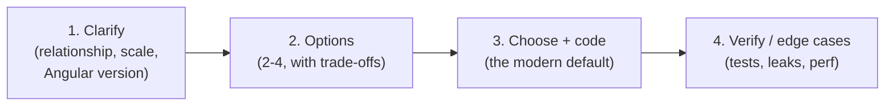

import { Tabs, TabItem, Aside } from '@astrojs/starlight/components';
import QuizBlock from '~/components/QuizBlock.astro';

## Why it matters in interviews

Senior-ish rounds replace "define X" with *"you have this problem, what do you do?"*. Interviewers listen for **structure**: clarify the situation, list options with trade-offs, pick one with a reason, and mention how you would verify it. This page gives a repeatable answer shape and seven scenarios that come up again and again.

## Core idea

Use the same four-step shape for every scenario answer:



Keep each answer to about two minutes, then let the interviewer dig in.

## Code

### Scenario 1: Parent and child components need to communicate

**Clarify:** direct parent/child in the same template? Data down, events up, or both?

**Options:**

| Direction | Modern API | Notes |
|---|---|---|
| Parent → child data | `input()` / `input.required()` | Read-only signal in the child |
| Child → parent event | `output()` | Parent binds `(saved)="..."` |
| Two-way | `model()` | Parent uses `[(value)]="sig"` |
| Parent calls child method | `viewChild(ChildComponent)` | Use sparingly; couples parent to child API |
| Deep tree | Shared service, or DI from the parent (child injects a parent-provided service) | Avoids passing inputs through 4 levels |

**Choose:** inputs/outputs for direct relationships, they keep the child reusable and testable.

```ts
@Component({
  selector: 'app-qty-picker',
  template: `
    <button (click)="qty.set(qty() - 1)" [disabled]="qty() <= 1">-</button>
    {{ qty() }}
    <button (click)="qty.set(qty() + 1)">+</button>
    <button (click)="removed.emit(productId())">Remove</button>
  `,
})
export class QtyPickerComponent {
  productId = input.required<number>();
  qty = model(1);            // parent: [(qty)]="line.qty"
  removed = output<number>(); // parent: (removed)="remove($event)"
}
```

**Verify:** test with `setInput` and by subscribing to the output.

### Scenario 2: Two sibling components need to share data

**Clarify:** do they share a parent? Is the data used elsewhere?

**Options:** (a) lift state to the common parent and pass via inputs/outputs; (b) a shared service holding a signal; (c) a store if many features use it; (d) the URL (query params) if it should survive refresh and be shareable.

**Choose:** for two siblings in one feature, lift state up or provide a service **at the parent component** so the state is scoped to that screen and destroyed with it.

```ts
@Injectable() // provided in the parent: providers: [FilterState]
export class FilterState {
  readonly category = signal<string | null>(null);
  readonly search = signal('');
  readonly query = computed(() => ({ category: this.category(), q: this.search() }));
}

// Sidebar sets it; ProductGrid reads it. Both: private state = inject(FilterState);
```

**Verify:** confirm that navigating away and back resets the filters (scoped service), or move them to query params if users expect them to persist.

### Scenario 3: Shared service or a store (NgRx)?

**Structured answer:** start with the simplest thing that works.

- **Component state** for UI-only state (open/closed, selected tab).
- **Signal-based service** per feature for shared state with a few update methods. Most apps stop here.
- **NgRx SignalStore** when you want structure (state, computed, methods, hooks) and plugins without full Redux ceremony.
- **NgRx Store + Effects** when many teams/features share complex state, you need strict unidirectional flow, DevTools time travel, or event-sourced style auditing of actions.

Mention costs: boilerplate and learning curve vs predictability. See [State management](../state-management/).

### Scenario 4: "I changed the data but the view doesn't update"

**Clarify:** is the component OnPush? Is the app zoneless? How is the data changed?

**Likely causes and fixes:**

1. **Mutation with OnPush**: `this.items.push(x)` keeps the same array reference, so the OnPush child's input didn't change. Fix: immutable update (`[...items, x]`) or a signal with `update`.
2. **Plain field changed in an async callback in a zoneless app**: nothing notified Angular. Fix: make it a signal (`this.status.set('done')`), or call `markForCheck()`.
3. **Mutating inside a signal**: `items().push(x)` doesn't change the signal's value identity, so no notification. Fix: `items.update((list) => [...list, x])`.
4. **Work outside Angular** (`runOutsideAngular`, third-party callbacks) in a zone app.

```ts
// Broken in OnPush / zoneless:
loadBroken() {
  this.api.get().subscribe((data) => (this.rows = data)); // plain field, no notification
}

// Fixed: signals notify the scheduler and mark the view dirty.
rows = signal<Row[]>([]);
load() {
  this.api.get().pipe(takeUntilDestroyed(this.destroyRef)).subscribe((data) => this.rows.set(data));
}
addRow(r: Row) {
  this.rows.update((list) => [...list, r]); // new array, not push
}
```

**Verify:** Angular DevTools profiler shows whether the component was checked. See [Change detection](../change-detection/).

### Scenario 5: The app's memory grows the longer users use it

**Clarify:** which screens? Reproduce by navigating back and forth, then take heap snapshots in Chrome DevTools (Memory tab) and compare: look for detached DOM nodes and component instances that should be gone.

**Usual causes in Angular:**

- Subscriptions to long-lived streams (`interval`, store, websockets, `valueChanges`, router events) without cleanup.
- `addEventListener` on `window`/`document` without removal, or `setInterval` without `clearInterval`.
- Root services holding references to components or large caches with no eviction.
- Third-party widgets (charts, maps) not destroyed.

```ts
export class LiveTickerComponent {
  private destroyRef = inject(DestroyRef);
  price = toSignal(inject(PriceSocket).prices$); // auto-unsubscribes

  constructor() {
    const onResize = () => this.layout();
    window.addEventListener('resize', onResize);
    const pollId = setInterval(() => this.layout(), 30_000);
    this.destroyRef.onDestroy(() => {
      window.removeEventListener('resize', onResize);
      clearInterval(pollId);
    });
  }
  private layout() {}
}
```

**Verify:** after the fix, repeated navigation should return the heap to the same baseline.

### Scenario 6: A list of 5,000 rows is slow to render and scroll

**Clarify:** is it slow on first render, on scroll, or when data refreshes? Does the user really need 5,000 rows on screen?

**Options, in order of impact:** server-side pagination or infinite scroll; **CDK virtual scroll** to render only visible rows; correct **`track item.id`** so refreshes reuse DOM; **OnPush** row components with signal inputs; move template method calls (formatting, filtering) into `computed()` or pure pipes; `@defer` heavy cell content.

```html
<cdk-virtual-scroll-viewport itemSize="40" style="height: 70vh">
  <app-order-row *cdkVirtualFor="let o of orders(); trackBy: trackById" [order]="o" />
</cdk-virtual-scroll-viewport>
```

**Verify:** compare the Performance panel recording and the DevTools profiler before and after. See [Performance](../performance/).

### Scenario 7: Build a typeahead search

**Clarify:** minimum characters, debounce delay, should results be cached, what happens on error?

**Answer:** stream of input values → trim → `debounceTime(300)` → `distinctUntilChanged()` → filter short terms → `switchMap` to the API so stale requests are cancelled → `catchError` **inside** the `switchMap` → expose as a signal.

```ts
export class CitySearchComponent {
  private api = inject(CityApi);
  term = signal('');

  results = toSignal(
    toObservable(this.term).pipe(
      map((t) => t.trim()),
      debounceTime(300),
      distinctUntilChanged(),
      switchMap((t) =>
        t.length < 2 ? of([]) : this.api.search(t).pipe(catchError(() => of([]))),
      ),
    ),
    { initialValue: [] as City[] },
  );
}
// template: <input [value]="term()" (input)="term.set($any($event.target).value)" />
```

**Verify:** test with fake timers that only one request is made after fast typing, and that a failed request does not stop later searches. Server side: add an index and a result limit.

## Interview Q&A

<details>
<summary>How many ways can components communicate in Angular?</summary>

Inputs (`input()`, `model()`), outputs (`output()`), template reference variables and `viewChild()`/`contentChild()` for direct access, a shared service (scoped to a component or root) holding signals or observables, a store, and the router (params, query params, route data). Pick by relationship and lifetime of the data.
</details>

<details>
<summary>Where should a shared service be provided when two siblings share state?</summary>

In the `providers` of their common parent component when the state belongs to that screen, so each instance of the screen gets its own state and it is destroyed with it. `providedIn: 'root'` makes it a global singleton that survives navigation.
</details>

<details>
<summary>An OnPush component doesn't update after `this.items.push(item)`. Why?</summary>

OnPush compares input references. Pushing mutates the same array, so the reference is unchanged and the component is not marked dirty. Create a new array or use a signal with `update`.
</details>

<details>
<summary>How do you find a memory leak in an Angular app?</summary>

Reproduce by repeating a navigation, take heap snapshots before and after in Chrome DevTools, compare retained objects (detached DOM, component instances), follow the retainer chain to the subscription or listener holding them, fix with `takeUntilDestroyed`/`DestroyRef.onDestroy`, and confirm the heap returns to baseline.
</details>

<details>
<summary>Why switchMap and not mergeMap in a typeahead?</summary>

Only the latest query's results matter. `switchMap` cancels the previous request, so a slow response for "an" can't overwrite results for "ang". `mergeMap` would let responses arrive out of order.
</details>

<details>
<summary>When would you put state in the URL instead of a service?</summary>

When it should survive a refresh, be bookmarkable or shareable, and work with back/forward: filters, sorting, pagination, selected tab. Read it with `withComponentInputBinding()` inputs or `ActivatedRoute` and write it with `router.navigate([], { queryParams, queryParamsHandling: 'merge' })`.
</details>

## Pitfalls

<Aside type="caution" title="Common mistakes">
- **Jumping straight to NgRx** for state that two components share.
- **`providedIn: 'root'` for screen-scoped state**, so stale filters reappear when users come back.
- **Answering "view not updating" with `detectChanges()` everywhere** instead of fixing the mutation or using signals.
- **Typeahead without debounce or cancellation**, or with `catchError` on the outer stream.
- **Rendering thousands of DOM rows** instead of paginating or virtualising.
- **Answering without structure**: list options and trade-offs before picking one.
</Aside>

## Related

- [Components & templates](../components-templates/)
- [State management](../state-management/)
- [RxJS operators](../rxjs-operators/)
- [Front-end architecture patterns](../../patterns/angular-patterns/)

## Quick quiz

<QuizBlock section="angular" topic="angular-scenarios" />
