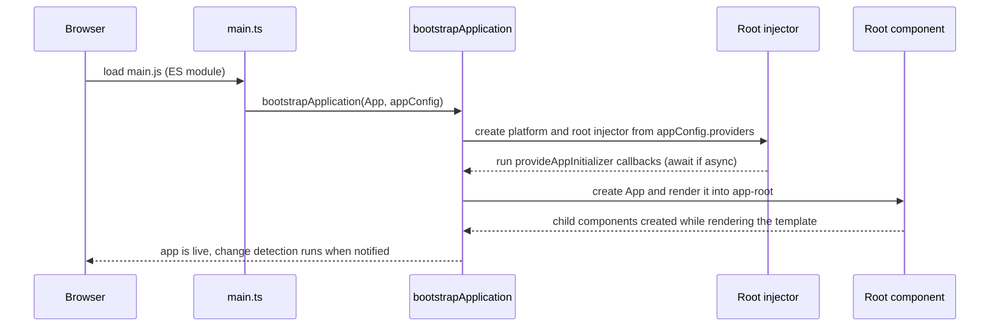

import { Tabs, TabItem, Aside } from '@astrojs/starlight/components';
import QuizBlock from '~/components/QuizBlock.astro';

## Why it matters in interviews

The opening Angular question is often *"walk me through how an Angular app starts"* or *"what is the difference between NgModules and standalone components?"*. It tells the interviewer whether you have worked on a modern codebase (v17+) or only on an older module-based one. Expect follow-ups on `app.config.ts`, where providers go, and what "zoneless" means for an app you would build today.

## Core idea

An Angular application is a **tree of components** rendered into one host element (usually `<app-root>` in `index.html`), plus an **injector tree** that supplies services to those components. Bootstrapping is the process of creating the root injector, creating the root component, and starting change detection.

### What happens when the app starts



1. The browser loads `index.html`, which references the bundled `main.js`.
2. `main.ts` calls `bootstrapApplication(App, appConfig)`.
3. Angular creates the **platform injector** and the **root environment injector** from the `providers` array in `appConfig`.
4. App initializers run (`provideAppInitializer`). If they return a Promise or Observable, bootstrap waits for them. This is how you load runtime config before anything renders.
5. The root component is created and attached to the `<app-root>` element, and its template creates the child components.
6. Change detection runs. In a **zoneless** app it is scheduled when Angular is notified of a change (signal updates, template events, `markForCheck`). With zone.js it runs after every async task.

### Standalone components

Since v19, every component, directive and pipe is **standalone by default**. A standalone component declares its own template dependencies in `imports`, so there is no module to register it in.

```ts
@Component({
  selector: 'app-order-list',
  imports: [CurrencyPipe, RouterLink, OrderCard], // what THIS template uses
  templateUrl: './order-list.html',
})
export class OrderList {}
```

The compiler only needs the component's own `imports` to know what its template can use. That makes tree-shaking and lazy loading a single component (`loadComponent`) straightforward.

### Legacy vs modern: NgModules

| | NgModule-based (legacy) | Standalone (default since v19) |
|---|---|---|
| Entry point | `platformBrowserDynamic().bootstrapModule(AppModule)` | `bootstrapApplication(App, appConfig)` |
| Where a component is registered | `declarations` of exactly one NgModule | Nowhere, it is self-contained |
| Template dependencies | Everything the module imports or declares | The component's own `imports` |
| App-wide providers | `AppModule.providers`, `forRoot()` | `appConfig.providers`, `provideX()` functions |
| Lazy loading | `loadChildren` with a module | `loadComponent`, or `loadChildren` with a routes file |
| The flag | n/a | `standalone: true` required in v14-v18, implicit since v19 |

NgModules are **not removed**. You will still meet them in large enterprise apps and some libraries, and a standalone component can import an NgModule (for example a third-party UI module) in its `imports`. The migration schematic is `ng generate @angular/core:standalone`.

<Aside type="tip" title="Interview phrasing">
"In the module world a component's compilation context was its NgModule. With standalone, the component is its own compilation context. App-wide providers moved from `forRoot()` modules to `provideX()` functions in `app.config.ts`."
</Aside>

### Zoneless by default

Older Angular used **zone.js**, which monkey-patches browser async APIs (`setTimeout`, promises, XHR, DOM events) so Angular knows "something may have changed" and runs change detection over the tree. Zoneless change detection became stable in v20 and is the **default for new projects since v21**: `zone.js` is no longer in the polyfills, and Angular runs change detection only when it is explicitly notified. The details are on the [Change detection](../change-detection/) page. For bootstrap, the difference is one provider.

### Project structure (v20+ CLI defaults)

```text
src/
  index.html            <app-root> host element
  main.ts               bootstrapApplication(App, appConfig)
  styles.scss           global styles
  app/
    app.ts              root component (v20+ naming: no .component suffix)
    app.html, app.scss
    app.config.ts       application-wide providers
    app.routes.ts       top-level routes
    core/               singletons: auth, interceptors, layout shell
    shared/             reusable presentational components, pipes, directives
    features/orders/    feature folder: routes, pages, components, services
angular.json            build/serve/test targets and budgets
```

The v20 style guide dropped the `.component` / `.service` suffixes from generated file names (`app.ts` rather than `app.component.ts`). Older projects keep the old names, and both work. Feature folders (rather than "all components in one folder") are what interviewers expect to hear; see [Front-end architecture patterns](../../patterns/angular-patterns/).

### CLI and builders

Since v17 the default builder is the **application builder** (`@angular/build:application`): **esbuild** for bundling and **Vite** for the dev server. It replaced the webpack-based `browser` builder, builds are much faster, and it produces both browser and SSR output. Since v21, new projects use **Vitest** as the unit-test runner instead of Karma/Jasmine.

| Command | What it does |
|---|---|
| `ng new shop` | Scaffolds a standalone, zoneless app (v21+) |
| `ng generate component features/orders/order-list` | Creates a standalone component |
| `ng serve` | Vite-based dev server |
| `ng build` | Production build: AOT, minified, hashed bundles, budgets checked |
| `ng test` | Unit tests (Vitest in new v21+ projects) |
| `ng update @angular/core @angular/cli` | Version upgrade with automatic migrations |

**AOT** (ahead-of-time) compilation is the default: templates are compiled to JavaScript instructions at build time, so the browser never downloads the template compiler, and template errors fail the build instead of failing at runtime.

## Code

<Tabs>
  <TabItem label="main.ts">

```ts
import { bootstrapApplication } from '@angular/platform-browser';
import { App } from './app/app';
import { appConfig } from './app/app.config';

bootstrapApplication(App, appConfig).catch((err) => console.error(err));
```

  </TabItem>
  <TabItem label="app.config.ts">

```ts
import {
  ApplicationConfig, inject, provideAppInitializer,
  provideBrowserGlobalErrorListeners, provideZonelessChangeDetection,
} from '@angular/core';
import { provideRouter, withComponentInputBinding } from '@angular/router';
import { provideHttpClient, withFetch, withInterceptors } from '@angular/common/http';
import { routes } from './app.routes';
import { authInterceptor } from './core/auth.interceptor';
import { ConfigService } from './core/config.service';

export const appConfig: ApplicationConfig = {
  providers: [
    provideBrowserGlobalErrorListeners(),
    provideZonelessChangeDetection(), // the default in v21+, harmless to state explicitly
    provideRouter(routes, withComponentInputBinding()),
    provideHttpClient(withFetch(), withInterceptors([authInterceptor])),
    // Load /config.json before the first render.
    provideAppInitializer(() => inject(ConfigService).load()),
  ],
};
```

  </TabItem>
  <TabItem label="app.ts">

```ts
import { Component } from '@angular/core';
import { RouterOutlet, RouterLink } from '@angular/router';

@Component({
  selector: 'app-root',
  imports: [RouterOutlet, RouterLink],
  template: `
    <nav><a routerLink="/orders">Orders</a></nav>
    <router-outlet />
  `,
})
export class App {}
```

  </TabItem>
  <TabItem label="Legacy (NgModule)">

```ts
// main.ts
platformBrowserDynamic().bootstrapModule(AppModule);

// app.module.ts
@NgModule({
  declarations: [AppComponent, OrderListComponent],
  imports: [BrowserModule, HttpClientModule, AppRoutingModule],
  providers: [
    { provide: APP_INITIALIZER, useFactory: initConfig, deps: [ConfigService], multi: true },
  ],
  bootstrap: [AppComponent],
})
export class AppModule {}
```

  </TabItem>
</Tabs>

`provideAppInitializer` (v19+) replaces the `APP_INITIALIZER` multi-provider. In the same way, `HttpClientModule` became `provideHttpClient()` and `RouterModule.forRoot()` became `provideRouter()`.

## Interview Q&A

<details>
<summary>How does an Angular application bootstrap?</summary>

`main.ts` calls `bootstrapApplication(App, appConfig)`. Angular creates the platform and the root environment injector from `appConfig.providers`, runs app initializers (waiting for any Promise or Observable they return), creates the root component inside the `<app-root>` host element, and starts change detection. With NgModules the same happens through `bootstrapModule(AppModule)` and the module's `bootstrap` array.
</details>

<details>
<summary>What problem did standalone components solve?</summary>

NgModules added an indirection: to know what a template could use, you had to find the one module that declared the component and everything that module imported. That caused "is not a known element" errors, `SharedModule` dumping grounds and coarse lazy loading. Standalone components list their own dependencies, so they are easier to reason about, tree-shake and lazy load individually.
</details>

<details>
<summary>Can standalone components and NgModules coexist?</summary>

Yes. A standalone component can import an NgModule in its `imports` (common with older libraries), and an NgModule can import a standalone component. `importProvidersFrom(SomeModule)` pulls a module's providers into `appConfig`. That is how large apps migrate incrementally.
</details>

<details>
<summary>What goes into `app.config.ts`?</summary>

Application-wide providers: change detection mode, router, HttpClient with interceptors, app initializers, global error listeners, and app-level `InjectionToken` values. Ordinary services should be `providedIn: 'root'` (tree-shakable) or provided on a lazy route's `providers`, not listed here.
</details>

<details>
<summary>What does "zoneless" mean and why did Angular move to it?</summary>

zone.js patched every async browser API so Angular ran change detection after any event, timer or XHR, even when nothing relevant changed. It added bundle size, startup cost and noisy stack traces, and it cannot patch native `async/await`, so the CLI had to down-level it. Zoneless Angular runs change detection only when notified: a signal read in a template changes, a template event fires, or `markForCheck()` is called. It is the default for new projects since v21.
</details>

<details>
<summary>How would you load runtime configuration (for example the API URL) before the app starts?</summary>

Use `provideAppInitializer(() => inject(ConfigService).load())` where `load()` returns a Promise or Observable that fetches `/config.json`. Bootstrap waits for it, so the first component already sees the config. This keeps one build artifact for every environment, which suits Docker images promoted from dev to test to prod.
</details>

<details>
<summary>What is AOT compilation and why is it the default?</summary>

Ahead-of-time compilation turns templates into JavaScript instructions during the build. The browser doesn't download the compiler, startup is faster, and template type errors are caught at build time. JIT compilation in the browser is essentially legacy today.
</details>

<details>
<summary>What changed in the Angular CLI build in recent versions?</summary>

The application builder (`@angular/build:application`) became the default in v17. It uses esbuild to bundle and Vite for the dev server, replacing webpack, and it supports SSR from the same builder. In v21, new projects default to Vitest for unit tests. Budgets in `angular.json` still fail the build when bundles grow past limits.
</details>

## Pitfalls

<Aside type="caution" title="Common mistakes">

- Saying Angular "still needs NgModules": since v19 standalone is the default and `standalone: true` is implicit.
- Putting every service in `appConfig.providers`. Prefer `providedIn: 'root'` so unused services are tree-shaken.
- Importing `HttpClientModule` into a standalone app instead of using `provideHttpClient()`.
- An app initializer that never resolves blocks the whole app with a blank screen. Add a timeout and a fallback.
- Upgrading an existing zone.js app to v21 and assuming it became zoneless. Only new projects are zoneless by default; existing apps keep zone.js until you migrate.
- Rebuilding the old giant `SharedModule` as a giant barrel file that every component imports. Import only what each template uses.

</Aside>

## Related

- [Change detection](../change-detection/)
- [Dependency injection](../dependency-injection/)
- [Routing and lazy loading](../routing/)
- [Angular version history](../version-history/)

## Quick quiz

<QuizBlock section="angular" topic="architecture-bootstrap" />
