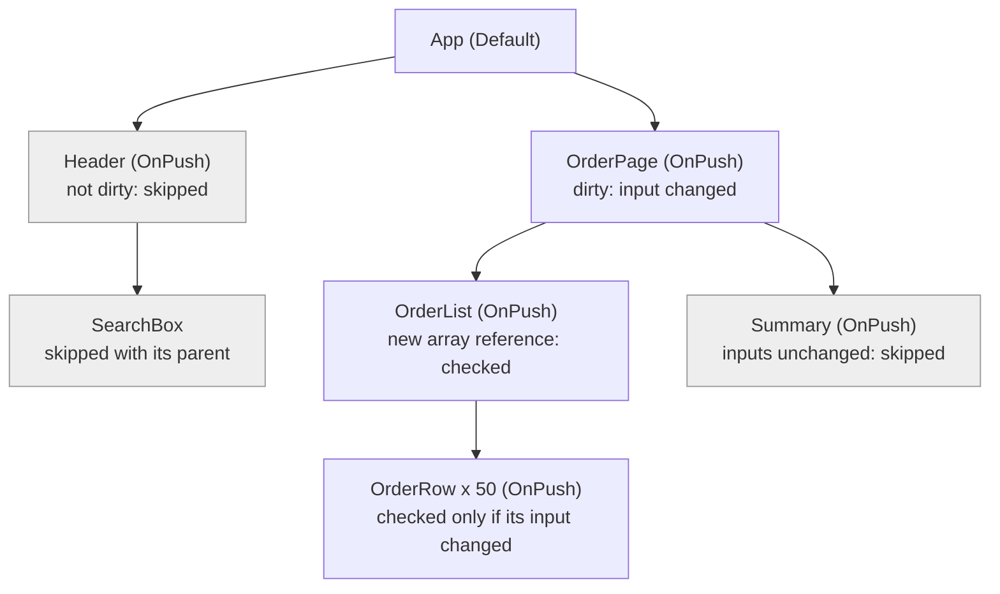

import { Tabs, TabItem, Aside } from '@astrojs/starlight/components';
import QuizBlock from '~/components/QuizBlock.astro';

## Why it matters in interviews

*"How does change detection work?"*, *"what does OnPush actually do?"* and *"my view is not updating, why?"* are the questions that separate people who use Angular from people who understand it. Since v21, new apps are zoneless by default, so expect *"what triggers change detection without zone.js?"* and *"how do signals fit in?"*. A clear mental model here also explains most performance work you have done on real projects.

## Core idea

Change detection (CD) is the process of **keeping the DOM in sync with component state**. Angular compiles each template into an update function. During CD it walks the component tree **top-down from the root**, runs each component's update function, compares every binding's new value with the previous one (`===`), and touches the DOM only where a value changed.

Two separate questions decide how much work that is:

1. **When does a CD pass start?** zone.js (after any async task) or zoneless (only on explicit notifications).
2. **Which components does the pass check?** Default (all of them) or OnPush (only dirty ones and their path from the root).

### The tree walk



With **Default** strategy every component in the tree is checked on every pass. With **OnPush**, a component and its whole subtree are skipped unless the component was marked dirty.

### What marks an OnPush component dirty

- An **input reference** changed (Angular compares with `===`, so mutating an object does not count).
- An **event** fired from a listener in its template or host (`(click)`, `(input)`), including events bubbling from child outputs it listens to.
- The **`async` pipe** received a new value (it calls `markForCheck()` internally).
- A **signal read in its template** changed.
- Code called **`ChangeDetectorRef.markForCheck()`** explicitly.

`markForCheck()` marks the component **and all its ancestors** as dirty, because CD always starts at the root and must be able to reach it. Signals are smarter: since v17 a signal change marks only the consuming view for refresh and flags the ancestors as "has a child to refresh", so OnPush parents can be traversed without re-checking their own bindings.

### Default vs OnPush vs zoneless

| | Default + zone.js | OnPush + zone.js | Zoneless (default since v21) |
|---|---|---|---|
| What starts a pass | Any async task patched by zone.js: events, timers, XHR, promises | Same | Only notifications: signal change read in a template, template/host event, `markForCheck` (incl. `async` pipe), `ComponentRef.setInput`, attaching a view |
| What gets checked | Every component, every pass | Dirty OnPush components and their path from the root | Views marked for refresh; OnPush still skips clean subtrees |
| Plain field set in `setTimeout` | Updates the view | Not shown until something marks the component dirty | Not shown: no notification is sent |
| Cost | Simple but wasteful at scale | Much less work, needs immutable inputs | Least work, no zone.js bundle, clean stack traces |
| Recommended | Legacy | Yes, for all components | Yes, with OnPush and signals |

<Aside type="note" title="Zoneless + Default strategy">
Zoneless does not require OnPush. When a pass is scheduled, Default components are still checked. What zoneless removes is the *automatic trigger*: code that mutates a plain field after `await fetch()` or in a `setTimeout` without a signal or `markForCheck()` will not update the view. That is exactly the code OnPush already forbade, which is why OnPush-ready apps migrate to zoneless easily.
</Aside>

### How zone.js worked (legacy, still common)

zone.js monkey-patches `addEventListener`, `setTimeout`, `Promise`, XHR and others. Angular runs inside `NgZone`; when the zone's microtask queue empties (`onMicrotaskEmpty`), Angular calls `ApplicationRef.tick()`, which runs CD from the root. That is why "everything just updated" in old apps, and also why a `mousemove` listener or a third-party library polling with `setInterval` could trigger thousands of CD passes. The fix was `ngZone.runOutsideAngular(() => ...)`. In zoneless apps there is nothing to run outside of.

### markForCheck vs detectChanges

| | `markForCheck()` | `detectChanges()` |
|---|---|---|
| What it does | Marks this view and ancestors dirty; they are checked in the **next** pass | Runs CD **synchronously, now**, on this view and its children |
| Zoneless | Also schedules a pass | Runs immediately, does not schedule |
| Use when | Data changed outside Angular's knowledge in an OnPush component | Rare: you need the DOM updated before continuing, or a detached view |

`detach()` removes a view from the CD tree entirely (you then call `detectChanges()` yourself), useful for very high-frequency widgets like live tickers.

### ExpressionChangedAfterItHasBeenChecked

In **development mode**, after each pass Angular runs a second verification pass (`checkNoChanges`) and compares every binding again. If a value differs, the data flow is not unidirectional: something changed state **during** CD, after the binding was already rendered. Angular throws NG0100 to warn you that the view now shows stale data. Production builds skip the check, so the bug is hidden, not fixed.

Typical causes:

- A child updates a parent's bound value in `ngOnInit` / `ngAfterViewInit` (via a shared service or an output).
- A getter or template method returns a new value each call (`new Date()`, `Math.random()`, a new array).
- Setting a property in `ngAfterViewInit` that the same template displays.

Fixes, best first: derive the value with `computed()` so it is consistent within a pass; move the state change earlier (constructor, `ngOnInit` of the owner) or to an event; restructure so the parent owns the state. Wrapping in `setTimeout` or calling `detectChanges()` silences it but leaves a double render.

## Code

<Tabs>
  <TabItem label="order-list.ts (modern)">

```ts
import { ChangeDetectionStrategy, Component, computed, inject, input, signal } from '@angular/core';
import { DatePipe } from '@angular/common';
import { OrderRow } from './order-row';
import { OrderStore } from './order.store';

@Component({
  selector: 'app-order-list',
  imports: [OrderRow, DatePipe],
  changeDetection: ChangeDetectionStrategy.OnPush,
  template: `
    <input (input)="filter.set($any($event.target).value)" placeholder="Filter" />
    @for (o of visible(); track o.id) {
      <app-order-row [order]="o" />
    }
    <p>Last refresh: {{ store.lastRefresh() | date: 'shortTime' }}</p>
  `,
})
export class OrderList {
  protected readonly store = inject(OrderStore);
  readonly status = input<'open' | 'all'>('all');
  protected readonly filter = signal('');

  // Recomputed only when orders, status or filter change.
  protected readonly visible = computed(() =>
    this.store.orders()
      .filter((o) => this.status() === 'all' || o.status === 'open')
      .filter((o) => o.number.includes(this.filter())),
  );
}
```

  </TabItem>
  <TabItem label="Legacy fix with markForCheck">

```ts
@Component({
  selector: 'app-ticker',
  changeDetection: ChangeDetectionStrategy.OnPush,
  template: `{{ price }}`,
})
export class TickerComponent implements OnInit {
  price = 0;
  private cdr = inject(ChangeDetectorRef);
  private socket = inject(PriceSocket);
  private destroyRef = inject(DestroyRef);

  ngOnInit() {
    // Callback from a non-Angular source: OnPush won't know about it.
    const off = this.socket.onPrice((p) => {
      this.price = p;
      this.cdr.markForCheck(); // or: make price a signal and call price.set(p)
    });
    this.destroyRef.onDestroy(off);
  }
}
```

  </TabItem>
</Tabs>

In the second tab, the modern fix is simply `price = signal(0)` and `price.set(p)`: the signal notifies Angular, no `ChangeDetectorRef` needed.

## Interview Q&A

<details>
<summary>Explain how Angular change detection works.</summary>

Each template compiles to an update function. When a CD pass runs, Angular walks the component tree from the root, evaluates every binding, compares it with the previous value using `===`, and updates only the DOM nodes whose values changed. What starts a pass (zone.js or zoneless notifications) and which components are visited (Default vs OnPush) are the two levers you control.
</details>

<details>
<summary>What exactly does OnPush do?</summary>

It tells Angular to skip the component and its subtree during a pass unless it is dirty. It becomes dirty when an input reference changes, a template or host event fires, the `async` pipe emits, a template-read signal changes, or `markForCheck()` is called. It forces immutable data patterns and cuts CD work dramatically on large trees.
</details>

<details>
<summary>An OnPush component doesn't update after the parent pushes an item into its array input. Why?</summary>

Input changes are detected by reference. `push` mutates the same array, so the input binding sees no change and the component stays clean. Create a new array (`[...items, x]`), or hold the list in a signal and use `update(a => [...a, x])`.
</details>

<details>
<summary>What triggers change detection in a zoneless app?</summary>

Updating a signal that a template reads, a template or host event listener, `markForCheck()` (which the `async` pipe calls), `ComponentRef.setInput()`, and attaching a dirty view. Angular then schedules one pass. Plain property assignments in callbacks, timers or after `await` do not trigger anything.
</details>

<details>
<summary>How do signals improve change detection?</summary>

A template is a reactive consumer of the signals it reads. When one changes, Angular knows exactly which view depends on it and marks only that view for refresh, rather than marking the whole ancestor chain dirty like `markForCheck()`. Combined with OnPush and zoneless, this gives fine-grained updates without zone.js.
</details>

<details>
<summary>`markForCheck()` vs `detectChanges()`?</summary>

`markForCheck()` marks the view and its ancestors dirty so they are checked in the next pass; it is cheap and safe. `detectChanges()` synchronously runs CD on this view and its children right now. Overusing `detectChanges()` causes extra renders and can hide data-flow bugs.
</details>

<details>
<summary>What causes `ExpressionChangedAfterItHasBeenChecked` and how do you fix it properly?</summary>

Dev mode re-checks bindings after each pass; if a value changed during the pass (a child mutating parent state in a lifecycle hook, or a binding that returns a new value every time), it throws. Fix the data flow: derive values with `computed`, move the change to the state owner or an event, or make the binding stable. `setTimeout` only hides it.
</details>

<details>
<summary>How would you migrate an existing app to zoneless?</summary>

First make components OnPush-compatible: immutable inputs, signals or the `async` pipe for state, `markForCheck()` where data arrives from callbacks. Remove reliance on `NgZone.onStable` / `onMicrotaskEmpty`. Then add `provideZonelessChangeDetection()`, remove `zone.js` from polyfills, and fix tests that relied on zone-based `fixture.whenStable()` timing.
</details>

## Pitfalls

<Aside type="caution" title="Common mistakes">

- Mutating objects or arrays passed to OnPush children instead of creating new references.
- Calling functions in templates that allocate or compute heavily; they run on every check of that component.
- Spraying `detectChanges()` everywhere to "fix" views that don't update instead of fixing the data flow.
- Silencing `ExpressionChangedAfterItHasBeenChecked` with `setTimeout`.
- Assuming zoneless means "Angular figures it out": plain fields updated in callbacks will not render.
- Using `runOutsideAngular` advice in a zoneless app, where it no longer has any effect.

</Aside>

## Related

- [Signals deep dive](../signals/)
- [Lifecycle hooks](../lifecycle-hooks/)
- [Performance](../performance/)
- [Scenario questions: view not updating](../angular-scenarios/)

## Quick quiz

<QuizBlock section="angular" topic="change-detection" />
