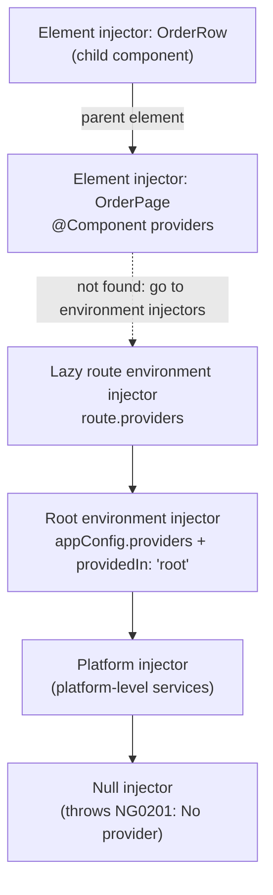

import { Tabs, TabItem, Aside } from '@astrojs/starlight/components';
import QuizBlock from '~/components/QuizBlock.astro';

## Why it matters in interviews

DI questions come in two layers. The basic layer: *"what is `providedIn: 'root'`?"*, *"how do you inject a config value?"*. The 3-4 year layer: *"why did my component get a different instance of the service?"*, *"how does Angular resolve a dependency through the injector tree?"*, *"what is a multi provider?"*. Coming from ASP.NET Core, compare with what you know: Angular has no "scoped per request", but it has **injector scopes** that behave like nested containers.

## Core idea

A **provider** tells an injector *how* to create a value for a **token**. When a class asks for the token (`inject(OrderService)`), the injector looks it up, creates the value once, caches it, and returns the same instance to everyone who asks **that injector**. Instances are singletons **per injector**, not globally.

### Providers

| Provider | Meaning | Example |
|---|---|---|
| `SomeService` (shorthand) | `{ provide: SomeService, useClass: SomeService }` | `providers: [CartService]` |
| `useClass` | Create an instance of another class for this token | `{ provide: Logger, useClass: AppInsightsLogger }` |
| `useValue` | Use a ready-made value | `{ provide: API_URL, useValue: '/api' }` |
| `useFactory` | Call a function; it can use `inject()` | `{ provide: Storage, useFactory: () => isBrowser() ? localStorage : memoryStorage }` |
| `useExisting` | Alias: same instance as another token | `{ provide: AbstractCache, useExisting: LruCache }` |
| `multi: true` | Collect many values under one token into an array | Validators, `HTTP_INTERCEPTORS` (legacy) |

`useClass` with two tokens creates **two instances**; `useExisting` gives **one instance** under two names. That difference is a common trick question.

### InjectionToken

Interfaces disappear at runtime in TypeScript, so you cannot inject an interface. For non-class values, define a token:

```ts
export interface AppConfig { apiUrl: string; featureFlags: Record<string, boolean> }
export const APP_CONFIG = new InjectionToken<AppConfig>('APP_CONFIG');

// Tree-shakable token with a default factory
export const PAGE_SIZE = new InjectionToken<number>('PAGE_SIZE', {
  providedIn: 'root',
  factory: () => 20,
});
```

### `inject()` vs constructor injection

`inject(Token)` is the modern style recommended by the style guide. It works in an **injection context**: field initialisers, constructors, provider factories, functional guards/resolvers/interceptors, and inside `runInInjectionContext`. Benefits: works in functions (which is why guards and interceptors became functions), plays well with inheritance (no `super(...)` with many arguments), and lets you write reusable `injectX()` helpers. Constructor injection still works; the schematic `ng generate @angular/core:inject` migrates it.

### The injector hierarchy



Angular has **two trees**:

1. **Environment injectors**: root (from `appConfig` and `providedIn: 'root'`), plus one per lazy-loaded route with `providers`, plus any created with `createEnvironmentInjector`.
2. **Element injectors**: one per component or directive that declares `providers` (or `viewProviders`), following the DOM/component tree.

**Resolution:** start at the requesting component's element injector, walk **up the element tree**; if not found, continue in the **environment injector** of that component (lazy route, then root, then platform); if still not found, the null injector throws `NullInjectorError` (or returns `null` with `optional: true`).

### Scopes in practice

| Where provided | Lifetime and sharing | Use for |
|---|---|---|
| `@Injectable({ providedIn: 'root' })` | One instance for the app, created lazily, tree-shaken if unused | Most services: API clients, auth, stores |
| `providers` on a lazy route | One instance per route injector, shared by that feature | Feature-scoped state, overriding a root service for one area |
| `providers` on a component | **New instance per component instance**, destroyed with it | Per-widget state (each tab editor has its own form store) |
| `viewProviders` on a component | Like `providers` but invisible to projected content | Library components hiding internals |

<Aside type="caution" title="Classic bug">
A service is `providedIn: 'root'` **and** also listed in a component's `providers`. That component and its children get a second, separate instance, so "state is not shared between pages". Remove the component-level provider unless you want an isolated instance.
</Aside>

### Resolution modifiers

Passed as options to `inject()` (the decorator equivalents in brackets):

- `optional: true` (`@Optional()`): return `null` instead of throwing.
- `self: true` (`@Self()`): look only in the current element injector.
- `skipSelf: true` (`@SkipSelf()`): start at the parent; used for "find my parent of the same type" (nested menus) or to prevent re-providing a singleton.
- `host: true` (`@Host()`): stop at the host component's injector, used by directives that must belong to a specific host.

### Multi providers

With `multi: true`, every provider for that token contributes one entry and `inject(TOKEN)` returns an **array**. Angular itself uses this for `NG_VALIDATORS`, `NG_VALUE_ACCESSOR` and the legacy `HTTP_INTERCEPTORS`. It is the plug-in pattern: features register handlers without the consumer knowing about them, similar to registering several `IHostedService` implementations in .NET.

## Code

<Tabs>
  <TabItem label="tokens and providers">

```ts
import { Injectable, InjectionToken, inject, makeEnvironmentProviders } from '@angular/core';

export interface NotificationChannel { send(msg: string): void }
export const NOTIFICATION_CHANNELS = new InjectionToken<NotificationChannel[]>('NOTIFICATION_CHANNELS');

@Injectable() export class ToastChannel implements NotificationChannel { send(m: string) { /* show toast */ } }
@Injectable() export class LogChannel implements NotificationChannel { send(m: string) { console.info(m); } }

@Injectable({ providedIn: 'root' })
export class Notifier {
  private readonly channels = inject(NOTIFICATION_CHANNELS, { optional: true }) ?? [];
  notify(msg: string) { this.channels.forEach((c) => c.send(msg)); }
}

// A reusable provideX() function, the modern replacement for Module.forRoot()
export function provideNotifications() {
  return makeEnvironmentProviders([
    { provide: NOTIFICATION_CHANNELS, useClass: ToastChannel, multi: true },
    { provide: NOTIFICATION_CHANNELS, useClass: LogChannel, multi: true },
  ]);
}
```

  </TabItem>
  <TabItem label="component scope">

```ts
@Injectable() // no providedIn: must be provided explicitly
export class EditorState {
  readonly dirty = signal(false);
}

@Component({
  selector: 'app-document-editor',
  providers: [EditorState], // each editor tab gets its own instance
  template: `<app-toolbar /><app-editor-body />`,
})
export class DocumentEditor {}

@Component({ selector: 'app-toolbar', template: `@if (state.dirty()) { <span>Unsaved</span> }` })
export class Toolbar {
  protected readonly state = inject(EditorState); // resolved from the parent editor
}
```

  </TabItem>
  <TabItem label="factory and lazy route">

```ts
export const routes: Routes = [
  {
    path: 'admin',
    loadChildren: () => import('./admin/admin.routes'),
    providers: [
      // Only the admin area gets this logger; the rest of the app keeps the root one.
      { provide: Logger, useClass: AuditLogger },
      {
        provide: APP_CONFIG,
        useFactory: () => ({ ...inject(BASE_CONFIG), featureFlags: { audit: true } }),
      },
    ],
  },
];
```

  </TabItem>
</Tabs>

## Interview Q&A

<details>
<summary>What does `providedIn: 'root'` do, and why is it preferred?</summary>

It registers the service in the root environment injector, so there is one instance for the app, created on first injection. It is **tree-shakable**: if nothing injects it, the bundler drops it. Listing services in `providers` arrays keeps them in the bundle even when unused.
</details>

<details>
<summary>Explain how Angular resolves a dependency.</summary>

It starts at the element injector of the requesting component or directive and walks up the component tree. If no element injector provides the token, it continues in the environment injectors: the lazy route's injector, then root, then platform. If none has it, `NullInjectorError` is thrown unless `optional: true` is used.
</details>

<details>
<summary>Why did two components get different instances of the same service?</summary>

Usually because a component (or a lazy route) also lists it in `providers`, creating a new instance at that level. Another cause in older code: a service provided in a lazy-loaded NgModule's `providers` gets a separate instance per lazy injector. Check every `providers` array for the class.
</details>

<details>
<summary>`useClass` vs `useExisting`?</summary>

`useClass` creates a new instance of the class for that token. `useExisting` makes the token an alias for another token, so both return the same instance. If you provide `{ provide: A, useClass: Impl }` and also `Impl`, you get two instances; with `useExisting: Impl` you get one.
</details>

<details>
<summary>Why do we need `InjectionToken`?</summary>

TypeScript interfaces and type aliases don't exist at runtime, so they cannot be used as DI keys. For config objects, primitive values, functions or interface-based abstractions, an `InjectionToken<T>` is the typed runtime key. It can also carry a `providedIn: 'root'` factory as a default.
</details>

<details>
<summary>What is an injection context and what happens if you call `inject()` outside one?</summary>

It is a period when Angular knows the current injector: constructing a class through DI, running a provider factory, or running a functional guard, resolver or interceptor. Calling `inject()` elsewhere, for example inside a `setTimeout` or a click handler, throws NG0203. Inject in a field initialiser instead, or wrap the code in `runInInjectionContext(injector, fn)`.
</details>

<details>
<summary>What are multi providers used for?</summary>

Collecting several values under one token as an array, a plug-in point. Angular uses it for `NG_VALIDATORS`, `NG_VALUE_ACCESSOR` and the old class-based `HTTP_INTERCEPTORS`. In app code it fits notification channels, feature registries or app initialisation steps contributed by different features.
</details>

<details>
<summary>How do Angular scopes compare to ASP.NET Core lifetimes?</summary>

`providedIn: 'root'` behaves like a singleton. There is no request scope in a browser app; the closest to "scoped" is a component-level or route-level provider, which creates an instance per component or per lazy area and destroys it with that injector. There is no "transient" mode, but a factory function you call yourself gives fresh objects.
</details>

## Pitfalls

<Aside type="caution" title="Common mistakes">

- Providing a root service again in a component's `providers` and losing shared state.
- Calling `inject()` inside methods, callbacks or `ngOnInit` of a non-DI-created class: NG0203.
- Injecting an interface type directly; it compiles but there is no runtime token.
- Using `useClass` where `useExisting` was intended, creating two instances of a "singleton".
- Storing per-user state in a root service in an SSR app; on the server, root services live per request, but module-level variables do not.
- Circular dependencies between services (NG0200). Break them by extracting a third service or using an event/signal instead.

</Aside>

## Related

- [Architecture and bootstrapping](../architecture-bootstrap/)
- [Routing: route-level providers](../routing/)
- [State management](../state-management/)
- [ASP.NET Core DI lifetimes](../../aspnet/dependency-injection/)

## Quick quiz

<QuizBlock section="angular" topic="dependency-injection" />
