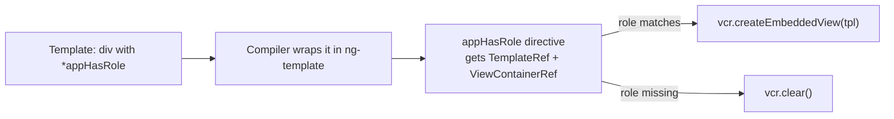

import { Tabs, TabItem, Aside } from '@astrojs/starlight/components';
import QuizBlock from '~/components/QuizBlock.astro';

## Why it matters in interviews

*"Component vs directive?"*, *"Write a directive that highlights on hover"*, *"Pure vs impure pipe?"* and *"Why is calling a method in a template bad?"* are common at 3-4 years. Live coding rounds often ask for a small custom pipe or directive, so you should be able to write one from memory using modern APIs (`input()`, `host`, `inject()`).

## Core idea

A **directive** is a class that adds behaviour to an element in a template. A **component** is a directive with its own template. There are three kinds:

| Kind | What it does | Examples |
|---|---|---|
| Component | Directive + template + styles | `app-order-list` |
| Attribute directive | Changes look/behaviour of the host element | `ngClass`, `ngStyle`, `ngModel`, `routerLink`, your `appHighlight` |
| Structural directive | Adds/removes DOM by creating views from a `TemplateRef` | `*ngIf`, `*ngFor`, `*cdkVirtualFor`, your `*appHasRole` |

Since v17, the built-in **control flow** (`@if`, `@for`, `@switch`) replaces `*ngIf`/`*ngFor`/`*ngSwitch` for most cases. It is part of the template compiler, needs no import, and `@for` requires `track`. The structural directives `*ngIf`/`*ngFor`/`*ngSwitch` are deprecated since v20, but you still write **custom** structural directives for things like permission checks.

### How a structural directive works

The `*` is sugar. `<div *appHasRole="'admin'">` becomes `<ng-template [appHasRole]="'admin'"><div>...</div></ng-template>`. The directive receives the `TemplateRef` (the blueprint) and a `ViewContainerRef` (the anchor where views can be inserted) and decides when to call `createEmbeddedView` or `clear()`.



### Host bindings and host directives

Prefer the `host` metadata object over `@HostBinding` / `@HostListener` decorators (the style guide recommends `host`): `host: { '(mouseenter)': 'onEnter()', '[class.active]': 'active()' }`.

**Host directives** (directive composition API, v15+) let a component or directive apply other standalone directives to its host element, and optionally re-expose their inputs/outputs:

```ts
@Component({
  selector: 'app-menu-item',
  hostDirectives: [
    { directive: HighlightDirective, inputs: ['appHighlight: color'] },
    CdkMenuItem,
  ],
  template: `<ng-content />`,
})
export class MenuItemComponent {}
```

This is composition instead of inheritance: reusable behaviour (focus trap, tooltip, tracking) without a base class. The host directives must be standalone, and their inputs/outputs are **not** exposed unless you list them.

### Pipes

A pipe transforms a value in a template: `{{ price | currency:'INR' }}`. Built-ins include `date`, `currency`, `decimal`, `percent`, `json`, `slice`, `keyvalue`, `titlecase`, `async`.

| | Pure pipe (default) | Impure pipe (`pure: false`) |
|---|---|---|
| Re-runs when | The **input reference** or an argument changes (`===` check) | **Every change detection cycle** |
| Mutation of an array/object | Not detected | Detected (because it always runs) |
| Cost | Cheap; result effectively memoised | Can be expensive; keep `transform` trivial |
| Examples | `date`, `currency`, `uppercase`, custom formatters | `async`, `json`, `keyvalue` (internally tracks changes) |

Why pure pipes beat template method calls: `{{ format(order) }}` runs on **every** change detection pass, while `{{ order | format }}` runs only when `order` changes reference. With signals you get the same memoisation from a `computed()`.

### Inside the async pipe

The `async` pipe is **impure** because the bound observable's reference does not change when it emits. On each CD pass it:

1. If the observable/promise reference is new, unsubscribes from the old one and subscribes to the new one.
2. On every emission stores the latest value and calls `markForCheck()` on the host view, so it works with **OnPush** (and triggers a refresh in zoneless apps).
3. Returns the latest stored value (initially `null`).
4. Unsubscribes in `ngOnDestroy`.

That is why `{{ getOrders() | async }}` with a method returning a **new** observable each time is a bug: every CD pass sees a new reference, resubscribes, and fires another HTTP request.

## Code

<Tabs>
  <TabItem label="Attribute directive">
```ts
@Directive({
  selector: '[appHighlight]',
  host: {
    '(mouseenter)': 'hovered.set(true)',
    '(mouseleave)': 'hovered.set(false)',
    '[style.backgroundColor]': 'hovered() ? appHighlight() : null',
  },
})
export class HighlightDirective {
  appHighlight = input('lightyellow'); // <p appHighlight="lightblue">
  protected hovered = signal(false);
}
```
  </TabItem>
  <TabItem label="Structural directive">
```ts
@Directive({ selector: '[appHasRole]' })
export class HasRoleDirective {
  private tpl = inject<TemplateRef<unknown>>(TemplateRef);
  private vcr = inject(ViewContainerRef);
  private auth = inject(AuthService); // exposes roles = signal<string[]>

  appHasRole = input.required<string>();

  constructor() {
    effect(() => {
      const allowed = this.auth.roles().includes(this.appHasRole());
      this.vcr.clear();
      if (allowed) this.vcr.createEmbeddedView(this.tpl);
    });
  }
}
// usage: <button *appHasRole="'admin'">Delete</button>
```
  </TabItem>
  <TabItem label="Custom pipe">
```ts
@Pipe({ name: 'fileSize' }) // pure by default
export class FileSizePipe implements PipeTransform {
  transform(bytes: number | null | undefined, decimals = 1): string {
    if (bytes == null || isNaN(bytes)) return '';
    const units = ['B', 'KB', 'MB', 'GB', 'TB'];
    let i = 0;
    let value = bytes;
    while (value >= 1024 && i < units.length - 1) {
      value /= 1024;
      i++;
    }
    return `${value.toFixed(i === 0 ? 0 : decimals)} ${units[i]}`;
  }
}
// usage: {{ file.size | fileSize:2 }}
```
  </TabItem>
</Tabs>

Using them in a standalone component:

```html
<!-- imports: [HighlightDirective, HasRoleDirective, FileSizePipe, AsyncPipe, DatePipe] -->
@for (file of files(); track file.id) {
  <li appHighlight="lightblue">
    {{ file.name }} ({{ file.size | fileSize }}) uploaded {{ file.uploadedAt | date: 'short' }}
    <button *appHasRole="'admin'" (click)="remove(file)">Delete</button>
  </li>
}
```

## Interview Q&A

<details>
<summary>Component vs directive?</summary>

A component is a directive with a template (and styles). Directives attach behaviour to an existing element; components render their own view. An element can have many directives but only one component.
</details>

<details>
<summary>Attribute vs structural directive?</summary>

Attribute directives change appearance or behaviour of their host (`ngClass`, `routerLink`). Structural directives change the DOM **structure** by creating and destroying embedded views from a `TemplateRef` via `ViewContainerRef`. The `*` prefix is sugar for wrapping the element in an `ng-template`. Only one structural directive per element.
</details>

<details>
<summary>Pure vs impure pipe, and why is a pure pipe faster than a method call in a template?</summary>

A pure pipe re-runs only when its input reference or arguments change; Angular can skip it otherwise. An impure pipe and a template method call run on every change detection cycle. Pure pipes therefore act like memoised functions. Caveat: mutating an array in place does not re-run a pure pipe.
</details>

<details>
<summary>How does the async pipe work with OnPush?</summary>

It subscribes, stores the latest value and calls `markForCheck()` on every emission, which marks the OnPush component and its ancestors dirty so the next CD pass refreshes it. It unsubscribes on destroy or when the observable reference changes.
</details>

<details>
<summary>What are host directives and why use them?</summary>

The directive composition API (`hostDirectives`) applies standalone directives to a component's host element from inside the component, optionally aliasing their inputs/outputs. It gives reusable behaviour by composition instead of inheritance, and consumers don't have to remember to add the directive.
</details>

<details>
<summary>Do you still need `*ngIf` and `*ngFor`?</summary>

No for new code: `@if`, `@for` (with mandatory `track`) and `@switch` are built in, faster, need no imports and type-narrow better. The old directives are deprecated since v20, and `ng generate @angular/core:control-flow` migrates templates. You still write custom structural directives for reusable view logic.
</details>

<details>
<summary>Why prefer the `host` object over `@HostListener`/`@HostBinding`?</summary>

It keeps all host bindings in one place in metadata, works naturally with signals, and is the style recommended by the Angular style guide. The decorators still work and remain supported.
</details>

## Pitfalls

<Aside type="caution" title="Common mistakes">
- **Mutating an array** passed to a pure pipe (`items.push(x)`) and expecting the output to change. Create a new array.
- **Making a pipe impure** to "fix" the above, then doing heavy work in `transform` on every CD cycle.
- **`method() | async`** where the method returns a new observable each call: endless resubscriptions and duplicate HTTP calls.
- **Direct DOM access with `ElementRef.nativeElement`** for things a host binding can do. It breaks SSR and bypasses sanitization.
- **Forgetting to import** standalone directives/pipes in the component's `imports` array: the attribute silently does nothing or the template fails to compile.
</Aside>

## Related

- [Components & templates](../components-templates/)
- [Change detection](../change-detection/)
- [RxJS fundamentals](../rxjs-basics/)
- [Angular live coding](../../dsa/angular-live-coding/)

## Quick quiz

<QuizBlock section="angular" topic="directives-pipes" />
