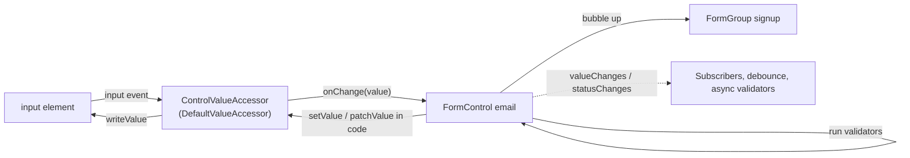

import { Tabs, TabItem, Aside } from '@astrojs/starlight/components';
import QuizBlock from '~/components/QuizBlock.astro';

## Why it matters in interviews

Line-of-business apps are mostly forms, so this is asked everywhere: *"reactive vs template-driven?"*, *"how do you write a custom validator?"*, *"cross-field validation?"*, *"how do you make a custom input work with `formControlName`?"* (ControlValueAccessor), and live-coding a reactive form with validation. In late 2026 you should also be able to say what Signal Forms are and why you would or wouldn't use them yet.

## Core idea

Every Angular form approach has the same three pieces: a **model** (the data), **form state** (value, validity, touched, dirty, errors per field) and **bindings** that sync the model with DOM inputs. The approaches differ in *where the model is defined* and *how changes are observed*.

| | Template-driven | Reactive Forms | Signal Forms (v21 experimental, v22 stable) |
|---|---|---|---|
| Model defined in | The template (`ngModel`) | The component class (`FormGroup`) | A `signal` holding your data, wrapped with `form()` |
| Import | `FormsModule` | `ReactiveFormsModule` | `@angular/forms/signals` |
| Typing | Weak | Strongly typed since v14 | Inferred from the data model |
| Observe changes | `ngModelChange` | `valueChanges` / `statusChanges` Observables | Signals: `value()`, `valid()`, `errors()` |
| Validation | Directives in the template (`required`, `minlength`) | Validator functions in code | Schema functions in code |
| Dynamic fields | Awkward | `FormArray`, `FormRecord` | Arrays in the model |
| Testing | Needs the DOM | Unit-test the `FormGroup` without the DOM | Unit-test the form without the DOM |
| Best for | Small simple forms | **Production default** for non-trivial forms | New forms on v22+; the long-term direction |

### Reactive Forms: how they work

The form model is a tree of `AbstractControl`s: `FormControl` (one value), `FormGroup` (fixed keys), `FormArray` (list), `FormRecord` (dynamic keys). Directives (`[formGroup]`, `formControlName`) connect each control to a DOM element through a **ControlValueAccessor**. When the user types, the accessor calls the control's `setValue`; the control runs its validators, updates `status` and `errors`, then bubbles the change up to its parent, and each control emits on `valueChanges`.



**Typed forms (v14+).** `new FormControl('')` is `FormControl<string | null>` because `reset()` sets it to `null`. Use `nonNullable: true` or `NonNullableFormBuilder` (`fb.nonNullable.group`) so reset returns to the initial value and the type is `string`. `form.value` is `Partial<...>` because **disabled controls are excluded**; `form.getRawValue()` includes them.

### Validators

- **Sync validators** are functions `(control) => ValidationErrors | null`.
- **Async validators** return an Observable or Promise of the same; they run only after sync validators pass, and the status is `PENDING` meanwhile. Use `updateOn: 'blur'` or debounce to avoid a request per keystroke.
- **Cross-field validators** go on the `FormGroup` (password and confirmation, start date before end date), because only the group sees both values.

## Code

<Tabs>
  <TabItem label="signup.ts">

```ts
import { Component, inject } from '@angular/core';
import { AbstractControl, NonNullableFormBuilder, ReactiveFormsModule, ValidationErrors, ValidatorFn, Validators } from '@angular/forms';
import { map, of, timer, switchMap, catchError } from 'rxjs';
import { UserApi } from './user-api';

const passwordsMatch: ValidatorFn = (g: AbstractControl): ValidationErrors | null =>
  g.get('password')?.value === g.get('confirm')?.value ? null : { passwordsMismatch: true };

@Component({ selector: 'app-signup', imports: [ReactiveFormsModule], templateUrl: './signup.html' })
export class Signup {
  private readonly fb = inject(NonNullableFormBuilder);
  private readonly api = inject(UserApi);

  readonly form = this.fb.group({
    email: this.fb.control('', {
      validators: [Validators.required, Validators.email],
      asyncValidators: [(c: AbstractControl) => timer(400).pipe(
        switchMap(() => this.api.emailExists(c.value)),
        map((exists) => (exists ? { emailTaken: true } : null)),
        catchError(() => of(null)),
      )],
      updateOn: 'blur',
    }),
    password: ['', [Validators.required, Validators.minLength(8)]],
    confirm: [''],
    phones: this.fb.array([this.fb.control('')]),
  }, { validators: passwordsMatch });

  addPhone() { this.form.controls.phones.push(this.fb.control('')); }

  submit() {
    if (this.form.invalid) { this.form.markAllAsTouched(); return; }
    const value = this.form.getRawValue(); // fully typed, includes disabled controls
    this.api.register(value).subscribe();
  }
}
```

  </TabItem>
  <TabItem label="signup.html">

```html
<form [formGroup]="form" (ngSubmit)="submit()">
  <input formControlName="email" type="email" />
  @let email = form.controls.email;
  @if (email.touched && email.hasError('required')) { <small>Email is required</small> }
  @if (email.hasError('emailTaken')) { <small>Already registered</small> }
  @if (email.pending) { <small>Checking…</small> }

  <input formControlName="password" type="password" />
  <input formControlName="confirm" type="password" />
  @if (form.hasError('passwordsMismatch')) { <small>Passwords do not match</small> }

  <div formArrayName="phones">
    @for (phone of form.controls.phones.controls; track phone; let i = $index) {
      <input [formControlName]="i" />
    }
  </div>
  <button type="button" (click)="addPhone()">Add phone</button>
  <button type="submit" [disabled]="form.pending">Sign up</button>
</form>
```

  </TabItem>
  <TabItem label="ControlValueAccessor">

```ts
@Component({
  selector: 'app-star-rating',
  template: `
    @for (s of stars; track s) {
      <button type="button" [class.on]="s <= value()" [disabled]="disabled()"
              (click)="select(s)" (blur)="onTouched()">★</button>
    }`,
  providers: [{ provide: NG_VALUE_ACCESSOR, useExisting: forwardRef(() => StarRating), multi: true }],
})
export class StarRating implements ControlValueAccessor {
  readonly stars = [1, 2, 3, 4, 5];
  readonly value = signal(0);
  readonly disabled = signal(false);
  private onChange: (v: number) => void = () => {};
  protected onTouched: () => void = () => {};

  writeValue(v: number | null) { this.value.set(v ?? 0); }       // form -> view
  registerOnChange(fn: (v: number) => void) { this.onChange = fn; } // view -> form
  registerOnTouched(fn: () => void) { this.onTouched = fn; }
  setDisabledState(d: boolean) { this.disabled.set(d); }

  select(s: number) { this.value.set(s); this.onChange(s); }
}
// usage: <app-star-rating formControlName="rating" />
```

  </TabItem>
  <TabItem label="Template-driven">

```html
<!-- imports: [FormsModule] -->
<form #f="ngForm" (ngSubmit)="save(f.value)">
  <input name="email" [(ngModel)]="user.email" required email #email="ngModel" />
  @if (email.invalid && email.touched) { <small>Valid email required</small> }
  <button [disabled]="f.invalid">Save</button>
</form>
```

  </TabItem>
</Tabs>

### Signal Forms (stable since v22)

Signal Forms were introduced in **v21 as an experimental API** in `@angular/forms/signals` and **became stable in v22** (June 2026). Instead of building a parallel tree of `FormControl` objects, you keep your data in a `signal` and `form()` derives a **field tree** from it. Each field exposes its state as signals, and validation rules are declared in a schema function.

```ts
import { form, required, email, minLength } from '@angular/forms/signals';

readonly model = signal({ email: '', password: '' });

readonly loginForm = form(this.model, (p) => {
  required(p.email, { message: 'Email is required' });
  email(p.email);
  minLength(p.password, 8);
});

// Field state is signals:
// this.loginForm.email().value(), .valid(), .errors(), .touched()
// The model signal stays the single source of truth: typing updates this.model().
```

In the template each input is bound to a field with the `FormField` directive: `[formField]="loginForm.email"`. Early v21 previews used a different name (`[field]`), so older blog posts may not match.

Why it is the direction: no `valueChanges` subscriptions, no `null` typing quirks, validity is `computed`, and it works naturally with OnPush and zoneless. Why Reactive Forms is still everywhere: Signal Forms only became stable in v22, the ecosystem (component libraries, custom accessors, docs) grew up on Reactive Forms, and existing apps have years of Reactive Forms code. Reactive Forms are not deprecated. A sensible interview answer: *"On v22+ I would use Signal Forms for new forms and keep existing Reactive Forms until there is a reason to migrate; on v21 they were experimental, so Reactive Forms was the safe choice."*

### Legacy vs modern

| Older code | Modern |
|---|---|
| Untyped `FormGroup` (pre-v14), `UntypedFormGroup` after migration | Typed forms, `NonNullableFormBuilder` |
| `valueChanges.subscribe` without cleanup | `takeUntilDestroyed()`, or `toSignal(form.valueChanges)` |
| `*ngIf="form.get('email')?.errors?.required"` | `@if (form.controls.email.hasError('required'))` |
| Separate `valueChanges` / `statusChanges` | Also a unified `events` Observable (v18+) |
| Reactive Forms everywhere | Signal Forms for new forms (stable since v22) |

## Interview Q&A

<details>
<summary>Reactive vs template-driven forms: which and why?</summary>

Reactive Forms define the model in code, are strongly typed, synchronous to access, easy to unit test without the DOM, and handle dynamic fields with `FormArray`. Template-driven forms define the model through `ngModel` directives; they are quick for small forms but harder to test and to validate dynamically. For anything non-trivial, Reactive Forms.
</details>

<details>
<summary>How do you write a custom validator, and a cross-field one?</summary>

A `ValidatorFn` takes a control and returns `null` when valid or an error object such as `{ minAge: { required: 18 } }`. For cross-field rules, attach the validator to the parent `FormGroup` via its `validators` option, read both child values, and return the error on the group. Display it with `form.hasError('passwordsMismatch')`.
</details>

<details>
<summary>How do async validators work, and how do you stop them from flooding the API?</summary>

They return an Observable or Promise of errors or `null`. They run only after sync validators pass, and the control is `PENDING` until they finish; a new value cancels the pending check. Reduce calls with `updateOn: 'blur'`, or debounce inside the validator with `timer()` + `switchMap`, and handle errors so a network failure doesn't block the form.
</details>

<details>
<summary>Why is `form.value` typed as `Partial` and what is `getRawValue()`?</summary>

`value` excludes disabled controls, so every key might be missing. `getRawValue()` returns all controls including disabled ones, fully typed. Use `getRawValue()` when submitting forms that disable fields conditionally.
</details>

<details>
<summary>What is ControlValueAccessor?</summary>

The interface that connects a form control to a UI element: `writeValue` (model to view), `registerOnChange` and `registerOnTouched` (view to model), and optional `setDisabledState`. Implement it and register with `NG_VALUE_ACCESSOR` (`multi: true`, `useExisting`) so a custom component such as a date picker works with `formControlName` and `ngModel` like a native input.
</details>

<details>
<summary>`setValue` vs `patchValue`?</summary>

`setValue` requires the full structure for a group and throws if a key is missing or extra. `patchValue` updates only the provided keys. Both accept `{ emitEvent: false }` to avoid triggering `valueChanges`, useful when syncing values programmatically.
</details>

<details>
<summary>What are Signal Forms and would you use them in production?</summary>

A new forms API (experimental in v21, stable in v22) where your data lives in a signal and `form()` creates a field tree whose value, validity and errors are signals, with validation declared in a schema function. It removes subscription plumbing and fits zoneless apps. On v22+ I would use it for new forms and leave working Reactive Forms alone; on v21 it was experimental, so I would only have piloted it on contained forms.
</details>

<details>
<summary>How do you show validation errors only after the user interacts?</summary>

Check `touched` (blurred) or `dirty` (changed) along with the error, and on submit call `form.markAllAsTouched()` so all errors appear at once. Keep error messages in a reusable component or pipe to avoid repeating conditions in every template.
</details>

## Pitfalls

<Aside type="caution" title="Common mistakes">

- Using `form.value` on submit and silently losing disabled fields.
- Forgetting that `reset()` sets controls to `null` unless they are non-nullable (`nonNullable: true` or `NonNullableFormBuilder`).
- Subscribing to `valueChanges` without cleanup, or causing loops by calling `setValue` inside its own `valueChanges` (use `emitEvent: false`).
- Async validators without debounce or `updateOn: 'blur'`, firing a request per keystroke.
- Mixing `ngModel` and `formControlName` on the same element (deprecated and confusing).
- Custom inputs that don't implement ControlValueAccessor, forcing `@Input`/`@Output` wiring on every form.
- Getting the stage wrong: Signal Forms were experimental in v21 and stable from v22. Say which version you mean.

</Aside>

## Related

- [Signals deep dive](../signals/)
- [Dependency injection: NG_VALUE_ACCESSOR and multi providers](../dependency-injection/)
- [RxJS operators for async validation](../rxjs-operators/)
- [Angular live coding: reactive form with custom validator](../../dsa/angular-live-coding/)

## Quick quiz

<QuizBlock section="angular" topic="forms" />
