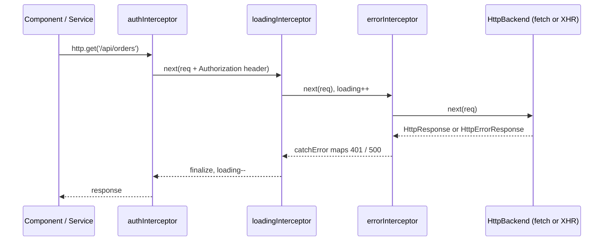

import { Tabs, TabItem, Aside } from '@astrojs/starlight/components';
import QuizBlock from '~/components/QuizBlock.astro';

## Why it matters in interviews

*"How do you attach a JWT to every request?"*, *"Where do you handle 401s globally?"* and *"Class-based vs functional interceptors?"* come up in almost every Angular round. They test whether you understand that `HttpClient` returns **cold observables** and that interceptors are a **chain of responsibility** around the real HTTP call, the same idea as ASP.NET Core middleware.

## Core idea

`HttpClient` is Angular's typed HTTP API. Every method (`get`, `post`, ...) returns a **cold** `Observable`: nothing is sent until someone subscribes, and **each subscription sends a new request**. For a normal JSON call the observable emits once and completes. Ask for `observe: 'events'` and it emits progress events too.

### Setting it up (standalone, v15+)

```ts
// app.config.ts
import { ApplicationConfig } from '@angular/core';
import { provideHttpClient, withFetch, withInterceptors } from '@angular/common/http';
import { authInterceptor } from './core/auth.interceptor';
import { errorInterceptor } from './core/error.interceptor';
import { loadingInterceptor } from './core/loading.interceptor';

export const appConfig: ApplicationConfig = {
  providers: [
    provideHttpClient(
      withFetch(), // use the Fetch API instead of XMLHttpRequest
      withInterceptors([authInterceptor, loadingInterceptor, errorInterceptor]),
    ),
  ],
};
```

- **`withFetch()`** switches the backend from `XMLHttpRequest` to `fetch`. It is recommended for SSR (fetch works natively on Node) and the CLI adds it to SSR apps. Trade-off: **upload progress events are not available** with fetch. Keep XHR if you show upload progress bars.
- **`withInterceptors([...])`** registers functional interceptors. `withInterceptorsFromDi()` is the bridge for legacy class-based `HttpInterceptor` services registered with the `HTTP_INTERCEPTORS` multi-provider.
- Other features: `withXsrfConfiguration(...)`, `withNoXsrfProtection()`, `withJsonpSupport()`, `withRequestsMadeViaParent()`.

### The interceptor chain

A functional interceptor is just a function `(req, next) => Observable<HttpEvent<unknown>>`. It can change the request, call `next(req)` to pass it on, and pipe operators onto the response stream. **Requests flow through interceptors in the order listed. Responses flow back in reverse order.**



Requests are **immutable**. You never set a header on `req`. You call `req.clone({ setHeaders: {...} })` and pass the clone on. This makes retries safe: re-subscribing to `next(req)` re-sends exactly the same request.

Functional interceptors run in an **injection context**, so `inject(AuthService)` works directly inside them. That is the main reason they replaced class-based interceptors: less boilerplate, and an explicit, predictable order. Class-based order depended on provider registration order, which was easy to break with lazy-loaded modules.

### HttpContext: per-request metadata

Sometimes one request needs different interceptor behaviour (skip the spinner, skip auth, cache this one). Headers are the wrong tool because they go over the wire. `HttpContextToken` carries metadata that **only interceptors see**:

```ts
export const SKIP_LOADING = new HttpContextToken<boolean>(() => false);
export const CACHE_TTL_MS = new HttpContextToken<number>(() => 0);

// caller
this.http.get('/api/ping', { context: new HttpContext().set(SKIP_LOADING, true) });
```

### Class-based vs functional

| | Class-based `HttpInterceptor` | Functional `HttpInterceptorFn` |
|---|---|---|
| Shape | `@Injectable` class with `intercept(req, next: HttpHandler)` | Plain function `(req, next: HttpHandlerFn)` |
| Registration | `{ provide: HTTP_INTERCEPTORS, useClass, multi: true }` | `withInterceptors([fn])` |
| DI | Constructor injection | `inject()` inside the function |
| Order | Provider registration order (fragile) | Array order (explicit) |
| Status | Supported, legacy style | Recommended |

## Code

<Tabs>
  <TabItem label="Auth + 401 refresh">
```ts
export const authInterceptor: HttpInterceptorFn = (req, next) => {
  const auth = inject(AuthService);
  // Only attach the token to our own API, never to third-party URLs.
  if (!req.url.startsWith(environment.apiUrl)) return next(req);

  const withToken = (token: string | null) =>
    token ? req.clone({ setHeaders: { Authorization: `Bearer ${token}` } }) : req;

  return next(withToken(auth.accessToken())).pipe(
    catchError((err: unknown) => {
      if (err instanceof HttpErrorResponse && err.status === 401 && !req.url.endsWith('/auth/refresh')) {
        // refresh() shares one in-flight call (shareReplay) for parallel 401s
        return auth.refresh().pipe(switchMap((token) => next(withToken(token))));
      }
      return throwError(() => err);
    }),
  );
};
```
  </TabItem>
  <TabItem label="Error + retry">
```ts
export const errorInterceptor: HttpInterceptorFn = (req, next) => {
  const toast = inject(ToastService);
  const router = inject(Router);

  return next(req).pipe(
    // Retry only idempotent reads, only for transient failures, with backoff.
    retry({
      count: req.method === 'GET' ? 2 : 0,
      delay: (err, attempt) =>
        err instanceof HttpErrorResponse && (err.status === 0 || err.status >= 500)
          ? timer(attempt * 500)
          : throwError(() => err),
    }),
    catchError((err: HttpErrorResponse) => {
      if (err.status === 403) router.navigate(['/forbidden']);
      else if (err.status >= 500 || err.status === 0) toast.error('Server unavailable, try again.');
      return throwError(() => err); // re-throw so the caller can still react
    }),
  );
};
```
  </TabItem>
  <TabItem label="Loading + cache">
```ts
export const loadingInterceptor: HttpInterceptorFn = (req, next) => {
  if (req.context.get(SKIP_LOADING)) return next(req);
  const loading = inject(LoadingService); // exposes a signal counter
  loading.start();
  return next(req).pipe(finalize(() => loading.stop()));
};

const cache = new Map<string, { at: number; res: HttpResponse<unknown> }>();

export const cacheInterceptor: HttpInterceptorFn = (req, next) => {
  const ttl = req.context.get(CACHE_TTL_MS);
  if (req.method !== 'GET' || ttl === 0) return next(req);

  const hit = cache.get(req.urlWithParams);
  if (hit && Date.now() - hit.at < ttl) return of(hit.res.clone());

  return next(req).pipe(
    tap((ev) => {
      if (ev instanceof HttpResponse) cache.set(req.urlWithParams, { at: Date.now(), res: ev });
    }),
  );
};
```
  </TabItem>
</Tabs>

**Calling it from a service.** Keep `HttpClient` in services, return typed observables, and let components decide how to consume them: `async` pipe, `toSignal`, or `httpResource` for signal-based reads (see [Resources](../resources/)).

```ts
@Injectable({ providedIn: 'root' })
export class OrderApi {
  private http = inject(HttpClient);

  list(page: number) {
    const params = new HttpParams().set('page', page).set('size', 20);
    return this.http.get<Order[]>('/api/orders', { params });
  }

  create(dto: CreateOrder) {
    return this.http.post<Order>('/api/orders', dto);
  }
}
```

The generic in `get<Order[]>` is a **compile-time assertion only**. Nothing validates the JSON at runtime, so if the API shape drifts you find out when the template breaks. Validate at the boundary (for example with a schema library) for critical data.

## Interview Q&A

<details>
<summary>Why does calling `http.get()` without subscribing not send a request?</summary>

`HttpClient` returns a **cold** observable. The request is created inside the subscribe logic, so no subscription means no request. Conversely, subscribing twice (for example two `async` pipes on the same observable) sends **two** requests. Share it with `shareReplay` or convert once with `toSignal`.
</details>

<details>
<summary>In what order do interceptors run?</summary>

Requests go through them in the order they appear in `withInterceptors([...])`. Responses come back in **reverse** order, because each interceptor wraps the observable returned by the next one. Put the auth interceptor first so the header is added before anything else sees the request.
</details>

<details>
<summary>Why do you have to clone the request?</summary>

`HttpRequest` is immutable so that the chain is predictable and **retries are safe**: if an interceptor re-subscribes to `next(req)`, the original request is resent untouched. Use `req.clone({ setHeaders, setParams, body, url })`.
</details>

<details>
<summary>How would you handle token refresh when several requests fail with 401 at once?</summary>

Make the refresh call **shared**. The auth service keeps one in-flight refresh observable (`shareReplay(1)`, or a flag plus a subject) so five parallel 401s trigger one refresh, then each retries its original request with the new token. Exclude the refresh endpoint itself from the 401 logic to avoid infinite loops. If refresh fails, clear state and redirect to login.
</details>

<details>
<summary>What is `HttpContext` for?</summary>

Per-request metadata for interceptors, typed by `HttpContextToken<T>` with a default value. Typical uses: skip the global spinner, opt into caching with a TTL, skip auth for public endpoints, set a custom retry count. Unlike headers, it never leaves the browser.
</details>

<details>
<summary>What does `withFetch()` change and when would you not use it?</summary>

It makes `HttpClient` use the Fetch API instead of `XMLHttpRequest`. It is recommended for SSR and the CLI adds it to SSR projects. The main thing you lose is **upload progress events**, so keep XHR for file uploads with progress bars.
</details>

<details>
<summary>Should the interceptor swallow errors after showing a toast?</summary>

Usually no. Show the global message and **re-throw** with `throwError(() => err)` so the calling code can still stop its own spinner, reset a form, or show inline field errors from a 400 ProblemDetails body. Swallowing with `return EMPTY` makes callers think the call completed with no value.
</details>

<details>
<summary>How do you cancel an in-flight HTTP request?</summary>

Unsubscribe. `HttpClient` aborts the underlying XHR/fetch when the subscription is torn down. That is why `switchMap` in a typeahead cancels the previous search, and why `takeUntilDestroyed()` stops requests when a component is destroyed.
</details>

## Pitfalls

<Aside type="caution" title="Common mistakes">
- **Attaching the bearer token to every URL**, including third-party APIs and CDNs. Check the URL against your API base first.
- **Infinite 401 loop**: the refresh call itself fails with 401 and the interceptor tries to refresh again. Exclude the refresh endpoint.
- **Retrying non-idempotent requests** (POST payment) blindly. Retry GETs, and only on network or 5xx errors.
- **Duplicate requests** from subscribing twice to the same cold observable (two `async` pipes, or `subscribe` plus `async`).
- **Mixing styles silently**: class-based interceptors do nothing unless you add `withInterceptorsFromDi()`.
- **Global cache without invalidation**: cached GETs show stale data after a POST. Clear related keys on writes.
</Aside>

## Related

- [RxJS fundamentals](../rxjs-basics/)
- [RxJS operators](../rxjs-operators/)
- [Resources: resource, rxResource & httpResource](../resources/)
- [Sessions, JWT & refresh tokens](../../security/authn-authz-tokens/)

## Quick quiz

<QuizBlock section="angular" topic="http-interceptors" />
