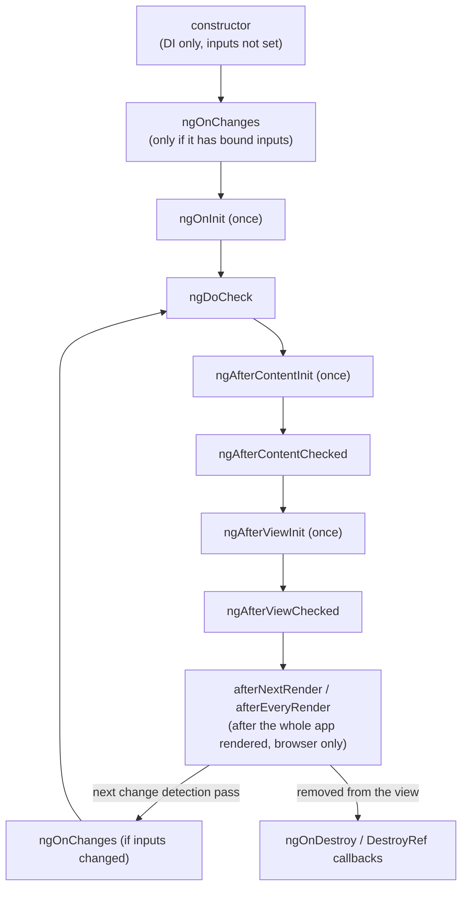

import { Tabs, TabItem, Aside } from '@astrojs/starlight/components';
import QuizBlock from '~/components/QuizBlock.astro';

## Why it matters in interviews

*"List the lifecycle hooks in order"*, *"constructor vs ngOnInit?"* and *"where do you unsubscribe?"* are asked in almost every Angular round, including fresher-level screens. At 3-4 years the interviewer expects more: why `ngAfterViewInit` exists, why `ngDoCheck` is dangerous, how signal inputs change the need for `ngOnChanges`, and the modern replacements `afterNextRender` and `DestroyRef`.

## Core idea

Angular creates a component, sets its inputs, renders its template, checks it repeatedly during change detection, and finally destroys it. At each stage it calls a **hook method** if the class implements it. The hooks are called **by change detection**, not by timers: `ngDoCheck`, `ngAfterContentChecked` and `ngAfterViewChecked` run on every change detection pass that visits the component.

### Order of hooks



| Hook | When | Typical use |
|---|---|---|
| `constructor` | Class is instantiated by DI | Inject dependencies, create signals. No inputs, no DOM |
| `ngOnChanges(changes)` | Before `ngOnInit` and whenever a bound input reference changes | React to input changes (legacy style) |
| `ngOnInit` | Once, after the first `ngOnChanges` | Initial logic that needs inputs, start data loading |
| `ngDoCheck` | Every change detection pass | Custom change detection. Rarely needed, must be cheap |
| `ngAfterContentInit` | Once, after projected content is initialised | Read `contentChild` results |
| `ngAfterContentChecked` | After every check of projected content | Rare |
| `ngAfterViewInit` | Once, after the component's view and child views are created | Read `viewChild` results, init a third-party widget on an element |
| `ngAfterViewChecked` | After every check of the view | Rare, must be cheap |
| `ngOnDestroy` | Just before Angular destroys the component | Cleanup: unsubscribe, clear timers, detach listeners |

**Parent and child ordering.** For a parent with one child, the parent's init and content hooks run first, then the child's whole set (including its view hooks), and only then the parent's `ngAfterViewInit`. The parent's view is not "initialised" until its children are.

### Constructor vs ngOnInit

The constructor runs when DI creates the instance. At that point **inputs are not yet set**, and reading a required signal input there throws an error (NG0950). Use the constructor (or field initialisers with `inject()`) for wiring: injecting services, declaring signals, `computed`, `effect`. Use `ngOnInit` for logic that needs input values, such as loading an order by the `orderId` input. With signals much of that logic moves into `computed()` or a [resource](../resources/), which re-runs automatically when the input changes, something `ngOnInit` never did.

### ngOnChanges with signal inputs

`ngOnChanges` still fires for signal inputs, but it is rarely the right tool any more:

```ts
// Legacy
ngOnChanges(changes: SimpleChanges) {
  if (changes['price'] || changes['qty']) this.total = this.price * this.qty;
}

// Modern: derived state, no hook, always consistent
readonly total = computed(() => this.price() * this.qty());
```

`ngOnChanges` only fires when the input **reference** changes. Mutating an object input in the parent (`order.items.push(x)`) does not trigger it, which is a frequent bug in legacy code and the main reason people reached for `ngDoCheck`.

### afterNextRender and afterEveryRender

`ngAfterViewInit` means "this component's view is created", not "the browser has painted and the DOM is measurable". The render hooks fill that gap:

- `afterNextRender(cb)` runs **once**, after the next time Angular finishes rendering the whole application to the DOM. Use it to initialise a chart library, focus an element, or measure size.
- `afterEveryRender(cb)` runs after **every** render. Called `afterRender` before v20. Use sparingly.
- Both run **only in the browser**, never during SSR, so they are the safe place for code that touches `window` or `document`.
- Both accept phases (`earlyRead`, `write`, `mixedReadWrite`, `read`) so DOM reads and writes are batched and you avoid layout thrashing.
- Both must be called in an injection context (constructor or field initialiser).

### DestroyRef and takeUntilDestroyed

`DestroyRef` lets any code running in an injection context register cleanup without implementing `OnDestroy`. `takeUntilDestroyed()` from `@angular/core/rxjs-interop` uses it to complete a subscription when the component (or service) is destroyed.

### Legacy vs modern cleanup

| Legacy | Modern |
|---|---|
| `implements OnDestroy` + `ngOnDestroy()` | `inject(DestroyRef).onDestroy(() => ...)` |
| `private destroy$ = new Subject<void>()` + `takeUntil(this.destroy$)` | `takeUntilDestroyed()` |
| `ngAfterViewInit` + `setTimeout` to wait for DOM | `afterNextRender()` |
| `ngOnChanges` to compute derived values | `computed()` from signal inputs |
| Manual subscribe + assign to a field | `toSignal(obs$)` or the `async` pipe, cleanup is automatic |

## Code

<Tabs>
  <TabItem label="sales-chart.ts">

```ts
import {
  Component, DestroyRef, ElementRef, afterNextRender, computed,
  inject, input, viewChild,
} from '@angular/core';
import { takeUntilDestroyed } from '@angular/core/rxjs-interop';
import { interval } from 'rxjs';
import { Chart } from 'chart.js/auto';

@Component({
  selector: 'app-sales-chart',
  template: `<canvas #canvas></canvas><p>Total: {{ total() }}</p>`,
})
export class SalesChart {
  readonly points = input.required<number[]>();
  readonly total = computed(() => this.points().reduce((a, b) => a + b, 0));
  private readonly canvas = viewChild.required<ElementRef<HTMLCanvasElement>>('canvas');
  private chart?: Chart;

  constructor() {
    // Browser only, after the DOM exists: safe with SSR.
    afterNextRender({
      write: () => {
        this.chart = new Chart(this.canvas().nativeElement, {
          type: 'line',
          data: { labels: this.points().map((_, i) => `${i}`), datasets: [{ data: this.points() }] },
        });
      },
    });

    inject(DestroyRef).onDestroy(() => this.chart?.destroy());

    interval(30_000).pipe(takeUntilDestroyed()).subscribe(() => this.chart?.update());
  }
}
```

  </TabItem>
  <TabItem label="Legacy version">

```ts
export class SalesChartComponent implements OnChanges, AfterViewInit, OnDestroy {
  @Input() points: number[] = [];
  @ViewChild('canvas') canvas!: ElementRef<HTMLCanvasElement>;
  total = 0;
  private destroy$ = new Subject<void>();
  private chart?: Chart;

  ngOnChanges() { this.total = this.points.reduce((a, b) => a + b, 0); }

  ngAfterViewInit() {
    this.chart = new Chart(this.canvas.nativeElement, { /* ... */ });
    interval(30_000).pipe(takeUntil(this.destroy$)).subscribe(() => this.chart?.update());
  }

  ngOnDestroy() {
    this.destroy$.next();
    this.destroy$.complete();
    this.chart?.destroy();
  }
}
```

  </TabItem>
</Tabs>

## Interview Q&A

<details>
<summary>List the lifecycle hooks in order.</summary>

`constructor`, `ngOnChanges` (if there are bound inputs), `ngOnInit`, `ngDoCheck`, `ngAfterContentInit`, `ngAfterContentChecked`, `ngAfterViewInit`, `ngAfterViewChecked`. On later change detection passes: `ngOnChanges` (if inputs changed), `ngDoCheck`, `ngAfterContentChecked`, `ngAfterViewChecked`. Finally `ngOnDestroy`. The render hooks `afterNextRender` / `afterEveryRender` run after the whole application has rendered.
</details>

<details>
<summary>Constructor vs ngOnInit: what goes where?</summary>

The constructor is for DI and setting up fields, signals, `computed` and `effect`, because it runs before inputs are bound. `ngOnInit` runs once after the first set of inputs, so it is for initial logic that needs them. Keep both free of DOM access; use `afterNextRender` for that.
</details>

<details>
<summary>Why didn't `ngOnChanges` fire when the parent added an item to an array input?</summary>

`ngOnChanges` compares input values by reference. `push` mutates the same array, so the reference is unchanged. Fix it by treating inputs as immutable (`this.items = [...this.items, x]` or `items.update(a => [...a, x])`). Using `ngDoCheck` to deep-compare is a workaround that runs on every pass.
</details>

<details>
<summary>What is the difference between `ngAfterViewInit` and `afterNextRender`?</summary>

`ngAfterViewInit` is per component and runs during change detection once its view and child views are created. It also runs on the server during SSR. `afterNextRender` runs after Angular has finished rendering the whole app to the DOM, only in the browser, and supports read/write phases. It is the right place for DOM measurement and third-party DOM libraries.
</details>

<details>
<summary>How do you avoid subscription memory leaks in components?</summary>

Prefer not subscribing manually: use `toSignal()` or the `async` pipe, which clean up automatically. When you must subscribe, use `takeUntilDestroyed()` (in an injection context, or pass a `DestroyRef`). Legacy code uses a `destroy$` Subject with `takeUntil` in `ngOnDestroy`. HTTP calls complete by themselves, but long-lived streams (interval, store selectors, router events, `valueChanges`) do not.
</details>

<details>
<summary>Why is `ngDoCheck` considered dangerous?</summary>

It runs on every change detection pass for that component, which with zone.js can be after every click, timer or HTTP response anywhere in the app. Anything non-trivial there slows the whole app. Its legitimate use was detecting mutations that `ngOnChanges` misses; immutable data and signals remove that need.
</details>

<details>
<summary>Can services use lifecycle hooks?</summary>

Only `ngOnDestroy`, which is called when the injector that created the service is destroyed (for example a component-level provider when the component is destroyed, or a lazy route's injector). Services can also `inject(DestroyRef)`. Other hooks are component and directive only.
</details>

<details>
<summary>Is `ngOnInit` still needed with signals?</summary>

Less often. Derived state becomes `computed`, input-driven loading becomes a `resource` or `toSignal` over `toObservable(input)`, and effects react to changes. `ngOnInit` is still fine and common for one-off initialisation, and you will see it in every legacy codebase, so know it well.
</details>

## Pitfalls

<Aside type="caution" title="Common mistakes">

- Reading inputs or `viewChild` results in the constructor. Inputs are unset and queries are empty; required signal inputs throw.
- Accessing `window` or `document` in `ngOnInit` / `ngAfterViewInit` in an SSR app. Use `afterNextRender`.
- Changing a bound value in `ngAfterViewInit` (for example setting a flag shown in the template), which causes `ExpressionChangedAfterItHasBeenChecked` in dev mode.
- Heavy work in `ngDoCheck`, `ngAfterViewChecked` or `afterEveryRender`.
- Forgetting cleanup for `setInterval`, `addEventListener` on `window`, WebSocket subscriptions or third-party widgets.
- Calling `takeUntilDestroyed()` without arguments outside an injection context (for example inside `ngOnInit`). Pass `this.destroyRef` explicitly.

</Aside>

## Related

- [Change detection](../change-detection/)
- [Signals deep dive](../signals/)
- [RxJS fundamentals and unsubscribing](../rxjs-basics/)
- [SSR and hydration](../ssr-hydration/)

## Quick quiz

<QuizBlock section="angular" topic="lifecycle-hooks" />
