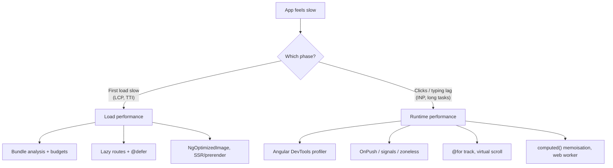

import { Tabs, TabItem, Aside } from '@astrojs/starlight/components';
import QuizBlock from '~/components/QuizBlock.astro';

## Why it matters in interviews

*"Your Angular app is slow, how do you fix it?"* is a classic open question. A strong answer separates **load performance** (bundle size, lazy loading, `@defer`, images, SSR) from **runtime performance** (change detection, list rendering, heavy computation), names how you **measured** it, and uses modern tools. Saying "I added OnPush and trackBy" is the 2019 answer; in 2026 interviewers expect signals, zoneless, `@defer` and `track`.

## Core idea

Measure first, then fix the right layer.



Tools: Chrome DevTools Performance panel and Lighthouse (Core Web Vitals: LCP, INP, CLS), **Angular DevTools** profiler (which components were checked and how long each CD cycle took), and the build's stats output for bundle analysis.

### Runtime: do less change detection

- **OnPush** components are checked only when an input reference changes, a template event fires, an `async` pipe emits, or a signal read in the template changes. Default components are checked on every cycle.
- **Signals** give fine-grained updates: when a signal read in a template changes, Angular marks that view for refresh. Combined with OnPush this avoids checking whole subtrees.
- **Zoneless** (stable since v20.2, default for new apps since v21) removes zone.js. Change detection is scheduled by signals, `markForCheck`, `async` pipe and template events, not by every `setTimeout` or XHR. Benefits: smaller bundle (no zone.js), fewer pointless CD cycles, cleaner stack traces. See [Change detection](../change-detection/).
- **No heavy work in templates.** A method call in a template runs on every check. Move derivations into `computed()` (memoised, recalculated only when dependencies change) or a pure pipe.

### Lists: `track` and virtual scroll

`@for` requires a `track` expression. With `track item.id`, when the array is replaced by a fresh API response Angular **reuses DOM nodes** for items with the same id and only creates/moves/destroys what changed. With `track $index` or tracking by object identity on immutable data, a refetch re-creates every row (lost focus, scroll, animations, expensive child component init).

For thousands of rows, render only what is visible with the CDK **virtual scroll** viewport. Alternatives: pagination or infinite scroll from the API.

### Load: ship less JavaScript up front

- **Lazy routes**: `loadComponent` / `loadChildren` split each feature into its own chunk. Add a preloading strategy (`withPreloading(PreloadAllModules)` or a custom one) to fetch chunks after first render.
- **`@defer` blocks** (stable since v18) lazy-load **part of a template**. Everything inside the block (standalone components, directives, pipes used only there) goes into a separate chunk, loaded when the trigger fires.

| `@defer` trigger | Loads when |
|---|---|
| `on idle` (default) | Browser is idle (`requestIdleCallback`) |
| `on viewport` | Placeholder (or a referenced element) scrolls into view |
| `on interaction` | User clicks or presses a key on the placeholder/element |
| `on hover` | Mouse enters / focus on the placeholder/element |
| `on immediate` | Right after the non-deferred content renders |
| `on timer(2s)` | After a delay |
| `when condition` | A boolean expression becomes true (one-way, does not unload) |

Add `prefetch on idle` (or another trigger) to download the chunk **before** it is needed. Sub-blocks: `@placeholder` (shown before loading; `minimum` avoids flicker), `@loading` (`after` and `minimum` timing), `@error`.

- **Budgets** in `angular.json` fail or warn the build when the initial bundle grows, so regressions are caught in CI.
- **Analyse** with `ng build --stats-json` and an esbuild bundle analyzer, or `source-map-explorer` on the output. Usual culprits: moment.js with all locales, full lodash, a chart library imported eagerly, icon packs.
- **Images**: `NgOptimizedImage` (`ngSrc`) enforces `width`/`height` (no layout shift), lazy-loads by default, sets `fetchpriority=high` for `priority` images (your LCP hero), generates `srcset` with an image loader, and warns in dev mode about common mistakes.
- **SSR / prerendering** improves first paint and SEO. See [SSR, hydration & prerendering](../ssr-hydration/).

### CPU-heavy work

Parsing a 50 MB CSV or running a big calculation on the main thread blocks input. Move it to a **web worker** (`ng generate web-worker`), which runs on a separate thread and talks via `postMessage`.

## Code

<Tabs>
  <TabItem label="@defer">
```html
<app-product-header [product]="product()" />

@defer (on viewport; prefetch on idle) {
  <app-reviews [productId]="product().id" />
} @placeholder (minimum 300ms) {
  <div class="skeleton" style="height: 400px"></div>
} @loading (after 150ms; minimum 500ms) {
  <app-spinner />
} @error {
  <p>Could not load reviews.</p>
}

@defer (on interaction(chartBtn)) {
  <app-sales-chart [data]="sales()" />  <!-- heavy chart lib goes into its own chunk -->
}
<button #chartBtn>Show chart</button>
```
  </TabItem>
  <TabItem label="List + OnPush">
```ts
@Component({
  selector: 'app-order-table',
  changeDetection: ChangeDetectionStrategy.OnPush,
  imports: [ScrollingModule, CurrencyPipe],
  template: `
    <p>Total: {{ total() | currency: 'INR' }}</p>
    <cdk-virtual-scroll-viewport itemSize="48" class="viewport">
      <div *cdkVirtualFor="let o of orders(); trackBy: byId" class="row">
        {{ o.number }} - {{ o.amount | currency: 'INR' }}
      </div>
    </cdk-virtual-scroll-viewport>
  `,
  styles: `.viewport { height: 600px; } .row { height: 48px; }`,
})
export class OrderTableComponent {
  orders = input.required<Order[]>();
  // computed: recalculated only when orders() changes, not on every CD pass
  total = computed(() => this.orders().reduce((s, o) => s + o.amount, 0));
  byId = (_: number, o: Order) => o.id;
}
```
  </TabItem>
  <TabItem label="Budgets + images">
```json
{
  "budgets": [
    { "type": "initial", "maximumWarning": "500kB", "maximumError": "1MB" },
    { "type": "anyComponentStyle", "maximumWarning": "4kB", "maximumError": "8kB" }
  ]
}
```
```html
<!-- LCP hero image: priority; others lazy by default -->


```
  </TabItem>
</Tabs>

## Interview Q&A

<details>
<summary>Your Angular page is slow. Walk me through how you would investigate.</summary>

Reproduce and measure: Lighthouse/Core Web Vitals for load, the Performance panel and Angular DevTools profiler for runtime. If first load is slow: analyse the bundle, lazy-load routes, `@defer` heavy widgets, optimise images, consider SSR. If interactions lag: check which components re-render (DevTools), move to OnPush + signals, fix `track`, virtualise long lists, move template method calls into `computed`, push CPU work to a worker. Re-measure after each change.
</details>

<details>
<summary>What does `track` do in `@for` and what should you track by?</summary>

It gives each item an identity so Angular can map old DOM nodes to new items when the array changes. Track by a stable unique key (`item.id`). Tracking by `$index` re-uses rows by position (wrong state after inserts/sorts); tracking by object identity re-creates every row when data is refetched as new objects.
</details>

<details>
<summary>How does `@defer` differ from a lazy-loaded route?</summary>

A lazy route splits code at the **page** level, loaded on navigation. `@defer` splits **part of a template** inside a page, loaded on a trigger (viewport, interaction, idle...). Dependencies inside the block must be standalone and not referenced elsewhere eagerly in the same file, or they stay in the main chunk.
</details>

<details>
<summary>Why does OnPush improve performance, and when does an OnPush component still update?</summary>

Angular skips checking the component and its subtree unless it is marked dirty. It is marked when an input reference changes, an event handler in its template runs, an `async` pipe emits, a signal read in its template changes, or `markForCheck()` is called. Mutating an input object in place does **not** mark it.
</details>

<details>
<summary>What does zoneless change for performance?</summary>

Without zone.js, Angular no longer runs change detection after every async task. It only schedules CD when something notifies it (signal change, `markForCheck`, `async` pipe, template event). That removes a dependency from the bundle and eliminates many useless CD cycles, especially with third-party libraries that fire timers.
</details>

<details>
<summary>What does NgOptimizedImage give you?</summary>

Enforced dimensions (prevents layout shift), lazy loading by default, `fetchpriority` for `priority` images (LCP), automatic `srcset` with a loader for a CDN, preconnect warnings, and dev-mode warnings for oversized or distorted images.
</details>

<details>
<summary>How do you stop bundle size from creeping up?</summary>

Set `budgets` in `angular.json` so CI warns/fails, review the stats-json output periodically, prefer tree-shakable imports (`lodash-es` per function, date-fns instead of moment), lazy-load features, and `@defer` heavy third-party widgets.
</details>

## Pitfalls

<Aside type="caution" title="Common mistakes">
- **Optimising without measuring**, for example adding OnPush everywhere when the real problem is a 3 MB initial bundle.
- **`track $index`** on lists that get sorted, filtered or refetched.
- **Calling functions in templates** that filter or sort large arrays on every CD pass.
- **Importing a deferred component elsewhere eagerly** in the same component, which silently defeats `@defer`.
- **`@defer (on viewport)` without a sized placeholder**, causing layout shift (CLS) when the content arrives.
- **Mutating OnPush inputs** in place and wondering why the view doesn't update.
</Aside>

## Related

- [Change detection](../change-detection/)
- [SSR, hydration & prerendering](../ssr-hydration/)
- [Routing (lazy loading)](../routing/)
- [Browser, DOM & storage](../../web/browser-dom/)

## Quick quiz

<QuizBlock section="angular" topic="performance" />
