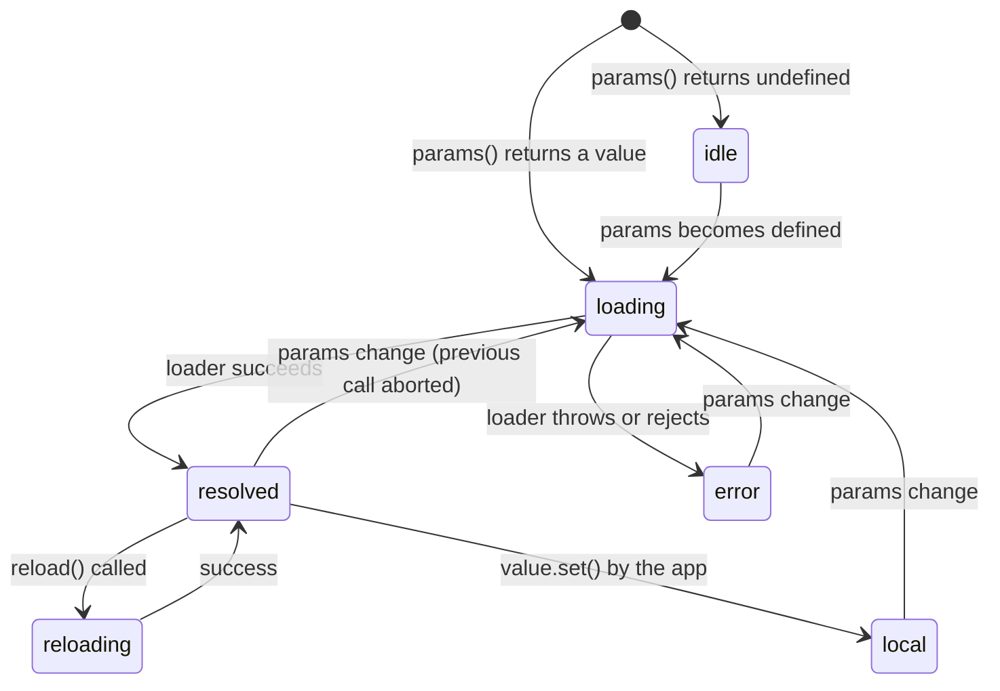

import { Tabs, TabItem, Aside } from '@astrojs/starlight/components';
import QuizBlock from '~/components/QuizBlock.astro';

## Why it matters in interviews

Resources are the signal-native way to load data, and interviewers at product companies use them to check whether you follow modern Angular: *"how do you load data based on a signal input?"*, *"what does `httpResource` give you over `HttpClient.get().subscribe()`?"*, *"how is the previous request cancelled?"*. Service companies with older codebases are more likely to ask about the RxJS version (`switchMap`), so knowing both and how they map is the strongest answer.

## Core idea

Signals are synchronous: `computed` cannot `await`. A **resource** bridges that gap. It wraps an async operation and exposes its result as signals, re-running automatically when the signals it depends on change.

```ts
const orderResource = resource({
  params: () => ({ id: this.orderId() }),               // reactive: tracked like computed
  loader: ({ params, abortSignal }) =>                   // async: not tracked
    fetch(`/api/orders/${params.id}`, { signal: abortSignal }).then((r) => r.json() as Promise<Order>),
});

orderResource.value();     // Order | undefined
orderResource.status();    // 'idle' | 'loading' | 'reloading' | 'resolved' | 'error' | 'local'
orderResource.isLoading(); // boolean
orderResource.error();     // unknown
```

<Aside type="note" title="API status and history">
`resource` and `rxResource` arrived as experimental APIs in v19, and `httpResource` in v19.2. In v20 the API was reshaped: `request` was renamed to `params`, `rxResource` got a `stream` option instead of `loader`, and `status()` became a string union instead of an enum. Older blog posts use the old names. All three (`resource`, `rxResource`, `httpResource`) became **stable in v22**. On v19-v21 they were experimental, so check your version before relying on details.
</Aside>

### How it works



1. `params` is a **reactive** function. Angular tracks the signals it reads, like a `computed`.
2. Whenever the params value changes, the resource calls `loader` with the new params. If a previous load is still running, its **`abortSignal` is aborted**, so pass it to `fetch` (or use `rxResource` / `httpResource`, which cancel automatically).
3. If `params` returns `undefined`, the resource goes to `idle` and the loader is not called. That is how you express "wait until we have an id".
4. The `loader` itself is **not** tracked: reading other signals inside it doesn't cause reloads.
5. `reload()` re-runs the loader with the same params (status `reloading`, the old value stays visible).
6. `value` is writable: `set` / `update` put the resource in `local` state, handy for optimistic UI. The next params change reloads from the server.

### The three flavours

| | `resource` | `rxResource` | `httpResource` |
|---|---|---|---|
| Import | `@angular/core` | `@angular/core/rxjs-interop` | `@angular/common/http` |
| Async function | `loader` returning a Promise | `stream` returning an Observable | You describe the request; Angular calls HttpClient |
| Cancellation | You pass `abortSignal` to `fetch` | Unsubscribes the previous Observable | Cancels the previous HTTP request |
| Interceptors | No (unless you call HttpClient yourself) | Yes, if the Observable uses HttpClient | Yes, goes through HttpClient |
| Typical use | Non-HTTP async work, IndexedDB, third-party SDKs | Reuse existing Observable-based services | Plain GET-style data loading |

`httpResource` is the most common in apps:

```ts
readonly userId = input.required<number>();

// Re-fetches whenever userId changes; goes through your interceptors.
readonly user = httpResource<User>(() => `/api/users/${this.userId()}`);

// Request object form, plus defaultValue so value() is never undefined.
readonly orders = httpResource<Order[]>(
  () => ({ url: '/api/orders', params: { page: this.page(), status: this.status() } }),
  { defaultValue: [] },
);
```

It also exposes `headers()`, `statusCode()` and `progress()` signals, offers `httpResource.text()` / `.blob()` / `.arrayBuffer()` variants, and accepts a `parse` option to validate the response (for example with a Zod schema).

### Resources are for reading, not writing

Resources model **derived async state**: "the data for the current params". They are not meant for mutations. A POST/PUT/DELETE triggered by a button should be a plain `HttpClient` call (or an RxJS pipeline with `exhaustMap` to block double submits), followed by `reload()` or a local `update()` of the resource.

### Resource vs HttpClient + subscribe

| | `HttpClient` + subscribe (classic) | `httpResource` |
|---|---|---|
| Re-fetch when an input changes | `ngOnChanges` or `toObservable` + `switchMap` | Automatic from tracked params |
| Cancel stale requests | `switchMap` | Automatic |
| Loading / error flags | Hand-written `loading = true` fields | `isLoading()`, `error()`, `status()` |
| Unsubscribe | `takeUntilDestroyed` / `async` pipe | Destroyed with the component |
| Works with zoneless / OnPush | Needs signals or `async` pipe | Yes, it is signals |
| Composition with time operators | Full RxJS | Use `rxResource` or RxJS before the resource |

## Code

<Tabs>
  <TabItem label="order-detail.ts">

```ts
import { Component, computed, input } from '@angular/core';
import { httpResource } from '@angular/common/http';
import { CurrencyPipe } from '@angular/common';

interface Order { id: number; number: string; total: number; lines: { sku: string; qty: number }[] }

@Component({
  selector: 'app-order-detail',
  imports: [CurrencyPipe],
  templateUrl: './order-detail.html',
})
export class OrderDetail {
  // Bound from the route with withComponentInputBinding(): /orders/:id
  readonly id = input<string>();

  readonly order = httpResource<Order>(() => {
    const id = this.id();
    return id ? `/api/orders/${id}` : undefined;   // undefined: stay idle
  });

  readonly lineCount = computed(() =>
    this.order.hasValue() ? this.order.value().lines.length : 0,
  );
}
```

  </TabItem>
  <TabItem label="order-detail.html">

```html
@switch (order.status()) {
  @case ('loading') { <app-spinner /> }
  @case ('error') {
    <p class="error">Could not load the order.</p>
    <button (click)="order.reload()">Retry</button>
  }
  @default {
    @if (order.hasValue()) {
      <h2>Order {{ order.value().number }}</h2>
      <p>{{ lineCount() }} lines, total {{ order.value().total | currency: 'EUR' }}</p>
      @if (order.isLoading()) { <small>Refreshing…</small> }
    }
  }
}
```

  </TabItem>
  <TabItem label="rxResource">

```ts
import { rxResource } from '@angular/core/rxjs-interop';

export class CustomerOrders {
  private readonly api = inject(OrderApi);           // existing Observable-based service
  readonly customerId = input.required<number>();

  readonly orders = rxResource({
    params: () => ({ customerId: this.customerId() }),
    stream: ({ params }) => this.api.byCustomer(params.customerId), // Observable<Order[]>
    defaultValue: [],
  });
}
```

  </TabItem>
  <TabItem label="Classic equivalent">

```ts
export class OrderDetailComponent implements OnChanges {
  @Input() id?: string;
  order?: Order;
  loading = false;
  error?: unknown;
  private id$ = new BehaviorSubject<string | undefined>(undefined);
  private http = inject(HttpClient);

  constructor() {
    this.id$.pipe(
      filter(Boolean),
      tap(() => (this.loading = true)),
      switchMap((id) => this.http.get<Order>(`/api/orders/${id}`)),
      takeUntilDestroyed(),
    ).subscribe({
      next: (o) => { this.order = o; this.loading = false; },
      error: (e) => { this.error = e; this.loading = false; },  // stream is now dead
    });
  }
  ngOnChanges() { this.id$.next(this.id); }
}
```

  </TabItem>
</Tabs>

The classic version also has a subtle bug: after the first error, the stream completes and later id changes are ignored. Resources don't have that problem; an error is just a status, and the next params change loads again.

## Interview Q&A

<details>
<summary>What problem do resources solve?</summary>

Signals and `computed` are synchronous, but most state comes from the server. A resource turns "load data for these params" into signals (`value`, `status`, `error`, `isLoading`), re-runs when the params change, and cancels stale requests. It replaces the `ngOnChanges` + `switchMap` + loading-flag boilerplate.
</details>

<details>
<summary>What is the difference between `params` and `loader`?</summary>

`params` is reactive: Angular tracks the signals it reads and re-runs the resource when its value changes. `loader` (or `stream` in `rxResource`) does the async work and is not tracked. Returning `undefined` from `params` keeps the resource idle.
</details>

<details>
<summary>How does a resource handle a new request while the old one is still running?</summary>

It aborts the previous one. `resource` passes an `abortSignal` to the loader that you forward to `fetch`. `rxResource` unsubscribes from the previous Observable, and `httpResource` cancels the previous HTTP request. This is the same behaviour as `switchMap`.
</details>

<details>
<summary>`httpResource` vs `resource` with `fetch`?</summary>

`httpResource` goes through `HttpClient`, so interceptors (auth token, error handling, caching), `HttpContext`, testing with `HttpTestingController` and SSR transfer cache all work. A `resource` with `fetch` bypasses all of that. Use `resource` for non-HTTP async sources.
</details>

<details>
<summary>Would you use `httpResource` for a POST that saves a form?</summary>

No. Resources represent reading data for the current params; they would re-send whenever a tracked signal changed. Save with `HttpClient.post` in an event handler (with `exhaustMap` or a disabled button to avoid double submits), then `reload()` or `update()` the resource that displays the data.
</details>

<details>
<summary>What is the difference between `loading` and `reloading`?</summary>

`loading` means the params changed and new data is being fetched; the value belongs to old params. `reloading` comes from `reload()` with the same params, so the current value is still valid and can stay on screen. `isLoading()` is true in both.
</details>

<details>
<summary>How do you safely read a resource's value in a template?</summary>

Check `hasValue()` first (it narrows the type), or give it a `defaultValue`. Also branch on `status()` or `error()` to show error UI. Reading `value()` blindly risks `undefined` access, and in recent versions reading `value()` while the resource is in the error state throws.
</details>

## Pitfalls

<Aside type="caution" title="Common mistakes">

- Reading signals inside `loader` and expecting reloads. Only `params` is tracked.
- Using `fetch` in a `resource` and forgetting to pass `abortSignal`, so stale responses still arrive and waste bandwidth.
- Using resources for mutations.
- Not handling the `error` state, leaving the user with a spinner or blank area.
- Copying old examples that use `request:` or `rxResource({ loader })`; those names changed in v20.
- Bypassing interceptors by using a raw `fetch` resource for your own API.

</Aside>

## Related

- [Signals deep dive](../signals/)
- [HttpClient and interceptors](../http-interceptors/)
- [RxJS operators: switchMap](../rxjs-operators/)
- [Routing: route params as inputs](../routing/)

## Quick quiz

<QuizBlock section="angular" topic="resources" />
