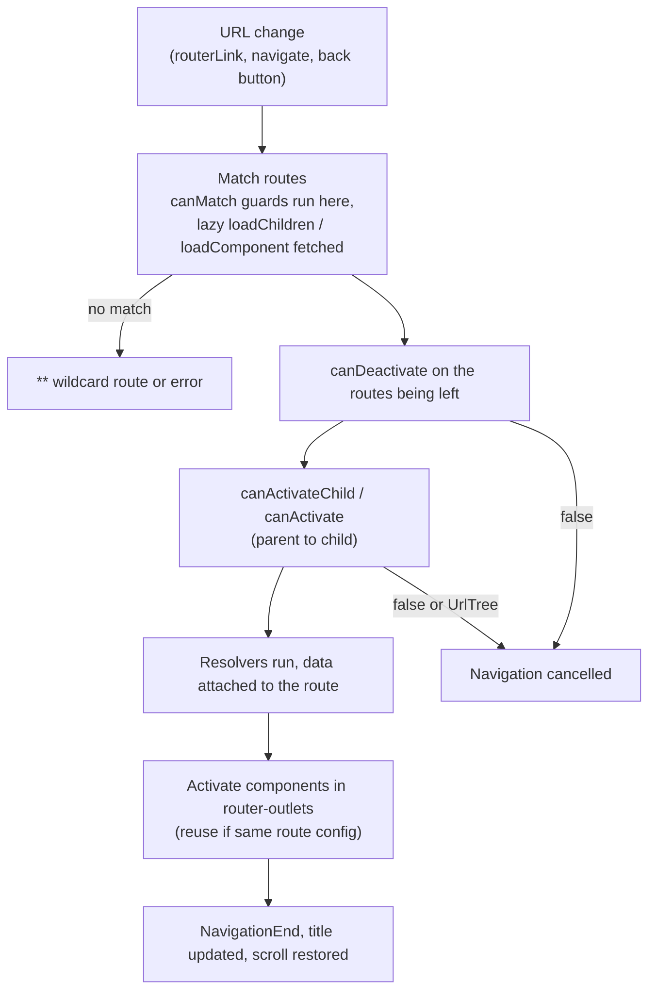

import { Tabs, TabItem, Aside } from '@astrojs/starlight/components';
import QuizBlock from '~/components/QuizBlock.astro';

## Why it matters in interviews

Every real Angular app has routing, so questions are practical: *"how do you lazy load a feature?"*, *"how do you protect a route?"*, *"canActivate vs canMatch?"*, *"how does a component read the route id?"*, *"why didn't my component reload when the id changed?"*. Interviewers also check whether you know that guards are UX, not security, and whether you've moved from class guards to functional ones.

## Core idea

The router maps a **URL** to a **tree of components** rendered into `<router-outlet>` elements. Routes are plain objects in an array passed to `provideRouter()`. On every navigation the router matches the URL against the config, runs guards and resolvers, then activates the components.

### Navigation lifecycle



Each guard returns `boolean`, a `UrlTree` (redirect), or a `RedirectCommand`, synchronously or as a Promise or Observable.

### Lazy loading

```ts
export const routes: Routes = [
  { path: '', component: Home, title: 'Home' },
  // One component, loaded on first visit
  { path: 'about', loadComponent: () => import('./about/about').then((m) => m.About) },
  // A whole feature with its own routes and providers
  {
    path: 'orders',
    canMatch: [authGuard],
    loadChildren: () => import('./orders/orders.routes').then((m) => m.ORDER_ROUTES),
  },
  { path: '**', loadComponent: () => import('./not-found/not-found').then((m) => m.NotFound) },
];
```

Each `import()` becomes a separate JS chunk that is downloaded on demand. If the file has a `default` export you can drop the `.then(...)`.

### Guards: functional and modern

| Guard | Runs | Typical use |
|---|---|---|
| `canMatch` | While matching; if false, the router tries the **next** route and its `loadChildren` chunk is **not downloaded** | Hide a feature entirely from users without access, A/B or role-based route variants |
| `canActivate` | After matching, before activating | "Must be logged in", redirect to login |
| `canActivateChild` | Before any child route activates | Protect a whole section with one guard |
| `canDeactivate` | When leaving the route | "You have unsaved changes" |
| `resolve` | After guards, before activation | Prefetch data the page cannot render without |

`canLoad` is deprecated in favour of `canMatch`. Class-based guards implementing `CanActivate` are the legacy style; the recommended form is a functional guard, a plain function that uses `inject()`. If you need to reuse an old class guard, wrap it: `canActivate: [() => inject(OldGuard).canActivate()]`.

<Aside type="caution" title="Guards are not security">
Guards run in the user's browser and can be bypassed by editing the JS or calling the API directly. They improve UX. Real protection is authorization on the API (`[Authorize]` and policies in ASP.NET Core). See [Angular security](../security/).
</Aside>

### Route parameters as inputs

With `provideRouter(routes, withComponentInputBinding())`, path params, query params, `data` and resolved values are bound to component **inputs** with the same name. The component no longer needs `ActivatedRoute`.

```ts
// route: { path: 'orders/:id', component: OrderDetail, resolve: { customer: customerResolver } }
export class OrderDetail {
  readonly id = input.required<string>();          // from :id
  readonly tab = input<string>();                  // from ?tab=lines
  readonly customer = input<Customer>();           // from the resolver
}
```

Because inputs are signals, anything derived from them (`computed`, `httpResource`) updates when the id changes, which solves the classic route-reuse problem below.

### Route reuse: "my component didn't reload"

When navigating from `/orders/1` to `/orders/2`, the route config is the same, so by default the router **reuses the component instance**: the constructor and `ngOnInit` don't run again. Code that reads `route.snapshot.paramMap.get('id')` once in `ngOnInit` shows stale data. Fixes: use signal inputs (above) and derive data from them, or subscribe to `route.paramMap` and `switchMap` to the HTTP call. A custom `RouteReuseStrategy` can also cache whole components (for example keep a list page alive when returning from a detail page), but it is advanced and easy to get wrong.

### Nested and named outlets

- **Nested routes**: a parent route has `children`; its component contains its own `<router-outlet />`. Typical for layouts: a shell with a sidebar and the child page inside.
- **Named (auxiliary) outlets**: `<router-outlet name="panel" />` with routes declaring `outlet: 'panel'`. The URL holds both, for example `/orders(panel:help)`, so a side panel can be opened independently and survives refresh.

### Preloading

Lazy loading speeds up the first load but delays navigation to a feature. Preloading downloads lazy chunks **in the background after the app is stable**: `withPreloading(PreloadAllModules)`, or a custom `PreloadingStrategy` that only preloads routes flagged with `data: { preload: true }` or those likely to be visited. Libraries such as `ngx-quicklink` preload routes whose links are visible.

### Legacy vs modern

| Legacy | Modern |
|---|---|
| `RouterModule.forRoot(routes)` | `provideRouter(routes, withX())` |
| `loadChildren` pointing at an NgModule | `loadChildren` returning `Routes`, or `loadComponent` |
| Class guards `implements CanActivate` | `CanActivateFn` functions with `inject()` |
| `canLoad` | `canMatch` |
| `ActivatedRoute` + `paramMap.subscribe` | `withComponentInputBinding()` + `input()` |
| Resolver classes `implements Resolve<T>` | `ResolveFn<T>` functions |

## Code

<Tabs>
  <TabItem label="guards.ts">

```ts
import { inject } from '@angular/core';
import { CanActivateFn, CanDeactivateFn, CanMatchFn, RedirectCommand, ResolveFn, Router } from '@angular/router';
import { AuthService } from '../core/auth.service';

export const authGuard: CanMatchFn = (route, segments) => {
  const auth = inject(AuthService);
  const router = inject(Router);
  return auth.isLoggedIn()
    ? true
    : router.createUrlTree(['/login'], { queryParams: { returnUrl: '/' + segments.join('/') } });
};

export const roleGuard = (role: string): CanActivateFn => () =>
  inject(AuthService).hasRole(role) || new RedirectCommand(inject(Router).parseUrl('/forbidden'));

export interface HasUnsavedChanges { hasUnsavedChanges(): boolean }
export const unsavedChangesGuard: CanDeactivateFn<HasUnsavedChanges> = (component) =>
  !component.hasUnsavedChanges() || confirm('Discard unsaved changes?');

export const customerResolver: ResolveFn<Customer> = (route) =>
  inject(CustomerApi).get(route.paramMap.get('customerId')!);
```

  </TabItem>
  <TabItem label="orders.routes.ts">

```ts
import { Routes } from '@angular/router';

export const ORDER_ROUTES: Routes = [
  {
    path: '',
    component: OrdersShell,              // contains <router-outlet />
    providers: [OrdersStore],            // feature-scoped instance
    canActivateChild: [roleGuard('sales')],
    children: [
      { path: '', component: OrderList, title: 'Orders' },
      {
        path: ':id',
        loadComponent: () => import('./order-detail').then((m) => m.OrderDetail),
        canDeactivate: [unsavedChangesGuard],
        resolve: { customer: customerResolver },
      },
    ],
  },
];
```

  </TabItem>
  <TabItem label="app.config.ts">

```ts
export const appConfig: ApplicationConfig = {
  providers: [
    provideRouter(
      routes,
      withComponentInputBinding(),
      withPreloading(PreloadAllModules),
      withInMemoryScrolling({ scrollPositionRestoration: 'enabled' }),
    ),
  ],
};
```

  </TabItem>
</Tabs>

## Interview Q&A

<details>
<summary>How do you lazy load in a standalone app?</summary>

`loadComponent: () => import('./x').then(m => m.X)` for a single page, or `loadChildren: () => import('./feature/feature.routes').then(m => m.ROUTES)` for a feature with child routes. The bundler emits a chunk per dynamic import, fetched on first navigation. Route-level `providers` create a feature-scoped environment injector.
</details>

<details>
<summary>`canActivate` vs `canMatch`?</summary>

`canMatch` runs during URL matching. If it returns false, the router behaves as if the route doesn't exist and tries the next one, and its `loadChildren` chunk is not downloaded. `canActivate` runs after a route matched (by then `loadChildren` config has already been fetched, because the router needs it to match child paths); returning false cancels navigation. Use `canMatch` to hide features or choose between routes with the same path, `canActivate` for "log in first".
</details>

<details>
<summary>What can a guard return?</summary>

`true` to continue, `false` to cancel, a `UrlTree` or `RedirectCommand` to redirect, or a Promise or Observable resolving to one of those. Returning a `UrlTree` is better than calling `router.navigate()` inside the guard, because the router treats it as one redirected navigation.
</details>

<details>
<summary>How does a component read route parameters?</summary>

Modern: enable `withComponentInputBinding()` and declare `id = input<string>()`; params, query params, data and resolver results bind to matching inputs. Classic: inject `ActivatedRoute` and use `paramMap` (observable) or `snapshot.paramMap` (one-off). The snapshot is wrong if the component can be reused for another id.
</details>

<details>
<summary>Navigating from `/products/1` to `/products/2` doesn't refresh the page data. Why?</summary>

The router reuses the component instance when only params change, so `ngOnInit` doesn't run again. Code reading the snapshot once keeps showing product 1. Derive the data from the param reactively: a signal input feeding `httpResource`, or `paramMap.pipe(switchMap(...))`.
</details>

<details>
<summary>Resolver or load in the component?</summary>

A resolver delays navigation until data arrives, so the page renders complete but the user sees nothing happen on slow networks, and an error blocks navigation. Loading in the component (with a resource) shows the page shell and a skeleton immediately. Many teams prefer component loading and keep resolvers for small, critical data such as the entity the page cannot render without.
</details>

<details>
<summary>What is a preloading strategy?</summary>

It controls whether lazy routes are downloaded in the background after the initial load. `NoPreloading` is the default; `PreloadAllModules` loads every lazy route; a custom `PreloadingStrategy` can preload selectively (by a `data` flag, by user role, or when the network is fast). It trades bandwidth for faster later navigation.
</details>

<details>
<summary>Are route guards enough to secure admin pages?</summary>

No. They only control navigation in the client and can be bypassed. The API must authorize every request. Guards improve UX by not showing pages the user cannot use; with `canMatch` they also avoid downloading that code.
</details>

## Pitfalls

<Aside type="caution" title="Common mistakes">

- Reading `route.snapshot` once and getting stale data when the component is reused for a new param.
- Putting the `**` wildcard route before other routes; the router uses the first match, so order matters.
- Using `canActivate` on a `loadChildren` route expecting the feature chunk not to download; the router loads child routes while matching, so use `canMatch`.
- Calling `router.navigate()` inside a guard instead of returning a `UrlTree`.
- Heavy resolvers that make navigation feel frozen with no feedback.
- Treating guards as the security boundary.
- Forgetting `pathMatch: 'full'` on an empty-path redirect, which then matches every URL.

</Aside>

## Related

- [Dependency injection: route-level providers](../dependency-injection/)
- [Resources and httpResource](../resources/)
- [Performance: lazy loading and @defer](../performance/)
- [Angular security](../security/)

## Quick quiz

<QuizBlock section="angular" topic="routing" />
