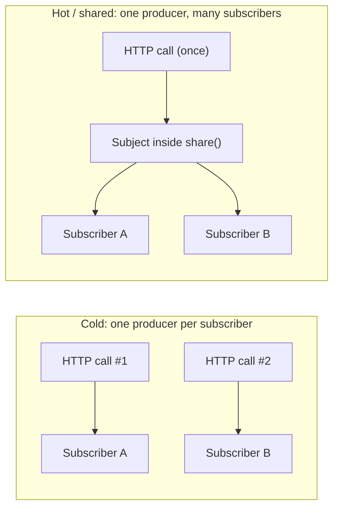

import { Tabs, TabItem, Aside } from '@astrojs/starlight/components';
import QuizBlock from '~/components/QuizBlock.astro';

## Why it matters in interviews

*"Observable vs Promise?"*, *"BehaviorSubject vs ReplaySubject?"*, *"How do you avoid memory leaks from subscriptions?"* are standard Angular screening questions. Even with signals everywhere, `HttpClient`, the router, forms and most libraries still speak RxJS, and interviewers want to hear that you know **when** a stream starts, **who** gets values, and **when** it stops.

## Core idea

An `Observable` is a **lazy function that can push zero or more values over time**, then optionally complete or error. Nothing runs until `subscribe()` is called. Subscribing returns a `Subscription` whose `unsubscribe()` runs the teardown logic (cancel the HTTP call, clear the timer, remove the listener).

The contract: `next*` then at most one of `error` or `complete`. After `error` or `complete`, the stream is **closed** and emits nothing more.

```ts
const ticks$ = new Observable<number>((subscriber) => {
  let i = 0;
  const id = setInterval(() => subscriber.next(i++), 1000);
  return () => clearInterval(id); // teardown, runs on unsubscribe/complete/error
});

const sub = ticks$.subscribe({ next: (v) => console.log(v), error: console.error, complete: () => console.log('done') });
sub.unsubscribe(); // stops the interval
```

### Observable vs Promise

| | Promise | Observable |
|---|---|---|
| Values | Exactly one (or rejection) | Zero, one or many over time |
| Eager or lazy | **Eager**: work starts when created | **Lazy**: work starts on subscribe |
| Cancellable | No (needs `AbortController`) | Yes, `unsubscribe()` runs teardown |
| Multiple consumers | Share the same result | Each subscriber runs the producer again (cold) unless shared |
| Operators | `then` chaining | 100+ composable operators |
| Delivery | Always async (microtask) | Sync or async, depends on the source |

Bridge with `firstValueFrom(obs$)` / `lastValueFrom(obs$)` (RxJS 7; `toPromise()` is deprecated) and `from(promise)`.

### Cold vs hot

- **Cold**: the producer is created **per subscriber**. `HttpClient`, `of`, `from`, `interval`, `timer` are cold. Two subscribers to `http.get()` send two requests.
- **Hot**: the producer exists **independently** of subscribers and is shared. DOM events via `fromEvent`, a `Subject`, router events. Late subscribers miss earlier values.

You turn cold into hot (multicast) with `share()` or `shareReplay()`, which put a `Subject` between the source and subscribers.



### Subjects

A `Subject` is both an Observable and an Observer: you can call `next()` on it and subscribe to it. It is **hot** and **multicast**.

| Type | Initial value? | What a late subscriber gets | Typical use |
|---|---|---|---|
| `Subject` | No | Only future values | Event bus, "save clicked" |
| `BehaviorSubject` | **Yes, required** | The **current** value, then future ones. Has `.value` / `getValue()` | Current state (logged-in user, filters) |
| `ReplaySubject(n, windowMs?)` | No | The last `n` values (optionally within a time window) | Cache last N messages |
| `AsyncSubject` | No | Only the **last** value, and only after `complete()` | Rare; one final result |

In new Angular code, **component and service state is usually a `signal`**, not a `BehaviorSubject`. Subjects remain the right tool for **events** and for streams that need time-based operators (debounce, switchMap). Expose them read-only: `readonly saved$ = this.savedSubject.asObservable()`.

### Subscription management

Every `subscribe()` that can outlive its component is a potential leak: the closure keeps the component alive and the callback keeps running on a destroyed view. Options, best first:

1. **Don't subscribe manually.** Use the `async` pipe or `toSignal()`. Both unsubscribe automatically when the view or injection context is destroyed.
2. **`takeUntilDestroyed()`** (from `@angular/core/rxjs-interop`, introduced in v16) for manual subscriptions. In a constructor or field initialiser it injects `DestroyRef` itself. Elsewhere (for example `ngOnInit`), pass it: `takeUntilDestroyed(this.destroyRef)`.
3. **Finite streams** (`HttpClient`, `first()`, `take(1)`) complete on their own, but a pending request can still call back after destroy. Usually harmless, sometimes not (navigation in the callback).
4. Legacy: a `destroy$` Subject with `takeUntil(this.destroy$)` in `ngOnDestroy`. Works, but more boilerplate.

Rule: put `takeUntilDestroyed()` / `takeUntil` **last** in the pipe. Operators after it (like `switchMap` to an inner interval) can keep inner subscriptions alive.

### Errors and completion

An error **terminates** the stream. If a `catchError` returns a fallback at the outer level, the outer stream completes after the fallback. That is why in an effect-like stream (`clicks$.pipe(switchMap(() => http...))`) you catch **inside** the inner observable, so one failed request does not kill the click stream forever. Details in [RxJS operators](../rxjs-operators/).

## Code

<Tabs>
  <TabItem label="Component">
```ts
@Component({
  selector: 'app-notifications',
  template: `
    <h3>{{ user()?.name }}</h3>
    @for (n of notifications$ | async; track n.id) {
      <p>{{ n.text }}</p>
    }
  `,
  imports: [AsyncPipe],
})
export class NotificationsComponent {
  private auth = inject(AuthService);
  private hub = inject(NotificationHub);

  user = toSignal(this.auth.user$, { initialValue: null }); // auto-unsubscribes
  notifications$ = this.hub.messages$;                       // async pipe unsubscribes

  constructor() {
    // Manual subscription for a side effect: clean up with takeUntilDestroyed.
    this.hub.connectionLost$
      .pipe(takeUntilDestroyed())
      .subscribe(() => console.warn('Realtime connection lost'));
  }
}
```
  </TabItem>
  <TabItem label="Service with subjects">
```ts
@Injectable({ providedIn: 'root' })
export class CartEvents {
  // Event stream: no "current value", so a plain Subject.
  private itemAdded = new Subject<CartItem>();
  readonly itemAdded$ = this.itemAdded.asObservable();

  // Latest-value stream for RxJS consumers; prefer a signal for template state.
  private filters = new BehaviorSubject<Filters>({ text: '', page: 1 });
  readonly filters$ = this.filters.asObservable();

  add(item: CartItem) { this.itemAdded.next(item); }
  setFilters(f: Partial<Filters>) { this.filters.next({ ...this.filters.value, ...f }); }
}
```
  </TabItem>
</Tabs>

**What gets logged?** (a favourite whiteboard question)

```ts
const s = new BehaviorSubject(0);
s.next(1);
s.subscribe((v) => console.log('A', v)); // A 1   (current value)
s.next(2);                               // A 2
const r = new ReplaySubject(2);
[1, 2, 3].forEach((v) => r.next(v));
r.subscribe((v) => console.log('B', v)); // B 2, B 3 (last two)
console.log('sync end');
// Order: A 1, A 2, B 2, B 3, sync end  (subjects deliver synchronously)
```

## Interview Q&A

<details>
<summary>Observable vs Promise: which would you use for an HTTP call in Angular?</summary>

`HttpClient` already returns an observable, and that buys cancellation (switchMap, unsubscribe on destroy), retry with operators, and composition. A promise is eager, single-valued and not cancellable. For a one-shot call in an `async` function, `firstValueFrom(http.get(...))` is fine. For signal-first components, `httpResource` or `toSignal` are now common.
</details>

<details>
<summary>What is the difference between cold and hot observables? Give Angular examples.</summary>

Cold observables create their producer per subscriber: `HttpClient`, `of`, `interval`. Hot observables share an existing producer: `fromEvent` on a DOM element, Subjects, `router.events`. A cold stream becomes hot (shared) with `share()` / `shareReplay()`.
</details>

<details>
<summary>BehaviorSubject vs ReplaySubject(1)?</summary>

Both replay the latest value to new subscribers. `BehaviorSubject` **requires an initial value**, always has a current value and exposes it synchronously via `.value`. `ReplaySubject(1)` has no initial value, so a subscriber gets nothing until the first `next`. Use `BehaviorSubject` for state with a sensible default, `ReplaySubject(1)` when "no value yet" must be distinguishable.
</details>

<details>
<summary>How do you prevent subscription memory leaks in modern Angular?</summary>

Avoid manual subscriptions where possible (`async` pipe, `toSignal`). For the rest, use `takeUntilDestroyed()` in an injection context or `takeUntilDestroyed(destroyRef)` elsewhere, placed last in the pipe. Long-lived streams (intervals, websockets, store selections, `valueChanges`) are the ones that leak; finite HTTP calls complete on their own.
</details>

<details>
<summary>Does the `async` pipe unsubscribe? What else does it do?</summary>

Yes. It subscribes when the view is created, stores the latest value, **marks the view for check** on each emission (so it works with OnPush), and unsubscribes on destroy or when the bound observable reference changes. Details in [Directives & Pipes](../directives-pipes/).
</details>

<details>
<summary>Can a stream emit after `error`?</summary>

No. `error` and `complete` are terminal. To keep a long-lived stream alive after a failure, handle errors in the inner observable (`switchMap(() => http.get().pipe(catchError(...)))`) or use `retry`, which resubscribes to the source.
</details>

<details>
<summary>Signals or BehaviorSubject for service state in 2026?</summary>

Signals for synchronous state the template reads: no subscriptions, fine-grained change detection, works zoneless. RxJS for **events over time** and async orchestration (debounce, cancellation, websockets). Bridge with `toSignal` / `toObservable`. See [Signals](../signals/).
</details>

## Pitfalls

<Aside type="caution" title="Common mistakes">
- **Subscribing in a component without cleanup** to `interval`, `valueChanges`, a store or a websocket.
- **`takeUntil` not last** in the pipe, so inner subscriptions created after it survive destroy.
- **Exposing a Subject publicly**, letting any consumer call `next()`. Expose `asObservable()`.
- **Nested subscribes** (`subscribe` inside `subscribe`) instead of a flattening operator: no cancellation, hard error handling.
- **Assuming Subjects are async.** `next()` delivers synchronously to current subscribers.
- **Two `async` pipes on one HTTP observable** sends two requests. Use one `@let`/`toSignal` or `shareReplay`.
</Aside>

## Related

- [RxJS operators](../rxjs-operators/)
- [Signals deep dive](../signals/)
- [HttpClient & interceptors](../http-interceptors/)
- [Event loop, promises & async](../../web/js-event-loop/)

## Quick quiz

<QuizBlock section="angular" topic="rxjs-basics" />
