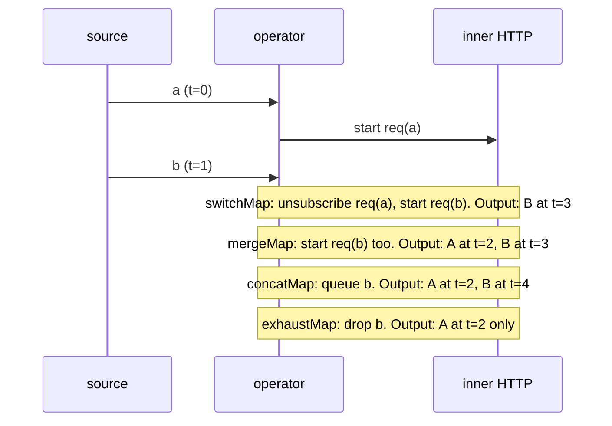
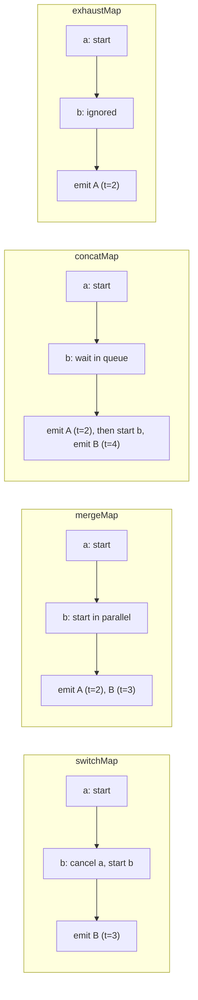

import { Tabs, TabItem, Aside } from '@astrojs/starlight/components';
import QuizBlock from '~/components/QuizBlock.astro';

## Why it matters in interviews

*"switchMap vs mergeMap vs concatMap vs exhaustMap"* is the single most asked RxJS question. Expect a follow-up like *"which one for a search box, a save button, a file queue?"* and a coding task: a debounced typeahead. Interviewers also probe `forkJoin` vs `combineLatest` and **where to put `catchError`**.

## Core idea

Operators are pure functions that take an observable and return a new one. You chain them with `pipe()`. Most are simple (`map`, `filter`, `tap`). The interesting ones are **higher-order mapping (flattening) operators**: each source value is mapped to an **inner observable** (usually an HTTP call), and the operator decides what to do when a new source value arrives while an inner one is still running.

### The four flattening operators

| Operator | When a new value arrives while inner is active | Order of results | Use for |
|---|---|---|---|
| `switchMap` | **Cancels** the previous inner, starts the new one | Only latest | Search/typeahead, route param → load details |
| `mergeMap` | Runs **all in parallel** (optional `concurrent` limit) | As they complete | Independent writes, fire many requests |
| `concatMap` | **Queues**; starts next after previous completes | Source order | Ordered saves, upload queue |
| `exhaustMap` | **Ignores** new values until current completes | First wins | Login / submit button, refresh trigger |

### Marble timelines

Source emits `a` at t=0 and `b` at t=1. Each inner request takes 2 time units, so `a` would finish at t=2 and `b` at t=3.



The same idea as a timeline per operator:



**How to choose, in one sentence each:** if only the latest result matters, `switchMap`. If every result matters and order does not, `mergeMap`. If every result matters and order does, `concatMap`. If duplicates while busy should be ignored, `exhaustMap`.

<Aside type="note" title="switchMap on writes">
`switchMap` cancels the **client** subscription, but a POST that already reached the server **still runs** there. Using `switchMap` for saves can leave the UI showing an older state than the database. Use `concatMap` or `exhaustMap` for writes.
</Aside>

### Combination operators

| Operator | Emits when | Completes when | Typical use |
|---|---|---|---|
| `forkJoin([a$, b$])` | **Once**, with the **last** value of each, after **all complete** | After that emission | Parallel HTTP calls (like `Promise.all` / `Task.WhenAll`) |
| `combineLatest([a$, b$])` | Every time **any** source emits, after **each has emitted at least once** | When all complete | Filters + data, derived view models |
| `withLatestFrom(b$)` | Only when the **source** emits, taking b's latest | With the source | "On save click, read the current form" |
| `zip(a$, b$)` | Pairs values by **index** (1st with 1st, 2nd with 2nd) | When any completes and its buffer is used | Rare; pairing requests with responses |

Gotchas: `forkJoin` never emits if any source never completes (a `BehaviorSubject`, `valueChanges`), and it errors as soon as one source errors. `combineLatest` waits silently until every source has emitted once, so seed sources with `startWith` when needed.

### Error handling placement

`catchError` replaces the errored stream with the one you return. **Where** you put it matters:

```ts
// BAD: the error kills the outer stream. After one failed search, typing does nothing.
search$.pipe(switchMap((q) => api.search(q)), catchError(() => of([])));

// GOOD: the inner request fails and is replaced; the outer stream keeps living.
search$.pipe(switchMap((q) => api.search(q).pipe(catchError(() => of([])))));
```

`retry({ count: 3, delay: 1000 })` resubscribes to the source on error. For HTTP that means re-sending the request, so retry only idempotent calls.

### Sharing: share and shareReplay

`shareReplay({ bufferSize: 1, refCount: true })` multicasts one subscription and replays the last value to late subscribers. With `refCount: false` (the default for the `shareReplay(1)` shorthand), the source subscription stays alive **even after all subscribers leave**, which is a leak for infinite sources but exactly what you want for an app-lifetime cache of a completed HTTP call.

### scan: state over time

`scan` is `reduce` that emits every intermediate accumulator. It is the RxJS way to build a running total or a mini store.

## Code

<Tabs>
  <TabItem label="Typeahead">
```ts
@Component({
  selector: 'app-product-search',
  template: `
    <input [formControl]="query" placeholder="Search products" />
    @for (p of results(); track p.id) { <li>{{ p.name }}</li> }
  `,
  imports: [ReactiveFormsModule],
})
export class ProductSearchComponent {
  private api = inject(ProductApi);
  query = new FormControl('', { nonNullable: true });

  results = toSignal(
    this.query.valueChanges.pipe(
      map((q) => q.trim()),
      debounceTime(300),          // wait for a typing pause
      distinctUntilChanged(),     // skip if the text did not change
      filter((q) => q.length >= 2),
      switchMap((q) =>            // cancel the previous request
        this.api.search(q).pipe(catchError(() => of([] as Product[]))),
      ),
    ),
    { initialValue: [] as Product[] },
  );
}
```
  </TabItem>
  <TabItem label="Save button">
```ts
// exhaustMap: double-clicks while saving are ignored.
this.saveClicks$
  .pipe(
    withLatestFrom(this.form$),
    exhaustMap(([, form]) =>
      this.api.save(form).pipe(catchError((e) => { this.toast.error(e); return EMPTY; })),
    ),
    takeUntilDestroyed(this.destroyRef),
  )
  .subscribe(() => this.toast.ok('Saved'));
```
  </TabItem>
  <TabItem label="Parallel + combine">
```ts
// forkJoin: load a dashboard once, all calls in parallel.
const dashboard$ = forkJoin({
  user: api.getUser(),
  orders: api.getOrders(),
  stats: api.getStats(),
});

// combineLatest: re-filter whenever data OR filter changes.
const visible$ = combineLatest([orders$, filter$.pipe(startWith('all'))]).pipe(
  map(([orders, f]) => (f === 'all' ? orders : orders.filter((o) => o.status === f))),
);

// scan: running total of cart changes.
const total$ = cartChanges$.pipe(scan((sum, c) => sum + c.qty * c.price, 0));
```
  </TabItem>
</Tabs>

**What is logged?**

```ts
of(1, 2, 3)
  .pipe(
    concatMap((x) => of(x * 10).pipe(delay(30 - x * 10))),
  )
  .subscribe(console.log);
// 10, 20, 30: concatMap keeps source order even though 3 finishes fastest.
// With mergeMap: 30, 20, 10 (completion order).
```

## Interview Q&A

<details>
<summary>Which flattening operator for a search box, a save button, sequential uploads, and loading several items in parallel?</summary>

Search box: `switchMap` (only the latest query matters, cancel stale ones). Save button: `exhaustMap` (ignore double clicks) or `concatMap` (queue every save). Sequential uploads: `concatMap`. Parallel loads: `mergeMap`, often with a concurrency limit, e.g. `mergeMap(fn, 4)`.
</details>

<details>
<summary>forkJoin vs combineLatest?</summary>

`forkJoin` waits for **all sources to complete** and emits once with their last values: ideal for parallel HTTP calls. `combineLatest` emits every time any source emits (after all have emitted once): ideal for streams that keep changing, like filters plus data. `forkJoin` on a never-completing source never emits.
</details>

<details>
<summary>Why does my typeahead stop working after one failed request?</summary>

`catchError` is on the outer stream, so the error terminated the `valueChanges` pipeline and `catchError` replaced it with a completed fallback. Move `catchError` inside the `switchMap` so only the inner request is replaced.
</details>

<details>
<summary>What do `debounceTime` and `distinctUntilChanged` do in a typeahead?</summary>

`debounceTime(300)` emits only after 300 ms of silence, so you send one request per typing pause instead of one per keystroke. `distinctUntilChanged()` drops a value equal to the previous emission, so "abc" → "abcd" → "abc" within a pause does not refire.
</details>

<details>
<summary>`shareReplay(1)` vs `shareReplay({ bufferSize: 1, refCount: true })`?</summary>

With `refCount: true`, when the subscriber count drops to zero the source subscription is torn down, and a later subscriber triggers a fresh subscription. Without it, the source stays subscribed forever. Use `refCount: true` for infinite sources (websocket, interval), and the default for a cached one-shot HTTP response you want to keep.
</details>

<details>
<summary>withLatestFrom vs combineLatest?</summary>

`combineLatest` emits when **any** input emits. `withLatestFrom` emits only when the **source** emits, sampling the other's latest value without being triggered by it. Use it for "on click, take the current state".
</details>

<details>
<summary>How would you implement retry with exponential backoff?</summary>

`retry({ count: 3, delay: (err, n) => timer(2 ** n * 250) })`. Return `throwError(() => err)` from `delay` for errors that should not be retried (4xx). Only retry idempotent operations.
</details>

<details>
<summary>Implement a running total from a stream of numbers.</summary>

`numbers$.pipe(scan((acc, n) => acc + n, 0))`. Unlike `reduce`, `scan` emits after every value, so it works on infinite streams.
</details>

## Pitfalls

<Aside type="caution" title="Common mistakes">
- **`switchMap` for writes**: the server still processes the "cancelled" POST, so UI and data can disagree.
- **`catchError` on the outer stream** of a long-lived pipeline, killing it after the first failure.
- **`forkJoin` with a never-completing source** such as a `BehaviorSubject` or `valueChanges`: nothing is ever emitted.
- **`mergeMap` without a concurrency limit** firing hundreds of parallel requests.
- **`shareReplay(1)` on an infinite source** without `refCount: true`, which keeps it subscribed forever.
- **Nested subscribes** instead of a flattening operator.
</Aside>

## Related

- [RxJS fundamentals](../rxjs-basics/)
- [HttpClient & interceptors](../http-interceptors/)
- [Angular scenario questions](../angular-scenarios/)
- [Angular live coding](../../dsa/angular-live-coding/)

## Quick quiz

<QuizBlock section="angular" topic="rxjs-operators" />
