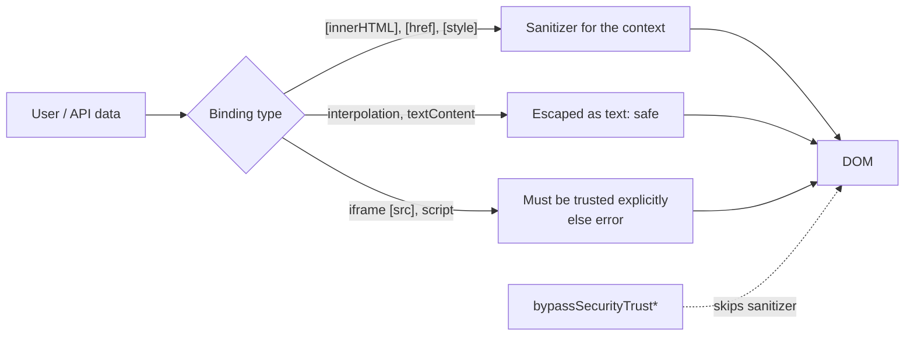

import { Tabs, TabItem, Aside } from '@astrojs/starlight/components';
import QuizBlock from '~/components/QuizBlock.astro';

## Why it matters in interviews

*"How does Angular protect against XSS?"*, *"What does `bypassSecurityTrustHtml` do and when is it dangerous?"*, *"Where do you store the JWT?"* and *"Is a route guard enough to protect admin pages?"* are asked in both Angular and security rounds. The strong answer explains what Angular does **automatically**, what it **cannot** do, and what the **server** must do.

## Core idea

### Angular treats every bound value as untrusted

Interpolation (`{{ value }}`) and property binding to text are always **escaped**: `<script>` becomes the literal text `&lt;script&gt;`. When you bind into a context that **interprets** markup or URLs, Angular **sanitizes** the value according to the security context:

| Security context | Example binding | What Angular does |
|---|---|---|
| HTML | `[innerHTML]="comment"` | Strips dangerous elements/attributes (`script`, `onerror`, `javascript:` links), keeps safe markup |
| Style | `[style.background]="x"` | Allows CSS values; dangerous constructs are blocked |
| URL | `[href]="link"`, `[src]` on `img` | Allows `http(s)`, `mailto`, relative etc.; unsafe URLs such as `javascript:` are prefixed with `unsafe:` |
| Resource URL | `[src]` on `iframe`, `script` | **No sanitization possible**; Angular throws unless the value is explicitly trusted |

Sanitization logs a warning in dev mode ("sanitizing HTML stripped some content"). That warning is a signal to review the data flow, not to silence it.



### DomSanitizer and bypassSecurityTrust*

`DomSanitizer` offers `bypassSecurityTrustHtml`, `...Style`, `...Script`, `...Url` and `...ResourceUrl`. They wrap a value in a `SafeValue` object that tells Angular **"I have checked this, don't sanitize it"**. Angular does no checking at all, so if the input contains user-controlled data you have just written an XSS hole.

Legitimate uses: embedding a YouTube iframe URL **built from a validated video id**, rendering HTML your own trusted CMS pipeline already sanitized on the server. Safer alternative when you need to clean but keep some HTML: `sanitizer.sanitize(SecurityContext.HTML, value)`, or a dedicated library like DOMPurify before binding.

### Ways to bypass Angular's protection (avoid)

- `ElementRef.nativeElement.innerHTML = userInput` or `Renderer2.setProperty(el, 'innerHTML', ...)`: direct DOM APIs skip the template sanitizer.
- Building templates from user input and compiling them at runtime (template injection). Angular templates are compiled ahead of time; never generate them from data.
- `bypassSecurityTrust*` on anything user-influenced.
- Third-party libraries that write raw HTML (some rich text, chart tooltip and markdown libraries).

### CSRF / XSRF

CSRF matters when authentication is in **cookies**, because browsers send cookies automatically on cross-site requests. `HttpClient` has built-in support for the **double-submit cookie** pattern:

1. The server sets a readable cookie `XSRF-TOKEN`.
2. For **mutating** requests (POST, PUT, PATCH, DELETE) to **relative / same-origin URLs**, `HttpClient` copies it into the `X-XSRF-TOKEN` header.
3. The server checks that header matches. An attacker's site can't read your cookie, so it can't set the header.

Names are configurable with `withXsrfConfiguration({ cookieName, headerName })` in `provideHttpClient`. ASP.NET Core antiforgery can be configured to use the same names. With bearer tokens in an `Authorization` header (not cookies), classic CSRF does not apply, but XSS becomes the main risk to the token.

### CSP and Trusted Types

A **Content Security Policy** header limits where scripts can come from, so injected inline scripts don't run. Angular supports a nonce for its inline styles via the `ngCspNonce` attribute on the root element or the `CSP_NONCE` injection token. The CLI also has an option to generate a hash-based CSP automatically (`autoCsp`). Angular is compatible with **Trusted Types**, a browser feature that forces DOM sinks like `innerHTML` to accept only typed, vetted values.

### Tokens and route guards

- **Token storage**: `localStorage` is readable by any script on the page, so an XSS steals the token. Safer options: keep the access token **in memory** with a short lifetime and the refresh token in an **HttpOnly, Secure, SameSite** cookie, or use a **BFF** (backend for frontend) so the SPA only holds a session cookie. Details in [Sessions, JWT & refresh tokens](../../security/authn-authz-tokens/).
- **Route guards are UX, not security.** All client code can be read and modified in DevTools. A guard hides the admin page, but the **API must authorise every request** (policies, roles, resource checks). Hiding a button is never access control.

## Code

<Tabs>
  <TabItem label="Safe vs unsafe">
```ts
@Component({
  selector: 'app-comment',
  template: `
    <p>{{ comment().text }}</p>                 <!-- escaped: always safe -->
    <div [innerHTML]="comment().html"></div>    <!-- sanitized: safe markup kept -->
    <iframe [src]="videoUrl()" title="Product video"></iframe>
  `,
})
export class CommentComponent {
  private sanitizer = inject(DomSanitizer);
  comment = input.required<{ text: string; html: string }>();
  videoId = input.required<string>();

  // Resource URL needs explicit trust. Validate first, then build the URL yourself.
  videoUrl = computed(() => {
    const id = this.videoId();
    if (!/^[\w-]{11}$/.test(id)) throw new Error('Invalid video id');
    return this.sanitizer.bypassSecurityTrustResourceUrl(`https://www.youtube-nocookie.com/embed/${id}`);
  });
}
```
  </TabItem>
  <TabItem label="Vulnerable">
```ts
// DON'T: each of these lets user content run script.
export class BadComponent {
  private el = inject(ElementRef);
  private sanitizer = inject(DomSanitizer);
  html = input.required<string>();

  render() {
    this.el.nativeElement.innerHTML = this.html();                // skips sanitizer
  }
  trusted = computed(() => this.sanitizer.bypassSecurityTrustHtml(this.html())); // trusts user input
}
```
  </TabItem>
  <TabItem label="XSRF config">
```ts
export const appConfig: ApplicationConfig = {
  providers: [
    provideHttpClient(
      withFetch(),
      withXsrfConfiguration({ cookieName: 'XSRF-TOKEN', headerName: 'X-XSRF-TOKEN' }),
    ),
  ],
};
// ASP.NET Core side (sketch): services.AddAntiforgery(o => o.HeaderName = "X-XSRF-TOKEN");
// and issue the XSRF-TOKEN cookie (HttpOnly = false) so Angular can read it.
```
  </TabItem>
</Tabs>

## Interview Q&A

<details>
<summary>How does Angular prevent XSS by default?</summary>

It treats all bound values as untrusted. Interpolation is escaped as text. Bindings into HTML, style and URL contexts are sanitized for that context; resource URLs (iframe/script `src`) are rejected unless explicitly trusted. Templates are compiled ahead of time, so user data never becomes template code.
</details>

<details>
<summary>What does `bypassSecurityTrustHtml` actually do?</summary>

It wraps the string in a `SafeHtml` marker so Angular skips sanitization. It performs **no** validation. Use it only for content you control or have sanitized yourself, never for raw user input.
</details>

<details>
<summary>Is `[innerHTML]` safe?</summary>

With Angular's binding, yes for most purposes: it sanitizes and strips scripts and event handler attributes. It becomes unsafe if you pass a bypassed `SafeHtml` of user content, or if you set `innerHTML` directly through `ElementRef`/`Renderer2`.
</details>

<details>
<summary>How does Angular help with CSRF?</summary>

`HttpClient` reads the `XSRF-TOKEN` cookie and sends it as `X-XSRF-TOKEN` on mutating requests to same-origin URLs. The server validates it. It only helps if the server issues and validates the token, and it does not send the header to absolute cross-origin URLs.
</details>

<details>
<summary>Where would you store a JWT in an Angular SPA?</summary>

Avoid `localStorage` for long-lived tokens because any XSS can read it. Prefer a short-lived access token in memory plus a refresh token in an HttpOnly, Secure, SameSite cookie, or a BFF where the browser only has a session cookie and the server holds tokens. Whatever you choose, preventing XSS matters most.
</details>

<details>
<summary>Is a CanActivate guard enough to protect an admin area?</summary>

No. Guards run in the browser and can be bypassed or the API called directly. They improve UX (don't show pages the user can't use). Security is enforced by the API authorising every request on the server.
</details>

<details>
<summary>How do CSP and Angular work together?</summary>

CSP restricts script sources so injected inline script won't execute. Angular needs a nonce for its inline styles (`ngCspNonce` or `CSP_NONCE`), and the CLI can generate a hash-based CSP for the index page (`autoCsp`). Combine CSP with Trusted Types for defence in depth.
</details>

## Pitfalls

<Aside type="caution" title="Common mistakes">
- **`bypassSecurityTrust*` to silence a sanitizer warning** without understanding the source of the data.
- **Writing to `nativeElement.innerHTML`** or using libraries that inject raw HTML.
- **Long-lived tokens in `localStorage`** in an app that also renders user content.
- **Relying on guards or hidden buttons** for authorisation.
- **Turning off XSRF** (`withNoXsrfProtection()`) while using cookie auth.
- **Sending secrets in the bundle** (API keys in `environment.ts` are public).
</Aside>

## Related

- [SQLi, XSS, CSRF, CORS & SSRF](../../security/web-attacks/)
- [Sessions, JWT & refresh tokens](../../security/authn-authz-tokens/)
- [HttpClient & interceptors](../http-interceptors/)
- [Routing (guards)](../routing/)

## Quick quiz

<QuizBlock section="angular" topic="security" />
