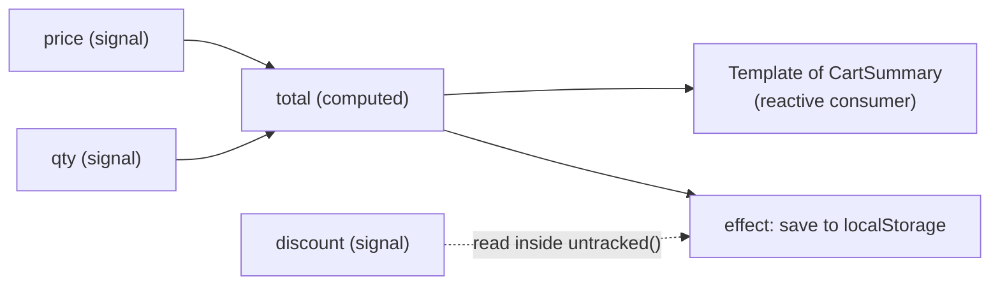

import { Tabs, TabItem, Aside } from '@astrojs/starlight/components';
import QuizBlock from '~/components/QuizBlock.astro';

## Why it matters in interviews

Signals are the centre of modern Angular: inputs, queries, forms, resources and zoneless change detection are all built on them. Interviewers ask *"what is a signal?"*, *"computed vs effect?"*, *"when would you still use RxJS?"* and, at 3-4 years, *"why shouldn't you use an effect to copy one signal into another?"*. Being able to explain the dependency graph is what makes the answer sound senior.

## Core idea

A **signal** is a wrapper around a value that **knows who reads it**. Reading it (`count()`) inside a reactive context registers a dependency; writing it (`set` / `update`) notifies the dependents. Angular uses that to recompute derived values and to refresh exactly the views that use them.

```ts
const price = signal(100);              // WritableSignal<number>
const qty = signal(2);
const total = computed(() => price() * qty()); // Signal<number>, read-only

effect(() => console.log('total is', total())); // side effect

qty.set(3);              // total becomes 300, the effect logs once (asynchronously)
price.update((p) => p + 10);
```

### The reactive graph



How it works internally, in the "push dirty, pull value" model:

1. **Tracking.** While a `computed`, `effect` or template runs, Angular records every signal it reads. Dependencies are **dynamic**: if a branch isn't taken, its signals aren't tracked in that run.
2. **Push.** On `set`, the signal bumps its version and marks its consumers as *possibly stale*. Nothing is recomputed yet.
3. **Pull.** When someone reads `total()`, it checks whether any producer's version actually changed and only then recomputes. If nobody reads it, it never recomputes: computed signals are **lazy** and **memoised**.
4. **Glitch-free.** Because values are pulled after all writes, a consumer never sees a half-updated state (for example `price` new but `total` old).
5. **Equality.** A signal only notifies when the new value is different by its `equal` function, `Object.is` by default. A computed that recomputes to an equal value does not notify its own consumers.

### The API

| API | What it is | Notes |
|---|---|---|
| `signal(v)` | Writable state | `set`, `update`, `asReadonly()`. Optional `{ equal }` |
| `computed(fn)` | Derived, read-only | Lazy, memoised, dynamic deps. Must be pure: no writes, no side effects |
| `effect(fn)` | Side effect that re-runs when its deps change | Needs an injection context; scheduled, not synchronous; `onCleanup` callback |
| `linkedSignal(...)` | Writable signal that **resets** when a source changes | Stable since v20. For "derived default the user can override" |
| `untracked(fn)` | Read signals without creating a dependency | Use inside effects to read context-only values |
| `toSignal(obs$)` | Observable to signal | Subscribes immediately; unsubscribes on destroy; needs `initialValue` or `requireSync` to avoid `undefined` |
| `toObservable(sig)` | Signal to Observable | Emits via an effect, so asynchronously and only the settled value |

### linkedSignal

A classic case: a dropdown whose selected value defaults to the first option, but the user can change it, and it must reset when the list of options changes.

```ts
readonly shippingOptions = input.required<ShippingOption[]>();

// Writable, but recomputed whenever shippingOptions changes.
readonly selected = linkedSignal(() => this.shippingOptions()[0]);

// Advanced form: keep the previous choice if it still exists.
readonly selectedKeep = linkedSignal<ShippingOption[], ShippingOption>({
  source: this.shippingOptions,
  computation: (opts, previous) =>
    opts.find((o) => o.id === previous?.value.id) ?? opts[0],
});
```

Before `linkedSignal`, people wrote an `effect` that set a signal whenever the input changed, which is exactly the anti-pattern below.

### Effects: what they are for

Effects are for **syncing signal state to the outside world**: localStorage, logging, analytics, a non-Angular chart, the document title. They are not for propagating state between signals.

- Effects created in a component are tied to its lifetime and destroyed with it; effects in a root service live as long as the app.
- They run at least once, then whenever a tracked dependency changes, **batched**: setting three signals in a row triggers one run.
- Since v19, writing signals inside an effect is allowed by default (the old `allowSignalWrites` flag is no longer needed). Allowed does not mean recommended.
- `afterRenderEffect` is the variant for DOM work that must run after rendering.

<Aside type="caution" title="Anti-pattern: effects to sync state">

```ts
// Bad: two sources of truth, an extra CD round, possible loops
effect(() => this.fullName.set(`${this.first()} ${this.last()}`));

// Good: derived state is computed
readonly fullName = computed(() => `${this.first()} ${this.last()}`);
```
If the derived value must also be writable, use `linkedSignal`. If it is async, use a [resource](../resources/).

</Aside>

### Signals vs RxJS

| Need | Use | Why |
|---|---|---|
| Component or service **state** read by templates | Signals | Synchronous current value, fine-grained CD, no subscriptions |
| Derived state | `computed` | Memoised, glitch-free |
| **Events over time**: typeahead, websocket, polling | RxJS | Time operators: `debounceTime`, `switchMap`, `retry`, `buffer` |
| Cancelling in-flight requests on new input | RxJS `switchMap` or a resource | Signals have no notion of cancellation |
| Combining several async sources with complex timing | RxJS | `combineLatest`, `withLatestFrom`, `merge` |
| Showing the result of a stream in a template | `toSignal(stream$)` | Best of both: RxJS pipeline, signal at the edge |

Rule of thumb used by the Angular team: **RxJS for events and async orchestration, signals for state**, with `toSignal` / `toObservable` at the boundary.

## Code

<Tabs>
  <TabItem label="product-search.ts">

```ts
import { Component, computed, effect, inject, signal, untracked } from '@angular/core';
import { toObservable, toSignal } from '@angular/core/rxjs-interop';
import { debounceTime, distinctUntilChanged, switchMap } from 'rxjs';
import { ProductApi, Product } from './product-api';
import { Analytics } from './analytics';

@Component({ selector: 'app-product-search', templateUrl: './product-search.html' })
export class ProductSearch {
  private readonly api = inject(ProductApi);
  private readonly analytics = inject(Analytics);

  readonly query = signal('');
  readonly sortDesc = signal(false);

  // RxJS for the time-based part, signal at the edge.
  readonly results = toSignal(
    toObservable(this.query).pipe(
      debounceTime(300),
      distinctUntilChanged(),
      switchMap((q) => this.api.search(q)), // cancels the previous request
    ),
    { initialValue: [] as Product[] },
  );

  readonly sorted = computed(() =>
    [...this.results()].sort((a, b) => (this.sortDesc() ? b.price - a.price : a.price - b.price)),
  );

  constructor() {
    effect(() => {
      const count = this.results().length;              // tracked
      const q = untracked(() => this.query());          // not tracked
      this.analytics.track('search_results', { q, count });
    });
  }
}
```

  </TabItem>
  <TabItem label="product-search.html">

```html
<input [value]="query()" (input)="query.set($any($event.target).value)" />
<label><input type="checkbox" (change)="sortDesc.set(!sortDesc())" /> Price high to low</label>

@for (p of sorted(); track p.id) {
  <app-product-card [product]="p" />
} @empty {
  <p>No results for "{{ query() }}"</p>
}
```

  </TabItem>
</Tabs>

**Updating objects and arrays immutably.** With the default `Object.is` equality, mutating in place does not notify:

```ts
const cart = signal<CartLine[]>([]);
cart().push(line);                              // no notification, views stay stale
cart.update((lines) => [...lines, line]);       // new reference, notifies
```

## Interview Q&A

<details>
<summary>What is a signal, and how is it different from a plain property?</summary>

A signal is a reactive value container: reading it inside a reactive context registers a dependency, and writing it notifies dependents. A plain property gives Angular no information, so it had to re-check everything (zone.js + Default CD). Signals let Angular refresh only the views that read the changed value, which is what enables zoneless.
</details>

<details>
<summary>`computed` vs `effect`?</summary>

`computed` derives a value: pure, lazy, memoised, read-only. `effect` performs a side effect when dependencies change and returns nothing useful. If you are calling `set` inside an effect to keep another signal in sync, it should almost always be a `computed` or `linkedSignal`.
</details>

<details>
<summary>Why are computed signals called lazy and memoised?</summary>

A computed doesn't run when its dependencies change; it is only marked stale. It recomputes the next time someone reads it, and only if a dependency's value actually changed. Repeated reads return the cached value. So an expensive `computed` nobody displays costs nothing.
</details>

<details>
<summary>What does `untracked` do and when do you need it?</summary>

It reads signals without registering them as dependencies. Use it inside an effect when you need a value for context (current user, a config flag) but don't want the effect to re-run when that value changes. It also stops services called from an effect from accidentally adding their internal signals as dependencies.
</details>

<details>
<summary>What is `linkedSignal` for?</summary>

State that has a derived default but can also be set locally, and resets when its source changes: a selected item that defaults to the first of a list, a page number that resets to 1 when the filter changes. It replaces the "effect that sets a signal when an input changes" pattern.
</details>

<details>
<summary>How do `toSignal` and `toObservable` behave?</summary>

`toSignal` subscribes immediately in the current injection context and unsubscribes when it is destroyed. Until the first emission its value is `undefined` unless you pass `initialValue` (or `requireSync: true` for synchronous sources such as a `BehaviorSubject`). If the observable errors, reading the signal throws. `toObservable` uses an effect internally, so it emits asynchronously and only the final value after several synchronous sets.
</details>

<details>
<summary>Will signals replace RxJS in Angular?</summary>

Not entirely. Signals replace RxJS for **state** (BehaviorSubject stores, `async` pipe everywhere). RxJS remains the best tool for **events over time** and async orchestration: debounce, cancellation with `switchMap`, retry, websockets. Angular made RxJS optional for simple apps, and the interop functions connect the two.
</details>

<details>
<summary>Why didn't my effect run when I updated an array signal?</summary>

The array was mutated in place, so the reference didn't change and `Object.is` equality said "same value". Use `update(arr => [...arr, item])`. Alternatively the signal was only read inside a branch that didn't execute, so it was never tracked.
</details>

## Pitfalls

<Aside type="caution" title="Common mistakes">

- Using `effect` to copy or derive state. Use `computed` or `linkedSignal`.
- Mutating objects or arrays inside a signal instead of replacing them.
- Writing to signals inside `computed` (throws) or doing side effects there.
- Creating `effect`, `toSignal` or `toObservable` outside an injection context (for example inside a click handler) without passing `{ injector }`.
- Forgetting `initialValue` with `toSignal`, then fighting `T | undefined` everywhere.
- Reading many unrelated signals in one effect and getting re-runs you didn't expect. Split effects or use `untracked`.
- Expecting `effect` to run synchronously right after `set`. It is scheduled.

</Aside>

## Related

- [Change detection](../change-detection/)
- [Resources and httpResource](../resources/)
- [RxJS fundamentals](../rxjs-basics/)
- [State management](../state-management/)

## Quick quiz

<QuizBlock section="angular" topic="signals" />
