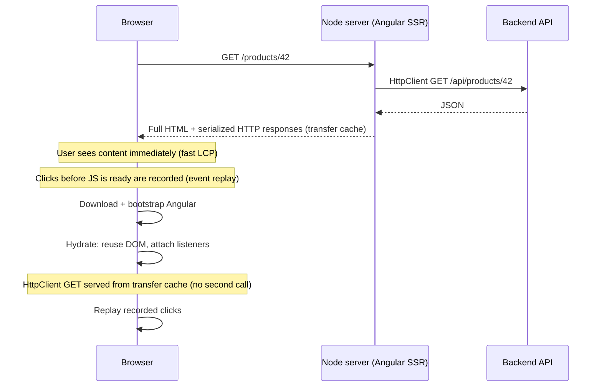

import { Tabs, TabItem, Aside } from '@astrojs/starlight/components';
import QuizBlock from '~/components/QuizBlock.astro';

## Why it matters in interviews

Product companies with public, SEO-sensitive pages (e-commerce, content, marketing) ask *"CSR vs SSR vs SSG?"*, *"What is hydration?"* and *"Why does `window is not defined` happen on the server?"*. Modern Angular added **incremental hydration**, **event replay** and **per-route render modes**, and interviewers use them to check that your knowledge is current.

## Core idea

### Three ways to produce HTML

| | CSR (client-side rendering) | SSR (server-side rendering) | SSG / prerendering |
|---|---|---|---|
| When HTML is built | In the browser, after JS downloads and runs | On the server, **per request** | At **build time**, once per route |
| First paint | Slow (blank until JS runs) | Fast | Fastest (static file from CDN) |
| SEO / link previews | Weak (crawlers may not run JS well) | Good | Good |
| Server cost | Static hosting only | Node server needed, CPU per request | Static hosting |
| Personalised / fresh data | Yes | Yes | No (same HTML for everyone until rebuilt) |
| Good for | Admin portals, dashboards behind login | Product pages, search results | Marketing pages, docs, blog |

Angular supports all three in one app with `@angular/ssr`. Since v19 (stable in v20) you choose **per route** with server routes:

```ts
// app.routes.server.ts
import { RenderMode, ServerRoute } from '@angular/ssr';

export const serverRoutes: ServerRoute[] = [
  { path: '', renderMode: RenderMode.Prerender },              // SSG
  { path: 'products/:id', renderMode: RenderMode.Server },    // SSR per request
  { path: 'account/**', renderMode: RenderMode.Client },      // CSR only
  { path: '**', renderMode: RenderMode.Server },
];
```

For prerendering parameterised routes, add `getPrerenderParams` to the route to return the list of ids to render at build time.

### Hydration

With SSR the browser receives finished HTML. The JS app then boots. **Before** hydration (pre-v16), Angular threw that DOM away and re-rendered, causing a visible flicker. **Non-destructive hydration** (stable since v17) instead **reuses the existing DOM**: Angular walks the server-rendered nodes, matches them to the component tree, and attaches event listeners and bindings. It is enabled with `provideClientHydration()`.



Requirement: the DOM the client expects must **match** what the server rendered. Direct DOM manipulation (`nativeElement.innerHTML`, jQuery plugins), invalid HTML nesting (a `div` inside a `p`) or rendering different content on server vs client causes hydration mismatch errors. As an escape hatch, `ngSkipHydration` on a component's host makes Angular re-render that subtree on the client instead.

### Event replay

Between first paint and hydration, the page looks interactive but has no listeners. **Event replay** records user events in that window (with a tiny inline script) and replays them once hydration completes, so the "dead click" disappears. Enable with `withEventReplay()`; it is included when the CLI sets up SSR in new projects (since v19).

### Incremental hydration (stable in v20)

Full hydration still downloads and hydrates the **whole** app. Incremental hydration combines SSR with `@defer`: deferred blocks are **rendered on the server** (so content and SEO are complete) but stay **dehydrated** on the client, without even downloading their code, until a `hydrate` trigger fires.

```html
@defer (hydrate on viewport) {
  <app-reviews [productId]="id()" />
} @placeholder {
  <div class="skeleton"></div>  <!-- used for CSR navigation; SSR shows the real content -->
}
```

Triggers mirror `@defer`: `hydrate on idle | viewport | interaction | hover | immediate | timer(...)`, `hydrate when cond`, and `hydrate never` (static content that never needs JS). Enable with `provideClientHydration(withIncrementalHydration())`, which also turns on event replay. An interaction with a dehydrated block triggers its hydration and the event is replayed.

### HTTP transfer cache

Without help, a request made during SSR would run again in the browser during hydration (double load, possible flicker). With `provideClientHydration()`, `HttpClient` **caches GET and HEAD responses made on the server, serialises them into the page**, and serves them from that cache during hydration. Requests with `Authorization` headers are excluded by default; tune it with `withHttpTransferCacheOptions(...)`.

### Browser-only APIs

On the server there is no `window`, `document`, `localStorage` or `navigator`. Options:

- `afterNextRender(() => ...)` / `afterEveryRender` run **only in the browser**: the right place for DOM measurement, chart libraries, focus.
- `isPlatformBrowser(inject(PLATFORM_ID))` for branches.
- Inject `DOCUMENT` instead of touching the global.
- Abstract storage behind a service with a server-safe implementation.

## Code

<Tabs>
  <TabItem label="Client config">
```ts
// app.config.ts
export const appConfig: ApplicationConfig = {
  providers: [
    provideRouter(routes),
    provideHttpClient(withFetch()),            // fetch is recommended for SSR
    provideClientHydration(
      withIncrementalHydration(),              // also enables event replay
      withHttpTransferCacheOptions({ includePostRequests: false }),
    ),
  ],
};
```
  </TabItem>
  <TabItem label="Server config">
```ts
// app.config.server.ts
import { mergeApplicationConfig, ApplicationConfig } from '@angular/core';
import { provideServerRendering, withRoutes } from '@angular/ssr';
import { appConfig } from './app.config';
import { serverRoutes } from './app.routes.server';

const serverConfig: ApplicationConfig = {
  providers: [provideServerRendering(withRoutes(serverRoutes))],
};

export const config = mergeApplicationConfig(appConfig, serverConfig);
```
  </TabItem>
  <TabItem label="Browser-only code">
```ts
@Component({ selector: 'app-sales-chart', template: `<canvas #c></canvas>` })
export class SalesChartComponent {
  private canvas = viewChild.required<ElementRef<HTMLCanvasElement>>('c');
  private platformId = inject(PLATFORM_ID);

  constructor() {
    // Runs only in the browser, after the DOM is rendered.
    afterNextRender(() => {
      const chart = new Chart(this.canvas().nativeElement, { type: 'bar', data: { datasets: [] } });
    });
  }

  saveDraft(json: string) {
    if (isPlatformBrowser(this.platformId)) localStorage.setItem('draft', json);
  }
}
```
  </TabItem>
</Tabs>

Add SSR to an existing app with `ng add @angular/ssr`, or create one with `ng new my-app --ssr`.

## Interview Q&A

<details>
<summary>CSR vs SSR vs SSG: which for an e-commerce site?</summary>

Mix per route: home and category landing pages prerendered (SSG, CDN-cached), product detail SSR (fresh price and stock, SEO), cart/checkout/account CSR (personalised, no SEO need). Angular server routes with `RenderMode` make this a configuration decision.
</details>

<details>
<summary>What is hydration and what problem does it solve?</summary>

Hydration makes server-rendered HTML interactive by **reusing** the existing DOM and attaching listeners, instead of destroying and re-rendering it. That removes flicker, preserves LCP, and avoids layout shift. It needs `provideClientHydration()` and a server/client DOM that match.
</details>

<details>
<summary>What is incremental hydration and how is it different from `@defer` in a CSR app?</summary>

In CSR, `@defer` shows a placeholder and loads the block later. With incremental hydration, the deferred block's **real content is rendered on the server**, so users and crawlers see it, but its JS is not downloaded or hydrated until a `hydrate on ...` trigger fires. You get full HTML with less JS on startup. Stable since v20.
</details>

<details>
<summary>What does event replay do?</summary>

It captures user events that happen after the HTML is visible but before hydration finishes, then replays them to the right handlers once the app is hydrated. Without it, early clicks are lost.
</details>

<details>
<summary>Why is my API called twice with SSR, and how do you fix it?</summary>

Once on the server and again in the browser during bootstrap. `provideClientHydration()` enables the HTTP transfer cache, which serialises server GET/HEAD responses into the HTML and reuses them during hydration. Check that the request is a GET without auth headers, or configure `withHttpTransferCacheOptions`.
</details>

<details>
<summary>`localStorage is not defined` on the server. How do you fix it properly?</summary>

Don't access browser globals during server rendering. Move DOM/storage work into `afterNextRender`, guard with `isPlatformBrowser`, inject `DOCUMENT`, or wrap storage in a service with a no-op server implementation. Wrapping everything in `typeof window !== 'undefined'` checks works but scatters platform logic.
</details>

<details>
<summary>What causes hydration mismatch errors?</summary>

The client-rendered structure differs from the server HTML: direct DOM manipulation, invalid HTML nesting the browser auto-corrects, content depending on `Date.now()`/random values/browser-only state, or third-party scripts altering the DOM. Fix the root cause; use `ngSkipHydration` only as a last resort.
</details>

## Pitfalls

<Aside type="caution" title="Common mistakes">
- **Using `window`/`document`/`localStorage` in constructors** or `ngOnInit` of SSR'd components.
- **Long-running timers or open websockets on the server** (for example `interval` in a root service), which keep the server render from becoming stable and finishing.
- **Caching personalised responses** in the transfer cache or at the CDN for SSR routes.
- **Assuming SSR fixes slow runtime performance.** It improves first paint; hydration still runs all the JS unless you use incremental hydration.
- **Direct DOM manipulation** breaking hydration.
</Aside>

## Related

- [Performance](../performance/)
- [Lifecycle hooks (afterNextRender)](../lifecycle-hooks/)
- [Architecture & bootstrapping](../architecture-bootstrap/)
- [Blob storage, files & CDN](../../system-design/storage-files-cdn/)

## Quick quiz

<QuizBlock section="angular" topic="ssr-hydration" />
