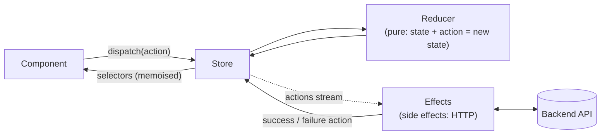

import { Tabs, TabItem, Aside } from '@astrojs/starlight/components';
import QuizBlock from '~/components/QuizBlock.astro';

## Why it matters in interviews

*"How do you manage state in your Angular app?"* is an open question that reveals judgement. Weak answers are "we use NgRx for everything" or "we just use services". A strong answer separates **kinds** of state, names the tool for each, and explains the trade-off: a signal-based service is enough for most apps, NgRx Store pays off with many teams, complex flows and a need for devtools. Expect follow-ups on actions/reducers/effects/selectors because many enterprise codebases still run classic NgRx.

## Core idea

"State" is not one thing. Classify it first, then choose the lightest tool that works.

| Kind of state | Example | Where it should live |
|---|---|---|
| **Local UI state** | Is the panel open, selected tab, hover | `signal()` in the component |
| **Form state** | Field values, validity, dirty | The form model (Reactive / Signal Forms) |
| **URL state** | Current page, filters, selected id | Router: path and query params |
| **Server cache** | Product list, order details | Resources, `HttpClient` + a cache, or a store |
| **Shared client state** | Cart, logged-in user, feature flags | Signal service store, SignalStore or NgRx |

Putting URL state in a store (and fighting to keep them in sync) or local UI state in a global store are the two most common over-engineering mistakes.

### Option 1: signal-based service store

A root (or route-scoped) service holds **private writable signals** and exposes **read-only signals** plus **methods** that describe intent. It is the modern replacement for the `BehaviorSubject` service pattern.

```ts
@Injectable({ providedIn: 'root' })
export class CartStore {
  private readonly _lines = signal<CartLine[]>([]);
  readonly lines = this._lines.asReadonly();
  readonly count = computed(() => this._lines().reduce((n, l) => n + l.qty, 0));
  readonly total = computed(() => this._lines().reduce((s, l) => s + l.qty * l.price, 0));

  add(product: Product) {
    this._lines.update((lines) => {
      const existing = lines.find((l) => l.sku === product.sku);
      return existing
        ? lines.map((l) => (l === existing ? { ...l, qty: l.qty + 1 } : l))
        : [...lines, { sku: product.sku, price: product.price, qty: 1 }];
    });
  }
  remove(sku: string) { this._lines.update((lines) => lines.filter((l) => l.sku !== sku)); }
}
```

Why it works: one owner mutates state (encapsulation), consumers can't `set` it, derived values are `computed`, and templates update with OnPush and zoneless automatically.

### Option 2: NgRx Store (Redux pattern)



- **Actions** describe events (`[Orders Page] Opened`, `[Orders API] Load Success`).
- **Reducers** are pure functions computing the new immutable state.
- **Selectors** are memoised projections of state (`selectOpenOrders`).
- **Effects** listen to actions, do side effects (HTTP, navigation), and dispatch result actions.
- Redux DevTools give time-travel debugging and an action log.

The cost is ceremony: one feature touches actions, reducer, selectors, effects and tests. `createActionGroup` and `createFeature` cut much of the boilerplate, and `store.selectSignal(selector)` returns a signal for templates.

### Option 3: NgRx SignalStore

`@ngrx/signals` is a lighter, signal-native store built from composable features: `withState`, `withComputed`, `withMethods`, `withHooks`, and plugins such as entity management. It can be provided in root or at component/route level. It suits teams who want a structured, testable store without the Redux ceremony.

### When to use which

| | Signal service | NgRx SignalStore | NgRx Store |
|---|---|---|---|
| Boilerplate | Minimal | Low | High |
| Learning curve | Low | Medium | High |
| Devtools / time travel | No | Limited (community plugins) | Yes |
| Event log, "who changed this?" | Method calls | Method calls | Every change is a named action |
| Side-effect handling | Methods, resources, RxJS | `rxMethod`, methods | Effects |
| Good fit | Most apps, feature state | Medium-large apps wanting structure | Large apps, many teams, complex cross-feature flows, audit needs |

### Facade pattern

A **facade** is a service that sits between components and the state implementation. Components call `ordersFacade.loadOrders()` and read `ordersFacade.orders()`; they don't know whether that is NgRx, a SignalStore or a plain service. It keeps components simple and lets you swap the state layer later. The trade-off: in NgRx apps it can hide the action-based design ("dispatching commands instead of events"), so keep facade methods meaningful.

### Legacy vs modern

| Legacy | Modern |
|---|---|
| `BehaviorSubject` in a service + `asObservable()` | Private `signal` + `asReadonly()` |
| `combineLatest` to derive values | `computed` |
| `store.select(selector)` + `async` pipe | `store.selectSignal(selector)` |
| Class-based `@Effect()` | `createEffect`, including functional effects |
| NgRx `ComponentStore` | NgRx SignalStore |

## Code

<Tabs>
  <TabItem label="NgRx SignalStore">

```ts
import { computed, inject } from '@angular/core';
import { patchState, signalStore, withComputed, withHooks, withMethods, withState } from '@ngrx/signals';
import { rxMethod } from '@ngrx/signals/rxjs-interop';
import { tapResponse } from '@ngrx/operators';
import { pipe, switchMap, tap } from 'rxjs';

type OrdersState = { orders: Order[]; filter: string; loading: boolean };

export const OrdersStore = signalStore(
  { providedIn: 'root' },
  withState<OrdersState>({ orders: [], filter: '', loading: false }),
  withComputed(({ orders, filter }) => ({
    visible: computed(() => orders().filter((o) => o.number.includes(filter()))),
  })),
  withMethods((store, api = inject(OrderApi)) => ({
    setFilter: (filter: string) => patchState(store, { filter }),
    load: rxMethod<void>(
      pipe(
        tap(() => patchState(store, { loading: true })),
        switchMap(() => api.getAll().pipe(
          tapResponse({
            next: (orders) => patchState(store, { orders, loading: false }),
            error: () => patchState(store, { loading: false }),
          }),
        )),
      ),
    ),
  })),
  withHooks({ onInit: (store) => store.load() }),
);
```

  </TabItem>
  <TabItem label="NgRx Store">

```ts
export const OrdersActions = createActionGroup({
  source: 'Orders',
  events: {
    'Page Opened': emptyProps(),
    'Load Success': props<{ orders: Order[] }>(),
    'Load Failure': props<{ error: string }>(),
  },
});

export const ordersFeature = createFeature({
  name: 'orders',
  reducer: createReducer(
    { orders: [] as Order[], loading: false },
    on(OrdersActions.pageOpened, (s) => ({ ...s, loading: true })),
    on(OrdersActions.loadSuccess, (s, { orders }) => ({ ...s, orders, loading: false })),
    on(OrdersActions.loadFailure, (s) => ({ ...s, loading: false })),
  ),
}); // generates selectOrders, selectLoading

export const loadOrders = createEffect(
  (actions$ = inject(Actions), api = inject(OrderApi)) =>
    actions$.pipe(
      ofType(OrdersActions.pageOpened),
      switchMap(() => api.getAll().pipe(
        map((orders) => OrdersActions.loadSuccess({ orders })),
        catchError((e) => of(OrdersActions.loadFailure({ error: String(e) }))),
      )),
    ),
  { functional: true },
);
```

  </TabItem>
  <TabItem label="Component">

```ts
@Component({
  selector: 'app-orders-page',
  template: `
    <input (input)="store.setFilter($any($event.target).value)" />
    @if (store.loading()) { <app-spinner /> }
    @for (o of store.visible(); track o.id) { <app-order-row [order]="o" /> }
  `,
})
export class OrdersPage {
  protected readonly store = inject(OrdersStore);
}
```

  </TabItem>
</Tabs>

Registering classic NgRx in a standalone app: `provideStore()`, `provideState(ordersFeature)` and `provideEffects({ loadOrders })` in `app.config.ts` or on a lazy route's `providers`.

## Interview Q&A

<details>
<summary>How do you decide whether an app needs NgRx?</summary>

Start from the kinds of state. If shared client state is modest and owned by a few features, signal services are enough. NgRx Store pays off when many features react to the same events, several teams work on the app, you need an auditable event log and devtools, or flows involve complex side-effect orchestration. Adopting it "because it's enterprise" mostly adds boilerplate.
</details>

<details>
<summary>How would you build a store with plain signals?</summary>

An injectable service with private writable signals, public read-only signals via `asReadonly()`, `computed` for derived values, and methods that update immutably with `update`. Provide it in root for global state or on a route/component for scoped state. Async loading goes into methods, a resource, or RxJS with `toSignal`.
</details>

<details>
<summary>Explain the NgRx data flow.</summary>

A component dispatches an action. Reducers compute a new immutable state from the current state and the action. Selectors derive memoised slices that components read. Effects listen for actions, perform side effects such as HTTP calls, and dispatch success or failure actions, which reducers handle in turn. State changes only through reducers, so every change is traceable.
</details>

<details>
<summary>Why must reducers be pure and state immutable?</summary>

Purity makes state changes predictable, testable and replayable (time-travel). Immutability lets selectors and OnPush components detect changes by reference: a new object means "changed", the same reference means "unchanged". Mutating state breaks memoisation and change detection.
</details>

<details>
<summary>What is NgRx SignalStore and how is it different from NgRx Store?</summary>

SignalStore is a signal-based store composed of features (`withState`, `withComputed`, `withMethods`, `withHooks`). State is exposed as signals, updates use `patchState`, and there are no actions or reducers by default. It is closer to a structured service than to Redux, with far less ceremony, and it can be scoped to a component or route.
</details>

<details>
<summary>What is a facade and why use one?</summary>

A service that exposes a simple API (signals and methods) to components and hides the state implementation. Components stay thin and testable, and the state layer can change (service to NgRx, for example) without touching them. Avoid facades that become a one-to-one mirror of every action with no added meaning.
</details>

<details>
<summary>Where should filters and pagination state live?</summary>

Usually in the URL as query parameters, so the page is shareable, bookmarkable and survives refresh. Bind them as component inputs with `withComponentInputBinding()` and derive the data request from them. Mirroring the same values into a store creates two sources of truth.
</details>

## Pitfalls

<Aside type="caution" title="Common mistakes">

- Putting everything, including local UI flags, into a global store.
- Exposing writable signals or `BehaviorSubject`s from a store so any component can change state.
- Mutating arrays and objects in state, which breaks selectors, `computed` equality and OnPush.
- Duplicating server data in several stores with no clear owner, so they drift apart.
- Doing HTTP calls in reducers or components when an effect or store method should own the side effect.
- Keeping user-specific state in a root store and forgetting to reset it on logout.

</Aside>

## Related

- [Signals deep dive](../signals/)
- [Dependency injection: scoping a store](../dependency-injection/)
- [Front-end architecture patterns](../../patterns/angular-patterns/)
- [Scenario questions: shared service vs store](../angular-scenarios/)

## Quick quiz

<QuizBlock section="angular" topic="state-management" />
