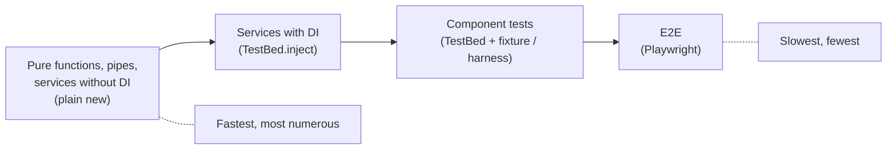

import { Tabs, TabItem, Aside } from '@astrojs/starlight/components';
import QuizBlock from '~/components/QuizBlock.astro';

## Why it matters in interviews

*"How do you unit test a component that calls an API?"*, *"How do you test an HTTP service?"* and *"What is TestBed?"* are common, and some rounds ask you to write a test live. Since v21 the CLI generates **Vitest** tests by default, so mentioning Vitest, `setInput` for signal inputs and `HttpTestingController` signals you are current.

## Core idea

### The tool chain

| | Vitest (default for new projects since v21) | Jasmine + Karma (legacy default) | Jest |
|---|---|---|---|
| Runs in | Node with a DOM emulation (jsdom / happy-dom), or a real browser via browser mode | Real browser launched by Karma | Node + jsdom |
| Speed | Fast, watch mode with smart re-runs | Slower startup | Fast |
| Status in Angular CLI | Default runner via the `@angular/build:unit-test` builder | Karma is deprecated; existing projects still work | Experimental CLI support only; mostly community builders |
| API | `describe/it/expect`, `vi.fn()`, `vi.spyOn` | `describe/it/expect`, `jasmine.createSpyObj` | `jest.fn()` |

The test-writing APIs that matter (**TestBed**, `ComponentFixture`, harnesses, `HttpTestingController`) are **Angular's**, identical whichever runner you use. Only the spy/mock syntax differs.

### Testing levels in an Angular app



Test the cheapest way that gives confidence. A pipe or a pure function needs no TestBed at all.

### TestBed

`TestBed` creates a small Angular environment (an injector and a compiler) per test. You configure it with the standalone component under test in `imports` and replace dependencies in `providers`. `TestBed.createComponent(X)` returns a `ComponentFixture` with:

- `componentInstance`: the class instance.
- `nativeElement` / `debugElement`: the rendered DOM.
- `componentRef.setInput(name, value)`: set inputs, **the way to set signal inputs** (you cannot assign to an `input()` signal).
- `detectChanges()`: run change detection now; `whenStable()`: wait for pending async work and rendering.

In zoneless apps (default since v21), prefer `await fixture.whenStable()` after changing state, so the test exercises the same scheduling as the real app.

### Mocking dependencies

Replace collaborators with `{ provide: RealService, useValue: fake }`. Fakes built on signals are trivial: a `signal()` property is enough. For HTTP, don't mock `HttpClient` directly: use `provideHttpClient()` + `provideHttpClientTesting()` and the `HttpTestingController` to assert requests and flush responses. This also exercises your interceptors.

### Component harnesses

A harness (from `@angular/cdk/testing`) is a page-object for a component: `await loader.getHarness(MatButtonHarness.with({ text: 'Save' }))` then `await button.click()`. Tests stop depending on internal DOM structure and CSS classes, and harnesses handle waiting for change detection. Angular Material ships harnesses for all its components; you can write your own by extending `ComponentHarness`.

### fakeAsync vs async/await

| | `fakeAsync` + `tick()` / `flush()` | `async` test + `await` | Vitest fake timers |
|---|---|---|---|
| How | Runs the test in a zone with a virtual clock | Real async, wait with `await fixture.whenStable()` | `vi.useFakeTimers()`, `vi.advanceTimersByTime()` |
| Needs zone.js | **Yes** (`zone.js/testing`) | No | No |
| Good for | `debounceTime`, `setTimeout` in zone-based apps | Most component tests | Timers in zoneless + Vitest projects |

Because new projects are zoneless and on Vitest, the default direction is `async`/`await` and Vitest fake timers; `fakeAsync` remains common in older Jasmine/Karma suites.

## Code

<Tabs>
  <TabItem label="Component">
```ts
describe('OrderSummaryComponent', () => {
  let fixture: ComponentFixture<OrderSummaryComponent>;
  const cart = { items: signal<CartItem[]>([]), checkout: vi.fn() };

  beforeEach(async () => {
    await TestBed.configureTestingModule({
      imports: [OrderSummaryComponent],
      providers: [{ provide: CartService, useValue: cart }],
    }).compileComponents();
    fixture = TestBed.createComponent(OrderSummaryComponent);
  });

  it('shows the total and emits on checkout', async () => {
    cart.items.set([{ id: 1, price: 100, qty: 2 }]);
    fixture.componentRef.setInput('currency', 'INR'); // signal input
    const emitted: number[] = [];
    fixture.componentInstance.checkedOut.subscribe((t) => emitted.push(t)); // output()

    await fixture.whenStable();
    const el: HTMLElement = fixture.nativeElement;
    expect(el.querySelector('.total')?.textContent).toContain('200');

    el.querySelector<HTMLButtonElement>('button.checkout')!.click();
    expect(cart.checkout).toHaveBeenCalled();
    expect(emitted).toEqual([200]);
  });
});
```
  </TabItem>
  <TabItem label="HTTP service">
```ts
describe('OrderApi', () => {
  let api: OrderApi;
  let http: HttpTestingController;

  beforeEach(() => {
    TestBed.configureTestingModule({
      providers: [provideHttpClient(), provideHttpClientTesting()], // order matters
    });
    api = TestBed.inject(OrderApi);
    http = TestBed.inject(HttpTestingController);
  });

  afterEach(() => http.verify()); // fail if unexpected requests were made

  it('requests page 2', () => {
    let result: Order[] | undefined;
    api.list(2).subscribe((r) => (result = r));

    const req = http.expectOne((r) => r.url === '/api/orders');
    expect(req.request.method).toBe('GET');
    expect(req.request.params.get('page')).toBe('2');
    req.flush([{ id: 7 }]);

    expect(result).toEqual([{ id: 7 }]);
  });
});
```
  </TabItem>
  <TabItem label="Signals + harness">
```ts
it('computed total follows the items signal', () => {
  const store = TestBed.inject(CartStore); // a signal-based service
  store.add({ id: 1, price: 50, qty: 1 });
  store.add({ id: 2, price: 25, qty: 2 });
  expect(store.total()).toBe(100);        // computed is read synchronously
});

it('saves via the Material button', async () => {
  const fixture = TestBed.createComponent(ProfileFormComponent);
  const loader = TestbedHarnessEnvironment.loader(fixture);
  const name = await loader.getHarness(MatInputHarness.with({ selector: '#name' }));
  await name.setValue('Asha');
  const save = await loader.getHarness(MatButtonHarness.with({ text: 'Save' }));
  await save.click();
  expect(fixture.componentInstance.saved()).toBe(true);
});
```
  </TabItem>
</Tabs>

## Interview Q&A

<details>
<summary>What is TestBed and when do you not need it?</summary>

TestBed builds a test Angular environment: an injector, compiled components and a fixture to drive change detection. You need it for components and for services that use `inject()`. You don't need it for pure functions, pipes with no dependencies, or classes you can construct with `new` and fakes.
</details>

<details>
<summary>How do you set a signal input in a test?</summary>

`fixture.componentRef.setInput('name', value)`, then let change detection run (`await fixture.whenStable()` or `fixture.detectChanges()`). Signal inputs are read-only from the outside, so you can't assign them on `componentInstance`. `setInput` also works for classic `@Input`s and marks OnPush components dirty.
</details>

<details>
<summary>How do you test a service that uses HttpClient?</summary>

Provide `provideHttpClient()` then `provideHttpClientTesting()`, inject `HttpTestingController`, call the service, use `expectOne` to assert URL, method, headers or body, `flush` a response (or an error with `{ status: 500, statusText: '...' }`), and call `verify()` in `afterEach` to catch unexpected requests.
</details>

<details>
<summary>How do you test an output?</summary>

`output()` returns an `OutputEmitterRef` with a `subscribe` method, so subscribe in the test, trigger the UI action, and assert the emitted value. Alternatively test through a small host component that binds `(saved)="onSaved($event)"`.
</details>

<details>
<summary>What are component harnesses and why use them?</summary>

Page-object style APIs from the CDK that interact with a component the way a user would (`click`, `setValue`, `getText`). Tests survive internal markup changes, and the harness handles waiting for stability. Material provides harnesses for every component.
</details>

<details>
<summary>fakeAsync or async/await?</summary>

`fakeAsync` uses a zone with a virtual clock, so `tick(300)` instantly advances a `debounceTime(300)`. It needs zone.js. In zoneless Vitest projects, use `async` tests with `await fixture.whenStable()` and Vitest fake timers for time-based code.
</details>

<details>
<summary>Why did Angular move to Vitest?</summary>

Karma was deprecated (the Karma project itself stopped active development), and Vitest offers fast startup and watch mode, a modern API compatible with Jest-style tests, and optional real-browser mode. Since v21 new projects use it by default; migration tooling exists for Jasmine-based suites.
</details>

## Pitfalls

<Aside type="caution" title="Common mistakes">
- **Mocking `HttpClient` with a spy** instead of `HttpTestingController`, so interceptors and URL/params building are never tested.
- **Forgetting `http.verify()`**, letting unexpected or duplicate requests pass silently.
- **Asserting before change detection** has run (missing `whenStable()` / `detectChanges()`).
- **Testing private implementation** (calling internal methods) instead of DOM behaviour and public outputs.
- **Using `fakeAsync` in a zoneless Vitest setup** without zone.js testing loaded.
- **Snapshot tests of whole templates** that break on every markup tweak and get blindly updated.
</Aside>

## Related

- [Testing strategy](../../testing-devops/testing-strategy/)
- [End-to-end testing](../../testing-devops/e2e-testing/)
- [HttpClient & interceptors](../http-interceptors/)
- [Signals deep dive](../signals/)

## Quick quiz

<QuizBlock section="angular" topic="testing" />
