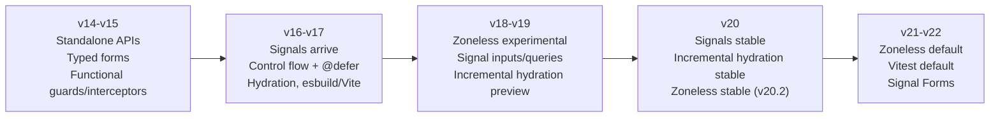

import { Tabs, TabItem, Aside } from '@astrojs/starlight/components';
import QuizBlock from '~/components/QuizBlock.astro';

## Why it matters in interviews

*"Which Angular version have you worked on and what changed recently?"* is a near-certain opener. Interviewers use it to separate people who **kept up** (standalone, signals, control flow, zoneless) from people who only know the NgModule + zone.js + `*ngIf` era. You don't need release dates by heart, but you should be able to tell the story of **why** Angular changed and what you would migrate first.

## Core idea

Angular ships a **major version roughly every six months** (around May and November), with minor releases in between. Each major is **actively supported for 6 months** and gets **12 more months of LTS** (security and critical fixes), so 18 months total. `ng update` runs automated migrations (schematics) between majors; the official **update guide** at angular.dev lists manual steps per version pair. Upgrade **one major at a time**.

Features usually move through **experimental → developer preview → stable**. In interviews, say which stage a feature was in when you used it.

### The big story in one diagram



The direction is consistent: **less boilerplate** (standalone, `inject()`, functions instead of classes), **fine-grained reactivity** (signals replacing zone.js-driven checking), and **faster builds and pages** (esbuild/Vite, `@defer`, hydration).

### Version table

| Version (release) | Headline features | Why interviewers care |
|---|---|---|
| **v14** (Jun 2022) | Standalone components (developer preview), **typed reactive forms**, `inject()` usable in more places, route `title` | Start of the move away from NgModules; typed forms catch `form.value` typos at compile time |
| **v15** (Nov 2022) | **Standalone APIs stable** (`bootstrapApplication`, `provideRouter`, `provideHttpClient`), **functional guards and interceptors**, **directive composition** (`hostDirectives`), `NgOptimizedImage` stable | The modern app shape: no AppModule, providers as functions. Asked as "class vs functional guard/interceptor" |
| **v16** (May 2023) | **Signals (developer preview)**, required inputs, `DestroyRef` + `takeUntilDestroyed`, route params as inputs (`withComponentInputBinding`), non-destructive hydration (developer preview), esbuild builder preview | The reactivity reset begins; `takeUntilDestroyed` is the modern unsubscribe answer |
| **v17** (Nov 2023) | **Built-in control flow** `@if/@for/@switch`, **`@defer`**, standalone default for new projects, **Vite + esbuild application builder** default, hydration stable, new angular.dev; signal inputs and `model()` arrived in 17.x minors | Template syntax changed for everyone; `@for` requires `track`; `@defer` is a top performance question |
| **v18** (May 2024) | **Zoneless change detection (experimental)**, control flow and `@defer` stable, event replay (developer preview), fallback content for `ng-content`, unified form control events, `@let` in 18.1 | Zoneless is the hot CD question: "how does Angular know to re-render without zone.js?" |
| **v19** (Nov 2024) | `standalone: true` becomes the default, **incremental hydration** (developer preview), **route-level render modes** (developer preview), `linkedSignal` and `resource` (experimental), event replay enabled by default for new SSR apps, signal inputs/outputs/queries stable, `httpResource` added in 19.2 | Standalone is now simply "how components work"; resources reshape data loading |
| **v20** (May 2025) | **Signal APIs stable** (`effect`, `linkedSignal`, `toSignal`), **incremental hydration stable**, route render modes stable, zoneless developer preview then **stable in v20.2**, `*ngIf`/`*ngFor`/`*ngSwitch` deprecated, template expression improvements (exponentiation `**`, the `in` operator) | Signals are no longer "preview": interviewers expect you to use them in answers |
| **v21** (Nov 2025) | **Zoneless by default for new apps**, **Vitest the default test runner** (Karma deprecated), **Signal Forms (experimental)**, **Angular Aria** (headless accessible component primitives) | New projects have no zone.js and no Karma; you should know how CD and testing work in that setup |
| **v22** (Jun 2026) | **Signal Forms stable**, **`resource` / `rxResource` / `httpResource` stable**; consolidation of the signals-first APIs started in v16-v21 | Shows whether you follow the roadmap; frame answers as "signals first, RxJS for events and async orchestration" |

<Aside type="note" title="How to talk about it">
Say what you used and why: *"Our app was on v15 with NgModules. We upgraded one major at a time to v19, migrated to standalone and control flow with the schematics, then moved new features to signals and OnPush. Zoneless was our next step."* A concrete story beats a list of features.
</Aside>

### Migration notes

Each of these has an official schematic, so a migration is mostly running a command, then reviewing and testing:

<Tabs>
  <TabItem label="Commands">
```bash
# One major at a time, framework + CLI together, then Material/CDK
ng update @angular/core@20 @angular/cli@20
ng update @angular/material@20

# NgModules -> standalone (run in stages: convert, remove modules, bootstrap)
ng generate @angular/core:standalone

# *ngIf / *ngFor / *ngSwitch -> @if / @for / @switch
ng generate @angular/core:control-flow

# Constructor injection -> inject()
ng generate @angular/core:inject

# @Input / @Output / queries -> signal inputs, output(), signal queries
ng generate @angular/core:signal-input-migration
ng generate @angular/core:output-migration
ng generate @angular/core:signal-queries-migration
```
  </TabItem>
  <TabItem label="Zoneless switch">
```ts
// app.config.ts in an existing app moving to zoneless (v20.2+)
export const appConfig: ApplicationConfig = {
  providers: [
    provideZonelessChangeDetection(),
    provideRouter(routes),
    provideHttpClient(withFetch()),
  ],
};
// Then remove 'zone.js' from the polyfills in angular.json, and fix components that
// relied on zone.js to refresh after setTimeout/subscribe: use signals or markForCheck.
```
  </TabItem>
</Tabs>

A practical upgrade order for an old app: update majors → move builder to `@angular/build` (esbuild) → standalone migration → control flow migration → OnPush + signals in new/changed components → functional guards/interceptors → zoneless once every component is OnPush-safe.

## Interview Q&A

<details>
<summary>What were the biggest changes in Angular over the last few versions?</summary>

Standalone components replacing NgModules, signals as the core reactivity model, the built-in control flow and `@defer`, the esbuild/Vite build system, non-destructive and then incremental hydration, and zoneless change detection becoming the default for new apps in v21, along with Vitest as the default test runner.
</details>

<details>
<summary>How would you upgrade an app from v14 to the latest version?</summary>

One major at a time with `ng update` (reading the update guide for each step), fixing deprecations and running tests after each. Then adopt new features gradually with schematics: standalone, control flow, `inject()`, signal inputs. Keep third-party libraries (Material, NgRx) in lockstep, since they publish matching majors.
</details>

<details>
<summary>What does zoneless mean and why did Angular make it the default?</summary>

Change detection is no longer triggered by zone.js patching every async API. Angular schedules it when it is notified: signal changes, `markForCheck` (including via the `async` pipe), template events, `setInput`. Benefits: smaller bundles, fewer unnecessary checks, better debugging and interop. It became the default for new projects in v21.
</details>

<details>
<summary>Are NgModules removed?</summary>

No. They are still supported for existing apps and libraries, but standalone is the default and the recommended approach. Many libraries still export NgModules for compatibility, which you can import into a standalone component's `imports`.
</details>

<details>
<summary>How long is an Angular version supported?</summary>

18 months: 6 months of active support and 12 months of long-term support. With a major every six months, an app more than about three majors behind is on an unsupported version.
</details>

<details>
<summary>What is Signal Forms?</summary>

A new forms API built on signals, introduced as experimental in v21 and stable in v22: the form model is a signal and the form state (value, validity, errors) is derived from it. Reactive Forms remain fully supported. See [Forms](../forms/) for the comparison.
</details>

## Pitfalls

<Aside type="caution" title="Common mistakes">
- **Jumping several majors at once**; `ng update` migrations are designed to run one major at a time.
- **Claiming a feature is stable when it was experimental** in your version (zoneless in v18, `resource` in v19). Say the stage.
- **Running migrations without tests**: the standalone and control flow schematics are reliable but not perfect.
- **Turning on zoneless before components are OnPush-compatible**: views that relied on zone.js to refresh after a subscribe will stop updating.
- **Upgrading Angular but not Material/NgRx/third-party** libraries, causing peer dependency errors.
</Aside>

## Related

- [Architecture & bootstrapping](../architecture-bootstrap/)
- [Change detection](../change-detection/)
- [Signals deep dive](../signals/)
- [Testing Angular](../testing/)

## Quick quiz

<QuizBlock section="angular" topic="version-history" />
