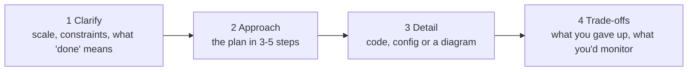
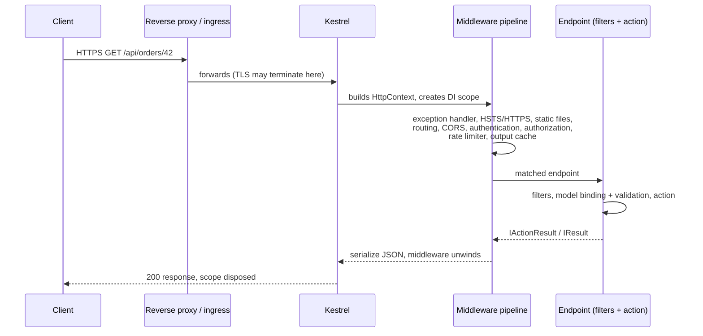
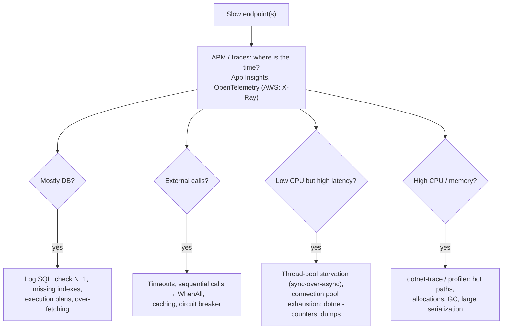
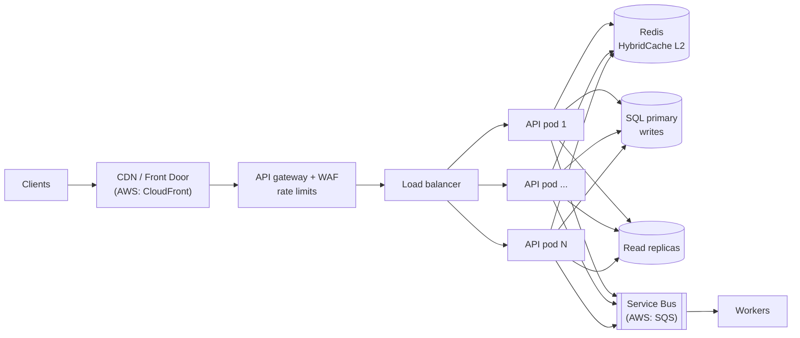
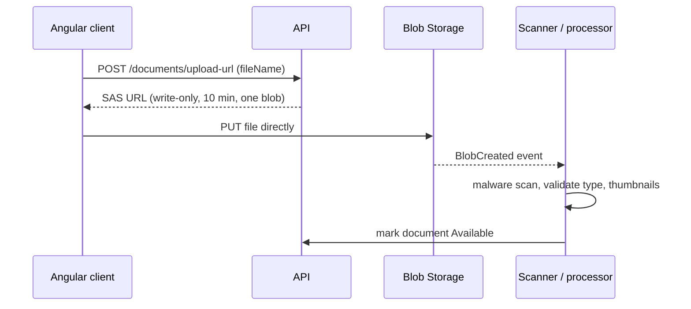

import { Aside } from '@astrojs/starlight/components';
import QuizBlock from '~/components/QuizBlock.astro';

## Why it matters in interviews

At 3-4 years, interviewers move from "what is X?" to "here is a situation, what do you do?". Scenario questions test whether you can connect topics (pipeline, DI, caching, resilience, security) and reason about trade-offs out loud. A structured answer beats a long list of buzzwords: it shows you have done this in a real project.

## Core idea

Use the same four steps for every scenario:



1. **Clarify**: ask 2-3 questions that change the answer (how big, how many, how fresh, who calls it). It shows judgement and buys thinking time.
2. **Approach**: state the plan in a few steps, in priority order.
3. **Detail**: go deep on one or two parts with code or a sketch. Name real APIs.
4. **Trade-offs**: what this costs, what you'd measure, what you'd do at 10x scale. Close with a real project example if you have one.

## Scenarios

### 1. "A request comes in. Walk me through what happens."

**Clarify**: minimal API or controller? Behind a reverse proxy? (Assume Azure App Service or AKS ingress, controllers, JWT auth.)

**Approach**



- Kestrel accepts the connection (HTTP/1.1, 2 or 3), parses the request into an `HttpContext`, and a **DI scope** is created for the request.
- The request flows through middleware **in registration order**; each can short-circuit (e.g. CORS preflight, 401, cached output).
- Routing matches an endpoint early; authorization uses the endpoint's metadata (`[Authorize]`, policies).
- For controllers, the **filter pipeline** runs: authorization, resource, model binding and validation (`[ApiController]` auto-400), action filters, the action, exception and result filters.
- The result is serialized (System.Text.Json), middleware unwinds in reverse order (logging, compression), the response is written, and the scope and its scoped services (`DbContext`) are disposed.

**Trade-offs / follow-ups**: middleware vs filters (filters know MVC context, middleware applies to everything), where exceptions are caught, why order matters (authentication before authorization; CORS before auth). See [middleware pipeline](../middleware-pipeline/) and [filters](../filters/).

### 2. "You injected a scoped service into a singleton. What happens?"

**Clarify**: which scoped service? Usually a `DbContext` or something holding per-request state such as the current user.

**Approach**

- This is a **captive dependency**: the singleton captures the first scoped instance it gets and keeps it for the app's lifetime.
- Symptoms: `DbContext` errors such as *"A second operation was started on this context instance before a previous operation completed"*, ever-growing change tracker memory, stale data, and worst of all **one user's data leaking into another user's request** if the service holds user context.
- In Development, scope validation (`ValidateScopes`, on by default in Development) throws at startup: *"Cannot consume scoped service from singleton"*. Production doesn't validate by default, so the bug ships.

**Fix**

```csharp
public sealed class PriceRefresher(IServiceScopeFactory scopeFactory) // singleton
{
    public async Task RefreshAsync(CancellationToken ct)
    {
        await using var scope = scopeFactory.CreateAsyncScope();     // one scope per unit of work
        var db = scope.ServiceProvider.GetRequiredService<AppDbContext>();
        await db.Products.ExecuteUpdateAsync(s => s.SetProperty(p => p.Price, p => p.Price * 1.02m), ct);
    }
}
```

**Trade-offs**: alternatively make the consumer scoped, or use `IDbContextFactory<T>` for singletons. Enable `ValidateOnBuild` and `ValidateScopes` in all environments' tests. See [dependency injection](../dependency-injection/).

### 3. "How would you secure this API?"

**Clarify**: who calls it (SPA, mobile, other services, partners)? Public internet or internal? What data (PII, payments)?

**Approach**, layered:

1. **Transport**: HTTPS only, HSTS, TLS 1.2+.
2. **Authentication**: JWT bearer tokens from an identity provider (Microsoft Entra ID; AWS: Cognito). Validate issuer, audience, lifetime and signature. Managed identities for service-to-service.
3. **Authorization**: deny by default with a fallback policy, then policies based on scopes/roles, plus **resource-based checks** (is this *your* order?) to prevent IDOR.
4. **Input**: validate everything (FluentValidation / DataAnnotations), parameterized queries via EF Core, limit body sizes, never bind directly to entities (over-posting).
5. **Abuse**: rate limiting per user/API key, CORS restricted to known origins, a WAF (Azure Front Door / Application Gateway WAF; AWS: WAF).
6. **Secrets**: Azure Key Vault (AWS: Secrets Manager), never in appsettings or source control.
7. **Errors and logs**: ProblemDetails without stack traces; no tokens or PII in logs; audit security events.
8. **Supply chain**: dependency scanning (Dependabot, `dotnet list package --vulnerable`), least-privilege DB user.

```csharp
builder.Services.AddAuthentication(JwtBearerDefaults.AuthenticationScheme)
    .AddJwtBearer(o =>
    {
        o.Authority = builder.Configuration["Auth:Authority"]; // issuer + signing keys via discovery
        o.Audience = builder.Configuration["Auth:Audience"];
    });
builder.Services.AddAuthorizationBuilder()
    .SetFallbackPolicy(new AuthorizationPolicyBuilder().RequireAuthenticatedUser().Build()) // deny by default
    .AddPolicy("orders:write", p => p.RequireClaim("scope", "orders.write"));
```

**Trade-offs**: short-lived access tokens plus refresh tokens vs revocation needs; gateway-level auth (APIM) vs in-app; the cost of WAF false positives. See [authentication & authorization](../authentication-authorization/) and [OWASP Top 10](../../security/owasp-top-10/).

### 4. "The API is slow. How do you debug it?"

**Clarify**: all endpoints or one? Always or under load / at certain times? Since a deployment? What do p50 vs p95/p99 look like?

**Approach**: measure first, then narrow down.



- **Database** is the most common culprit: N+1 queries from lazy loading, missing `AsNoTracking`, selecting whole entities instead of projections, missing indexes, parameter sniffing. Turn on EF Core command logging and look at actual execution plans.
- **Dependencies**: sequential HTTP calls that could run concurrently, no timeouts, retry storms.
- **Runtime**: thread-pool starvation shows as low CPU and rising latency; check for `.Result` / `.Wait()`.
- **Payload**: huge responses without pagination or compression.

**Fix and verify**: change one thing, load-test (k6, Azure Load Testing), compare p95, add a regression alert. **Trade-offs**: caching hides slowness but adds staleness; scaling out treats symptoms and can make DB contention worse.

### 5. "Design an API to handle 10,000 requests per second."

**Clarify**: read/write ratio? Payload size? Latency target (p99 under 200 ms?)? Peak vs average? Strong consistency needed? Same data for everyone or per-user?

**Approach** (assume 90% reads of product data):



1. **Stateless API instances** behind a load balancer with autoscaling; no in-memory session state.
2. **Cache aggressively**: CDN for public GETs, output cache, `HybridCache` (memory + Redis) for hot data. A 95% hit ratio turns 9,000 reads/s into 450 DB queries/s.
3. **Efficient code**: async everywhere, `AsNoTracking`, projections, compiled queries on hot paths, `DbContext` pooling, System.Text.Json source generation, response compression at the edge.
4. **Database**: read replicas for reads, proper indexes, connection pool sizing; consider partitioning if writes grow.
5. **Writes**: accept and queue (202) where the business allows, process with competing consumers.
6. **Protect it**: rate limiting, timeouts, circuit breakers, health checks so unhealthy pods leave the pool.

**Capacity sketch**: if one instance handles ~1,500 req/s for this workload at target latency (measure it!), you need about 7 instances at peak, plus headroom for one zone failing, so 10-12. **Trade-offs**: caching and replicas mean eventual consistency; queueing writes changes the API contract to async. Prove it with a load test before go-live.

### 6. "Design a file upload API."

**Clarify**: file sizes (KBs or GBs)? Types? Who downloads them? Virus scanning? Resumable uploads?

**Approach**: two designs, chosen by size.

| | Through the API (`IFormFile`) | Direct to storage with a SAS URL |
|---|---|---|
| Size | Small (up to ~10-30 MB) | Large files, many uploads |
| Flow | Client → API → Blob Storage | Client asks API for a short-lived write URL, uploads straight to Azure Blob Storage (AWS: S3 presigned URL) |
| API load | Bandwidth and memory on your servers | Minimal; storage does the heavy lifting |
| Validation | Before storing | After upload (Event Grid / blob trigger; AWS: S3 event + Lambda) |



Security checklist for either design: limit size (Kestrel's default `MaxRequestBodySize` is about 28.6 MB, form multipart limit 128 MB; set explicit limits per endpoint), allow-list extensions **and** check magic bytes, generate your own blob names (never trust `FileName`, path traversal), store outside the web root, scan for malware (Microsoft Defender for Storage), serve downloads with `Content-Disposition: attachment` and short-lived read SAS URLs.

```csharp
HashSet<string> Allowed = [".pdf", ".png", ".jpg"];

app.MapPost("/api/documents/upload-url", async (string fileName, BlobServiceClient blobs, CancellationToken ct) =>
{
    var ext = Path.GetExtension(fileName).ToLowerInvariant();
    if (!Allowed.Contains(ext)) return Results.BadRequest();

    var blobName = $"{Guid.NewGuid():N}{ext}";            // never trust the client's name
    var expiresOn = DateTimeOffset.UtcNow.AddMinutes(10);
    var key = await blobs.GetUserDelegationKeyAsync(DateTimeOffset.UtcNow.AddMinutes(-1), expiresOn, ct);

    var sas = new BlobSasBuilder { BlobContainerName = "uploads", BlobName = blobName, Resource = "b", ExpiresOn = expiresOn };
    sas.SetPermissions(BlobSasPermissions.Create | BlobSasPermissions.Write);

    var blobUri = blobs.GetBlobContainerClient("uploads").GetBlobClient(blobName).Uri;
    var uploadUrl = new BlobUriBuilder(blobUri) { Sas = sas.ToSasQueryParameters(key.Value, blobs.AccountName) }.ToUri();
    return Results.Ok(new UploadTicket(uploadUrl, blobName, expiresOn));
});
```

**Trade-offs**: direct upload scales and is cheaper but validation happens after the fact, so files stay "pending" until scanned. A user delegation SAS (signed with Entra ID via managed identity) avoids handing out account keys. For huge files, use block blobs with chunked, resumable uploads.

### 7. "A third-party payment API is flaky. How do you integrate it?"

**Clarify**: what fails (timeouts, 5xx, rate limits)? Does the provider support idempotency keys? Must the user get a synchronous answer?

**Approach**

1. Typed `HttpClient` with the **standard resilience handler**: per-attempt and total timeouts, retries with jitter **only** when the request is idempotent (send the provider's idempotency key), and a circuit breaker.
2. When the circuit is open, fail fast with a clear message ("payment temporarily unavailable") rather than queuing users behind timeouts.
3. If the business allows, make it **asynchronous**: save the order as `PaymentPending` and an outbox message in one transaction, let a worker call the provider with retries, and notify the client (SignalR, email) when done.
4. **Reconciliation**: a scheduled job compares your records with the provider's to fix "we timed out but they charged".

**Trade-offs**: async improves availability but complicates UX; retries without idempotency keys risk double charges. See [performance & resilience](../performance-resilience/).

### 8. "An export endpoint takes 2 minutes and times out."

**Clarify**: how often is it run, how big is the output, does it need to be fresh?

**Approach**: switch to the **asynchronous request-reply** pattern. `POST /exports` validates and enqueues a job, returning **202 Accepted** with `Location: /exports/123`. A `BackgroundService` (or Azure Function; AWS: Lambda) streams rows from the DB with `AsAsyncEnumerable`, writes the file to Blob Storage and marks the job done. `GET /exports/123` returns the status and, when complete, a short-lived download URL. Notify via SignalR if users shouldn't poll.

**Trade-offs**: more moving parts (job table, worker, storage cleanup) but no request timeouts, no tied-up threads, and the work survives client disconnects if the queue is durable. For moderate sizes, streaming the response directly (`IAsyncEnumerable` / CSV stream) may be enough. See [background services](../background-services/).

## Interview Q&A

<details>
<summary>How do you start answering a scenario question you haven't seen before?</summary>

Clarify the two or three facts that change the design (scale, consistency, who the clients are), state assumptions out loud, give a short plan in priority order, go deep on one part with real APIs, and finish with trade-offs and how you'd verify it (metrics, load test). Interviewers grade the reasoning more than the final design.
</details>

<details>
<summary>Where would you put a cross-cutting concern like request logging with a correlation id: middleware or filter?</summary>

Middleware: it must run for every request, including ones that never reach MVC (404s, static files, health checks) and failures before model binding. Filters fit concerns that need MVC context such as action arguments or model state.
</details>

<details>
<summary>Your API works for one user but under load users see each other's data. What do you suspect?</summary>

Shared mutable state: a scoped or per-user service captured in a singleton, a static field holding request data, a cache key missing the user or tenant id, or output caching of authenticated responses. I'd check DI lifetimes with scope validation, search for static state, and review cache keys and output cache policies.
</details>

<details>
<summary>After a deployment, p99 latency triples but p50 is unchanged. What could it be?</summary>

Something affecting a minority of requests: cold caches after restart (stampede on hot keys), JIT and connection warm-up on new instances (mitigate with readiness probes and warm-up), a new query that is slow for some parameter values (parameter sniffing, missing index on one path), or retries against a struggling dependency. Compare traces of slow vs fast requests for the same endpoint.
</details>

<details>
<summary>How do you protect an API from a sudden 10x traffic spike?</summary>

Absorb what you can (CDN and caching, autoscaling with headroom), shed what you can't (rate limiting per client and globally, queue-length based load shedding returning 429/503 quickly), protect dependencies (circuit breakers, bulkheads, timeouts) and keep health checks honest so the orchestrator routes around overloaded instances. Queue non-urgent writes.
</details>

<details>
<summary>How do you make a file download endpoint efficient for large files?</summary>

Don't load the file into memory as a `byte[]`. Return a stream (`Results.File(stream, contentType, enableRangeProcessing: true)`) so the server streams it and supports range requests for resume. Better still, redirect to or return a short-lived read SAS URL so Blob Storage or a CDN serves the bytes and your API only authorizes.
</details>

## Pitfalls

<Aside type="caution" title="Common mistakes in scenario answers">

- **Jumping straight to tools** ("I'd use Redis and Kubernetes") without clarifying the problem.
- **Listing every technique you know** instead of prioritizing two or three that fit.
- **Ignoring failure modes**: what happens when the cache, queue or dependency is down?
- **No numbers**: estimate instances, cache hit ratio or file sizes, even roughly.
- **Forgetting security and multi-tenancy** in design answers (whose data is this?).
- **Not saying how you'd verify** the fix: metrics, traces, load tests, alerts.

</Aside>

## Related

- [Request pipeline & middleware](../middleware-pipeline/)
- [Dependency injection](../dependency-injection/)
- [Caching in ASP.NET Core](../caching/)
- [Case study: file upload](../../system-design/case-file-upload/)

## Quick quiz

<QuizBlock section="aspnet" topic="aspnet-scenarios" />
