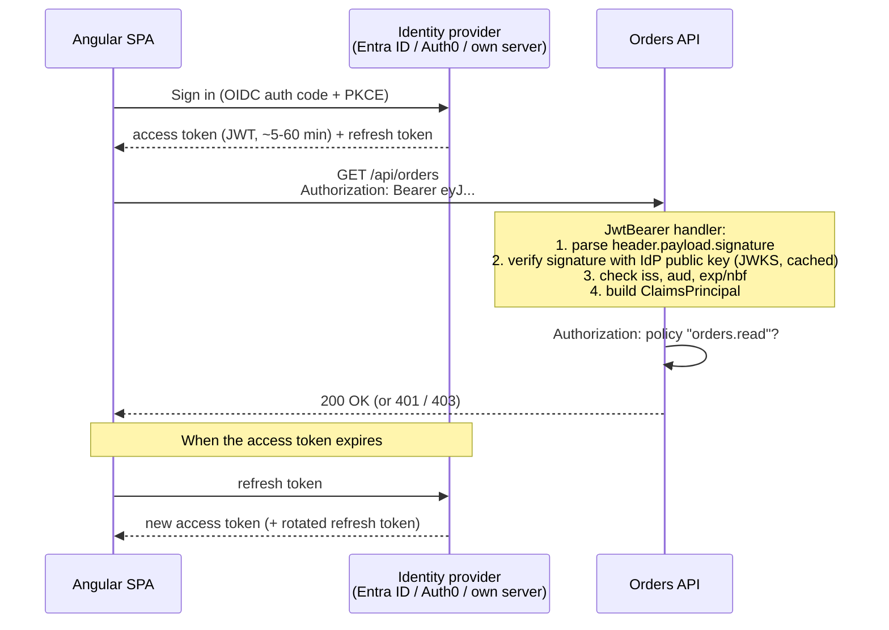
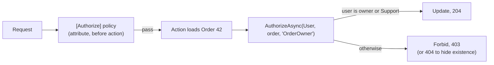

import { Tabs, TabItem, Aside } from '@astrojs/starlight/components';
import QuizBlock from '~/components/QuizBlock.astro';

## Why it matters in interviews

Security is where interviewers dig deepest: *"Explain the JWT flow end to end"*, *"How does the API know the token is valid?"*, *"401 vs 403?"*, *"How do you implement 'a user can edit only their own orders'?"*, *"Where does the Angular app keep the token?"*, *"How do refresh tokens work and how do you revoke access?"*. A good answer covers both the protocol and the ASP.NET Core building blocks: schemes, handlers, claims, policies and requirements.

## Core idea

- **Authentication (authN)**: *who are you?* A handler reads a credential (JWT, cookie, API key, certificate), validates it and builds a `ClaimsPrincipal` in `HttpContext.User`.
- **Authorization (authZ)**: *are you allowed to do this?* Policies evaluate the principal's claims (and optionally the resource) and allow or deny.

| Outcome | Status | ASP.NET Core term |
|---|---|---|
| No valid credentials | **401 Unauthorized** | Challenge |
| Authenticated, but not permitted | **403 Forbidden** | Forbid |

The `UseAuthentication()` middleware runs the default scheme's handler for every request. `UseAuthorization()` reads the endpoint's `[Authorize]` / `RequireAuthorization()` metadata and evaluates the policies. Order matters: see [Request pipeline](../middleware-pipeline/).

### The JWT bearer flow



A JWT is `base64url(header).base64url(payload).signature`. It is **signed, not encrypted**: anyone holding it can read the claims, so never put secrets in it. The API doesn't call the identity provider per request. It downloads the provider's **public signing keys** once from the OpenID Connect discovery document (`{authority}/.well-known/openid-configuration` → `jwks_uri`), caches them, and verifies signatures locally. That is why JWTs scale well and also why they **can't be revoked** before expiry without extra machinery.

### What the API validates

| Check | Option | Why |
|---|---|---|
| Signature | `ValidateIssuerSigningKey`, keys from `Authority` | Token not forged or modified |
| Issuer (`iss`) | `ValidIssuer` | Issued by the IdP you trust |
| Audience (`aud`) | `Audience` / `ValidAudience` | Issued **for this API**, not another app |
| Lifetime (`exp`, `nbf`) | `ValidateLifetime`, `ClockSkew` (default 5 min) | Expired tokens rejected |
| Algorithm | `ValidAlgorithms` | Blocks downgrade tricks such as `alg: none` |

Skipping the audience check is a classic bug: a token issued for *another* API of the same tenant would be accepted.

### Refresh tokens

Access tokens are short-lived to limit damage if stolen. A **refresh token** (opaque, long-lived, stored server-side by the IdP or your auth service) gets new access tokens without re-login. Good practice:

- **Rotation**: each use returns a new refresh token and invalidates the old one; reuse of an old one signals theft, so revoke the whole family.
- Store refresh tokens **hashed**, bound to the user/device, with expiry and revocation.
- In a browser, keep tokens out of `localStorage` where XSS can read them: memory for the access token, an HttpOnly cookie or a **BFF** for the refresh token. See [Sessions, JWT & refresh tokens](../../security/authn-authz-tokens/).

### Cookie authentication

The cookie handler stores the serialized, **encrypted** (Data Protection) principal in a cookie. Best for server-rendered apps and the **BFF pattern**, where the Angular app talks to its own backend with a `HttpOnly; Secure; SameSite` cookie and the backend holds the tokens. Cookies are sent automatically by the browser, so you need **CSRF protection** (SameSite plus antiforgery tokens) that bearer tokens don't need.

| | JWT bearer | Cookie |
|---|---|---|
| Sent by | Client code (`Authorization` header) | Browser automatically |
| State | Stateless; validated by signature | Stateless ticket in cookie (or server session store) |
| Revocation | Hard until expiry | Easy (security stamp check, session store) |
| CSRF risk | No | Yes, mitigate with SameSite + antiforgery |
| XSS risk | Token readable if stored in JS-accessible storage | HttpOnly cookie not readable by JS |
| Fits | APIs, mobile, service-to-service | Same-site web apps, BFF |

### Claims, roles and policies

A **claim** is a key-value statement about the user (`sub`, `email`, `roles`, `tenant_id`, `scp`). A `ClaimsPrincipal` holds one or more `ClaimsIdentity` objects.

- **Roles**: `[Authorize(Roles = "Admin,Support")]`. Simple, but couples code to role names.
- **Policies**: named rules registered once and applied by name: `[Authorize(Policy = "CanRefund")]`. A policy is a list of **requirements**; each requirement is handled by one or more `AuthorizationHandler`s that call `context.Succeed(requirement)`.
- A requirement passes if **any** handler succeeds and none explicitly calls `context.Fail()`. The policy passes only if **all** requirements pass.
- **Fallback policy**: applies to endpoints with no auth metadata. Setting it to "require authenticated user" makes the API secure by default; use `[AllowAnonymous]` for public endpoints.
- **`IClaimsTransformation`**: enrich the principal after authentication, e.g. load permissions from the database (cache it, it runs on every request).

### Resource-based authorization

"A user can edit only their own orders" depends on **data you load in the action**, so an attribute can't decide it. Load the resource, then call `IAuthorizationService.AuthorizeAsync(User, order, policy)` with a handler typed on the resource.



### ASP.NET Core Identity and external identity providers

**ASP.NET Core Identity** is a membership system: users, password hashing (PBKDF2 by default), lockout, email confirmation, 2FA, external logins, stored via EF Core. .NET 8 added `MapIdentityApi<TUser>()` endpoints that issue Identity's own bearer tokens for SPAs; those tokens are opaque, not JWTs.

For most company apps, **delegate identity** to a provider such as **Microsoft Entra ID** (AWS: Cognito), Auth0 or Duende IdentityServer. The API only validates tokens. With Entra ID, `Microsoft.Identity.Web` wires JwtBearer from an `AzureAd` config section; delegated permissions arrive as the `scp` claim, and app roles as `roles`.

## Code

```csharp
var builder = WebApplication.CreateBuilder(args);

builder.Services.AddAuthentication(JwtBearerDefaults.AuthenticationScheme)
    .AddJwtBearer(o =>
    {
        o.Authority = "https://login.microsoftonline.com/<tenant-id>/v2.0"; // discovery + signing keys
        o.Audience = "api://orders-api";
        o.MapInboundClaims = false;            // keep "sub", "roles" instead of long ClaimTypes URIs
        o.TokenValidationParameters = new TokenValidationParameters
        {
            ValidateIssuer = true,
            ValidateAudience = true,
            ValidateLifetime = true,
            ClockSkew = TimeSpan.FromMinutes(1),
            RoleClaimType = "roles",
            NameClaimType = "name"
        };
    });

builder.Services.AddAuthorizationBuilder()
    .SetFallbackPolicy(new AuthorizationPolicyBuilder().RequireAuthenticatedUser().Build())
    .AddPolicy("orders.read", p => p.RequireClaim("scp", "Orders.Read"))
    .AddPolicy("CanRefund", p => p.RequireRole("Support").AddRequirements(new MaxRefundRequirement(5000)))
    .AddPolicy("OrderOwner", p => p.AddRequirements(new OrderOwnerRequirement()));

builder.Services.AddSingleton<IAuthorizationHandler, MaxRefundHandler>();
builder.Services.AddSingleton<IAuthorizationHandler, OrderOwnerHandler>();

var app = builder.Build();
app.UseAuthentication();
app.UseAuthorization();
app.MapGet("/health", () => "ok").AllowAnonymous();
app.MapGet("/api/orders", () => Results.Ok()).RequireAuthorization("orders.read");
app.Run();
```

<Tabs syncKey="authz-kind">
  <TabItem label="Requirement + handler">

```csharp
public sealed record MaxRefundRequirement(decimal Limit) : IAuthorizationRequirement;

public sealed class MaxRefundHandler : AuthorizationHandler<MaxRefundRequirement>
{
    protected override Task HandleRequirementAsync(
        AuthorizationHandlerContext context, MaxRefundRequirement requirement)
    {
        // Managers bypass the limit; others must have an approval limit claim >= policy limit.
        if (context.User.IsInRole("Manager") ||
            (decimal.TryParse(context.User.FindFirst("refund_limit")?.Value, out var limit)
             && limit >= requirement.Limit))
        {
            context.Succeed(requirement);
        }
        return Task.CompletedTask;            // not calling Succeed = this handler doesn't grant
    }
}
```

  </TabItem>
  <TabItem label="Resource-based">

```csharp
public sealed class OrderOwnerRequirement : IAuthorizationRequirement;

public sealed class OrderOwnerHandler : AuthorizationHandler<OrderOwnerRequirement, Order>
{
    protected override Task HandleRequirementAsync(
        AuthorizationHandlerContext context, OrderOwnerRequirement requirement, Order order)
    {
        if (order.CustomerId == context.User.FindFirst("sub")?.Value || context.User.IsInRole("Support"))
            context.Succeed(requirement);
        return Task.CompletedTask;
    }
}

[HttpPut("{id:int}")]
public async Task<IActionResult> Update(int id, UpdateOrder cmd,
    [FromServices] IAuthorizationService auth, CancellationToken ct)
{
    var order = await db.Orders.FindAsync([id], ct);
    if (order is null) return NotFound();

    var result = await auth.AuthorizeAsync(User, order, "OrderOwner");
    if (!result.Succeeded) return Forbid();

    order.Apply(cmd);
    await db.SaveChangesAsync(ct);
    return NoContent();
}
```

  </TabItem>
</Tabs>

## Interview Q&A

<details>
<summary>Explain the JWT authentication flow in an Angular + ASP.NET Core app.</summary>

The SPA signs the user in at an identity provider using OIDC authorization code with PKCE and receives an access token (a signed JWT) plus usually a refresh token. An HTTP interceptor adds `Authorization: Bearer <token>` to API calls. The API's JwtBearer handler verifies the signature with the provider's public keys (fetched from the discovery document and cached), checks issuer, audience and expiry, and builds `HttpContext.User` from the claims. Authorization policies then decide 200 vs 403. When the access token expires, the client uses the refresh token to get a new one.
</details>

<details>
<summary>401 vs 403?</summary>

401 Unauthorized means the request isn't authenticated: no token, an expired or invalid one. The handler issues a challenge (`WWW-Authenticate: Bearer`). 403 Forbidden means the identity is known but lacks permission for this resource. Returning 403 for a missing token, or 401 for a missing role, confuses clients and their retry/login logic.
</details>

<details>
<summary>How does the API validate a JWT without calling the identity provider?</summary>

The token is signed with the provider's private key. The API fetches the matching public keys (JWKS) from the OIDC discovery endpoint at startup, caches them and refreshes them periodically, then verifies the signature locally. With a valid signature, it trusts the claims and checks `iss`, `aud`, `exp` and `nbf`. No network call per request.
</details>

<details>
<summary>How do you log a user out or revoke a JWT?</summary>

You can't invalidate a self-contained JWT before it expires, so keep access tokens short (5-15 minutes) and revoke the **refresh token**, which is server-side. For immediate revocation (account compromised), add a check against a denylist of token ids (`jti`) or a per-user "tokens valid after" timestamp in a fast store like Redis, accepting the extra lookup per request.
</details>

<details>
<summary>Roles vs claims vs policies: which do you use?</summary>

Roles are coarse groups and fine for simple apps. Claims carry facts about the user (department, tenant, permissions, scopes). Policies combine requirements over claims, roles or custom logic under a name, so controllers say `[Authorize(Policy = "CanRefund")]` and the rule lives in one place. I prefer policies, with roles or permission claims as their inputs.
</details>

<details>
<summary>How do you implement "users can edit only their own orders"?</summary>

With resource-based authorization. Write a requirement and an `AuthorizationHandler<TRequirement, Order>` that succeeds when `order.CustomerId` matches the user's `sub` (or the user has a Support role). In the action, load the order, call `IAuthorizationService.AuthorizeAsync(User, order, "OrderOwner")`, and return `Forbid()` (or `NotFound()` to avoid revealing existence) if it fails. Also scope queries by the user so list endpoints can't leak other users' data.
</details>

<details>
<summary>Where should an Angular app store tokens?</summary>

Not in `localStorage`, where any XSS can steal them. Options: keep the access token in memory and the refresh token in an HttpOnly, Secure, SameSite cookie; or use the BFF pattern, where the backend handles OIDC and the browser only gets an HttpOnly session cookie. Either way, a strict CSP and Angular's built-in sanitization reduce XSS risk.
</details>

<details>
<summary>What is the fallback policy and why set it?</summary>

It applies to endpoints that have no `[Authorize]` or `[AllowAnonymous]` metadata. Setting it to `RequireAuthenticatedUser()` makes every new endpoint secure by default, so a developer who forgets an attribute doesn't expose data. Public endpoints (health, login) opt out with `[AllowAnonymous]` / `.AllowAnonymous()`.
</details>

## Pitfalls

<Aside type="caution" title="Common mistakes">

- **Not validating audience** (or turning off validation "to make it work"), so tokens for other apps are accepted.
- **Long-lived access tokens** (days) with no refresh flow, which makes theft costly and revocation impossible.
- **Symmetric signing keys hard-coded in appsettings** and shared across services. Prefer an IdP with asymmetric keys, or keep the key in Key Vault.
- **Checking authorization only in the Angular route guard.** Guards are UX, the API must enforce every rule.
- **Role-name strings scattered** across controllers instead of named policies.
- **Claim type confusion**: `User.IsInRole` checks the configured `RoleClaimType`; if the token uses `roles` but the handler expects the long `ClaimTypes.Role` URI, every role check fails.
- **IDOR**: fetching `/orders/{id}` by id without checking ownership.

</Aside>

## Related

- [Sessions, JWT & refresh tokens](../../security/authn-authz-tokens/)
- [OAuth 2.0 & OpenID Connect](../../security/oauth-oidc/)
- [Request pipeline & middleware](../middleware-pipeline/)
- [Angular security](../../angular/security/)

## Quick quiz

<QuizBlock section="aspnet" topic="authentication-authorization" />
