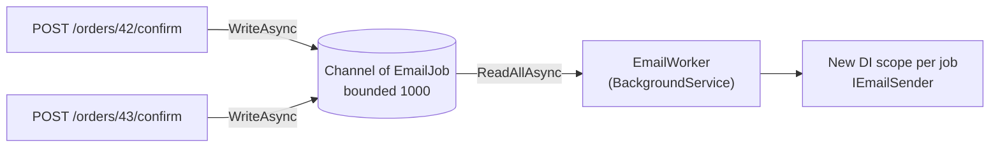
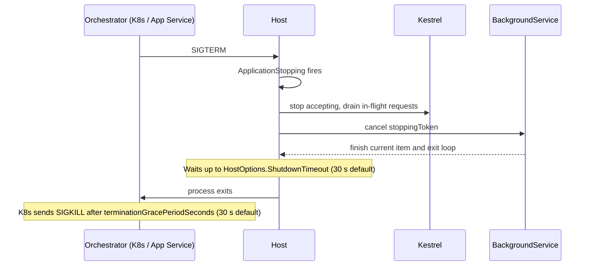

import { Aside } from '@astrojs/starlight/components';
import QuizBlock from '~/components/QuizBlock.astro';

## Why it matters in interviews

Real APIs do work outside the request: sending emails, publishing outbox messages, expiring orders, nightly reports. Interviewers ask *"how do you run a background job in ASP.NET Core?"*, then probe the details that bite in production: *"how do you use a `DbContext` in it?"*, *"what happens on deployment?"*, *"what if you run 3 instances?"* and *"when would you use Hangfire or Azure Functions instead?"*.

## Core idea

### IHostedService and BackgroundService

The generic host starts every registered `IHostedService` when the app starts and stops them when it shuts down.

| | `IHostedService` | `BackgroundService` |
|---|---|---|
| What you implement | `StartAsync` and `StopAsync` | `ExecuteAsync(CancellationToken stoppingToken)` |
| Fits | Short start-up / shut-down work (warm a cache, open a connection) | Long-running loops (queue consumer, polling, timers) |
| Stop signal | `StopAsync` is called | `stoppingToken` is cancelled, then base `StopAsync` waits for `ExecuteAsync` |

`BackgroundService` is an abstract class implementing `IHostedService`: its `StartAsync` kicks off `ExecuteAsync` and returns, and its `StopAsync` cancels the token and waits for the task. Register either with `AddHostedService<T>()`.

Facts that come up in interviews:

- Hosted services start **before** Kestrel begins accepting requests, so a slow `StartAsync` delays the app.
- Before .NET 10, the synchronous part of `ExecuteAsync` (everything before the first real `await`) ran on the startup thread and could block startup of the rest of the app. .NET 10 starts `ExecuteAsync` on a background thread, but avoiding heavy synchronous work at the top is still good practice.
- Since .NET 6, an **unhandled exception in `ExecuteAsync` stops the host** (`BackgroundServiceExceptionBehavior.StopHost`). Catch and log inside your loop unless crashing is what you want.
- .NET 8 added `IHostedLifecycleService` (`StartingAsync`, `StartedAsync`, `StoppingAsync`, `StoppedAsync`) and options to start and stop services concurrently.

### Scoped services inside a singleton worker

Hosted services are **singletons**. Injecting `AppDbContext` (scoped) directly is a captive dependency: scope validation throws at startup in Development, and in production you would share one non-thread-safe `DbContext` forever. Inject `IServiceScopeFactory` and create a scope **per unit of work** (per message, per tick), so each iteration gets a fresh `DbContext` and change tracker.

### Producer/consumer with Channel

To move work out of a request, write it to an in-memory `Channel<T>` and let a `BackgroundService` consume it. The request returns immediately (often 202 Accepted).



Use a **bounded** channel so a slow consumer applies back-pressure (`FullMode = Wait`) instead of growing memory forever. The big caveat: an in-memory queue is **lost on crash, restart or deployment**, and it is per instance. If the work must not be lost, use a durable queue (Azure Service Bus or Storage Queues; AWS: SQS) or Hangfire, or write an outbox row in the same transaction as the business data.

### Timers: PeriodicTimer

`PeriodicTimer` (.NET 6+) is the async-friendly timer: `await timer.WaitForNextTickAsync(ct)` in a loop. Ticks never overlap, because the next wait only starts after your work finishes, and cancellation is built in. `System.Threading.Timer` callbacks can overlap if work takes longer than the interval and push you towards `async void`. `PeriodicTimer` gives fixed intervals, not cron schedules; for "every day at 02:00" use a scheduler.

### Graceful shutdown



Make the worker respond to the token, finish or abandon the current item cleanly, and keep `ShutdownTimeout` below the orchestrator's grace period. Work that takes minutes should be checkpointed or made resumable, not "finished during shutdown".

### Multiple instances

A `BackgroundService` runs on **every** instance. Scale to 3 and your nightly report runs 3 times. Options: make the job idempotent and safe to run concurrently (`UPDATE ... WHERE Status = 'Pending'` with row locks), use a distributed lock or lease (Azure Blob lease, Redis lock, SQL `sp_getapplock`), let a scheduler with clustering handle it (Hangfire, Quartz.NET), or move jobs into a separate single-replica worker.

### When to use something else

| Option | Persistence | Scheduling | Good for |
|---|---|---|---|
| `BackgroundService` + `Channel<T>` | None (in memory) | `PeriodicTimer` intervals | Best-effort, fast, in-process work |
| **Hangfire** | SQL Server / Redis storage | Fire-and-forget, delayed, recurring (cron) | Durable jobs with retries and a dashboard inside your app |
| **Quartz.NET** | RAM or ADO.NET job store | Rich cron, calendars, misfire handling, clustering | Complex schedules |
| **Azure Functions** / WebJobs / Container Apps Jobs (AWS: Lambda, EventBridge Scheduler) | Trigger source (queue, timer) | Timer and queue triggers | Independent scaling and deployment, event-driven work |
| Worker Service (`dotnet new worker`) | Your choice | Your choice | Same `BackgroundService` model in its own process |

## Code

**Periodic job with a scope per tick**

```csharp
public sealed class OrderExpiryWorker(IServiceScopeFactory scopeFactory, ILogger<OrderExpiryWorker> logger)
    : BackgroundService
{
    protected override async Task ExecuteAsync(CancellationToken stoppingToken)
    {
        using var timer = new PeriodicTimer(TimeSpan.FromMinutes(1));
        try
        {
            do
            {
                try
                {
                    await using var scope = scopeFactory.CreateAsyncScope();
                    var db = scope.ServiceProvider.GetRequiredService<AppDbContext>();
                    var cutoff = DateTime.UtcNow.AddMinutes(-30);
                    var expired = await db.Orders
                        .Where(o => o.Status == "Pending" && o.CreatedUtc < cutoff)
                        .ExecuteUpdateAsync(s => s.SetProperty(o => o.Status, "Expired"), stoppingToken);
                    logger.LogInformation("Expired {Count} orders", expired);
                }
                catch (Exception ex) when (ex is not OperationCanceledException)
                {
                    logger.LogError(ex, "Order expiry run failed"); // keep the loop alive
                }
            }
            while (await timer.WaitForNextTickAsync(stoppingToken));
        }
        catch (OperationCanceledException) { /* shutting down */ }
    }
}
```

**Bounded Channel queue and consumer**

```csharp
public sealed record EmailJob(string To, string Template, int OrderId);

public sealed class EmailQueue
{
    private readonly Channel<EmailJob> _channel = Channel.CreateBounded<EmailJob>(
        new BoundedChannelOptions(capacity: 1_000) { FullMode = BoundedChannelFullMode.Wait, SingleReader = true });

    public ValueTask EnqueueAsync(EmailJob job, CancellationToken ct) => _channel.Writer.WriteAsync(job, ct);
    public IAsyncEnumerable<EmailJob> DequeueAllAsync(CancellationToken ct) => _channel.Reader.ReadAllAsync(ct);
}

public sealed class EmailWorker(EmailQueue queue, IServiceScopeFactory scopeFactory, ILogger<EmailWorker> logger)
    : BackgroundService
{
    protected override async Task ExecuteAsync(CancellationToken stoppingToken)
    {
        await foreach (var job in queue.DequeueAllAsync(stoppingToken))
        {
            try
            {
                await using var scope = scopeFactory.CreateAsyncScope();
                var sender = scope.ServiceProvider.GetRequiredService<IEmailSender>();
                await sender.SendAsync(job, stoppingToken);
            }
            catch (Exception ex) when (ex is not OperationCanceledException)
            {
                logger.LogError(ex, "Email for order {OrderId} failed", job.OrderId);
            }
        }
    }
}
```

**Registration and an endpoint that enqueues**

```csharp
builder.Services.AddSingleton<EmailQueue>();
builder.Services.AddHostedService<EmailWorker>();
builder.Services.AddHostedService<OrderExpiryWorker>();
builder.Services.Configure<HostOptions>(o => o.ShutdownTimeout = TimeSpan.FromSeconds(25));

app.MapPost("/api/orders/{id:int}/confirm", async (int id, EmailQueue queue, CancellationToken ct) =>
{
    await queue.EnqueueAsync(new EmailJob("customer@example.com", "order-confirmed", id), ct);
    return TypedResults.Accepted($"/api/orders/{id}");
});
```

**Hangfire for durable jobs**

```csharp
// Arguments are serialized to storage: pass ids, not entities or DbContexts.
BackgroundJob.Enqueue<IEmailSender>(s => s.SendAsync(new EmailJob(userId, "welcome", 0), CancellationToken.None));
RecurringJob.AddOrUpdate<IReportJob>("nightly-report", j => j.RunAsync(), Cron.Daily(2));
```

## Interview Q&A

<details>
<summary>IHostedService vs BackgroundService?</summary>

`IHostedService` is the interface: `StartAsync` and `StopAsync`, called by the host. `BackgroundService` is a base class for long-running work: you implement `ExecuteAsync`, it handles starting the task and cancelling it on shutdown. Use `IHostedService` directly for short start/stop actions, `BackgroundService` for loops.
</details>

<details>
<summary>How do you use a DbContext inside a BackgroundService?</summary>

Inject `IServiceScopeFactory` and create a scope per unit of work with `CreateAsyncScope()`, resolve the `DbContext` from that scope and dispose it at the end. Injecting a scoped service into the singleton directly is a captive dependency: one `DbContext` would live forever, grow its change tracker and be used concurrently.
</details>

<details>
<summary>Why not just `Task.Run` the work from the controller?</summary>

The request's DI scope (and `DbContext`) is disposed when the response completes, so the task uses disposed objects. Exceptions are unobserved, the host doesn't know the work exists so shutdown kills it mid-way, and there's no back-pressure. Queue it to a `Channel` consumed by a `BackgroundService`, or a durable queue if it must survive restarts.
</details>

<details>
<summary>What happens to background work when you deploy?</summary>

The orchestrator sends SIGTERM, the host cancels `stoppingToken` and waits up to `ShutdownTimeout` (30 s by default) for services to stop, then exits. In-memory queue items not yet processed are lost. Design for it: respond to cancellation, keep items small, use durable queues or an outbox for work that must happen, and make jobs idempotent so a retry after a crash is safe.
</details>

<details>
<summary>Your app runs on 3 instances and the nightly job sends emails 3 times. Fix it.</summary>

Every instance runs every hosted service. Options: a scheduler with distributed coordination (Hangfire with shared storage runs a recurring job once; Quartz clustering), a distributed lock or lease so only the holder runs, moving the job to a single dedicated worker or an Azure Function timer trigger (AWS: EventBridge Scheduler + Lambda), and in all cases idempotency (mark rows as sent in the same transaction) as a safety net.
</details>

<details>
<summary>PeriodicTimer vs System.Threading.Timer vs Task.Delay loop?</summary>

`PeriodicTimer` is awaited, never overlaps ticks, supports cancellation and keeps a steady cadence regardless of how long the work takes (as long as it fits in the interval). `System.Threading.Timer` fires callbacks on the pool even if the previous one is still running, and async callbacks become `async void`. A `Task.Delay` loop drifts because the delay starts after the work.
</details>

<details>
<summary>What happens if ExecuteAsync throws?</summary>

Since .NET 6 the exception is logged and the host stops (`BackgroundServiceExceptionBehavior.StopHost`), which in Kubernetes means a restart. Before .NET 6 the service silently died while the app kept running. You can set the behaviour to `Ignore`, but it's better to catch per-iteration errors inside the loop and let only truly fatal ones escape.
</details>

<details>
<summary>When would you choose Hangfire over a BackgroundService?</summary>

When jobs must survive restarts, need automatic retries, delayed or cron scheduling, a dashboard, or must run once across a scaled-out app. Hangfire stores jobs in SQL Server or Redis. The trade-offs are an extra dependency, storage load, and serialized job arguments. For high-volume event processing, a message broker with competing consumers fits better.
</details>

## Pitfalls

<Aside type="caution" title="Common mistakes">

- **Injecting scoped services (`DbContext`) into a hosted service** constructor.
- **One scope for the whole lifetime** of the worker instead of one per unit of work.
- **Ignoring `stoppingToken`**, so shutdown waits for the timeout and then kills the work mid-way.
- **Letting one bad message throw out of `ExecuteAsync`**, which stops the entire host.
- **Unbounded channels** that grow until the process runs out of memory.
- **Assuming in-memory queues are durable**; deployments drop their contents.
- **Running schedulers on every instance** without coordination.
- **`ShutdownTimeout` longer than the orchestrator's grace period**, so SIGKILL arrives first.

</Aside>

## Related

- [Async/await deep dive](../../csharp/async-await/)
- [Dependency injection (captive dependencies)](../dependency-injection/)
- [Case study: job scheduler](../../system-design/case-job-scheduler/)
- [Message brokers](../../microservices/message-brokers/)

## Quick quiz

<QuizBlock section="aspnet" topic="background-services" />
