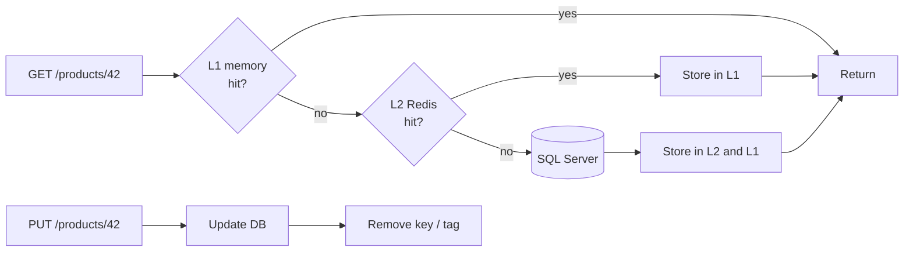

import { Aside } from '@astrojs/starlight/components';
import QuizBlock from '~/components/QuizBlock.astro';

## Why it matters in interviews

"How would you make this API faster?" almost always leads to caching, and the follow-ups are where 3-4 year candidates are separated: *"what happens with three instances behind a load balancer?"*, *"how do you invalidate?"*, *"what is a cache stampede?"*, *"output cache or response cache?"*. You are expected to know the built-in options in ASP.NET Core and when each is the right layer.

## Core idea

Caching trades **freshness** for **latency and load**. In a typical .NET API there are four layers, from the client inwards:

| Layer | Where it lives | ASP.NET Core feature | Typical use |
|---|---|---|---|
| HTTP / browser / CDN cache | Client, proxy, Azure Front Door (AWS: CloudFront) | `Cache-Control`, ETag, response caching middleware | Static or public GETs |
| Output cache | Your server, whole HTTP response | Output caching middleware (.NET 7+) | Expensive GET endpoints, same response for many users |
| Data cache, in-process | Each app instance's memory | `IMemoryCache` | Reference data, config, hot lookups |
| Data cache, distributed | Redis (Azure Cache for Redis / Azure Managed Redis; AWS: ElastiCache) | `IDistributedCache`, `HybridCache` | Shared across instances, survives restarts |

Most data caching follows the **cache-aside** pattern: read from the cache, on a miss load from the source and populate the cache, and on writes invalidate.



### IMemoryCache

An in-process dictionary with expiration. It stores **object references**, not serialized copies, so reads are nanoseconds but:

- If you mutate an object you got from the cache, every other request sees the change. Cache immutable DTOs or records.
- Each instance has its own cache. With 3 instances behind a load balancer you get 3 copies that can disagree for up to the TTL.
- It lives and dies with the process: a deployment or restart empties it.
- Expiration: **absolute** (dies at a fixed time), **sliding** (extended on each access, always pair it with an absolute cap or hot keys never refresh), plus priority and optional `SizeLimit` (when set, every entry must declare a `Size`).
- `GetOrCreateAsync` is **not** stampede-safe: two concurrent misses both run the factory.

### IDistributedCache

A `byte[]`-based interface with implementations for Redis, SQL Server and others. Every instance sees the same data and it survives app restarts. The cost is a network hop plus serialization, and the API is low-level: you serialize yourself and there is no stampede protection.

### HybridCache (GA since .NET 9)

`HybridCache` (package `Microsoft.Extensions.Caching.Hybrid`) is the modern default. It wraps an in-memory **L1** and an optional `IDistributedCache` **L2**, and gives you:

- One call, `GetOrCreateAsync(key, factory)`, instead of hand-written get / deserialize / miss / serialize / set.
- **Stampede protection**: concurrent callers for the same key on the same instance share one factory execution.
- **Tags**: `RemoveByTagAsync("products")` invalidates a group of entries.
- Configurable serialization (System.Text.Json by default, pluggable for protobuf and others) and a maximum payload size.
- Separate `Expiration` (L2) and `LocalCacheExpiration` (L1) so local copies can be short-lived.

If no `IDistributedCache` is registered it works as a stampede-safe memory cache. Removing a key clears this instance's L1 and the shared L2. Other instances' L1 copies only disappear when `LocalCacheExpiration` passes, which is why you keep L1 short.

### Output caching vs response caching

| | Output caching (`AddOutputCache`, .NET 7+) | Response caching (`AddResponseCaching`) |
|---|---|---|
| Who decides | **Server** policy per endpoint | **HTTP headers** (`Cache-Control`, `Vary`) |
| Client can bypass with `Cache-Control: no-cache`? | No | Yes |
| Invalidation | Tags, `IOutputCacheStore.EvictByTagAsync` | Only by expiry |
| Stampede protection | Yes (resource locking, on by default) | No |
| Storage | Memory by default, Redis store available (.NET 8+) | Memory only |
| Defaults | GET/HEAD, 200 only; skips authenticated requests and responses that set cookies | GET/HEAD, 200 only; follows HTTP caching rules |

For APIs you control, prefer **output caching**. Response caching is useful mainly when you want standards-based behaviour together with downstream HTTP caches.

### ETags and conditional requests

An **ETag** is a version identifier for a representation (a hash or SQL `rowversion`). The client sends it back:

- `If-None-Match: "abc"` on GET: if unchanged, return **304 Not Modified** with no body. Saves bandwidth, but the server still does a lookup.
- `If-Match: "abc"` on PUT/PATCH: if the resource changed since the client read it, return **412 Precondition Failed**. This is optimistic concurrency over HTTP.

### Cache stampede (thundering herd)

A hot key expires, and 500 concurrent requests all miss and hit the database at once. Mitigations:

1. **Single-flight / locking**: only one caller recomputes, the rest wait (built into `HybridCache` and output caching per instance).
2. **TTL jitter**: add a random few seconds so many keys don't expire together.
3. **Early refresh / stale-while-revalidate**: refresh in the background before expiry and serve the slightly stale value meanwhile.
4. **Pre-warming** hot keys on startup or after deployments.

### Invalidation strategies

- **TTL only**: simplest; accept staleness up to the TTL. Good for reference data.
- **Explicit eviction on write**: update the database, then remove the key (delete, don't update, to avoid racing writers).
- **Tags**: evict a group (`products`) when any member changes.
- **Events**: publish a "ProductChanged" message (Azure Service Bus, AWS: SNS/SQS) so every service evicts its copies.
- **Versioned keys**: `catalog:v17:product:42`; bump the version to orphan the old set.

## Code

**Registration (Program.cs)**

```csharp
builder.Services.AddStackExchangeRedisCache(o =>
{
    o.Configuration = builder.Configuration.GetConnectionString("redis");
    o.InstanceName = "shop:";
});

// HybridCache picks up the registered IDistributedCache as L2.
builder.Services.AddHybridCache(o =>
{
    o.MaximumPayloadBytes = 1024 * 1024;
    o.DefaultEntryOptions = new HybridCacheEntryOptions
    {
        Expiration = TimeSpan.FromMinutes(5),          // L2
        LocalCacheExpiration = TimeSpan.FromMinutes(1) // L1
    };
});

builder.Services.AddOutputCache(o =>
{
    o.AddBasePolicy(b => b.Expire(TimeSpan.FromSeconds(30)));
    o.AddPolicy("catalog", b => b
        .Expire(TimeSpan.FromMinutes(5))
        .SetVaryByQuery("page", "category")
        .Tag("products"));
});
```

**Data caching with HybridCache**

```csharp
public sealed class ProductService(HybridCache cache, AppDbContext db)
{
    public async Task<ProductDto?> GetAsync(int id, CancellationToken ct) =>
        await cache.GetOrCreateAsync(
            $"product:{id}",
            async token => await db.Products
                .Where(p => p.Id == id)
                .Select(p => new ProductDto(p.Id, p.Name, p.Price))
                .FirstOrDefaultAsync(token),
            tags: ["products"],
            cancellationToken: ct);

    public async Task UpdatePriceAsync(int id, decimal price, CancellationToken ct)
    {
        await db.Products.Where(p => p.Id == id)
            .ExecuteUpdateAsync(s => s.SetProperty(p => p.Price, price), ct);
        await cache.RemoveAsync($"product:{id}", ct); // write DB first, then evict
    }
}

public sealed record ProductDto(int Id, string Name, decimal Price);
```

**Output cache with tag eviction**

```csharp
app.UseOutputCache(); // must come after UseCors (and UseRouting if you call it explicitly)

app.MapGet("/api/products", (int page, int? category, AppDbContext db) =>
        db.Products.AsNoTracking().Skip((page - 1) * 20).Take(20).ToListAsync())
   .CacheOutput("catalog");

app.MapPost("/api/products/{id:int}/price", async (int id, decimal price,
    ProductService svc, IOutputCacheStore store, CancellationToken ct) =>
{
    await svc.UpdatePriceAsync(id, price, ct);
    await store.EvictByTagAsync("products", ct);
    return Results.NoContent();
});
```

**ETag with a SQL Server rowversion**

```csharp
app.MapGet("/api/products/{id:int}", async (int id, HttpContext http, AppDbContext db, CancellationToken ct) =>
{
    var product = await db.Products.AsNoTracking().FirstOrDefaultAsync(p => p.Id == id, ct);
    if (product is null) return Results.NotFound();

    var etag = $"\"{Convert.ToBase64String(product.RowVersion)}\"";
    if (http.Request.Headers.IfNoneMatch == etag)
        return Results.StatusCode(StatusCodes.Status304NotModified);

    http.Response.Headers.ETag = etag;
    return Results.Ok(product);
});
```

## Interview Q&A

<details>
<summary>IMemoryCache vs IDistributedCache: when do you use which?</summary>

`IMemoryCache` is per-process, stores live object references and is the fastest option. Use it for small, rarely changing data where a short inconsistency between instances is acceptable. `IDistributedCache` (Redis) is shared by all instances and survives restarts, at the cost of a network hop and serialization. Use it for data that must be consistent across a scaled-out app or is expensive to rebuild. In .NET 9+ `HybridCache` combines both, so it is usually the default choice for new code.
</details>

<details>
<summary>What problems does HybridCache solve over hand-written Redis caching?</summary>

Four things: it removes the get / deserialize / miss / load / serialize / set boilerplate; it adds stampede protection so concurrent misses for one key run the factory once per instance; it adds a fast L1 in front of Redis; and it supports tag-based invalidation. You still choose sensible keys, TTLs and invalidation points.
</details>

<details>
<summary>What is a cache stampede and how do you prevent it?</summary>

When a hot entry expires, many concurrent requests miss together and all hit the database, sometimes taking it down. Prevent it with single-flight loading (`HybridCache`, output cache locking, or a per-key `SemaphoreSlim`), TTL jitter, background refresh before expiry, and pre-warming hot keys.
</details>

<details>
<summary>Output caching vs response caching?</summary>

Output caching is server-controlled: you define policies per endpoint, clients cannot bypass it with `no-cache`, it supports tag eviction and stampede protection, and it can store in Redis. Response caching follows HTTP caching headers, so the client influences it, and it only expires by time. For APIs, output caching is usually the right one.
</details>

<details>
<summary>Your API runs on 4 instances with IMemoryCache. A product price is updated. What happens?</summary>

Only the instance that handled the update can evict its own entry. The other three keep serving the old price until their TTL expires, so users see different prices depending on which instance they hit. Fixes: move to a distributed or hybrid cache, keep the L1 TTL short, or broadcast an invalidation message (Redis pub/sub, Service Bus) that every instance listens to.
</details>

<details>
<summary>Why "update the database, then delete the cache key" rather than updating the cached value?</summary>

Two concurrent writers can interleave so that the older value is written to the cache last and stays there until the TTL expires. Deleting forces the next reader to load the current value from the source of truth. Updating the DB first ensures a reader can't reload the old value after you evicted it (except in a narrow race, which a TTL bounds).
</details>

<details>
<summary>How do ETags help both performance and concurrency?</summary>

On GET, the client sends `If-None-Match`; if the ETag is unchanged the server returns 304 with no body, saving bandwidth and serialization. On PUT/PATCH the client sends `If-Match`; if the resource changed meanwhile, the server returns 412, which prevents lost updates. A SQL Server `rowversion` column is a natural ETag source.
</details>

<details>
<summary>What should you never cache, or cache carefully?</summary>

Per-user or tenant data under a shared key (a data leak: always include user or tenant id in the key and never output-cache authenticated responses without varying by user), secrets and tokens, data that must be strongly consistent (balances, stock at checkout), and huge payloads that evict everything else. Also cache negative results ("not found") only briefly.
</details>

## Pitfalls

<Aside type="caution" title="Common mistakes">

- **Mutating objects returned from `IMemoryCache`**: you are changing the shared instance for every request.
- **Sliding expiration without an absolute cap**: a hot key is never refreshed and serves stale data forever.
- **Cache keys missing a dimension** (tenant, user, culture, page size), so one user sees another's data.
- **Assuming `IMemoryCache` is consistent across instances** behind a load balancer.
- **No TTL jitter** on keys created together, causing synchronized expiry and a stampede.
- **Placing `UseOutputCache` before `UseCors`**, or output-caching authenticated responses by forcing the policy without varying by user.
- **Caching `IQueryable` or EF entities with lazy-loading proxies** instead of materialized DTOs.
- **Treating Redis as the source of truth**: it is a cache; eviction under memory pressure is normal.

</Aside>

## Related

- [Caching in system design](../../system-design/caching/)
- [Performance & resilience](../performance-resilience/)
- [REST API design (conditional requests, idempotency)](../rest-api-design/)
- [EF Core performance](../../data/efcore-performance/)

## Quick quiz

<QuizBlock section="aspnet" topic="caching" />
