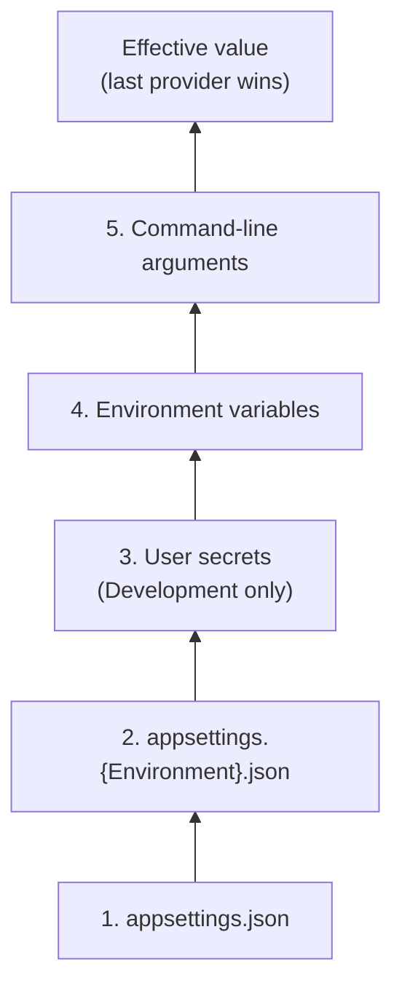

import { Tabs, TabItem, Aside } from '@astrojs/starlight/components';
import QuizBlock from '~/components/QuizBlock.astro';

## Why it matters in interviews

Configuration questions reveal how you have handled real deployments: *"Where do you keep the connection string in production?"*, *"`appsettings.Production.json` says X, but the app uses Y, why?"*, *"`IOptions` vs `IOptionsSnapshot` vs `IOptionsMonitor`?"*, *"How do you fail fast on a missing setting?"*. The last two are near-certain at 3-4 years.

## Core idea

`IConfiguration` is a **flattened key-value view** over several **providers**. Keys are hierarchical with `:` as the separator (`Payment:Stripe:ApiKey`). Each provider loads its keys, and when the same key exists in several providers, **the provider added last wins**.

### Default providers and precedence

`WebApplication.CreateBuilder` adds these, lowest to highest priority:



Anything you add after `CreateBuilder` (Azure Key Vault, Azure App Configuration) sits **above** command-line args unless you re-order sources. So the typical layering is: defaults in `appsettings.json`, environment differences in `appsettings.{env}.json`, secrets and per-deployment values in environment variables or a vault.

### Environment variables and naming

Environment variables can't contain `:` on every platform, so use **double underscore**: `ConnectionStrings__Orders` maps to `ConnectionStrings:Orders`. Arrays use indexes: `AllowedOrigins__0`. Azure App Service application settings and Kubernetes `env` entries are just environment variables, which is why they override `appsettings.json` without code changes.

### Secrets: where they belong

| Environment | Store | Notes |
|---|---|---|
| Local dev | **User secrets** (`dotnet user-secrets set ...`) | Plain JSON in your user profile, outside the repo. Not encryption, just "not in git". |
| CI/CD | Pipeline secret variables | Injected as env vars at deploy time |
| Cloud | **Azure Key Vault** (AWS: Secrets Manager / SSM Parameter Store) | Accessed with **managed identity**, no credentials in config |
| Anywhere | Never in `appsettings.json` committed to git | Rotate immediately if one leaks |

Key Vault secret names can't contain `:`, so the provider maps `--` to `:`: a secret named `ConnectionStrings--Orders` becomes `ConnectionStrings:Orders`. Azure App Service also supports **Key Vault references** in app settings (`@Microsoft.KeyVault(SecretUri=...)`), which resolve the secret into an environment variable without any code.

### The Options pattern

Instead of injecting `IConfiguration` and reading strings everywhere, bind a section to a **strongly typed class** and inject it through the options interfaces. Benefits: type safety, validation, testability (`Options.Create(new PaymentOptions { ... })`), and one place that knows the section name.

| | `IOptions<T>` | `IOptionsSnapshot<T>` | `IOptionsMonitor<T>` |
|---|---|---|---|
| Registered as | Singleton | **Scoped** | Singleton |
| Value computed | Once, on first `.Value` | Once per request (scope) | On change; `CurrentValue` always latest |
| Sees config reload | No | Yes, from the next request | Yes, immediately; `OnChange` callback |
| Named options | No (default name only) | `Get(name)` | `Get(name)` |
| Inject into singletons | Yes | **No** (captive dependency) | Yes |
| Use when | Settings that never change at runtime (most) | Per-request consistency with reload | Singletons/background services that must react to changes |

`appsettings*.json` files are loaded with `reloadOnChange: true`, so editing the file on disk (or a Kubernetes ConfigMap mounted as a file) updates `IConfiguration`. Only `IOptionsSnapshot` and `IOptionsMonitor` surface that change to your code.

### Validation and fail-fast

By default, options are bound and validated **lazily**, the first time someone reads `.Value`. A typo in a key then blows up on the first request that needs it, possibly hours after deployment. Fix it with:

- `ValidateDataAnnotations()` for `[Required]`, `[Range]`, `[Url]` on the options class.
- `Validate(o => ..., "message")` or an `IValidateOptions<T>` class for cross-field rules.
- **`ValidateOnStart()`**, which validates when the host starts, so a bad deployment fails its startup (and its health probe) instead of serving errors.
- In .NET 8+, the `[OptionsValidator]` source generator creates a reflection-free, AOT-friendly validator from the DataAnnotations.

## Code

```json
{
  "Payment": {
    "Provider": "Stripe",
    "BaseUrl": "https://api.stripe.com",
    "TimeoutSeconds": 10,
    "Retry": { "MaxAttempts": 3 }
  },
  "ConnectionStrings": { "Orders": "Server=localhost;Database=Orders;Trusted_Connection=True;TrustServerCertificate=True" }
}
```

```csharp
namespace Orders.Api.Options;

public sealed class PaymentOptions
{
    public const string Section = "Payment";

    [Required] public string Provider { get; set; } = "";
    [Required, Url] public string BaseUrl { get; set; } = "";
    [Range(1, 60)] public int TimeoutSeconds { get; set; } = 10;
    public string? ApiKey { get; set; }                       // from Key Vault / user secrets
    public RetryOptions Retry { get; set; } = new();
}

public sealed class RetryOptions
{
    [Range(0, 10)] public int MaxAttempts { get; set; } = 3;
}
```

```csharp
var builder = WebApplication.CreateBuilder(args);

if (builder.Environment.IsProduction())
{
    // Managed identity in Azure, developer login locally. Secret "Payment--ApiKey" -> "Payment:ApiKey".
    builder.Configuration.AddAzureKeyVault(
        new Uri(builder.Configuration["KeyVault:Uri"]!), new DefaultAzureCredential());
}

builder.Services.AddOptions<PaymentOptions>()
    .Bind(builder.Configuration.GetSection(PaymentOptions.Section))
    .ValidateDataAnnotations()
    .Validate(o => o.Provider != "Stripe" || !string.IsNullOrEmpty(o.ApiKey),
              "Payment:ApiKey is required for Stripe")
    .ValidateOnStart();                                       // fail at startup, not on first use

// Named options: two configurations of the same type
builder.Services.Configure<RetryOptions>("fast", o => o.MaxAttempts = 1);
builder.Services.Configure<RetryOptions>("patient", o => o.MaxAttempts = 8);
```

Consuming the three interfaces:

```csharp
// Most services: settings fixed for the app's life
public sealed class PaymentClient(HttpClient http, IOptions<PaymentOptions> options)
{
    private readonly PaymentOptions _opts = options.Value;
}

// Singleton that must react to changes without a restart
public sealed class FeatureGate : IDisposable
{
    private readonly IDisposable? _sub;
    private volatile bool _maintenance;

    public FeatureGate(IOptionsMonitor<MaintenanceOptions> monitor, ILogger<FeatureGate> log)
    {
        _maintenance = monitor.CurrentValue.Enabled;
        _sub = monitor.OnChange(o =>
        {
            _maintenance = o.Enabled;
            log.LogInformation("Maintenance mode is now {Enabled}", o.Enabled);
        });
    }

    public bool InMaintenance => _maintenance;
    public void Dispose() => _sub?.Dispose();
}

// Scoped service wanting a consistent value for the whole request + named options
public sealed class RetryPolicyFactory(IOptionsSnapshot<RetryOptions> retry)
{
    public int AttemptsFor(bool userFacing) => retry.Get(userFacing ? "fast" : "patient").MaxAttempts;
}
```

## Interview Q&A

<details>
<summary>In what order are configuration sources applied by default?</summary>

`appsettings.json`, then `appsettings.{Environment}.json`, then user secrets (Development only), then environment variables, then command-line arguments. Later sources override earlier ones for the same key. Providers you add afterwards, such as Key Vault, override all of them.
</details>

<details>
<summary>`appsettings.Production.json` has the right connection string, but the app in Azure uses a different one. What would you check?</summary>

First, whether something with higher precedence sets the same key: an App Service application setting or connection string, a Kubernetes env var (`ConnectionStrings__Orders`), a command-line argument, or Key Vault. Second, whether the environment is really `Production`, since `ASPNETCORE_ENVIRONMENT` may be unset or different. Third, whether the file was actually published. Logging the configuration source with `builder.Configuration.GetDebugView()` (never in production logs, it prints secrets) helps locally.
</details>

<details>
<summary>`IOptions` vs `IOptionsSnapshot` vs `IOptionsMonitor`?</summary>

`IOptions<T>` is a singleton computed once, so it never sees reloads. `IOptionsSnapshot<T>` is scoped and recomputed per request, so changes apply from the next request and stay stable within one; it supports named options but can't be injected into singletons. `IOptionsMonitor<T>` is a singleton whose `CurrentValue` always reflects the latest config and offers `OnChange` notifications, which suits singletons and background services.
</details>

<details>
<summary>How do you make the app fail at startup if a required setting is missing?</summary>

Register with `AddOptions<T>().Bind(section).ValidateDataAnnotations().ValidateOnStart()`, adding `Validate(...)` or an `IValidateOptions<T>` for custom rules. Without `ValidateOnStart`, validation only happens the first time `.Value` is read, which could be deep inside a request hours later.
</details>

<details>
<summary>How do you manage secrets locally and in production?</summary>

Locally with user secrets, which live outside the repo in the user profile. In CI, as secret pipeline variables. In Azure, in Key Vault accessed with a managed identity, either through the Key Vault configuration provider or App Service Key Vault references (AWS: Secrets Manager or SSM Parameter Store with an IAM role). Nothing secret goes into committed appsettings files.
</details>

<details>
<summary>Why not just inject `IConfiguration` everywhere?</summary>

It spreads magic strings across the codebase, gives no type safety or validation, and makes classes harder to test because you need to build a configuration object. Options classes centralise the section name, validate at startup and can be created directly in tests with `Options.Create(...)`. Reading `IConfiguration` in `Program.cs` during setup is fine.
</details>

<details>
<summary>How do you override a nested setting with an environment variable in Docker or Kubernetes?</summary>

Replace each `:` with `__`: `Payment__Retry__MaxAttempts=5` overrides `Payment:Retry:MaxAttempts`. For arrays use the index, such as `Cors__Origins__0`. Environment variables beat appsettings files in the default order.
</details>

## Pitfalls

<Aside type="caution" title="Common mistakes">

- **Secrets in `appsettings.json` committed to git**, including "temporary" dev keys that are shared with production.
- **Injecting `IOptionsSnapshot` into a singleton**: scope validation error or a captive, never-updating value.
- **Expecting `IOptions<T>` to pick up a changed file** without restarting.
- **Lazy validation**: no `ValidateOnStart`, so a typo in a key surfaces as a `NullReferenceException` in production traffic.
- **Using `:` in environment variable names on Linux**: use `__`.
- **Logging the whole configuration** (or `GetDebugView()`) and leaking connection strings into log storage.
- **Mutating options objects at runtime** to "change config". They are shared; use a proper feature flag or settings store such as Azure App Configuration.

</Aside>

## Related

- [Hosting model & Program.cs](../hosting-startup/)
- [Dependency injection](../dependency-injection/)
- [Hashing, encryption & secrets](../../security/crypto-secrets/)
- [Enterprise patterns (Options pattern)](../../patterns/enterprise-patterns/)

## Quick quiz

<QuizBlock section="aspnet" topic="configuration-options" />
