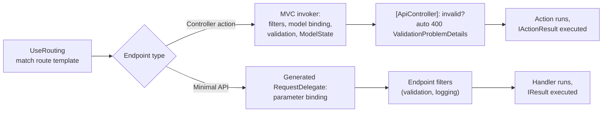

import { Tabs, TabItem, Aside } from '@astrojs/starlight/components';
import QuizBlock from '~/components/QuizBlock.astro';

## Why it matters in interviews

Every API you have built went through routing, model binding and validation, so interviewers expect precise answers: *"What does `[ApiController]` actually do?"*, *"Where does a parameter come from if you don't annotate it?"*, *"Controllers or minimal APIs for a new service, and why?"*, *"How do you return a consistent error format?"*. Vague answers here suggest you only ever copied the scaffolded controller.

## Core idea

Both programming models sit on the same **endpoint routing** system. A controller action and a `MapGet` lambda both become an `Endpoint` with a route pattern and metadata. What differs is what runs *inside* the endpoint.



### Controllers vs minimal APIs

| | Controllers | Minimal APIs |
|---|---|---|
| Style | Classes deriving from `ControllerBase`, attributes | Lambdas / static methods mapped in code |
| Cross-cutting | MVC filters (action, result, exception, resource) | Endpoint filters, route groups |
| Validation | Automatic via `ModelState` + `[ApiController]` | Built-in DataAnnotations validation since .NET 10 (`AddValidation()`); before that, filters or manual |
| Native AOT | Not supported | Supported (source-generated delegates) |
| Overhead | Slightly more (MVC invoker, filters) | Lower; fewer allocations |
| Fits | Large existing codebases, teams used to MVC conventions, heavy filter usage | New microservices, vertical slices, high-throughput endpoints |

Neither is "the right one". Microsoft now treats minimal APIs as the recommended starting point for new APIs, but controllers are fully supported and dominate existing codebases. A good interview answer names the trade-offs and picks based on team, codebase and AOT needs.

### What `[ApiController]` does

1. **Attribute routing is required**: conventional routes don't reach these controllers.
2. **Automatic 400**: if `ModelState` is invalid after binding/validation, the action never runs; the client gets a `ValidationProblemDetails` body. Disable with `SuppressModelStateInvalidFilter`.
3. **Binding source inference**: complex types → body, route-template names → route, `IFormFile` → form, registered services → DI, everything else → query.
4. **Multipart inference**: `IFormFile` parameters imply `multipart/form-data`.
5. **ProblemDetails for error codes**: `NotFound()`, `BadRequest()` and other 4xx results get an RFC 9457 problem body.

### Routing and constraints

Attribute routes combine controller and action templates: `[Route("api/orders")]` + `[HttpGet("{id:int}")]` gives `GET api/orders/42`. **Route constraints** (`int`, `guid`, `alpha`, `min(1)`, `length(3,20)`, `regex(...)`) help pick between endpoints; a request that fails a constraint simply doesn't match, so the client gets **404, not 400**. Use them for disambiguation, and use validation for input rules.

### Model binding sources

| Source | Attribute | Typical data |
|---|---|---|
| Route values | `[FromRoute]` | `/orders/{id}` |
| Query string | `[FromQuery]` | `?page=2&status=Open` |
| Headers | `[FromHeader]` | `X-Tenant`, `If-Match` |
| Body (JSON, **only one** per action) | `[FromBody]` | Command DTOs |
| Form fields / files | `[FromForm]` | File uploads |
| DI container | `[FromServices]` (often inferred) | Services used by one action only |
| Keyed service | `[FromKeyedServices("key")]` | Strategy per endpoint |

Special types like `CancellationToken`, `HttpContext` and `ClaimsPrincipal` bind automatically in both models. In minimal APIs, `[AsParameters]` groups many parameters into one record.

### Validation

- **DataAnnotations** (`[Required]`, `[Range]`, `[StringLength]`, `[EmailAddress]`, `IValidatableObject` for cross-field rules): run automatically during model binding for controllers. In .NET 10, minimal APIs validate them too after `builder.Services.AddValidation()`.
- **FluentValidation**: rules in separate validator classes, better for complex, conditional or async rules and for keeping DTOs clean. The library's automatic MVC pipeline integration is no longer recommended by its authors, so teams call validators explicitly or through a filter (see the code below).
- Keep **business rule checks** (e.g. "order already shipped") in the domain/service layer and return 409/422, not in input validation.

### Return types

| Type | Used in | Notes |
|---|---|---|
| `IActionResult` | Controllers | Any result; OpenAPI needs `[ProducesResponseType]` |
| `ActionResult<T>` | Controllers | Return `T` or a result like `NotFound()`; response type inferred |
| `IResult` via `Results.Ok(...)` | Minimal APIs | Flexible but untyped for OpenAPI |
| `TypedResults.Ok(...)` / `Results<Ok<T>, NotFound>` | Minimal APIs | Concrete types: OpenAPI metadata inferred, easy to assert in unit tests |

### ProblemDetails

`ProblemDetails` (RFC 9457, which replaced RFC 7807) is the standard JSON error shape: `type`, `title`, `status`, `detail`, `instance` plus extensions such as `traceId` or `errors`. `builder.Services.AddProblemDetails()` registers `IProblemDetailsService` so the exception handler, status code pages and `[ApiController]` all produce the same format. Details in [Global error handling](../error-handling/).

## Code

<Tabs syncKey="api-style">
  <TabItem label="Controller">

```csharp
namespace Orders.Api.Controllers;

[ApiController]
[Route("api/orders")]
public sealed class OrdersController(IOrderService orders) : ControllerBase
{
    [HttpGet("{id:int:min(1)}")]
    [ProducesResponseType<OrderDto>(StatusCodes.Status200OK)]
    [ProducesResponseType(StatusCodes.Status404NotFound)]
    public async Task<ActionResult<OrderDto>> Get(int id, CancellationToken ct) =>
        await orders.FindAsync(id, ct) is { } dto ? dto : NotFound();

    [HttpGet]
    public Task<PagedResult<OrderDto>> Search(
        [FromQuery] OrderQuery query,
        [FromHeader(Name = "X-Tenant")] string tenant,
        CancellationToken ct) => orders.SearchAsync(tenant, query, ct);

    [HttpPost]
    public async Task<IActionResult> Create(CreateOrder cmd, CancellationToken ct)  // body inferred
    {
        var id = await orders.CreateAsync(cmd, ct);   // invalid cmd never reaches here
        return CreatedAtAction(nameof(Get), new { id }, null);
    }
}

// On positional records, put attributes on the parameters (not [property: ...]):
// MVC reads validation metadata from the constructor parameters.
public sealed record CreateOrder(
    [Required] string CustomerId,
    [Range(1, 100)] int Quantity,
    [StringLength(200)] string? Notes);
```

  </TabItem>
  <TabItem label="Minimal API">

```csharp
namespace Orders.Api.Endpoints;

public static class OrderEndpoints
{
    public static RouteGroupBuilder MapOrders(this IEndpointRouteBuilder app)
    {
        var group = app.MapGroup("/api/orders")
            .WithTags("Orders")
            .RequireAuthorization();                     // applies to every endpoint in the group

        group.MapGet("/{id:int}", GetAsync).WithName("GetOrder");
        group.MapPost("/", CreateAsync)
             .AddEndpointFilter<ValidationFilter<CreateOrder>>();
        return group;
    }

    static async Task<Results<Ok<OrderDto>, NotFound>> GetAsync(
        int id, IOrderService orders, CancellationToken ct) =>
        await orders.FindAsync(id, ct) is { } dto ? TypedResults.Ok(dto) : TypedResults.NotFound();

    static async Task<CreatedAtRoute> CreateAsync(
        CreateOrder cmd, IOrderService orders, CancellationToken ct)
    {
        var id = await orders.CreateAsync(cmd, ct);
        return TypedResults.CreatedAtRoute("GetOrder", new { id });
    }
}
```

  </TabItem>
</Tabs>

A reusable FluentValidation endpoint filter for minimal APIs:

```csharp
public sealed class ValidationFilter<T>(IValidator<T> validator) : IEndpointFilter
{
    public async ValueTask<object?> InvokeAsync(EndpointFilterInvocationContext ctx, EndpointFilterDelegate next)
    {
        var arg = ctx.Arguments.OfType<T>().FirstOrDefault();
        if (arg is null) return TypedResults.Problem("Request body is missing.", statusCode: 400);

        var result = await validator.ValidateAsync(arg, ctx.HttpContext.RequestAborted);
        return result.IsValid
            ? await next(ctx)                                      // continue to the handler
            : TypedResults.ValidationProblem(result.ToDictionary()); // 400 with errors map
    }
}

public sealed class CreateOrderValidator : AbstractValidator<CreateOrder>
{
    public CreateOrderValidator()
    {
        RuleFor(x => x.CustomerId).NotEmpty();
        RuleFor(x => x.Quantity).InclusiveBetween(1, 100);
    }
}

// Program.cs
// builder.Services.AddValidatorsFromAssemblyContaining<CreateOrderValidator>();
// app.MapOrders();
```

## Interview Q&A

<details>
<summary>What does `[ApiController]` give you?</summary>

Required attribute routing, automatic 400 responses with `ValidationProblemDetails` when `ModelState` is invalid, inference of binding sources (body for complex types, route/query for simple ones, DI for registered services), multipart inference for `IFormFile`, and ProblemDetails bodies for error status codes. Without it, you would check `ModelState.IsValid` in every action.
</details>

<details>
<summary>Controllers or minimal APIs for a new microservice?</summary>

For a small, focused service I'd use minimal APIs with route groups: less ceremony, lower overhead, Native AOT support, and endpoint filters cover cross-cutting needs. For a large app with many existing controllers, heavy use of MVC filters, or a team standard, I'd stay with controllers. Mixing both in one app is fine because they share routing, DI, auth and OpenAPI.
</details>

<details>
<summary>A route has `{id:int}` and the client calls `/orders/abc`. What status code comes back, and why?</summary>

404. Route constraints are part of matching: `abc` doesn't satisfy `int`, so no endpoint matches. If you want a 400 with a message for bad input, accept the value and validate it instead. Constraints are for disambiguating routes, not for user-facing validation.
</details>

<details>
<summary>Why can an action have only one `[FromBody]` parameter?</summary>

The request body is a forward-only stream that the input formatter reads once and deserializes into one object. To accept several pieces of data, wrap them in one DTO, or move the simple values to route/query/header.
</details>

<details>
<summary>`IActionResult` vs `ActionResult<T>` vs `TypedResults`?</summary>

`IActionResult` can return anything but tells OpenAPI nothing, so you add `[ProducesResponseType]`. `ActionResult<T>` lets you return `T` directly or an error result, and infers the success type. In minimal APIs, `TypedResults` return concrete types such as `Ok<OrderDto>`, and `Results<Ok<OrderDto>, NotFound>` declares all outcomes, so OpenAPI metadata is generated automatically and unit tests can assert on the type.
</details>

<details>
<summary>DataAnnotations or FluentValidation?</summary>

DataAnnotations are built in, zero setup and fine for simple field rules. FluentValidation keeps rules out of the DTO, handles conditional, cross-field, collection and async rules more readably, and is easy to unit test. On bigger projects I've used FluentValidation for commands and DataAnnotations for simple query models, invoking validators through an endpoint filter or a MediatR pipeline behaviour.
</details>

<details>
<summary>How do you apply authorization, a tag and a filter to 20 minimal API endpoints at once?</summary>

Use a route group: `app.MapGroup("/api/orders").RequireAuthorization().WithTags("Orders").AddEndpointFilter<AuditFilter>()`. Everything mapped on the group inherits the prefix, metadata and filters. Groups can be nested, so `/api/v1` can hold shared conventions and `/orders` adds its own.
</details>

<details>
<summary>How do you turn off the automatic 400 to return your own error format?</summary>

Set `ApiBehaviorOptions.SuppressModelStateInvalidFilter = true` and check `ModelState` yourself, or better, keep it and customise `InvalidModelStateResponseFactory` to produce your own payload. If you use `AddProblemDetails` with a `CustomizeProblemDetails` callback, you can add fields such as `traceId` to every problem response, including validation ones.
</details>

## Pitfalls

<Aside type="caution" title="Common mistakes">

- **Using route constraints as validation**, then wondering why clients get 404 for bad ids.
- **Binding entities directly** (`Create(Order order)`) instead of DTOs. This enables over-posting (`IsAdmin`, `Price`) and couples the API to the database schema.
- **Not accepting `CancellationToken`**, so EF Core queries keep running after the client disconnects.
- **Returning `IActionResult` everywhere without `[ProducesResponseType]`**, so the OpenAPI document shows no response schemas.
- **Mixing validation and business rules**: "customer exists" checks inside validators that hit the DB on every request, often twice.
- **Forgetting that minimal APIs before .NET 10 don't validate DataAnnotations** automatically.

</Aside>

## Related

- [Filters vs Middleware](../filters/)
- [Global error handling](../error-handling/)
- [API versioning, OpenAPI & CORS](../versioning-openapi-cors/)
- [REST API design](../rest-api-design/)

## Quick quiz

<QuizBlock section="aspnet" topic="controllers-minimal-apis" />
