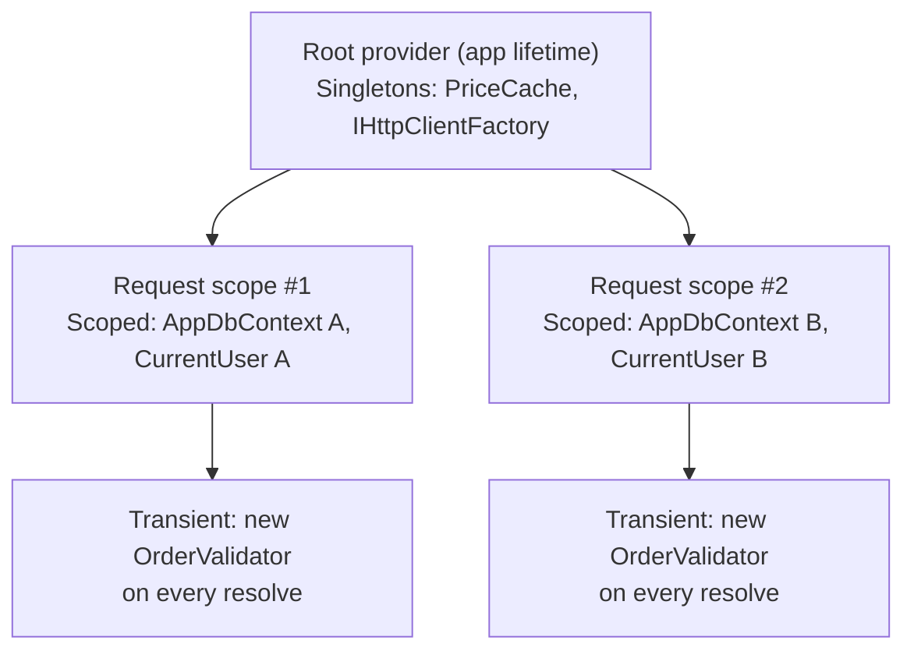

import { Tabs, TabItem, Aside } from '@astrojs/starlight/components';
import QuizBlock from '~/components/QuizBlock.astro';

## Why it matters in interviews

DI is asked in nearly every .NET round, and almost never as *"what is DI?"*. Expect *"What happens if you inject a scoped service into a singleton?"*, *"How do you use a `DbContext` inside a `BackgroundService`?"*, *"You registered two implementations of the same interface, which one do you get?"*. These questions test whether you have debugged real lifetime bugs: stale data, `ObjectDisposedException`, `DbContext` used across threads, memory growth.

## Core idea

**Dependency injection** means a class receives its collaborators (usually through the constructor) instead of creating them. The **container** (`IServiceProvider`) builds the object graph from registrations in `IServiceCollection`. The benefits: loose coupling to abstractions, easy swapping in tests, and centrally managed **lifetimes** and **disposal**.

When resolving a type, the built-in container picks the public constructor with the most parameters it can satisfy, resolves each parameter recursively, and caches the instance according to its lifetime. Anything it created that implements `IDisposable` / `IAsyncDisposable` is disposed when its owning scope (or the root) is disposed.

### Lifetimes

| Lifetime | One instance per | Disposed when | Typical use |
|---|---|---|---|
| **Transient** | Every resolution | Owning scope ends | Lightweight, stateless helpers, mappers |
| **Scoped** | Scope (one HTTP request in ASP.NET Core) | Request ends | `DbContext`, unit of work, current-user / tenant context |
| **Singleton** | Application | App shuts down | Caches, `IHttpClientFactory`, configuration wrappers, thread-safe clients |



Rule of thumb: **a service may depend only on services with the same or a longer lifetime.** Singleton → singleton only. Scoped → scoped or singleton. Transient → anything.

### Captive dependency

A **captive dependency** is a shorter-lived service trapped inside a longer-lived one. The classic case: a singleton takes a scoped `DbContext` in its constructor. The singleton is created once, so it holds the first request's `DbContext` forever. Results: stale tracked entities, the context being used concurrently by many requests (it isn't thread-safe), and `ObjectDisposedException` after the first scope ends.

**Scope validation** catches this. In the Development environment, `CreateBuilder` turns on `ValidateScopes` and `ValidateOnBuild`, so the app throws *"Cannot consume scoped service X from singleton Y"* at startup. In Production it is off by default for startup speed, so a bug that slipped past dev can silently ship. You can turn it on everywhere:

```csharp
builder.Host.UseDefaultServiceProvider(o =>
{
    o.ValidateScopes = true;
    o.ValidateOnBuild = true;
});
```

A related trap: a **transient** that captures a scoped service is fine when resolved inside a request, but if a singleton depends on that transient, the chain is captive again. Validation checks the whole graph.

### Using scoped services from singletons and background work

A `BackgroundService` is a singleton and has no request scope. Inject `IServiceScopeFactory` and create a scope per unit of work:

```csharp
public sealed class InvoiceWorker(IServiceScopeFactory scopes, ILogger<InvoiceWorker> log) : BackgroundService
{
    protected override async Task ExecuteAsync(CancellationToken stoppingToken)
    {
        using var timer = new PeriodicTimer(TimeSpan.FromMinutes(1));
        while (await timer.WaitForNextTickAsync(stoppingToken))
        {
            await using var scope = scopes.CreateAsyncScope();   // fresh DbContext per batch
            var db = scope.ServiceProvider.GetRequiredService<AppDbContext>();
            var due = await db.Invoices.Where(i => !i.Sent).Take(100).ToListAsync(stoppingToken);
            log.LogInformation("Sending {Count} invoices", due.Count);
            // ... send, mark as sent, SaveChangesAsync
        }
    }
}
```

This is legitimate "service location" at a **composition boundary**. Doing the same inside ordinary business classes is the **service locator anti-pattern**: dependencies become hidden, tests need a container, and missing registrations surface at runtime instead of at construction.

### Multiple registrations, TryAdd and IEnumerable

- Register the same interface twice and inject `IOrderNotifier`: you get the **last** registration.
- Inject `IEnumerable<IOrderNotifier>`: you get **all** of them in registration order (handy for strategy or pipeline patterns).
- `TryAddScoped<IClock, SystemClock>()` registers only if nothing is registered for `IClock` yet. Libraries use it so the app can override defaults.
- `TryAddEnumerable(ServiceDescriptor.Scoped<IOrderNotifier, EmailNotifier>())` skips the add only if that **exact implementation** is already registered for the service, avoiding duplicates when an `AddXyz()` extension is called twice.

### Keyed services (.NET 8+)

When you need several implementations of one interface and pick by name, keyed services replace hand-written factories:

```csharp
builder.Services.AddKeyedSingleton<IPaymentGateway, StripeGateway>("stripe");
builder.Services.AddKeyedSingleton<IPaymentGateway, RazorpayGateway>("razorpay");

public sealed class CheckoutService([FromKeyedServices("razorpay")] IPaymentGateway gateway) { /* ... */ }

// Or choose at runtime:
var gw = sp.GetRequiredKeyedService<IPaymentGateway>(tenant.PaymentProvider);
```

### Factories and open generics

```csharp
// Factory: when construction needs config values or runtime decisions
builder.Services.AddSingleton<IBlobStore>(sp =>
{
    var opts = sp.GetRequiredService<IOptions<StorageOptions>>().Value;
    return opts.UseLocal ? new LocalBlobStore(opts.Path) : new AzureBlobStore(opts.ConnectionString);
});

// Open generic: one line covers IRepository<Order>, IRepository<Customer>, ...
builder.Services.AddScoped(typeof(IRepository<>), typeof(EfRepository<>));
```

### Decoration with Scrutor

The built-in container has no decorator API. The **Scrutor** package adds assembly scanning and `Decorate`, which wraps an existing registration, keeping its lifetime:

```csharp
builder.Services.AddScoped<IProductRepository, SqlProductRepository>();
builder.Services.Decorate<IProductRepository, CachedProductRepository>();
// CachedProductRepository(IProductRepository inner, HybridCache cache) receives the SQL one.

builder.Services.Scan(s => s
    .FromAssemblyOf<Program>()
    .AddClasses(c => c.AssignableTo(typeof(IValidator<>)))
    .AsImplementedInterfaces()
    .WithScopedLifetime());
```

### Built-in container vs third-party

| Need | Built-in | Autofac / Lamar / Scrutor |
|---|---|---|
| Constructor injection, 3 lifetimes, open generics | Yes | Yes |
| Keyed / named services | Yes (.NET 8+) | Yes |
| Decorators, assembly scanning | No (use Scrutor on top) | Yes |
| Property injection, child containers, interception | No | Autofac and others |

Most teams stay on the built-in container and add Scrutor when they need scanning or decoration.

## Code

Typical registration block in a layered API:

```csharp
var builder = WebApplication.CreateBuilder(args);

builder.Services.AddDbContext<AppDbContext>(o =>
    o.UseSqlServer(builder.Configuration.GetConnectionString("Orders")));   // scoped

builder.Services.AddScoped<IOrderService, OrderService>();
builder.Services.AddScoped<ICurrentUser, HttpCurrentUser>();
builder.Services.AddSingleton(TimeProvider.System);                        // abstract the clock
builder.Services.AddTransient<IOrderNumberGenerator, OrderNumberGenerator>();
builder.Services.AddHttpContextAccessor();

builder.Services.AddScoped<IOrderNotifier, EmailNotifier>();
builder.Services.AddScoped<IOrderNotifier, SmsNotifier>();                  // both via IEnumerable

var app = builder.Build();
```

Consuming services, including in a minimal API handler (parameters are resolved from DI when they are registered services):

```csharp
public sealed class OrderService(
    AppDbContext db,
    IEnumerable<IOrderNotifier> notifiers,
    TimeProvider clock) : IOrderService
{
    public async Task<int> PlaceAsync(PlaceOrder cmd, CancellationToken ct)
    {
        var order = new Order(cmd.CustomerId, clock.GetUtcNow());
        db.Orders.Add(order);
        await db.SaveChangesAsync(ct);
        foreach (var n in notifiers) await n.NotifyAsync(order, ct);
        return order.Id;
    }
}

app.MapPost("/orders", async (PlaceOrder cmd, IOrderService svc, CancellationToken ct) =>
    TypedResults.Created($"/orders/{await svc.PlaceAsync(cmd, ct)}"));
```

## Interview Q&A

<details>
<summary>Explain transient, scoped and singleton with an example of each.</summary>

Transient: a new instance on every resolution, for lightweight stateless helpers such as a mapper. Scoped: one instance per scope, which in ASP.NET Core is one HTTP request, so `DbContext` and a current-user accessor are scoped and shared by all services in that request. Singleton: one instance for the app's lifetime, for thread-safe shared state such as an in-memory cache or `IHttpClientFactory`. Lifetime also decides disposal: scoped and transient disposables are disposed at the end of the request, singletons at shutdown.
</details>

<details>
<summary>What happens if you inject a scoped service into a singleton?</summary>

In Development, scope validation throws at startup: "Cannot consume scoped service from singleton". Without validation, the singleton captures the first scoped instance forever (a captive dependency). For `DbContext` that means stale tracked data, thread-safety violations under concurrent requests, and `ObjectDisposedException` once the first scope is disposed. Fix: make the consumer scoped, or inject `IServiceScopeFactory` and create a scope per operation.
</details>

<details>
<summary>Is it OK to inject a singleton into a scoped service?</summary>

Yes. Longer-lived dependencies are always safe. The only requirement is that the singleton is thread-safe because many requests use it concurrently.
</details>

<details>
<summary>How do you use `DbContext` in a `BackgroundService` or a singleton?</summary>

Inject `IServiceScopeFactory`, create a scope (`CreateAsyncScope`) per unit of work, resolve `DbContext` from `scope.ServiceProvider`, and dispose the scope after. Alternatively register `AddDbContextFactory` and inject `IDbContextFactory<AppDbContext>`, creating a short-lived context per operation with `await using`.
</details>

<details>
<summary>Two classes implement `INotifier` and both are registered. What does the constructor receive?</summary>

Asking for `INotifier` gives the last registration. Asking for `IEnumerable<INotifier>` gives all implementations in registration order. To pick a specific one by name, use keyed services with `[FromKeyedServices("sms")]`.
</details>

<details>
<summary>Why is injecting `IServiceProvider` into business classes considered an anti-pattern?</summary>

It hides the real dependencies (the constructor no longer documents them), defers missing-registration errors to runtime, makes unit tests need a container, and lets lifetimes be misused. It is acceptable in infrastructure code at composition boundaries: factories, middleware, background workers creating scopes.
</details>

<details>
<summary>Does the container dispose a singleton you registered as an instance?</summary>

No. With `AddSingleton(new Foo())` you created the object, so you own it and the container won't dispose it. With `AddSingleton<Foo>()` or a factory, the container created it and disposes it on shutdown. Related leak: transient disposables resolved from the **root** provider are tracked until the app stops, so resolving them repeatedly outside a scope grows memory.
</details>

<details>
<summary>How would you add caching to a repository without changing it or its callers?</summary>

Use the decorator pattern: `CachedProductRepository` implements `IProductRepository`, takes the inner repository and a cache, and serves reads from cache. Register with Scrutor's `services.Decorate<IProductRepository, CachedProductRepository>()`, or by hand with a factory that resolves the concrete inner type. Callers keep depending on `IProductRepository`.
</details>

## Pitfalls

<Aside type="caution" title="Common mistakes">

- **Scoped services captured by singletons** (directly or through a transient), including `DbContext` and `IHttpContextAccessor`-based user context cached in a field.
- **Running Production without scope validation** and never noticing the bug because Development used a different code path.
- **Resolving from `app.Services` (root) at startup** for scoped services; create a scope first.
- **Storing `HttpContext` in a singleton field.** Use `IHttpContextAccessor` and read it per call, and never across threads after the request ends.
- **Typed `HttpClient` injected into a singleton**, pinning one handler forever and ignoring DNS changes. Use `IHttpClientFactory` and create clients per call.
- **Constructor over-injection** (8+ dependencies) is a design smell: split the class rather than hide dependencies behind a service locator.

</Aside>

## Related

- [Hosting model & Program.cs](../hosting-startup/)
- [Background services](../background-services/)
- [EF Core architecture & DbContext lifetime](../../data/efcore-architecture/)
- [Structural patterns (Decorator)](../../patterns/structural-patterns/)

## Quick quiz

<QuizBlock section="aspnet" topic="dependency-injection" />
