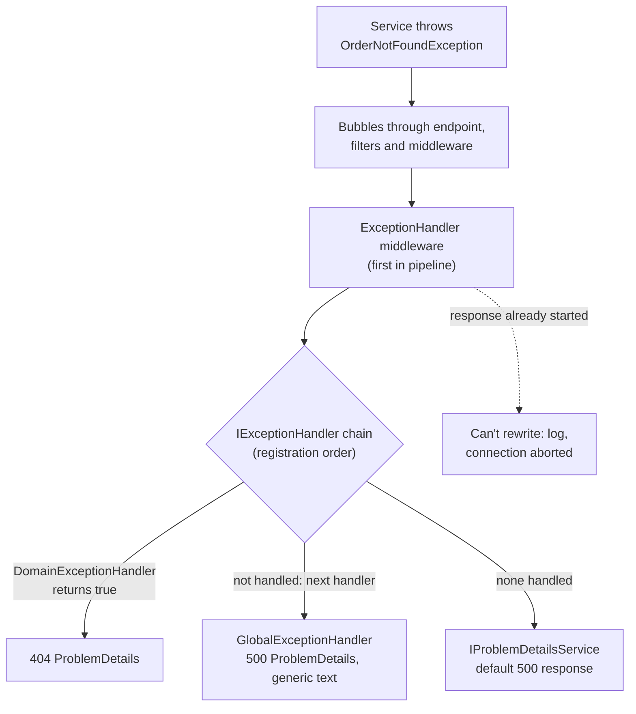

import { Tabs, TabItem, Aside } from '@astrojs/starlight/components';
import QuizBlock from '~/components/QuizBlock.astro';

## Why it matters in interviews

*"How do you handle exceptions globally in your API?"* comes up in almost every ASP.NET Core interview. Interviewers want to hear one central place, a consistent error contract, correct status codes, logging with a correlation id, and no stack traces leaking to clients. Mentioning `IExceptionHandler` (.NET 8+) and `ProblemDetails` shows you are current; still describing a hand-written try/catch middleware is fine if you explain why.

## Core idea

Exceptions thrown anywhere below the exception handling middleware **bubble up** through the pipeline. One middleware placed **first** catches them, logs once, and turns them into an HTTP response in a standard format. Everything else (controllers, services, repositories) simply throws or returns results; no try/catch in every action.



### The building blocks

| Piece | Since | Role |
|---|---|---|
| `app.UseExceptionHandler()` | 1.0 | Middleware that catches exceptions, clears the response and re-executes with a handler. |
| `IExceptionHandler` | .NET 8 | Class-based handler: `TryHandleAsync` returns `true` if it wrote the response. Several can be chained. |
| `AddProblemDetails()` / `IProblemDetailsService` | .NET 7 | Writes RFC 9457 `ProblemDetails` JSON consistently from the exception handler, status code pages and `[ApiController]`. |
| `UseStatusCodePages()` | 1.0 | Adds a body to empty error responses (e.g. a bare 404 or 405); with ProblemDetails registered the body is a `ProblemDetails`. |
| Developer exception page | 1.0 | Detailed HTML/JSON with stack trace. `WebApplication` enables it automatically in **Development** only. |
| `ExceptionHandlerOptions.StatusCodeSelector` | .NET 9 | Maps exception type → status code without writing a handler. |

### Why middleware, not filters or try/catch everywhere

- **Exception filters** only see exceptions from MVC actions and action filters. They miss middleware, result serialization, minimal APIs, and other endpoints. See [Filters vs Middleware](../filters/).
- **try/catch in every action** duplicates logging and mapping, and the format drifts between developers.
- A hand-rolled `try { await next(context); } catch` middleware works and was the norm before .NET 8. `UseExceptionHandler` adds edge-case handling for free: it clears headers, resets the status, re-executes the pipeline branch, and avoids rewriting a response that has already started.

### Mapping exceptions to status codes

| Exception (your domain) | Status | Notes |
|---|---|---|
| `ValidationException` (FluentValidation, custom) | 400 | Include field errors (`errors` extension) |
| `NotFoundException` | 404 | |
| `ConflictException`, `DbUpdateConcurrencyException` | 409 | Optimistic concurrency, duplicate keys |
| Business rule violation (`OrderAlreadyShippedException`) | 409 or 422 | Pick one convention and document it |
| `UnauthorizedAccessException` (domain-level) | 403 | |
| `OperationCanceledException` when `RequestAborted` is cancelled | No body needed | Client left; log at Debug, not Error |
| Anything else | 500 | Generic message, details only in logs |

Many teams prefer the **Result pattern** for expected failures (not found, validation, business rules) and keep exceptions for the truly unexpected. Then the global handler mainly deals with 500s. Either approach is fine in an interview if you are consistent.

### Don't leak internals

In production, the response must not contain stack traces, exception messages from SQL or third-party libraries, file paths or connection info: they help attackers fingerprint the system. Return a generic `title`, a `traceId` the client can quote to support, and log the full exception server-side. Show `exception.Message` only for your own domain exceptions whose messages are written for clients.

## Code

The response the client receives:

```json
{
  "type": "https://tools.ietf.org/html/rfc9110#section-15.5.5",
  "title": "Order not found",
  "status": 404,
  "detail": "Order 1042 does not exist.",
  "instance": "GET /api/orders/1042",
  "traceId": "00-4bf92f3577b34da6a3ce929d0e0e4736-00f067aa0ba902b7-01"
}
```

Domain exceptions and two chained handlers:

```csharp
namespace Orders.Api.Errors;

public abstract class DomainException(string message, int statusCode) : Exception(message)
{
    public int StatusCode { get; } = statusCode;
}
public sealed class NotFoundException(string what) : DomainException($"{what} does not exist.", 404);
public sealed class ConflictException(string message) : DomainException(message, 409);

// 1. Known domain exceptions: safe to show their message
public sealed class DomainExceptionHandler(IProblemDetailsService problems) : IExceptionHandler
{
    public async ValueTask<bool> TryHandleAsync(HttpContext http, Exception ex, CancellationToken ct)
    {
        if (ex is not DomainException domain) return false;          // let the next handler try

        http.Response.StatusCode = domain.StatusCode;
        return await problems.TryWriteAsync(new ProblemDetailsContext
        {
            HttpContext = http,
            Exception = ex,
            ProblemDetails = { Status = domain.StatusCode, Detail = domain.Message,
                               Title = domain.StatusCode == 404 ? "Resource not found" : "Request conflict" }
        });
    }
}
```

```csharp
namespace Orders.Api.Errors;

// 2. Everything else: log once, generic 500, no internals
public sealed class GlobalExceptionHandler(IProblemDetailsService problems, ILogger<GlobalExceptionHandler> log)
    : IExceptionHandler
{
    public async ValueTask<bool> TryHandleAsync(HttpContext http, Exception ex, CancellationToken ct)
    {
        if (ex is OperationCanceledException && http.RequestAborted.IsCancellationRequested)
        {
            log.LogDebug("Request cancelled by client");
            http.Response.StatusCode = 499;                           // non-standard "client closed request"
            return true;
        }

        log.LogError(ex, "Unhandled exception for {Method} {Path}", http.Request.Method, http.Request.Path);
        http.Response.StatusCode = StatusCodes.Status500InternalServerError;
        return await problems.TryWriteAsync(new ProblemDetailsContext
        {
            HttpContext = http,
            Exception = ex,
            ProblemDetails = { Status = 500, Title = "An unexpected error occurred." }  // no ex.Message
        });
    }
}
```

Registration and pipeline:

```csharp
var builder = WebApplication.CreateBuilder(args);

builder.Services.AddProblemDetails(o => o.CustomizeProblemDetails = ctx =>
{
    ctx.ProblemDetails.Instance = $"{ctx.HttpContext.Request.Method} {ctx.HttpContext.Request.Path}";
    ctx.ProblemDetails.Extensions["traceId"] =
        Activity.Current?.Id ?? ctx.HttpContext.TraceIdentifier;     // quote this to support
});
builder.Services.AddExceptionHandler<DomainExceptionHandler>();      // order = evaluation order
builder.Services.AddExceptionHandler<GlobalExceptionHandler>();
builder.Services.AddControllers();

var app = builder.Build();

app.UseExceptionHandler();      // first: catches everything below; uses the handlers above
app.UseStatusCodePages();       // ProblemDetails body for bare 404/405 etc.
// Developer exception page is added automatically in Development by WebApplication.

app.MapControllers();
app.Run();
```

Simpler alternative for pure type-to-status mapping (.NET 9+):

```csharp
app.UseExceptionHandler(new ExceptionHandlerOptions
{
    StatusCodeSelector = ex => ex switch
    {
        NotFoundException => StatusCodes.Status404NotFound,
        ConflictException => StatusCodes.Status409Conflict,
        _ => StatusCodes.Status500InternalServerError
    }
});
```

## Interview Q&A

<details>
<summary>How do you implement global exception handling in ASP.NET Core today?</summary>

Register `AddProblemDetails()` and one or more `IExceptionHandler` implementations with `AddExceptionHandler<T>()`, then call `app.UseExceptionHandler()` first in the pipeline. Handlers run in registration order; each returns `true` if it handled the exception. A domain handler maps known exceptions to 4xx, a final handler logs and returns a generic 500. All responses use `ProblemDetails` with a trace id.
</details>

<details>
<summary>Why put the exception handler first in the pipeline?</summary>

Middleware can only catch exceptions thrown by components that run after it, because those run inside its `await next()`. If it sits after authentication or routing, exceptions thrown there escape as raw 500s without your format or logging.
</details>

<details>
<summary>What is `ProblemDetails` and why use it?</summary>

A standard JSON error format defined by RFC 9457 (formerly RFC 7807) with `type`, `title`, `status`, `detail` and `instance`, plus custom extensions such as `traceId` or `errors`. Using it everywhere gives clients one parsing path for all errors; `[ApiController]` validation errors, the exception handler and status code pages all produce it once `AddProblemDetails()` is registered.
</details>

<details>
<summary>What happens if an exception is thrown after the response has started streaming?</summary>

The status code and headers are already sent, so the handler can't change them into a 500 ProblemDetails. The exception handler middleware detects `Response.HasStarted`, logs, and rethrows, and the server aborts the connection so the client sees a truncated response. Avoid it by buffering small responses and handling errors before writing for streaming endpoints.
</details>

<details>
<summary>Exceptions or Result pattern for "order not found"?</summary>

Exceptions are simple and keep services clean, but they are relatively expensive and blur expected outcomes with real failures. The Result pattern makes expected failures explicit in method signatures and keeps the global handler for unexpected errors. On a high-traffic path or in a codebase already using results, I'd return results; otherwise domain exceptions mapped centrally are acceptable. The key is one consistent convention.
</details>

<details>
<summary>How do you avoid leaking sensitive details in error responses?</summary>

Return generic titles for 500s and never include `ex.Message`, stack traces or inner exceptions from infrastructure code. Only domain exceptions with client-safe messages expose their text. The developer exception page is limited to Development. Include a trace id so support can correlate with the full exception in logs or Application Insights.
</details>

<details>
<summary>An `IExceptionHandler` depends on a scoped service and fails at startup. Why?</summary>

Exception handlers registered with `AddExceptionHandler<T>()` are singletons, so a scoped dependency in the constructor is a captive dependency and scope validation rejects it. Resolve scoped services from `httpContext.RequestServices` inside `TryHandleAsync`, or depend only on singletons such as `IProblemDetailsService` and `ILogger`.
</details>

## Pitfalls

<Aside type="caution" title="Common mistakes">

- **`UseExceptionHandler` not first**, so earlier middleware failures bypass it.
- **Logging the same exception at every layer** (catch-log-rethrow), then again in the handler.
- **Returning `ex.Message` or stack traces in production**, leaking table names and library versions.
- **Treating client cancellations as 500 errors**, flooding alerts every time a user navigates away.
- **Swallowing exceptions** with empty catch blocks in services so the handler never sees them.
- **Using exceptions for normal control flow** in hot loops (validation of thousands of rows).
- **Different error shapes** from validation (`ModelState` dictionary), the handler and custom code. Register `AddProblemDetails()` and route everything through it.

</Aside>

## Related

- [Exception handling in C#](../../csharp/exceptions/)
- [Filters vs Middleware](../filters/)
- [Logging & observability](../logging-observability/)
- [Enterprise patterns (Result pattern)](../../patterns/enterprise-patterns/)

## Quick quiz

<QuizBlock section="aspnet" topic="error-handling" />
