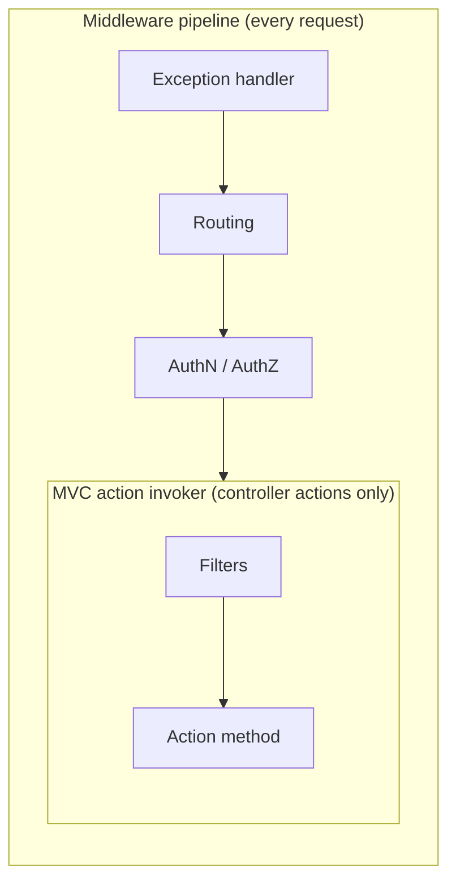
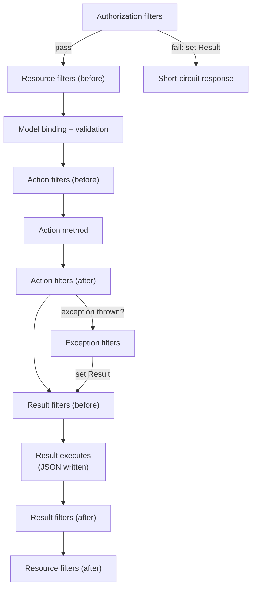

import { Tabs, TabItem, Aside } from '@astrojs/starlight/components';
import QuizBlock from '~/components/QuizBlock.astro';

## Why it matters in interviews

*"Filters vs middleware, when would you use each?"* is a favourite because it checks whether you understand **where** in the request each runs and **what information** each can see. Follow-ups: *"What is the order of filters?"*, *"Why doesn't my exception filter catch this error?"*, *"How do you inject a service into a filter attribute?"*. A crisp answer with one real example (audit logging, idempotency, validation) scores well.

## Core idea

**Middleware** wraps the whole HTTP pipeline and sees only `HttpContext`. **Filters** run inside the MVC action invoker, **after** an endpoint has been selected as a controller action, and see MVC concepts: the action descriptor, bound arguments, `ModelState`, the `IActionResult` before it is written.



### Filter types and order

| Filter | Interface | Runs | Typical use |
|---|---|---|---|
| Authorization | `IAuthorizationFilter` / `IAsyncAuthorizationFilter` | First | Custom auth checks (prefer policies) |
| Resource | `IResourceFilter` / `IAsyncResourceFilter` | Before model binding, after everything else | Caching, idempotency keys, short-circuit early |
| Action | `IActionFilter` / `IAsyncActionFilter` | Just before / after the action, arguments bound | Validation, auditing, argument tweaks |
| Exception | `IExceptionFilter` / `IAsyncExceptionFilter` | When the action or action filters throw | Map exceptions for one controller |
| Result | `IResultFilter` / `IAsyncResultFilter` | Around result execution | Add headers, wrap responses |



Key details interviewers like:

- **Short-circuit** by setting `context.Result` in an authorization, resource or action filter. Later stages don't run (result filters still run for an action-filter short-circuit, but not for authorization/resource short-circuits).
- **Exception filters** catch exceptions from model binding, action filters and the action. They **do not** catch exceptions from result execution, resource filters or middleware. That gap is why global error handling belongs in middleware.
- **Scope ordering**: global → controller → action for the "before" part, reversed for "after". Override with the `Order` property (lower runs first).
- If a filter implements both sync and async interfaces, **only the async one** is called.

### Global vs attribute filters

```csharp
// Global: applies to every controller action
builder.Services.AddControllers(o =>
{
    o.Filters.Add<AuditActionFilter>();        // type-activated, ctor injection works
});

// Attribute: per controller or action
[ServiceFilter(typeof(IdempotencyFilter))]     // resolved from DI, must be registered
[HttpPost]
public async Task<IActionResult> Pay(PaymentRequest req, CancellationToken ct) { /* ... */ }
```

### Dependency injection in filters

Attributes are instantiated by the runtime with **constant arguments only**, so an attribute filter cannot take services in its constructor. Options:

| Approach | How it is created | Registration needed | Notes |
|---|---|---|---|
| `[ServiceFilter(typeof(T))]` | Resolved from DI | Yes | Respects lifetime you register |
| `[TypeFilter(typeof(T), Arguments = ...)]` | `ActivatorUtilities`: DI for services plus extra constant args | No | Handy for parameters per usage |
| `o.Filters.Add<T>()` | Type-activated per request | No | Global filters with DI |
| `IFilterFactory` | Your own creation logic | Optional | Full control, `IsReusable` caching |
| Service locator inside attribute | `context.HttpContext.RequestServices` | Yes | Works, but hides dependencies |

### Endpoint filters (minimal APIs)

Minimal APIs don't use MVC filters. Their equivalent is `IEndpointFilter`, added with `.AddEndpointFilter<T>()` on an endpoint or route group. One filter shape covers what action and result filters do: run code before, call `next`, inspect or replace the result after. See [Controllers & Minimal APIs](../controllers-minimal-apis/).

### Filter or middleware?

| Question | Middleware | Filter |
|---|---|---|
| Needs to run for static files, health checks, gRPC, SignalR? | Yes | No (MVC only) |
| Needs action arguments, `ModelState`, action attributes? | Hard | Easy |
| Needs to catch every exception, including from other middleware? | Yes | No |
| Should apply to a few actions declaratively? | Via metadata checks | `[Attribute]` |
| Cheap rejection before any MVC work (e.g. IP block)? | Yes | Too late |

Rule of thumb: **HTTP-level, app-wide concerns → middleware** (correlation id, exception handling, security headers, request logging, rate limiting). **Action-aware concerns → filters** (audit with arguments, idempotency per endpoint, response envelope for some controllers, feature flags on actions).

## Code

An audit filter that logs the action and its arguments, plus a resource filter that enforces an idempotency key:

<Tabs syncKey="filter-kind">
  <TabItem label="Action filter">

```csharp
namespace Orders.Api.Filters;

public sealed class AuditActionFilter(ILogger<AuditActionFilter> log, ICurrentUser user) : IAsyncActionFilter
{
    public async Task OnActionExecutionAsync(ActionExecutingContext context, ActionExecutionDelegate next)
    {
        var action = context.ActionDescriptor.DisplayName;
        log.LogInformation("User {User} calling {Action} with {@Args}",
            user.Id, action, context.ActionArguments);

        var executed = await next();                  // runs the action (and inner filters)

        if (executed.Exception is not null && !executed.ExceptionHandled)
            log.LogWarning(executed.Exception, "{Action} failed", action);
    }
}
```

  </TabItem>
  <TabItem label="Resource filter">

```csharp
namespace Orders.Api.Filters;

public sealed class IdempotencyFilter(IIdempotencyStore store) : IAsyncResourceFilter
{
    public async Task OnResourceExecutionAsync(ResourceExecutingContext context, ResourceExecutionDelegate next)
    {
        var key = context.HttpContext.Request.Headers["Idempotency-Key"].ToString();
        if (string.IsNullOrEmpty(key))
        {
            context.Result = new BadRequestObjectResult("Idempotency-Key header is required");
            return;                                   // short-circuit: no binding, no action
        }

        var ct = context.HttpContext.RequestAborted;
        if (await store.GetAsync(key, ct) is { } cached)
        {
            context.Result = new ObjectResult(cached.Body) { StatusCode = cached.Status };
            return;                                   // replay the first response
        }

        var executed = await next();
        if (executed.Result is ObjectResult { Value: { } body } r)
            await store.SaveAsync(key, new StoredResponse(r.StatusCode ?? 200, body), ct);
    }
}

// builder.Services.AddScoped<IdempotencyFilter>();
// [ServiceFilter(typeof(IdempotencyFilter))] on the action
```

  </TabItem>
</Tabs>

A `TypeFilter` with a per-usage argument:

```csharp
public sealed class RequireFeatureFilter(IFeatureFlags flags, string feature) : IAsyncActionFilter
{
    public async Task OnActionExecutionAsync(ActionExecutingContext context, ActionExecutionDelegate next)
    {
        if (!await flags.IsEnabledAsync(feature)) { context.Result = new NotFoundResult(); return; }
        await next();
    }
}

[TypeFilter(typeof(RequireFeatureFilter), Arguments = ["NewCheckout"])]
[HttpPost("checkout")]
public IActionResult Checkout() => Ok();
```

## Interview Q&A

<details>
<summary>What is the difference between middleware and filters?</summary>

Middleware is part of the HTTP pipeline, runs for every request (including static files, health checks, SignalR), and only knows `HttpContext`. Filters run inside the MVC action invoker for controller actions only, after routing has selected the action, and can see action arguments, `ModelState`, the action descriptor and the `IActionResult`. Use middleware for app-wide HTTP concerns and filters for logic that depends on the action.
</details>

<details>
<summary>What is the order of MVC filters?</summary>

Authorization → resource (before) → model binding → action (before) → action → action (after) → exception filters if something threw → result (before) → result execution → result (after) → resource (after). Within one type, global runs before controller-level before action-level on the way in, and the reverse on the way out, unless `Order` is set.
</details>

<details>
<summary>An exception thrown while serializing the response isn't caught by my exception filter. Why?</summary>

Exception filters only cover controller creation, model binding, action filters and the action method. Serialization happens during result execution, which is outside their scope. So do exceptions in resource filters, result filters and middleware. Use `UseExceptionHandler` with an `IExceptionHandler` for global handling, and keep exception filters for controller-specific mapping.
</details>

<details>
<summary>How do you inject a service into a filter used as an attribute?</summary>

Attributes can't have constructor dependencies because their arguments must be compile-time constants. Use `[ServiceFilter(typeof(MyFilter))]` with `MyFilter` registered in DI, or `[TypeFilter(typeof(MyFilter))]`, which builds it with `ActivatorUtilities` (services from DI plus optional constant `Arguments`). For global filters, `options.Filters.Add<MyFilter>()` also supports constructor injection.
</details>

<details>
<summary>When would you use a resource filter rather than an action filter?</summary>

When you need to run before model binding or short-circuit as early as possible within MVC: response caching, idempotency replay, rejecting oversized or unsupported requests before deserialising the body. Action filters run after binding, so they suit logic that needs the bound arguments, such as auditing or argument validation.
</details>

<details>
<summary>How do you short-circuit from an action filter, and what still runs?</summary>

Set `context.Result` in `OnActionExecuting` (or don't call `next()` in the async version). The action and later action filters are skipped, but result filters and result execution still run for the result you set. Short-circuiting in an authorization or resource filter also skips the result filters.
</details>

<details>
<summary>What is the equivalent of action filters in minimal APIs?</summary>

Endpoint filters: implement `IEndpointFilter` (or pass a lambda to `AddEndpointFilter`), and access arguments through `EndpointFilterInvocationContext.Arguments`. They can run code before and after `next`, short-circuit by returning a result, and can be applied to a whole route group.
</details>

## Pitfalls

<Aside type="caution" title="Common mistakes">

- **Relying on an exception filter for global error handling.** It misses middleware, result execution and non-MVC endpoints.
- **Using `[ServiceFilter]` without registering the filter**: runtime `InvalidOperationException` on first request.
- **Registering a `ServiceFilter` as singleton while it depends on scoped services**: captive dependency.
- **Putting cross-cutting HTTP concerns in filters** (correlation id, security headers), so minimal API endpoints and health checks miss them.
- **Implementing both sync and async filter interfaces** and expecting both to run.
- **Writing to `Response` directly in a result filter after the result has executed.** Headers have already been sent.

</Aside>

## Related

- [Request pipeline & middleware](../middleware-pipeline/)
- [Controllers, Minimal APIs & Model Binding](../controllers-minimal-apis/)
- [Global error handling](../error-handling/)
- [Dependency injection](../dependency-injection/)

## Quick quiz

<QuizBlock section="aspnet" topic="filters" />
