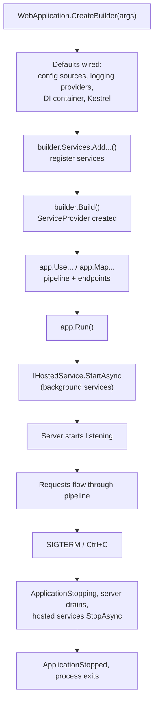
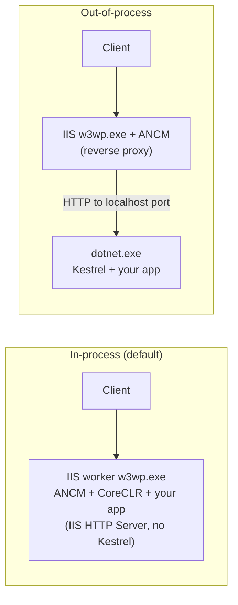

import { Tabs, TabItem, Aside } from '@astrojs/starlight/components';
import QuizBlock from '~/components/QuizBlock.astro';

## Why it matters in interviews

This is usually the warm-up: *"Walk me through `Program.cs`"*, *"What is Kestrel and why put IIS or Nginx in front of it?"*, *"How does the app know it is running in Production?"*. A weak answer recites the template. A strong answer explains **what the builder actually creates** (a generic host with config, logging and DI already wired), **who listens on the socket**, and **what happens on shutdown**. It also opens the door to follow-ups on deployment, containers and graceful shutdown in Kubernetes.

## Core idea

An ASP.NET Core app is a **console app that hosts a web server**. Since .NET 6 the *minimal hosting model* puts everything in `Program.cs`:

1. `WebApplication.CreateBuilder(args)` creates a **builder** that pre-wires the **.NET Generic Host**: configuration, logging, DI container and Kestrel.
2. You register services on `builder.Services` and tweak `builder.Configuration`, `builder.Logging`, `builder.WebHost`.
3. `builder.Build()` builds the `IServiceProvider` and makes the service collection read-only. Registering services after this throws.
4. You configure the **middleware pipeline** and **endpoints** on the returned `WebApplication`.
5. `app.Run()` starts the host: hosted services start, then the server begins accepting requests, and the call blocks until shutdown.

`WebApplication` is three things at once: an `IHost` (start/stop), an `IApplicationBuilder` (middleware) and an `IEndpointRouteBuilder` (`MapGet`, `MapControllers`). That is why one object can do `app.UseAuthentication()`, `app.MapGet(...)` and `app.Run()`.



### What CreateBuilder gives you for free

| Area | Default |
|---|---|
| Configuration | `appsettings.json`, `appsettings.{Environment}.json`, user secrets (Development only), environment variables, command-line args. Later sources override earlier ones. |
| Logging | Console, Debug, EventSource (and EventLog on Windows) providers, levels from the `Logging` config section |
| DI | Default container, with **scope validation** and build-time validation on in Development |
| Server | Kestrel, plus IIS integration when launched by the ASP.NET Core Module |
| Content root | Current directory; `wwwroot` as web root |

Variants: `WebApplication.CreateSlimBuilder` (.NET 8+) drops some defaults for smaller, Native AOT friendly apps, and `CreateEmptyBuilder` wires almost nothing. The older `Startup` class with `ConfigureServices` / `Configure` still works, and you will meet it in legacy codebases, but new code uses the minimal model.

### Kestrel and reverse proxies

**Kestrel** is the cross-platform, in-process HTTP server that ships with ASP.NET Core. It supports HTTP/1.1, HTTP/2, HTTP/3, HTTPS, and is fast enough to face the internet directly. Teams still put a **reverse proxy** in front of it for:

- TLS termination and certificate management in one place
- Load balancing across instances, path-based routing to several apps
- Sharing ports 80/443 between apps, request buffering, WAF, static file caching

Typical fronts: IIS, Nginx, YARP, Azure Application Gateway / Front Door or the Container Apps ingress (AWS: ALB / CloudFront). When a proxy terminates TLS, the app sees plain HTTP from the proxy's IP. Use **Forwarded Headers middleware** so `Request.Scheme`, `Request.Host` and `RemoteIpAddress` reflect the original client. Otherwise HTTPS redirects loop and logs show the proxy IP.

### IIS: in-process vs out-of-process

On Windows, IIS uses the **ASP.NET Core Module (ANCM)** to start and supervise the app.



| | In-process (default since 3.0) | Out-of-process |
|---|---|---|
| Server | IIS HTTP Server inside `w3wp.exe` | Kestrel in a separate `dotnet` process |
| Performance | Faster, no extra loopback hop | Extra proxy hop |
| Isolation | App crash takes down the worker process | App process restarts independently |
| Set by | `<AspNetCoreHostingModel>InProcess</AspNetCoreHostingModel>` | `OutOfProcess` in the csproj / web.config |

### Environments and launchSettings

The environment name comes from `ASPNETCORE_ENVIRONMENT` (or `DOTNET_ENVIRONMENT`). If neither is set, it is **Production**. That safe default means a forgotten variable never exposes the developer exception page.

`Properties/launchSettings.json` is **only for local development**: `dotnet run` and Visual Studio read it to pick the URL, environment and profile. It is not used by published apps, so it has no effect in Azure App Service, IIS or a container. In deployed environments, set the environment through App Service settings, the container `ENV`, Kubernetes manifests, or `web.config` for IIS.

Inside code, use `app.Environment.IsDevelopment()`, `IsStaging()`, `IsProduction()` or `IsEnvironment("QA")`.

### Ports and URLs

Without any configuration Kestrel listens on `http://localhost:5000`. Override with `ASPNETCORE_URLS`, the `--urls` argument, `Kestrel:Endpoints` in config, or `ASPNETCORE_HTTP_PORTS` / `ASPNETCORE_HTTPS_PORTS` (.NET 8+). The official .NET 8+ container images listen on port **8080** and run as a non-root user, which is why old Dockerfiles exposing port 80 broke after upgrading.

### Application lifetime and graceful shutdown

`IHostApplicationLifetime` (also exposed as `app.Lifetime`) has `ApplicationStarted`, `ApplicationStopping` and `ApplicationStopped` tokens plus `StopApplication()`. On SIGTERM (Kubernetes pod deletion, App Service restart) the host:

1. Fires `ApplicationStopping`.
2. Stops accepting new connections and lets in-flight requests finish.
3. Calls `StopAsync` on hosted services, which cancels the `stoppingToken` of each `BackgroundService`.
4. Fires `ApplicationStopped` and exits.

All of that must finish within `HostOptions.ShutdownTimeout` (30 seconds by default since .NET 6). Kubernetes has its own termination grace period (also 30 s by default), so long-running work must honour cancellation or it gets killed mid-way.

## Code

A realistic `Program.cs` for an API behind a TLS-terminating proxy:

```csharp
using Microsoft.AspNetCore.HttpOverrides;

var builder = WebApplication.CreateBuilder(args);

// 1. Services (the container is still open)
builder.Services.AddControllers();
builder.Services.AddOpenApi();               // built-in OpenAPI document (.NET 9+)
builder.Services.AddProblemDetails();
builder.Services.AddHealthChecks();
builder.Services.Configure<ForwardedHeadersOptions>(o =>
{
    o.ForwardedHeaders = ForwardedHeaders.XForwardedFor | ForwardedHeaders.XForwardedProto;
    o.KnownIPNetworks.Add(System.Net.IPNetwork.Parse("10.0.0.0/8")); // trust only the proxy subnet
});
builder.WebHost.ConfigureKestrel(k =>
{
    k.Limits.MaxRequestBodySize = 10 * 1024 * 1024;   // 10 MB (default is ~28.6 MB)
    k.AddServerHeader = false;
});

var app = builder.Build();                   // container is read-only from here

// 2. Pipeline (order matters, see the middleware page)
app.UseForwardedHeaders();                   // first, so later middleware sees real scheme/IP
if (app.Environment.IsDevelopment())
    app.MapOpenApi();
else
    app.UseHsts();
app.UseHttpsRedirection();
app.UseAuthentication();
app.UseAuthorization();
app.MapControllers();
app.MapHealthChecks("/health");

// 3. Lifetime hooks
app.Lifetime.ApplicationStopping.Register(() =>
    app.Logger.LogInformation("Shutdown requested, draining requests"));

app.Run();
```

Changing the shutdown timeout and reacting to stop in a background worker:

```csharp
builder.Services.Configure<HostOptions>(o => o.ShutdownTimeout = TimeSpan.FromSeconds(45));
builder.Services.AddHostedService<OutboxPublisher>();

public sealed class OutboxPublisher(ILogger<OutboxPublisher> log) : BackgroundService
{
    protected override async Task ExecuteAsync(CancellationToken stoppingToken)
    {
        using var timer = new PeriodicTimer(TimeSpan.FromSeconds(5));
        try
        {
            while (await timer.WaitForNextTickAsync(stoppingToken))
                log.LogDebug("Publishing pending outbox messages");
        }
        catch (OperationCanceledException)
        {
            log.LogInformation("Outbox publisher stopping");   // host is shutting down
        }
    }
}
```

Setting the environment in a container image:

```dockerfile
FROM mcr.microsoft.com/dotnet/aspnet:10.0
WORKDIR /app
COPY ./publish .
ENV ASPNETCORE_ENVIRONMENT=Production
EXPOSE 8080
ENTRYPOINT ["dotnet", "Orders.Api.dll"]
```

## Interview Q&A

<details>
<summary>What does `WebApplication.CreateBuilder` do?</summary>

It creates a generic-host-based builder with sensible defaults: configuration from appsettings files, user secrets (Development), environment variables and command line; console/debug logging; the default DI container with scope validation in Development; and Kestrel (or IIS in-process) as the server. You add services, then `Build()` creates the `WebApplication`, which you use to configure middleware and endpoints.
</details>

<details>
<summary>What is the Generic Host and why did ASP.NET Core move to it?</summary>

The Generic Host (`Microsoft.Extensions.Hosting`) is the shared shell for any .NET app: config, logging, DI and lifetime management for `IHostedService`s. ASP.NET Core 3.0 rebuilt web hosting on top of it, so a web API, a worker service and a console tool share the same model. A web app is a host whose hosted service happens to run an HTTP server.
</details>

<details>
<summary>What is Kestrel? Do you still need IIS or Nginx?</summary>

Kestrel is the built-in, cross-platform HTTP server. It is production-ready and can be exposed directly. A reverse proxy is still common for TLS termination, load balancing, several apps on one port, WAF and central certificate management. On cloud platforms the platform ingress (App Service front end, Container Apps ingress, Application Gateway) usually plays that role, so you rarely run Nginx yourself.
</details>

<details>
<summary>In-process vs out-of-process hosting in IIS?</summary>

In-process (the default) loads the app into the IIS worker process `w3wp.exe` and uses the IIS HTTP Server instead of Kestrel, so there is no loopback hop and throughput is higher. Out-of-process runs the app in its own `dotnet` process with Kestrel, and IIS forwards requests to it through ANCM. Out-of-process gives process isolation at the cost of an extra hop.
</details>

<details>
<summary>How does the app decide which `appsettings.{env}.json` to load?</summary>

From the environment name, read from `ASPNETCORE_ENVIRONMENT` or `DOTNET_ENVIRONMENT`, defaulting to `Production`. Locally, `launchSettings.json` sets it to `Development`. In deployed environments you set the variable on the host: App Service configuration, container `ENV`, Kubernetes manifest or IIS `web.config`.
</details>

<details>
<summary>Our app sits behind a load balancer and `UseHttpsRedirection` causes an infinite redirect loop. Why?</summary>

The load balancer terminates TLS and forwards plain HTTP, so the app thinks every request is HTTP and keeps redirecting to HTTPS. Add `UseForwardedHeaders` early in the pipeline with `XForwardedProto`, and trust the proxy's network. Then `Request.Scheme` is `https` and the loop stops. The same fix makes `RemoteIpAddress` the real client IP for rate limiting and audit logs.
</details>

<details>
<summary>What happens when Kubernetes stops a pod running your API?</summary>

Kubernetes sends SIGTERM. The host fires `ApplicationStopping`, stops accepting connections, lets in-flight requests finish, cancels `stoppingToken` for background services and awaits their `StopAsync`, then exits. Everything must finish within `HostOptions.ShutdownTimeout` and the pod's termination grace period, or the process is killed. Pair it with a readiness probe so the load balancer stops sending new traffic.
</details>

<details>
<summary>Can you register a service after `builder.Build()`?</summary>

No. `Build()` creates the `IServiceProvider` and makes the service collection read-only, so adding a registration afterwards throws `InvalidOperationException`. All registrations go before `Build()`; all middleware and endpoint mapping goes after.
</details>

## Pitfalls

<Aside type="caution" title="Common mistakes">

- **Relying on `launchSettings.json` in production.** Deployed apps ignore it, so the environment silently falls back to Production (or whatever the host sets).
- **Missing forwarded headers behind a proxy**: redirect loops, wrong scheme in generated links, proxy IP in logs and rate limiter partitions.
- **Trusting `X-Forwarded-For` from anywhere.** Restrict `KnownProxies` / `KnownIPNetworks`, otherwise clients can spoof their IP.
- **Old Dockerfiles exposing port 80** with .NET 8+ images, which listen on 8080 by default.
- **Ignoring `stoppingToken`** in background services, so shutdown exceeds the timeout and work is killed half-done.
- **Heavy work in `Program.cs` before `Run()`** (migrations, cache warm-up) without timeouts. It delays startup and can fail health probes.

</Aside>

## Related

- [Request pipeline & middleware](../middleware-pipeline/)
- [Configuration & Options pattern](../configuration-options/)
- [Background services](../background-services/)
- [Deploying to Azure (and AWS)](../../testing-devops/cloud-deployment/)

## Quick quiz

<QuizBlock section="aspnet" topic="hosting-startup" />
