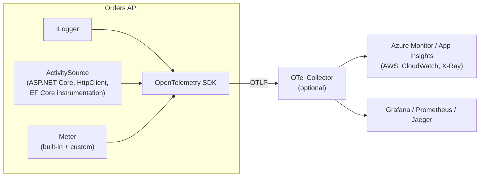
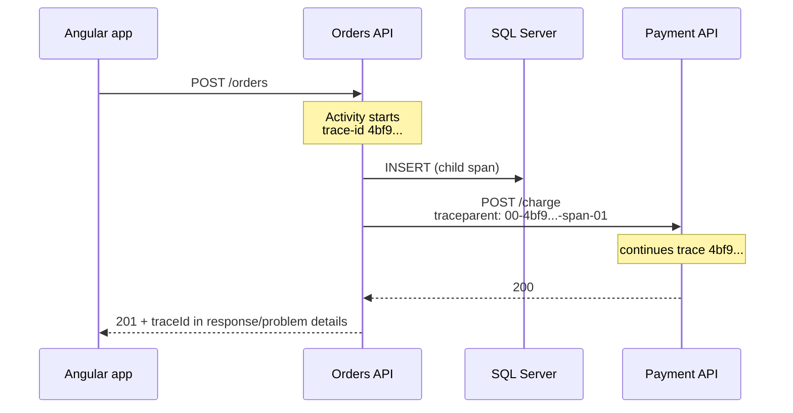

import { Tabs, TabItem, Aside } from '@astrojs/starlight/components';
import QuizBlock from '~/components/QuizBlock.astro';

## Why it matters in interviews

*"How do you debug an issue in production?"* is a standard question, and a good answer is built on logs, traces and metrics. Interviewers also check details: *"What is structured logging?"*, *"Why not use string interpolation in log calls?"*, *"How do you correlate logs across two services?"*, *"Serilog or the built-in logger?"*. Being able to describe how you found a slow dependency through a distributed trace is a strong signal at 3-4 years.

## Core idea

Observability has three pillars:

| Pillar | Answers | .NET API |
|---|---|---|
| **Logs** | What happened, with details | `ILogger<T>` |
| **Traces** | Where the time went across services | `ActivitySource` / `Activity` (an OpenTelemetry span) |
| **Metrics** | How much / how often, cheaply aggregated | `Meter`, `Counter<T>`, `Histogram<T>` |

.NET has its own APIs for all three, and **OpenTelemetry** (OTel) is the vendor-neutral way to collect and export them to Application Insights, Grafana, Jaeger, Datadog or AWS X-Ray/CloudWatch.



### ILogger basics

- **Category**: `ILogger<OrderService>` uses the full type name as category, so you can filter per namespace.
- **Levels**: `Trace` < `Debug` < `Information` < `Warning` < `Error` < `Critical` (`None` disables). Configured per category in the `Logging` section; the most specific prefix wins.
- **Providers**: Console, Debug, EventSource, plus any you add (OpenTelemetry, Application Insights, Serilog). Each log call fans out to every enabled provider.

```json
{
  "Logging": {
    "LogLevel": {
      "Default": "Information",
      "Microsoft.AspNetCore": "Warning",
      "Microsoft.EntityFrameworkCore.Database.Command": "Warning"
    }
  }
}
```

### Structured logging

A **message template** has named placeholders. The provider stores both the rendered text and each value as a separate, queryable property:

```csharp
// Good: OrderId and ElapsedMs become fields you can filter and aggregate on
log.LogInformation("Order {OrderId} placed in {ElapsedMs} ms", order.Id, elapsed);

// Bad: one opaque string, formatted even when Information is disabled
log.LogInformation($"Order {order.Id} placed in {elapsed} ms");
```

With structured logs you can query "all logs where `OrderId = 1042`" in Application Insights (KQL) or Seq, instead of regex over text. The interpolated version also allocates the string before the logger checks whether the level is enabled, and the CA2254 analyzer flags it.

### Scopes

`BeginScope` attaches properties to **every** log written inside it, across all classes in the call chain, which is how you stamp `CorrelationId`, `TenantId` or `OrderId` on a whole operation without passing it around. Providers must have scopes enabled (Serilog's `FromLogContext`, `IncludeScopes` for console, OTel `IncludeScopes`).

### High-performance logging: LoggerMessage source generator

On hot paths, each `LogInformation(...)` call boxes value types into `object[]` and parses the template. The `[LoggerMessage]` source generator (.NET 6+) produces strongly typed methods that check `IsEnabled` first, avoid boxing and cache the parsed template:

```csharp
public static partial class OrderLog
{
    [LoggerMessage(EventId = 1001, Level = LogLevel.Information,
        Message = "Order {OrderId} placed for customer {CustomerId}")]
    public static partial void OrderPlaced(this ILogger logger, int orderId, string customerId);

    [LoggerMessage(EventId = 1002, Level = LogLevel.Warning,
        Message = "Payment declined for order {OrderId}: {Reason}")]
    public static partial void PaymentDeclined(this ILogger logger, int orderId, string reason);
}

// usage: log.OrderPlaced(order.Id, order.CustomerId);
```

### Serilog vs built-in logging

`ILogger` is the abstraction; Serilog is a popular **implementation** behind it. Code keeps depending on `ILogger<T>`, and Serilog adds rich sinks (Console JSON, File with rolling, Seq, Elasticsearch, Application Insights), enrichers (machine name, environment, correlation id), destructuring (`{@Order}` logs the object's properties) and `UseSerilogRequestLogging()` for one concise line per request. Many teams now send logs through OpenTelemetry instead and keep Serilog only where its sinks are needed.

### Distributed tracing and correlation

ASP.NET Core starts an `Activity` for every incoming request. `HttpClient` propagates its context through the W3C **`traceparent`** header, and the downstream service continues the same **trace id**. Instrumentation for ASP.NET Core, `HttpClient`, EF Core / SqlClient and messaging libraries creates child spans, so one trace shows: API → SQL query (180 ms) → payment service (900 ms) → Service Bus publish.



Log records written inside an `Activity` carry its `TraceId` and `SpanId` automatically (with OTel or App Insights), so you can jump from a failed trace to its logs. Returning the trace id in error responses (`ProblemDetails.Extensions["traceId"]`) lets support staff find the exact request.

### Metrics

.NET 8+ ASP.NET Core emits built-in metrics such as `http.server.request.duration` and active requests through `System.Diagnostics.Metrics`. Add business metrics with a `Meter`:

```csharp
public sealed class OrderMetrics
{
    public const string MeterName = "Orders.Api";
    private readonly Counter<long> _placed;
    private readonly Histogram<double> _value;

    public OrderMetrics(IMeterFactory meters)
    {
        var meter = meters.Create(MeterName);
        _placed = meter.CreateCounter<long>("orders.placed");
        _value = meter.CreateHistogram<double>("orders.value", unit: "INR");
    }

    public void Placed(string channel, double amount)
    {
        _placed.Add(1, new KeyValuePair<string, object?>("channel", channel));
        _value.Record(amount);
    }
}
```

## Code

Wiring OpenTelemetry for logs, traces and metrics with an OTLP exporter:

```csharp
var builder = WebApplication.CreateBuilder(args);

builder.Logging.AddOpenTelemetry(o =>
{
    o.IncludeScopes = true;
    o.IncludeFormattedMessage = true;
});

builder.Services.AddSingleton<OrderMetrics>();
builder.Services.AddOpenTelemetry()
    .ConfigureResource(r => r.AddService("orders-api"))
    .WithTracing(t => t
        .AddAspNetCoreInstrumentation()
        .AddHttpClientInstrumentation()
        .AddSource("Orders.Api"))                    // your own ActivitySource
    .WithMetrics(m => m
        .AddAspNetCoreInstrumentation()
        .AddHttpClientInstrumentation()
        .AddMeter(OrderMetrics.MeterName))
    .UseOtlpExporter();   // endpoint from OTEL_EXPORTER_OTLP_ENDPOINT
// For Azure Monitor, the Azure.Monitor.OpenTelemetry.AspNetCore distro uses .UseAzureMonitor() instead.

var app = builder.Build();
```

Serilog as the logging implementation (Serilog.AspNetCore):

```csharp
builder.Services.AddSerilog((services, cfg) => cfg
    .ReadFrom.Configuration(builder.Configuration)
    .ReadFrom.Services(services)
    .Enrich.FromLogContext()
    .Enrich.WithProperty("Application", "orders-api")
    .WriteTo.Console(new Serilog.Formatting.Compact.CompactJsonFormatter()));

var app = builder.Build();
app.UseSerilogRequestLogging();   // one line per request: method, path, status, elapsed
```

A custom span around a business operation:

```csharp
public sealed class CheckoutService(ILogger<CheckoutService> log)
{
    private static readonly ActivitySource Source = new("Orders.Api");

    public async Task CheckoutAsync(Cart cart, CancellationToken ct)
    {
        using var activity = Source.StartActivity("Checkout");   // null if nobody listens
        activity?.SetTag("cart.items", cart.Items.Count);

        using (log.BeginScope(new Dictionary<string, object> { ["CartId"] = cart.Id }))
        {
            log.LogInformation("Checkout started with {ItemCount} items", cart.Items.Count);
            await Task.Delay(10, ct);   // ... reserve stock, charge, save
        }
    }
}
```

## Interview Q&A

<details>
<summary>What is structured logging and why does it matter?</summary>

Logging with message templates whose placeholders are captured as named properties, not just baked into a string. The backend (App Insights, Seq, Elasticsearch, CloudWatch Logs Insights) can then filter and aggregate by `OrderId`, `UserId` or `ElapsedMs`. It turns logs from text to grep into data you can query.
</details>

<details>
<summary>Why shouldn't you use string interpolation in `LogInformation`?</summary>

The interpolated string is built before the logger checks whether the level is enabled, wasting allocations, and the values are lost as separate properties, so you can't query them. Use a template with placeholders, or the `[LoggerMessage]` source generator on hot paths.
</details>

<details>
<summary>How would you trace a request across an Angular app and three microservices?</summary>

Use OpenTelemetry with W3C trace context. ASP.NET Core and `HttpClient` instrumentation start and propagate spans through the `traceparent` header automatically; messaging libraries carry it in message properties. Export to one backend (Application Insights, Jaeger, AWS X-Ray), where all spans with the same trace id form one timeline. Logs written during each span carry the trace id, and the API returns it in error responses so a user-reported failure can be found.
</details>

<details>
<summary>What does `BeginScope` do?</summary>

It pushes a set of key-value properties onto an ambient (async-local) stack. Every log written until the scope is disposed, in any class in that async flow, includes those properties if the provider supports scopes. It is how you tag all logs of one request or message with a correlation id or tenant id.
</details>

<details>
<summary>How would you reduce logging cost in a high-traffic API?</summary>

Raise default levels (Information for app code, Warning for `Microsoft.*`), avoid logging full request/response bodies, use `[LoggerMessage]` on hot paths, rely on metrics instead of logs for counts and durations, and apply trace sampling (head-based or tail-based in the collector). In App Insights, also set daily caps and ingestion sampling.
</details>

<details>
<summary>Logs vs metrics vs traces: which do you check first when an API is slow?</summary>

Metrics first, to see scope: which endpoint, since when, latency percentiles (p95/p99), error rate, CPU or thread pool. Then traces for slow requests to see which span dominates (a SQL query, an external call, a lock). Then logs for that trace id to see details and exceptions. Each pillar narrows the search for the next.
</details>

<details>
<summary>Serilog or Microsoft.Extensions.Logging?</summary>

Both: application code depends on `ILogger<T>` from Microsoft.Extensions.Logging, and Serilog can be the provider behind it. Choose Serilog for its sinks, enrichers and request-logging middleware; choose plain providers plus OpenTelemetry when you want fewer dependencies and vendor-neutral export. Avoid using Serilog's static `Log` class in business code because it bypasses DI and makes tests harder.
</details>

## Pitfalls

<Aside type="caution" title="Common mistakes">

- **Logging PII and secrets** (passwords, tokens, card numbers, full request bodies). Logs are often less protected than the database.
- **String interpolation in log calls**, losing structure and allocating when disabled.
- **`Information` logging inside tight loops** in production, multiplying ingestion cost.
- **Catch, log and rethrow at every layer**, producing the same exception five times. Log once at the boundary (the global handler).
- **Forgetting to dispose `BeginScope`** or `Activity`, which leaks properties into unrelated logs.
- **Separate correlation id schemes per service** instead of the W3C trace id, so traces and logs can't be joined.
- **High-cardinality metric tags** (user id, order id), which explode storage in Prometheus or App Insights.

</Aside>

## Related

- [Global error handling](../error-handling/)
- [Request pipeline & middleware](../middleware-pipeline/)
- [Observability in production](../../testing-devops/observability/)
- [Microservices observability & cross-cutting concerns](../../microservices/observability-cross-cutting/)

## Quick quiz

<QuizBlock section="aspnet" topic="logging-observability" />
