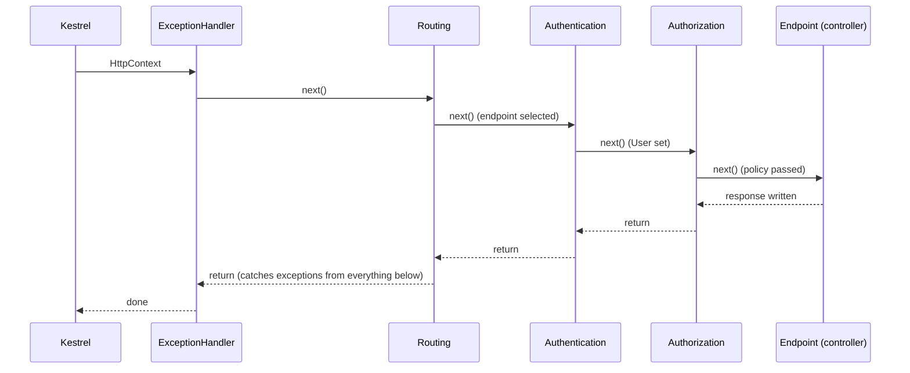
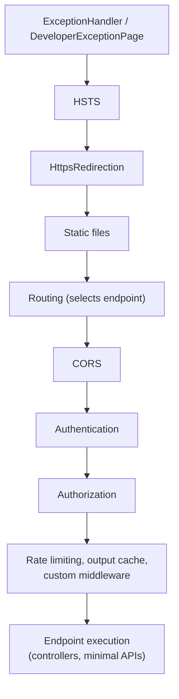

import { Tabs, TabItem, Aside } from '@astrojs/starlight/components';
import QuizBlock from '~/components/QuizBlock.astro';

## Why it matters in interviews

*"A request hits your API. What happens?"* is the single most common ASP.NET Core question, and the answer is the middleware pipeline. Interviewers then probe: *"Why must `UseAuthentication` come before `UseAuthorization`?"*, *"What's the difference between `Use` and `Run`?"*, *"Write a middleware that adds a correlation id"*, *"Can a middleware take a scoped service?"*. Knowing the order and the reasons behind it separates someone who copied the template from someone who can debug a 401 that should have been a 200.

## Core idea

The pipeline is a chain of **request delegates**. Each middleware receives the `HttpContext` and a reference to the **next** delegate. It can:

1. Do work **before** calling `next` (inspect/modify the request, start a timer).
2. Call `await next(context)` to pass control down the chain, **or not call it** to short-circuit.
3. Do work **after** `next` returns (inspect the status code, log duration).

So the request goes *in* through the middleware in registration order and the response comes back *out* in **reverse order**, like layers of an onion. Under the hood, `app.Build()` composes all the `Func<RequestDelegate, RequestDelegate>` registrations into one nested `RequestDelegate` that Kestrel invokes per request.



### The standard order and why



| Position | Middleware | Reason |
|---|---|---|
| First | Exception handler | It can only catch exceptions from middleware **after** it. |
| Early | HSTS, HTTPS redirection | Redirect before doing any real work. |
| Before routing | Static files | Serve `wwwroot` files and short-circuit without auth or routing cost (in .NET 9+ templates `MapStaticAssets` serves them as endpoints instead). |
| Middle | `UseRouting` | Matches the URL to an endpoint and stores it on `HttpContext` so later middleware can read its metadata. |
| After routing | CORS | Endpoint-specific CORS policies need the selected endpoint; preflight must be answered before auth rejects it. |
| After CORS | Authentication **then** Authorization | AuthN builds `HttpContext.User`; AuthZ reads `User` plus the endpoint's `[Authorize]` metadata. Reversed, every user looks anonymous. |
| Last | Endpoints | Runs the selected controller action or handler. |

With `WebApplication`, you rarely call `UseRouting` / `UseEndpoints` yourself: the host adds routing at the start and endpoint execution at the end of the pipeline automatically. You call `UseRouting()` explicitly only when middleware must run **before** routing, or to control exactly where it sits.

### Use, Run, Map, MapWhen, UseWhen

| Method | What it does | Calls next? |
|---|---|---|
| `app.Use(...)` | Adds middleware that may call `next` | Optional |
| `app.Run(...)` | Terminal middleware. Nothing after it runs | Never |
| `app.Map("/path", branch)` | Branches on a **path prefix**; the prefix moves to `PathBase` | Branch does not rejoin |
| `app.MapWhen(predicate, branch)` | Branches on any condition (header, query) | Branch does not rejoin |
| `app.UseWhen(predicate, branch)` | Conditionally runs extra middleware | **Rejoins** the main pipeline unless short-circuited |

Do not confuse `Map` (pipeline branching) with `MapGet` / `MapControllers` (endpoint routing). Endpoints are matched by the routing middleware using route templates; `Map` is a simple prefix split in the middleware chain.

### Middleware vs endpoint routing

Since ASP.NET Core 3.0, routing is split in two: **endpoint selection** (`UseRouting`) and **endpoint execution** (end of the pipeline). Anything in between can call `context.GetEndpoint()` and read metadata such as `[Authorize]`, `[EnableCors]`, `[EnableRateLimiting]` or your own attributes. That is how one authorization middleware can apply different policies to different endpoints.

### Short-circuiting

A middleware that writes a response and doesn't call `next` short-circuits everything after it. Examples: static files, CORS preflight answers, rate limiter returning 429, health checks. .NET 8 added endpoint-level short-circuiting: `app.MapGet("/ping", ...).ShortCircuit()` runs the endpoint immediately after routing, skipping authentication, CORS and the rest, and `app.MapShortCircuit(404, "robots.txt", "favicon.ico")` answers junk paths cheaply.

### Writing custom middleware

**Convention-based** (most common): a class with a constructor taking `RequestDelegate` and a public `InvokeAsync(HttpContext, ...)` method. It is created **once** at startup, so it behaves like a singleton. Constructor dependencies must be singletons; **scoped services go in `InvokeAsync` parameters**, which are resolved per request.

**Factory-based (`IMiddleware`)**: implement `IMiddleware.InvokeAsync(HttpContext, RequestDelegate)`, register the class in DI with any lifetime, and the `IMiddlewareFactory` resolves it **per request**. This allows scoped constructor dependencies and is easier to unit test, at the cost of one resolution per request.

| | Convention-based | `IMiddleware` |
|---|---|---|
| Created | Once, at pipeline build | Per request, from DI |
| Must register in DI | No | Yes (`AddScoped`/`AddTransient`) |
| Scoped dependencies | Via `InvokeAsync` parameters | Via constructor |
| Extra args at `UseMiddleware` | Supported | Not supported |

## Code

<Tabs syncKey="lang">
  <TabItem label="Convention-based">

```csharp
namespace Orders.Api.Middleware;

public sealed class CorrelationIdMiddleware(RequestDelegate next, ILogger<CorrelationIdMiddleware> log)
{
    private const string Header = "X-Correlation-Id";

    // Scoped services (e.g. a per-request context) would be extra InvokeAsync parameters.
    public async Task InvokeAsync(HttpContext context)
    {
        var id = context.Request.Headers.TryGetValue(Header, out var v) && !string.IsNullOrWhiteSpace(v)
            ? v.ToString()
            : Guid.NewGuid().ToString("N");

        context.TraceIdentifier = id;
        // Headers can't change once the body starts streaming, so register a callback.
        context.Response.OnStarting(() =>
        {
            context.Response.Headers[Header] = id;
            return Task.CompletedTask;
        });

        using (log.BeginScope(new Dictionary<string, object> { ["CorrelationId"] = id }))
        {
            await next(context);
        }
    }
}

public static class CorrelationIdExtensions
{
    public static IApplicationBuilder UseCorrelationId(this IApplicationBuilder app) =>
        app.UseMiddleware<CorrelationIdMiddleware>();
}
```

  </TabItem>
  <TabItem label="IMiddleware">

```csharp
namespace Orders.Api.Middleware;

// Resolved per request, so a scoped dependency in the constructor is fine.
public sealed class TenantMiddleware(ITenantStore tenants) : IMiddleware
{
    public async Task InvokeAsync(HttpContext context, RequestDelegate next)
    {
        var key = context.Request.Headers["X-Tenant"].ToString();
        if (await tenants.FindAsync(key, context.RequestAborted) is null)
        {
            context.Response.StatusCode = StatusCodes.Status400BadRequest;
            await context.Response.WriteAsJsonAsync(new { error = "Unknown tenant" });
            return;                                   // short-circuit: next is never called
        }
        await next(context);
    }
}

// Program.cs
// builder.Services.AddScoped<TenantMiddleware>();
// app.UseMiddleware<TenantMiddleware>();
```

  </TabItem>
</Tabs>

Inline middleware, branching and timing:

```csharp
var app = builder.Build();

app.UseExceptionHandler();
app.UseCorrelationId();

// Inline: work before and after next
app.Use(async (context, next) =>
{
    var start = Stopwatch.GetTimestamp();
    await next(context);
    var ms = Stopwatch.GetElapsedTime(start).TotalMilliseconds;
    app.Logger.LogInformation("{Method} {Path} -> {Status} in {Elapsed} ms",
        context.Request.Method, context.Request.Path, context.Response.StatusCode, ms);
});

// Extra middleware only for /api/admin, then rejoin the main pipeline
app.UseWhen(ctx => ctx.Request.Path.StartsWithSegments("/api/admin"),
    branch => branch.UseMiddleware<AuditMiddleware>());

app.UseAuthentication();
app.UseAuthorization();

app.MapGet("/ping", () => "pong").ShortCircuit();   // skips auth, CORS etc.
app.MapControllers();

app.Run();
```

## Interview Q&A

<details>
<summary>Walk me through what happens when a request hits an ASP.NET Core API.</summary>

Kestrel parses the HTTP request and creates an `HttpContext` with a new DI scope (`RequestServices`). The context goes through each middleware in order: exception handler, HTTPS redirection, routing (which picks the endpoint), CORS, authentication (sets `User`), authorization (checks the endpoint's policy), then the endpoint. For a controller, MVC runs model binding, validation and filters before the action. The result is serialized to the response, control unwinds back through the middleware in reverse, and finally the scope and its scoped services are disposed.
</details>

<details>
<summary>Why must `UseAuthentication` come before `UseAuthorization`?</summary>

Authentication reads the token or cookie and populates `HttpContext.User`. Authorization evaluates policies against that `User`. If authorization runs first, `User` is still anonymous, so every `[Authorize]` endpoint returns 401 (or a challenge) even with a valid token.
</details>

<details>
<summary>Difference between `Use`, `Run` and `Map`?</summary>

`Use` adds middleware that can call `next` (or short-circuit). `Run` adds terminal middleware that never calls `next`, so anything registered after it is unreachable. `Map` creates a separate branch for a path prefix; requests matching the prefix go only down that branch. `MapWhen` branches on any predicate, and `UseWhen` runs extra middleware conditionally and then rejoins the main pipeline.
</details>

<details>
<summary>Can a convention-based middleware inject a scoped service such as `DbContext` in its constructor?</summary>

It shouldn't. Convention middleware is constructed once when the pipeline is built, so a scoped service captured in the constructor would effectively become a singleton (a captive dependency); with scope validation on, it throws at startup. Take scoped services as parameters of `InvokeAsync` instead, or implement `IMiddleware` and register it as scoped.
</details>

<details>
<summary>Why does setting a response header after `await next(context)` sometimes throw?</summary>

Once the endpoint starts writing the body, headers are flushed to the client and `Response.HasStarted` is true; changing them throws `InvalidOperationException`. Use `context.Response.OnStarting(...)` to set headers just before they are sent, or set them before calling `next`.
</details>

<details>
<summary>What is endpoint routing and why was it introduced?</summary>

It separates choosing the endpoint (`UseRouting`) from executing it (the end of the pipeline). Middleware in between can read the selected endpoint and its metadata, so authorization, CORS, rate limiting and output caching can apply per-endpoint policies without each framework (MVC, SignalR, gRPC, minimal APIs) having its own routing. All endpoint types share one route table.
</details>

<details>
<summary>Middleware vs filters: when do you use which?</summary>

Middleware sees every request (static files, health checks, endpoints from any framework) and only knows about `HttpContext`. MVC filters run only for controller actions and have access to MVC concepts: model binding results, `ModelState`, action arguments, `IActionResult`. Use middleware for cross-cutting HTTP concerns (correlation ids, exception handling, security headers) and filters for action-specific logic. See [Filters vs Middleware](../filters/).
</details>

<details>
<summary>How would you make a middleware run only for some endpoints?</summary>

Options: `UseWhen` with a path predicate; or read endpoint metadata inside the middleware (`context.GetEndpoint()?.Metadata.GetMetadata<MyAttribute>()`) and skip when absent. The metadata approach is cleaner because the decision lives with the endpoint (`.WithMetadata(...)` or an attribute) instead of string-matching paths. It requires the middleware to sit after routing.
</details>

## Pitfalls

<Aside type="caution" title="Common mistakes">

- **Exception handler not first**, so exceptions from earlier middleware escape as raw 500s.
- **`UseAuthorization` before `UseAuthentication`**, or auth before `UseRouting` when you placed routing explicitly, so `[Authorize]` metadata is invisible.
- **CORS after authentication**: preflight `OPTIONS` requests carry no token, get 401, and the browser reports a CORS error.
- **Calling `next` after writing the response body** or modifying headers after `HasStarted`.
- **Capturing scoped services in a convention middleware constructor.**
- **Reading the request body** in middleware without `EnableBuffering()` and resetting `Position`, which leaves the body empty for model binding.
- **Putting code after `app.Run(...)`** terminal middleware and wondering why it never executes.

</Aside>

## Related

- [Filters vs Middleware](../filters/)
- [Global error handling](../error-handling/)
- [Authentication & Authorization](../authentication-authorization/)
- [Chain of Responsibility and other behavioral patterns](../../patterns/behavioral-patterns/)

## Quick quiz

<QuizBlock section="aspnet" topic="middleware-pipeline" />
