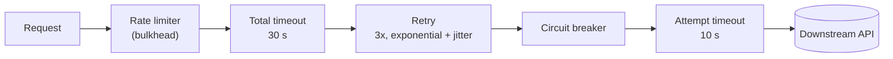
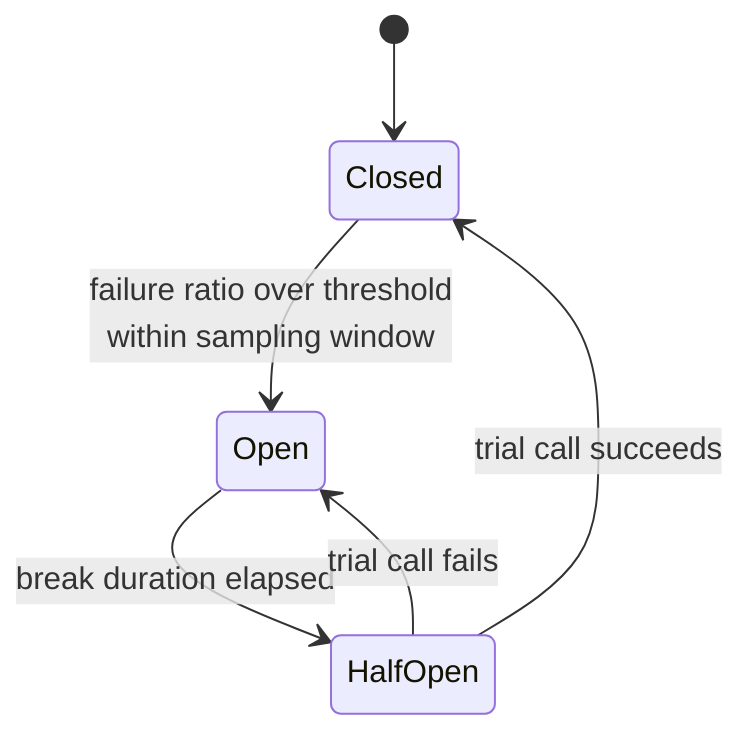

import { Aside } from '@astrojs/starlight/components';
import QuizBlock from '~/components/QuizBlock.astro';

## Why it matters in interviews

Two questions come up in almost every .NET loop: *"why shouldn't you `new HttpClient()` per request?"* and *"how do you handle a flaky downstream service?"*. Around them sit the follow-ups that show production experience: thread-pool starvation, retry storms, circuit breakers, pagination of large tables and "how did you measure it?". Interviewers want reasons, not a list of NuGet packages.

## Core idea

Performance in a Web API is mostly about **not wasting threads, connections and bytes**. Resilience is about **failing fast and recovering** when something you depend on is slow or down. The two are linked: a slow dependency without timeouts holds requests open, which exhausts threads and connections, which makes *your* API slow for everyone.

### Async all the way and thread-pool starvation

ASP.NET Core serves requests from the thread pool. If request code blocks on I/O (`.Result`, `.Wait()`, synchronous `DbContext.SaveChanges` against a slow DB), each blocked request holds a pool thread. Under load the pool runs dry, it injects new threads only slowly, and latency spikes even though CPU is low. The fix is async end to end and passing `CancellationToken` everywhere. Diagnose with `dotnet-counters` (watch the thread-pool queue length and thread count climb) or a memory dump showing hundreds of threads blocked in `Task.Wait`. Details in [async/await](../../csharp/async-await/).

### IHttpClientFactory and socket exhaustion

`HttpClient` is disposable, which tempts people into `using var client = new HttpClient()` per call. Disposing it closes the underlying connection, and each closed socket sits in `TIME_WAIT` for up to a few minutes. Under load you run out of ephemeral ports: **socket exhaustion** (`SocketException: Only one usage of each socket address...`).

The opposite fix, one static `HttpClient` forever, reuses connections but never re-resolves DNS, so after a blue/green swap or failover it keeps talking to the old IP.

`IHttpClientFactory` solves both: it **pools `HttpMessageHandler` instances** (the part that owns connections) and recycles them after `HandlerLifetime` (2 minutes by default). `HttpClient` objects it hands out are cheap and short-lived. It also gives you named and typed clients, central configuration, and a place to plug in delegating handlers and resilience.

| Approach | Connection reuse | DNS changes picked up | Verdict |
|---|---|---|---|
| `new HttpClient()` per request | No | Yes | Socket exhaustion under load |
| Static singleton `HttpClient` | Yes | No (unless `PooledConnectionLifetime` is set) | OK for console apps with `SocketsHttpHandler` configured |
| `IHttpClientFactory` (named / typed) | Yes | Yes (handler rotation) | Default for ASP.NET Core |

A typed client is registered as **transient**. Injecting it into a singleton captures one handler forever and brings the DNS problem back.

### Resilience with Microsoft.Extensions.Http.Resilience

Polly v8 is the resilience engine; `Microsoft.Extensions.Http.Resilience` (since .NET 8) wires it into `IHttpClientFactory`. `AddStandardResilienceHandler()` adds five strategies, outermost first:



- **Retry** handles transient failures only: 408, 429, 5xx, `HttpRequestException` and attempt timeouts. It honours `Retry-After` by default. Use exponential backoff **with jitter** so a thousand clients don't retry in lockstep.
- **Attempt timeout** bounds each try; **total timeout** bounds the whole operation including retries.
- **Circuit breaker** stops calling a service that is clearly failing, giving it time to recover and making your callers fail fast instead of queueing.
- **Rate limiter / bulkhead** caps concurrent outbound calls so one slow dependency can't eat all your resources.
- **Hedging** (`AddStandardHedgingHandler`) is the alternative for latency-sensitive reads: send a second request to another replica if the first is slow, and take whichever answers first.



While **open**, calls fail immediately with `BrokenCircuitException`. Your code must handle that: serve a cached value, a default, or a clear 503.

**Retries are only safe for idempotent operations.** Retrying a POST that timed out after the server processed it can create a duplicate order. Disable retries for unsafe methods or make the operation idempotent with an idempotency key (see [REST API design](../rest-api-design/)).

### Response compression

Brotli or Gzip shrink JSON by 70-90%. `UseResponseCompression` does it in-app, but compressing at the reverse proxy or gateway (Azure Front Door, Application Gateway, YARP, Nginx; AWS: CloudFront) is usually cheaper. Compression over HTTPS is off by default because of BREACH-style attacks when secrets and attacker-controlled input share a response. Enable it deliberately and use `CompressionLevel.Fastest`, since max compression costs CPU on every response.

### Pagination

Never return an unbounded list. Clamp `pageSize` on the server.

| | Offset (`Skip`/`Take`) | Keyset / cursor (`WHERE Id > @last`) |
|---|---|---|
| Jump to page N | Yes | No, only next / previous |
| Cost of deep pages | Grows: DB reads and discards N rows | Constant, uses the index |
| Stable under inserts / deletes | No, rows shift between pages | Yes |
| Total count | Easy but costs a `COUNT(*)` | Usually omitted |
| Fits | Admin grids | Infinite scroll, feeds, exports, APIs |

### Streaming

Returning `IAsyncEnumerable<T>` from an endpoint lets System.Text.Json write rows as EF Core reads them, so memory stays flat instead of buffering 100k objects in a `List<T>`. For files, return a `Stream` (`Results.File`, `Results.Stream`) instead of a `byte[]`.

### Pooling and allocations

Allocations become GC pauses under load. Tools: `ArrayPool<T>.Shared` for temporary buffers, `ObjectPool<T>` (`Microsoft.Extensions.ObjectPool`) for expensive reusable objects like `StringBuilder`, `RecyclableMemoryStream` for large streams. `DbContext` pooling (`AddDbContextPool`) is the same idea for EF Core. Pool only after profiling shows allocation pressure; pooling adds bugs if objects aren't reset.

### Measure, don't guess

- **Micro**: BenchmarkDotNet with `[MemoryDiagnoser]` to compare two implementations.
- **Load**: k6, JMeter or Azure Load Testing (AWS: Distributed Load Testing) against a production-like environment. Look at p95/p99, not averages.
- **Live**: `dotnet-counters`, `dotnet-trace`, Application Insights / OpenTelemetry traces (AWS: X-Ray) to find which dependency eats the time.

## Code

**Typed client with the standard resilience pipeline**

```csharp
builder.Services.AddHttpClient<PricingClient>(c =>
        c.BaseAddress = new Uri("https://pricing.internal"))
    .AddStandardResilienceHandler(o =>
    {
        o.Retry.MaxRetryAttempts = 3;
        o.Retry.DisableForUnsafeHttpMethods(); // no retries for POST, PATCH, DELETE...
        o.AttemptTimeout.Timeout = TimeSpan.FromSeconds(2);
        o.TotalRequestTimeout.Timeout = TimeSpan.FromSeconds(10);
        o.CircuitBreaker.FailureRatio = 0.2;
        o.CircuitBreaker.SamplingDuration = TimeSpan.FromSeconds(30); // >= 2x attempt timeout
        o.CircuitBreaker.BreakDuration = TimeSpan.FromSeconds(15);
    });

public sealed class PricingClient(HttpClient http)
{
    public Task<PriceDto?> GetPriceAsync(string sku, CancellationToken ct) =>
        http.GetFromJsonAsync<PriceDto>($"/prices/{Uri.EscapeDataString(sku)}", ct);
}
```

**Custom pipeline when the defaults don't fit**

```csharp
builder.Services.AddHttpClient("inventory", c => c.BaseAddress = new Uri("https://inventory.internal"))
    .AddResilienceHandler("inventory-pipeline", pipeline =>
    {
        pipeline.AddTimeout(TimeSpan.FromSeconds(8));          // total
        pipeline.AddRetry(new HttpRetryStrategyOptions
        {
            MaxRetryAttempts = 2,
            Delay = TimeSpan.FromMilliseconds(200),
            BackoffType = DelayBackoffType.Exponential,
            UseJitter = true
        });
        pipeline.AddCircuitBreaker(new HttpCircuitBreakerStrategyOptions
        {
            FailureRatio = 0.5,
            MinimumThroughput = 20,
            SamplingDuration = TimeSpan.FromSeconds(30),
            BreakDuration = TimeSpan.FromSeconds(30)
        });
        pipeline.AddTimeout(TimeSpan.FromSeconds(2));          // per attempt
    });
```

**Keyset pagination and streaming**

```csharp
app.MapGet("/api/orders", async (AppDbContext db, int? afterId, int pageSize = 50, CancellationToken ct = default) =>
{
    pageSize = Math.Clamp(pageSize, 1, 200);
    var items = await db.Orders.AsNoTracking()
        .Where(o => afterId == null || o.Id > afterId)
        .OrderBy(o => o.Id)
        .Take(pageSize + 1)                      // one extra row tells us if there is a next page
        .ToListAsync(ct);
    var hasMore = items.Count > pageSize;
    if (hasMore) items.RemoveAt(items.Count - 1);
    return Results.Ok(new { items, nextCursor = hasMore ? items[^1].Id : (int?)null });
});

// Rows are serialized as they are read; memory stays flat.
app.MapGet("/api/orders/export", (AppDbContext db) =>
    db.Orders.AsNoTracking().OrderBy(o => o.Id).AsAsyncEnumerable());
```

**Response compression**

```csharp
builder.Services.AddResponseCompression(o =>
{
    o.EnableForHttps = true; // only if responses don't mix secrets with user-controlled input
    o.Providers.Add<BrotliCompressionProvider>();
    o.Providers.Add<GzipCompressionProvider>();
});
builder.Services.Configure<BrotliCompressionProviderOptions>(o => o.Level = CompressionLevel.Fastest);

app.UseResponseCompression(); // early, before middleware that writes responses
```

## Interview Q&A

<details>
<summary>Why not create a new HttpClient per request? And why not a single static one?</summary>

Per request: disposing closes the connection and leaves the socket in `TIME_WAIT`, so under load you exhaust ephemeral ports. Static forever: connections are reused but DNS is never re-resolved, so you keep hitting old IPs after failover. `IHttpClientFactory` pools and periodically rotates handlers, fixing both. A static client with `SocketsHttpHandler.PooledConnectionLifetime` set is also valid outside DI.
</details>

<details>
<summary>Named vs typed clients?</summary>

Named clients are configured by name and created with `factory.CreateClient("github")`. Typed clients wrap an `HttpClient` in a class (`GitHubClient(HttpClient http)`) that exposes domain methods, which is easier to test and keeps URLs in one place. Typed clients are transient; don't inject them into singletons.
</details>

<details>
<summary>Explain the circuit breaker states.</summary>

**Closed**: calls flow, failures are counted over a sampling window. If the failure ratio passes the threshold (with a minimum throughput), it goes **Open**: calls fail immediately for the break duration. Then **Half-open**: a trial call is let through; success closes the circuit, failure opens it again. It protects the dependency from load while it recovers and protects you from waiting on timeouts.
</details>

<details>
<summary>Why add jitter to retries? What is a retry storm?</summary>

If a dependency blips and every client retries after exactly 1 s, 2 s, 4 s, the retries arrive as synchronized waves that knock it down again. Jitter spreads them out. A retry storm is when retries at several layers multiply (3 retries at gateway × 3 in service A × 3 in service B = 27 calls per user request). Retry at one layer, cap attempts, and rely on circuit breakers.
</details>

<details>
<summary>Why order total timeout, retry, circuit breaker, attempt timeout that way?</summary>

The total timeout outside the retry bounds the whole operation including waits between attempts. The attempt timeout inside the retry makes a single hung attempt count as a failure that can be retried. The circuit breaker sits between them so each attempt counts toward its statistics and an open circuit short-circuits further retries.
</details>

<details>
<summary>Offset vs keyset pagination?</summary>

Offset (`Skip/Take`) allows jumping to page N but gets slower for deep pages because the database still walks the skipped rows, and results shift when rows are inserted. Keyset (`WHERE Id > @lastId ORDER BY Id`) uses the index, stays fast at any depth and is stable, but only supports next/previous. For APIs and infinite scroll I use keyset with an opaque cursor; for admin grids with page numbers, offset with a capped page size.
</details>

<details>
<summary>The API is fast in dev but times out in production under load, with low CPU. What do you suspect?</summary>

Thread-pool starvation from sync-over-async or blocking I/O, connection-pool exhaustion (SQL `Max Pool Size`, or `HttpClient` misuse), or a slow dependency without timeouts holding requests open. I'd check `dotnet-counters` for thread-pool queue length, SQL connection counters, and distributed traces to see where time goes, then fix the root cause instead of adding instances.
</details>

<details>
<summary>When is response compression a bad idea?</summary>

When the response is already compressed (images, zip), when it is tiny (overhead outweighs savings), when CPU is the bottleneck, and over HTTPS when responses reflect user input alongside secrets (BREACH). Often a gateway or CDN should compress instead of every app instance.
</details>

## Pitfalls

<Aside type="caution" title="Common mistakes">

- **`new HttpClient()` in a `using` per request**, or a typed client captured by a singleton.
- **Retrying non-idempotent POSTs** without an idempotency key, creating duplicates.
- **Retries at every layer**, multiplying load during an outage.
- **No timeout at all**: `HttpClient.Timeout` defaults to 100 s, which is far too long for an API call chain.
- **Circuit breaker sampling duration shorter than twice the attempt timeout**: the standard handler validates this and throws at startup.
- **Returning an unbounded `List<T>`** or using `Skip` on page 10,000.
- **Pooling objects without resetting state**, leaking data between requests.
- **Optimizing without measuring** p95 latency and allocations first.

</Aside>

## Related

- [Async/await deep dive](../../csharp/async-await/)
- [Caching in ASP.NET Core](../caching/)
- [Reliability patterns in microservices](../../microservices/reliability-patterns/)
- [EF Core performance](../../data/efcore-performance/)

## Quick quiz

<QuizBlock section="aspnet" topic="performance-resilience" />
