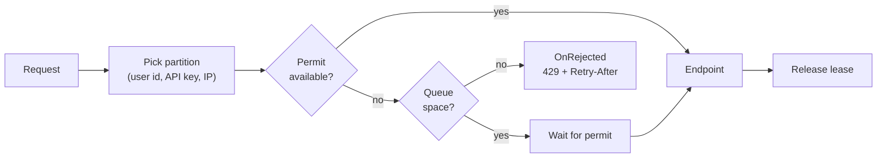
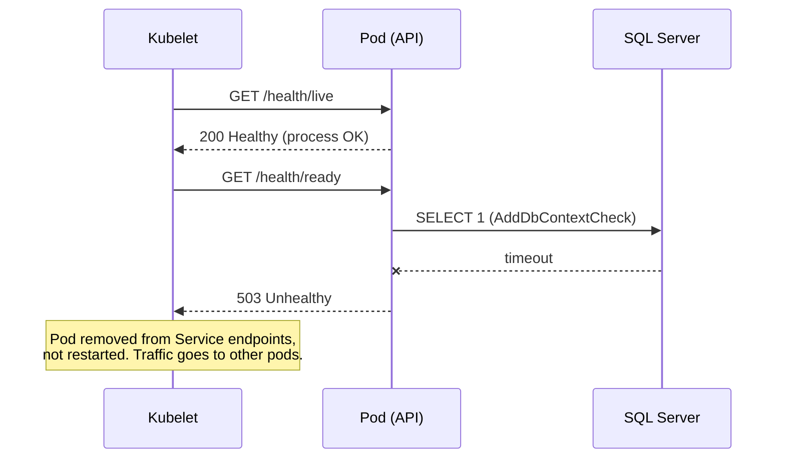

import { Aside } from '@astrojs/starlight/components';
import QuizBlock from '~/components/QuizBlock.astro';

## Why it matters in interviews

Both features protect availability. Rate limiting stops one noisy client from taking the API down for everyone; health checks let the load balancer or Kubernetes route traffic only to instances that can serve it. Typical questions: *"which algorithm would you use for a public API?"*, *"what does the client get when it is throttled?"*, *"what happens with 5 instances?"* and *"what is the difference between liveness and readiness?"*. The last one has a classic wrong answer that causes real outages.

## Core idea

### Built-in rate limiting (.NET 7+)

`Microsoft.AspNetCore.RateLimiting` is middleware on top of `System.Threading.RateLimiting`. You register named **policies** with `AddRateLimiter`, add `app.UseRateLimiter()`, and attach policies to endpoints with `RequireRateLimiting("name")` or `[EnableRateLimiting("name")]`. A `GlobalLimiter` can apply to every request in addition to endpoint policies.

Each request asks the limiter for a **lease**. If acquired, the request continues and the lease is released at the end. If not, the request either **waits in a queue** (if `QueueLimit > 0`) or is **rejected**.



| Algorithm | How it works | Good for | Watch out |
|---|---|---|---|
| **Fixed window** | N requests per window; counter resets at window boundaries | Simple quotas ("100/min") | Up to 2N requests across a boundary (end of one window + start of next) |
| **Sliding window** | Window split into segments; old segments slide out | Smoother version of fixed window | Slightly more state; `SegmentsPerWindow` tuning |
| **Token bucket** | Bucket of `TokenLimit` tokens, refilled by `TokensPerPeriod` every period | Allowing short bursts but a steady average rate | Burst size = bucket size |
| **Concurrency** | At most N requests **in flight** at once | Protecting expensive endpoints (reports, exports) | Limits parallelism, not requests per second |

**Partitioning** gives each client its own limiter: `RateLimitPartition.GetTokenBucketLimiter(userId, ...)`. Partition by authenticated user or API key first, IP as a fallback. Partitioning by IP alone is unfair behind corporate NAT and, behind a reverse proxy, every request shows the proxy's IP unless you configure the Forwarded Headers middleware with known proxies.

Important details:

- The **default rejection status is 503**, not 429. Set `RejectionStatusCode = 429` and add a `Retry-After` header in `OnRejected`.
- Limits are **in memory, per instance**. Five instances with 100/min each effectively allow 500/min. For a global quota, enforce it at the gateway (Azure API Management `rate-limit-by-key`, Azure Front Door WAF; AWS: API Gateway throttling, AWS WAF) or use a Redis-backed limiter.
- Place `UseRateLimiter` **after** `UseRouting` (if you call it explicitly) for endpoint policies, and after `UseAuthentication` if you partition by user.
- Exclude health endpoints with `DisableRateLimiting()`, or the orchestrator may see your instance as down under load.

### Health checks

`AddHealthChecks()` registers checks; `MapHealthChecks("/path")` exposes them. Each check returns `Healthy`, `Degraded` or `Unhealthy`; by default the endpoint maps Healthy and Degraded to **200** and Unhealthy to **503**, with a plain-text body. You can write custom checks (`IHealthCheck`), use `AddDbContextCheck<T>()` for EF Core, or the community `AspNetCore.HealthChecks.*` packages (SQL Server, Redis, Service Bus...) and their HealthChecks UI dashboard. `IHealthCheckPublisher` pushes results periodically to monitoring.

### Liveness vs readiness vs startup

| Probe | Question it answers | On failure | Should check |
|---|---|---|---|
| **Liveness** | Is the process alive and not deadlocked? | Container is **restarted** | Only the process itself; no dependencies |
| **Readiness** | Can this instance serve traffic right now? | Removed from the load balancer / Service endpoints, **not** restarted | Critical dependencies (DB, cache), warm-up done |
| **Startup** | Has the app finished starting? | Liveness/readiness wait; restart if it never succeeds | Slow initialization (migrations, cache warm-up) |

The classic mistake: checking the database in the **liveness** probe. When the database blips, every pod fails liveness, Kubernetes restarts all of them at once, and a short DB hiccup becomes a full outage with cold starts. Dependencies belong in **readiness**.



Outside Kubernetes the same idea applies: Azure App Service Health check and Application Gateway probes (AWS: ALB target group health checks) stop routing to unhealthy instances.

## Code

**Rate limiter policies**

```csharp
using System.Globalization;
using System.Security.Claims;
using System.Threading.RateLimiting;
using Microsoft.AspNetCore.RateLimiting;

builder.Services.AddRateLimiter(o =>
{
    o.RejectionStatusCode = StatusCodes.Status429TooManyRequests; // default is 503
    o.OnRejected = async (ctx, ct) =>
    {
        if (ctx.Lease.TryGetMetadata(MetadataName.RetryAfter, out var retryAfter))
            ctx.HttpContext.Response.Headers.RetryAfter =
                ((int)retryAfter.TotalSeconds).ToString(NumberFormatInfo.InvariantInfo);
        await ctx.HttpContext.Response.WriteAsJsonAsync(new { title = "Too many requests" }, ct);
    };

    o.AddFixedWindowLimiter("fixed", w => { w.PermitLimit = 100; w.Window = TimeSpan.FromMinutes(1); });
    o.AddConcurrencyLimiter("reports", c =>
    {
        c.PermitLimit = 4;
        c.QueueLimit = 10;
        c.QueueProcessingOrder = QueueProcessingOrder.OldestFirst;
    });

    // Per-user token bucket, per-IP fixed window for anonymous callers
    o.AddPolicy("per-user", http =>
    {
        var userId = http.User.FindFirstValue(ClaimTypes.NameIdentifier);
        return userId is not null
            ? RateLimitPartition.GetTokenBucketLimiter(userId, _ => new TokenBucketRateLimiterOptions
              { TokenLimit = 50, TokensPerPeriod = 25, ReplenishmentPeriod = TimeSpan.FromSeconds(1) })
            : RateLimitPartition.GetFixedWindowLimiter(
                http.Connection.RemoteIpAddress?.ToString() ?? "unknown",
                _ => new FixedWindowRateLimiterOptions { PermitLimit = 20, Window = TimeSpan.FromMinutes(1) });
    });
});
```

```csharp
app.UseAuthentication();
app.UseRateLimiter();

app.MapGet("/api/search", Search).RequireRateLimiting("per-user");
app.MapGet("/api/reports/{id:int}", GetReport).RequireRateLimiting("reports");
```

**Health checks with live/ready split**

```csharp
builder.Services.AddHealthChecks()
    .AddCheck("self", () => HealthCheckResult.Healthy(), tags: ["live"])
    .AddDbContextCheck<AppDbContext>(tags: ["ready"])
    .AddCheck<PaymentGatewayHealthCheck>("payment-gateway", tags: ["ready"]);

app.MapHealthChecks("/health/live", new HealthCheckOptions
{
    Predicate = c => c.Tags.Contains("live")
}).DisableRateLimiting();

app.MapHealthChecks("/health/ready", new HealthCheckOptions
{
    Predicate = c => c.Tags.Contains("ready")
}).DisableRateLimiting();
```

```csharp
public sealed class PaymentGatewayHealthCheck(IHttpClientFactory factory) : IHealthCheck
{
    public async Task<HealthCheckResult> CheckHealthAsync(HealthCheckContext context, CancellationToken ct = default)
    {
        try
        {
            using var cts = CancellationTokenSource.CreateLinkedTokenSource(ct);
            cts.CancelAfter(TimeSpan.FromSeconds(2)); // health checks must be fast
            var response = await factory.CreateClient("payments").GetAsync("https://payments.internal/ping", cts.Token);
            return response.IsSuccessStatusCode
                ? HealthCheckResult.Healthy()
                : HealthCheckResult.Degraded($"Gateway returned {(int)response.StatusCode}");
        }
        catch (Exception ex)
        {
            return HealthCheckResult.Unhealthy("Gateway unreachable", ex);
        }
    }
}
```

**Kubernetes probes**

```yaml
startupProbe:
  httpGet: { path: /health/live, port: 8080 }
  failureThreshold: 30
  periodSeconds: 2
livenessProbe:
  httpGet: { path: /health/live, port: 8080 }
  periodSeconds: 10
readinessProbe:
  httpGet: { path: /health/ready, port: 8080 }
  periodSeconds: 5
  failureThreshold: 3
```

## Interview Q&A

<details>
<summary>Fixed window vs sliding window vs token bucket: which for a public API?</summary>

Token bucket is usually the best fit: it allows short bursts (a page load firing 10 calls) while enforcing an average rate. Fixed window is simplest but lets a client send up to twice the limit around the window boundary. Sliding window smooths that out at the cost of a bit more state. Concurrency limiting is different: it caps in-flight requests, which suits expensive endpoints like report generation.
</details>

<details>
<summary>What should a throttled client receive?</summary>

`429 Too Many Requests` with a `Retry-After` header, ideally a ProblemDetails body, and optionally headers describing the quota. Well-behaved clients (and `Microsoft.Extensions.Http.Resilience`, which honours `Retry-After`) back off accordingly. Note ASP.NET Core's limiter returns 503 unless you set `RejectionStatusCode`.
</details>

<details>
<summary>You run 6 instances behind a load balancer with a 100/min limit per user. What is the real limit?</summary>

Up to 600/min, because each instance has its own in-memory counters, and how many a user gets depends on load-balancer distribution. If the quota must be exact (billing, partner contracts), enforce it centrally: at the API gateway (Azure API Management, AWS API Gateway) or with a Redis-backed distributed limiter. The in-app limiter is still useful as a per-instance safety net.
</details>

<details>
<summary>How do you partition limits per user, and what's wrong with partitioning by IP?</summary>

Use `AddPolicy` with a `RateLimitPartition` keyed by the user id claim or API key. IP-only partitioning is unfair (a whole office behind one NAT IP shares a limit), easy to evade by rotating IPs, and behind a reverse proxy every request has the proxy's IP unless forwarded headers are configured with trusted proxies. Use IP only for anonymous traffic.
</details>

<details>
<summary>Liveness vs readiness: what goes in each?</summary>

Liveness answers "should this container be restarted?" and should only verify the process responds. Readiness answers "should this instance get traffic?" and checks critical dependencies and warm-up. Putting the database in liveness turns a DB blip into a restart storm across all pods. A startup probe protects slow-starting apps from being killed by liveness during startup.
</details>

<details>
<summary>What makes a good health check?</summary>

Fast (seconds, with its own timeout), cheap (`SELECT 1`, not a report query), checks only what this instance needs to serve traffic, returns Degraded for non-critical dependencies so the instance stays in rotation, and doesn't leak details publicly. Exclude it from rate limiting and authentication, or restrict it by host or network.
</details>

<details>
<summary>Where should rate limiting live: gateway or application?</summary>

Both, for different reasons. The gateway (APIM, Front Door WAF, API Gateway) enforces global, per-subscription quotas and absorbs abusive traffic before it reaches your compute. The app-level limiter protects specific expensive endpoints and each instance's resources, and works with business-aware partitions like tenant id.
</details>

## Pitfalls

<Aside type="caution" title="Common mistakes">

- **Leaving the default 503** so clients think the service is down instead of backing off.
- **Assuming in-memory limits are global** across scaled-out instances.
- **Partitioning by `RemoteIpAddress` behind a proxy** without forwarded headers: everyone shares one bucket.
- **Unbounded partitions** keyed on attacker-controlled values (random header values) growing memory; prefer authenticated ids.
- **Dependencies in the liveness probe**, causing restart storms.
- **Slow health checks** without timeouts, so the probe itself times out under load.
- **Rate-limiting or authenticating the health endpoints** so the orchestrator marks healthy pods as down.
- **Exposing detailed health JSON** (connection strings, versions) publicly.

</Aside>

## Related

- [Case study: rate limiter design](../../system-design/case-rate-limiter/)
- [Kubernetes core concepts](../../testing-devops/kubernetes-core/)
- [Performance & resilience](../performance-resilience/)
- [Request pipeline & middleware](../middleware-pipeline/)

## Quick quiz

<QuizBlock section="aspnet" topic="rate-limiting-health-checks" />
