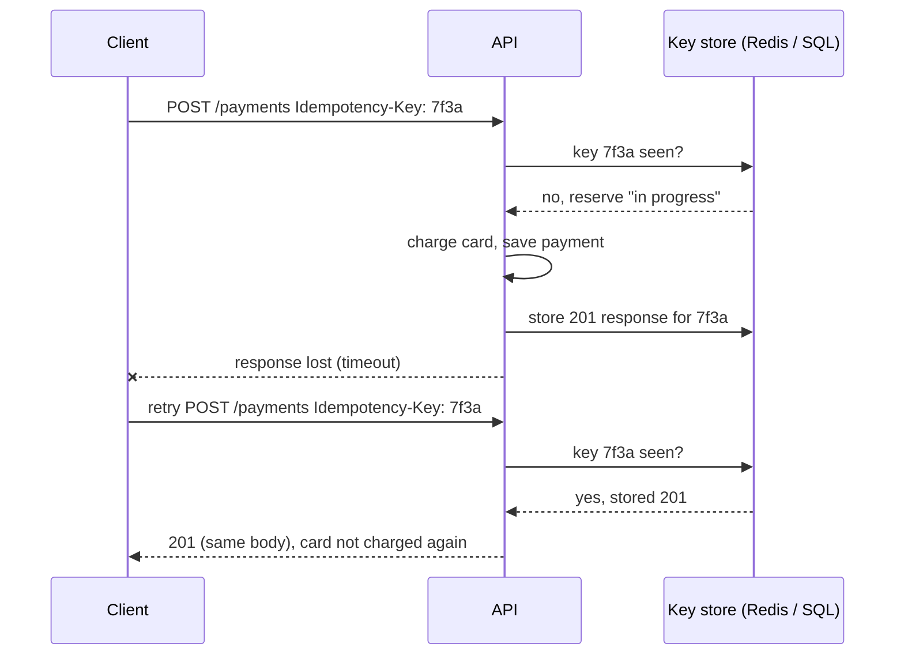

import { Aside } from '@astrojs/starlight/components';
import QuizBlock from '~/components/QuizBlock.astro';

## Why it matters in interviews

Every API round has a design component: *"design the endpoints for an order system"*, *"PUT or PATCH?"*, *"which status code for...?"*, *"what does idempotent mean, and how do you make a POST idempotent?"*. Answers here show whether you have designed APIs others consume or just added controller actions. Precise HTTP semantics are cheap points to win.

## Core idea

### Resources and naming

REST models the domain as **resources** identified by URLs, manipulated with a small set of **HTTP methods**, and transferred as **representations** (JSON).

| Do | Avoid |
|---|---|
| `GET /api/orders`, `GET /api/orders/42` | `GET /api/getOrders`, `/api/order/getById?id=42` |
| Plural nouns: `/customers/7/orders` | Verbs in paths for CRUD: `/createOrder` |
| Shallow nesting (one level): `/customers/7/orders` | `/customers/7/orders/42/lines/3/discounts` |
| Lowercase, kebab-case: `/shipping-addresses` | Mixed case, file extensions (`.json`) |
| Filtering in the query: `/orders?status=shipped` | `/orders/shipped` as a separate collection |
| Actions as sub-resources when not CRUD: `POST /orders/42/cancel` | `GET /orders/42/cancel` (GET must be safe) |

### HTTP methods: safe, idempotent, cacheable

**Safe** means no server-side state change. **Idempotent** means making the same request N times leaves the server in the same state as making it once (responses may differ, e.g. 200 then 404 for DELETE).

| Method | Use | Safe | Idempotent | Typical success |
|---|---|---|---|---|
| GET | Read a resource or collection | Yes | Yes | 200 |
| HEAD | Headers only (exists? size? ETag?) | Yes | Yes | 200 |
| POST | Create in a collection, or run an action | No | **No** | 201 + `Location`, or 200/202 |
| PUT | Create or **replace** the whole resource at a known URL | No | Yes | 200 or 204 (201 if created) |
| PATCH | **Partial** update | No | Not guaranteed | 200 or 204 |
| DELETE | Remove | No | Yes | 204 (404 or 204 on repeat) |
| OPTIONS | Capabilities, CORS preflight | Yes | Yes | 204 |

### PUT vs PATCH

`PUT` sends the **full** representation; fields you omit are reset. It's idempotent by definition. `PATCH` sends only the changes, in one of two formats:

- **JSON Merge Patch** (RFC 7396, `application/merge-patch+json`): a partial document; `null` means "remove". Simple, but you can't distinguish "set to null" from "not sent" with plain nullable DTOs, and arrays are replaced wholesale.
- **JSON Patch** (RFC 6902, `application/json-patch+json`): a list of operations (`add`, `remove`, `replace`, `test`...). Precise, including array edits and conditional `test`. ASP.NET Core historically needed Newtonsoft.Json for it; .NET 10 adds a System.Text.Json-based implementation.

In practice many teams use a small DTO with nullable fields for PATCH, or task-based endpoints (`POST /orders/42/address`) that express intent better than generic patches.

### Status code cheat sheet

| Code | When |
|---|---|
| **200 OK** | Successful GET, or PUT/PATCH returning the updated resource |
| **201 Created** | POST created a resource; include `Location` header and usually the body |
| **202 Accepted** | Work queued; return a status URL to poll (`Location` or `Operation-Location`) |
| **204 No Content** | Success with no body (DELETE, PUT/PATCH without body) |
| **304 Not Modified** | Conditional GET, ETag matched |
| **400 Bad Request** | Malformed request or validation errors (ProblemDetails with `errors`) |
| **401 Unauthorized** | Not authenticated (missing or invalid token) |
| **403 Forbidden** | Authenticated but not allowed |
| **404 Not Found** | Resource doesn't exist, or you hide existence from unauthorized users |
| **405 Method Not Allowed** | Path exists but not for this verb |
| **409 Conflict** | State conflict: duplicate unique value, invalid state transition, request in progress |
| **412 Precondition Failed** | `If-Match` ETag didn't match (optimistic concurrency) |
| **415 Unsupported Media Type** | Wrong `Content-Type` |
| **422 Unprocessable Content** | Well-formed but semantically invalid (some teams use 400 for all validation; be consistent) |
| **429 Too Many Requests** | Rate limited; include `Retry-After` |
| **500 / 502 / 503 / 504** | Server bug / bad upstream / unavailable or overloaded / upstream timeout |

### Idempotency and idempotency keys

Networks fail **after** the server did the work: the client times out, retries the POST, and the customer is charged twice. GET, PUT and DELETE are safe to retry by design; POST is not. The standard fix is an **idempotency key**: the client generates a unique key (a GUID) per logical operation and sends it in an `Idempotency-Key` header. The server stores the key with the result; a retry with the same key returns the stored result instead of executing again.



Details that impress: scope keys per client or user, reserve the key **atomically** (Redis `SET NX` or a unique index) so two concurrent retries can't both run, return 409 while the first is still in progress, reject a reused key with a different body (store a request hash), and expire keys after 24 hours or so. A database unique constraint on a natural key (e.g. `ClientOrderRef`) is another solid approach.

### Pagination, filtering and sorting conventions

- Query parameters: `GET /orders?status=shipped&customerId=7&sort=-createdAt,total&pageSize=20&cursor=eyJpZCI6MTAwfQ`.
- Server-enforced maximum `pageSize`; default sort that is **deterministic** (tie-break on id).
- Whitelist sortable and filterable fields; never pass them straight into dynamic SQL.
- Response envelope with items and navigation: `{ "items": [...], "nextCursor": "...", "links": { "next": "/api/orders?cursor=..." } }`, or a `Link` header. Expose `X-Total-Count` only if you can afford the `COUNT(*)`.
- Keyset (cursor) pagination for large or fast-changing data; offset for small admin grids. See [Performance & resilience](../performance-resilience/).

### HATEOAS-lite

Full HATEOAS (clients discover every action from links) is rare in practice. A pragmatic version adds a few links where they help: `self`, `next`/`prev` for pages, and maybe available actions (`cancel` only present when the order is cancellable). This lets the server own business rules the UI would otherwise duplicate.

### Error format: ProblemDetails

Use one error shape everywhere: **ProblemDetails** (RFC 9457, which replaced RFC 7807), content type `application/problem+json`, with `type`, `title`, `status`, `detail`, `instance` and extensions such as `errors` (validation) and `traceId`. `builder.Services.AddProblemDetails()` plus the exception handler middleware produce it for unhandled errors and empty error responses. Never return stack traces or SQL messages to clients.

```json
{
  "type": "https://api.contoso.com/problems/order-not-cancellable",
  "title": "Order cannot be cancelled",
  "status": 409,
  "detail": "Order 42 has already shipped.",
  "instance": "/api/orders/42/cancel",
  "traceId": "00-4bf92f3577b34da6a3ce929d0e0e4736-00f067aa0ba902b7-01"
}
```

### Richardson maturity model

| Level | Description | Example |
|---|---|---|
| 0 | One endpoint, one verb, RPC over HTTP | `POST /api` with `{ "action": "getOrder" }` (SOAP-style) |
| 1 | Resources | `POST /orders/42` to read, `POST /orders/42/delete` |
| 2 | Resources + proper HTTP verbs and status codes | `GET /orders/42`, `DELETE /orders/42` → 204 |
| 3 | Hypermedia controls (HATEOAS) | Responses contain links to next actions |

Most good real-world APIs are **level 2**, with a touch of level 3 for pagination links.

## Code

**Endpoints with precise results (minimal APIs)**

```csharp
var orders = app.MapGroup("/api/orders").WithTags("Orders");

orders.MapGet("/{id:int}", async Task<Results<Ok<OrderDto>, NotFound>> (int id, IOrderService svc, CancellationToken ct) =>
    await svc.GetAsync(id, ct) is { } order ? TypedResults.Ok(order) : TypedResults.NotFound());

orders.MapPost("/", async Task<Created<OrderDto>> (CreateOrderRequest request, IOrderService svc, CancellationToken ct) =>
{
    var order = await svc.CreateAsync(request, ct);
    return TypedResults.Created($"/api/orders/{order.Id}", order);   // 201 + Location
})
.AddEndpointFilter<IdempotencyFilter>();

orders.MapPatch("/{id:int}", async Task<Results<NoContent, NotFound>> (int id, UpdateOrderNoteRequest patch,
    IOrderService svc, CancellationToken ct) =>
    await svc.PatchAsync(id, patch, ct) ? TypedResults.NoContent() : TypedResults.NotFound());

// Non-CRUD action as a sub-resource
orders.MapPost("/{id:int}/cancel", async Task<Results<NoContent, NotFound>> (int id, IOrderService svc, CancellationToken ct) =>
    await svc.CancelAsync(id, ct) ? TypedResults.NoContent() : TypedResults.NotFound());
```

**A simplified idempotency-key filter**

```csharp
public sealed class IdempotencyFilter(IDistributedCache cache) : IEndpointFilter
{
    public async ValueTask<object?> InvokeAsync(EndpointFilterInvocationContext context, EndpointFilterDelegate next)
    {
        var http = context.HttpContext;
        if (!http.Request.Headers.TryGetValue("Idempotency-Key", out var key) || string.IsNullOrWhiteSpace(key))
            return TypedResults.Problem("Idempotency-Key header is required", statusCode: StatusCodes.Status400BadRequest);

        var cacheKey = $"idem:{http.User.Identity?.Name}:{key}";
        if (await cache.GetStringAsync(cacheKey, http.RequestAborted) is { } cached)
        {
            var order = JsonSerializer.Deserialize<OrderDto>(cached)!;
            return TypedResults.Created($"/api/orders/{order.Id}", order); // replay the first response
        }

        var result = await next(context);
        if (result is Created<OrderDto> { Value: { } created })
            await cache.SetStringAsync(cacheKey, JsonSerializer.Serialize(created),
                new DistributedCacheEntryOptions { AbsoluteExpirationRelativeToNow = TimeSpan.FromHours(24) },
                http.RequestAborted);
        return result;
    }
}
```

This version is deliberately simple: two concurrent requests with the same key can both pass the check. Production code reserves the key atomically first (Redis `SET NX` or an insert into a table with a unique index), returns 409 while it is in progress, and stores a request hash to reject a reused key with a different body.

## Interview Q&A

<details>
<summary>What does idempotent mean? Which methods are idempotent?</summary>

Repeating the same request has the same effect on server state as sending it once. GET, HEAD, PUT, DELETE and OPTIONS are idempotent by definition; POST is not, and PATCH isn't guaranteed (an "increment by 1" patch isn't). Idempotency is about state, not the response: a second DELETE may return 404, and that's fine.
</details>

<details>
<summary>How do you make a "create payment" POST safe to retry?</summary>

Require an `Idempotency-Key` header generated by the client per logical operation. On the first request, atomically reserve the key, do the work and store the response with the key. On a retry with the same key, return the stored response without re-executing; if the first is still running, return 409. Scope keys per client and expire them after a day. Alternatively, enforce a unique client reference in the database.
</details>

<details>
<summary>PUT vs PATCH vs POST?</summary>

POST creates a resource in a collection where the server picks the id, or triggers an action; not idempotent. PUT replaces the whole resource at a client-known URL (or creates it there); idempotent. PATCH applies a partial change using merge patch or JSON Patch. If a client sends PUT with a missing field, that field should be cleared, which is why partial updates should use PATCH.
</details>

<details>
<summary>401 vs 403? 400 vs 422? 404 vs 403 for someone else's order?</summary>

401: you aren't authenticated (no or invalid token). 403: authenticated but not allowed. 400 for malformed input and, in many APIs, validation; 422 for well-formed input that breaks business rules, if the team adopts that convention. For another user's order, returning 404 avoids revealing that the id exists, which matters for enumerable ids.
</details>

<details>
<summary>What should a POST that creates a resource return?</summary>

201 Created with a `Location` header pointing to the new resource (`/api/orders/42`) and usually the created representation, including server-generated fields like id and timestamps. In ASP.NET Core: `TypedResults.Created(uri, dto)` or `CreatedAtRoute`. If the work is asynchronous, return 202 Accepted with a status URL instead.
</details>

<details>
<summary>How do you design a long-running operation, like generating a large report?</summary>

`POST /reports` returns 202 Accepted with `Location: /reports/jobs/123`. The client polls `GET /reports/jobs/123`, which returns the status (`Running`, `Succeeded`, `Failed`); when done it links to `GET /reports/123/file` or a time-limited blob SAS URL (AWS: S3 presigned URL). Optionally notify via SignalR or a webhook instead of polling. The work runs in a background worker or a queue-triggered function.
</details>

<details>
<summary>What is the Richardson maturity model, and where are most APIs?</summary>

A scale of REST adoption: level 0 is RPC over a single endpoint, level 1 introduces resources, level 2 adds proper HTTP verbs and status codes, and level 3 adds hypermedia links (HATEOAS). Most production APIs sit at level 2, sometimes with pagination or action links borrowed from level 3.
</details>

<details>
<summary>How should errors be returned?</summary>

Consistently, as ProblemDetails (`application/problem+json`, RFC 9457) with a status code that matches the error, a human-readable title and detail, validation errors in an `errors` dictionary and a `traceId` for support. No stack traces, SQL or internal hostnames. In ASP.NET Core, `AddProblemDetails()` with `UseExceptionHandler` and `[ApiController]` validation give you this shape.
</details>

## Pitfalls

<Aside type="caution" title="Common mistakes">

- **Returning 200 with `{ "success": false }`** for errors, which breaks clients, monitoring and retries.
- **State-changing GETs** (`GET /orders/42/cancel`): crawlers, prefetchers and caches will trigger them.
- **Using PUT for partial updates**, silently nulling fields the client didn't send.
- **Retrying POSTs without an idempotency key**, causing duplicate orders or payments.
- **Unbounded collections** with no max page size, or non-deterministic sort orders that skip or repeat rows between pages.
- **Exposing database entities directly**, leaking internal fields and coupling clients to your schema.
- **Inconsistent naming and casing** across endpoints (`/Orders`, `/order-items`, `/customerAddresses`).
- **Leaking internals in error responses**.

</Aside>

## Related

- [API versioning, OpenAPI & CORS](../versioning-openapi-cors/)
- [Global error handling](../error-handling/)
- [HTTP & HTTPS fundamentals](../../fundamentals/http-https/)
- [API design & rate limiting in system design](../../system-design/api-design-rate-limiting/)

## Quick quiz

<QuizBlock section="aspnet" topic="rest-api-design" />
