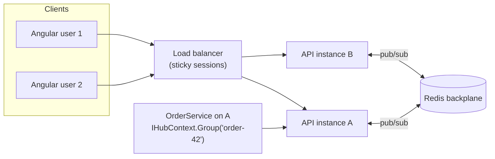

import { Tabs, TabItem, Aside } from '@astrojs/starlight/components';
import QuizBlock from '~/components/QuizBlock.astro';

## Why it matters in interviews

REST covers most APIs, but interviewers like to check that you know the alternatives and, more importantly, **when not to use them**. Typical prompts: *"how would you push order status updates to the Angular app?"*, *"how does SignalR work with 4 servers?"*, *"why would two microservices talk over gRPC?"* and *"REST vs GraphQL?"*. A comparison table in your head and one real use case for each is enough at 3-4 years.

## Core idea

### SignalR: server push over persistent connections

SignalR is ASP.NET Core's real-time library. Clients open a long-lived connection to a **hub**; either side can invoke methods on the other.

- **Transports**, negotiated in order of preference: **WebSockets**, then **Server-Sent Events**, then **Long Polling**. The client first calls a `negotiate` endpoint to agree on transport and get a connection id.
- **Protocols**: JSON by default, MessagePack for smaller binary payloads.
- **Addressing**: `Clients.All`, `Caller`, `Others`, `Client(connectionId)`, `User(userId)` (all connections of a user, based on the `NameIdentifier` claim by default), `Group(name)`.
- **Groups** are lightweight, in-memory, and **not persisted**: after a reconnect the client gets a new connection id and must rejoin.
- **Hubs are transient**: a new instance per invocation. Don't keep state in hub fields; use a store or `IHubContext` from services.
- **Delivery is at-most-once** with no persistence. If a client was offline, it should re-fetch current state over REST on reconnect. (.NET 8 added optional stateful reconnect, which buffers messages across brief disconnects.)
- **Auth**: browsers can't set an `Authorization` header on a WebSocket, so the JS client sends the JWT as an `access_token` query parameter; the server reads it in `JwtBearerEvents.OnMessageReceived` for the hub path.

**Scale-out** is the main design question. A connection lives on one server. If server A wants to message a group whose members are connected to servers B and C, something must relay it:



| Option | How | Trade-offs |
|---|---|---|
| **Redis backplane** (`AddStackExchangeRedis`) | Every server publishes every message to Redis; all servers receive and forward to their own connections | Simple; requires sticky sessions (unless WebSockets-only with negotiation skipped); every server sees every message, so it caps out at very high scale |
| **Azure SignalR Service** (`AddAzureSignalR`) | Clients connect to the managed service; your servers hold a few connections to it | Offloads connections, no sticky sessions, scales to very large numbers of clients; cost and vendor lock-in (AWS: API Gateway WebSocket APIs, a different programming model) |

### gRPC: contract-first RPC over HTTP/2

gRPC services are defined in a `.proto` file; tooling (`Grpc.Tools`) generates server base classes and typed clients for C# and other languages.

- **Protobuf** binary serialization: much smaller and faster to parse than JSON, strongly typed.
- **HTTP/2** multiplexing over one connection; four call types: **unary**, **server streaming**, **client streaming**, **bidirectional streaming**.
- **Deadlines** and cancellation propagate across calls; errors use gRPC status codes (`NotFound`, `InvalidArgument`, `Unavailable`, `DeadlineExceeded`).
- **Versioning by field numbers**: you can add fields safely; never reuse or change the number of an existing field (mark removed ones `reserved`).
- **Browsers can't call native gRPC** (no control over HTTP/2 frames and trailers). Use **gRPC-Web** (`Grpc.AspNetCore.Web`) or **JSON transcoding** (`Microsoft.AspNetCore.Grpc.JsonTranscoding`, .NET 7+) to expose the same service as REST.
- **Load balancing**: long-lived HTTP/2 connections defeat connection-level (L4) balancers; all calls from one client stick to one server. Use an L7 proxy or service mesh (Envoy, Linkerd, YARP) or client-side load balancing.

Use gRPC for **internal service-to-service** calls where performance, streaming and strict contracts matter, especially in polyglot systems. Keep REST for public and browser-facing APIs.

### GraphQL in one paragraph

GraphQL exposes **one endpoint** and a typed schema; the client sends a query naming exactly the fields it needs, possibly across related entities, in one round trip. It solves over- and under-fetching for varied clients (mobile vs web) and aggregation over several services. Costs: HTTP caching mostly doesn't apply (POST to one URL), naive resolvers cause **N+1** queries (solved with DataLoader batching), clients can write very expensive queries (enforce depth/complexity limits and timeouts), and errors often come back with HTTP 200. In .NET the common server is **Hot Chocolate**.

### Comparison

| | REST | gRPC | GraphQL | SignalR |
|---|---|---|---|---|
| Transport | HTTP/1.1, 2 or 3 | HTTP/2 (HTTP/3 possible) | HTTP (usually POST) | WebSockets / SSE / long polling |
| Payload | JSON (text) | Protobuf (binary) | JSON | JSON or MessagePack |
| Contract | OpenAPI (optional) | `.proto` (required) | Schema (required) | Hub method names (C# / TS) |
| Browser support | Native | Via gRPC-Web or transcoding | Native | JS client library |
| Streaming | Limited (chunked, SSE) | Full, bidirectional | Subscriptions | Full duplex |
| Caching | HTTP caching, CDN | Custom | Hard, client-side caches | N/A |
| Best for | Public APIs, CRUD, broad compatibility | Internal microservices, low latency, polyglot | Many client shapes, aggregation, BFF | Live updates, dashboards, chat, notifications |

## Code

**Strongly typed hub and pushing from a service**

```csharp
public interface IOrderClient
{
    Task OrderStatusChanged(int orderId, string status);
}

[Authorize]
public sealed class OrderHub(ILogger<OrderHub> logger) : Hub<IOrderClient>
{
    public async Task WatchOrder(int orderId)
    {
        await Groups.AddToGroupAsync(Context.ConnectionId, $"order-{orderId}");
        logger.LogInformation("{User} watching order {OrderId}", Context.UserIdentifier, orderId);
    }
}

public sealed class OrderNotifier(IHubContext<OrderHub, IOrderClient> hub)
{
    public Task StatusChangedAsync(int orderId, string status) =>
        hub.Clients.Group($"order-{orderId}").OrderStatusChanged(orderId, status);
}

// Program.cs
builder.Services.AddSignalR()
    .AddStackExchangeRedis(builder.Configuration.GetConnectionString("redis")!,
        o => o.Configuration.ChannelPrefix = RedisChannel.Literal("shop"));
app.MapHub<OrderHub>("/hubs/orders");
```

**Angular client**

```ts
import { HubConnectionBuilder, LogLevel } from '@microsoft/signalr';

const connection = new HubConnectionBuilder()
  .withUrl('/hubs/orders', { accessTokenFactory: () => auth.token() })
  .withAutomaticReconnect()
  .configureLogging(LogLevel.Warning)
  .build();

connection.on('OrderStatusChanged', (orderId: number, status: string) => orders.updateStatus(orderId, status));
connection.onreconnected(() => connection.invoke('WatchOrder', orderId)); // groups are lost on reconnect

await connection.start();
await connection.invoke('WatchOrder', orderId);
```

**gRPC contract, service and client**

<Tabs>
  <TabItem label="inventory.proto">

```proto
syntax = "proto3";
option csharp_namespace = "Inventory.Grpc";
package inventory.v1;

service Inventory {
  rpc GetStock (StockRequest) returns (StockReply);
  rpc WatchStock (StockRequest) returns (stream StockReply); // server streaming
}

message StockRequest { string sku = 1; }
message StockReply {
  string sku = 1;
  int32 quantity = 2;
  int64 updated_unix_ms = 3;
}
```

  </TabItem>
  <TabItem label="Server">

```csharp
public sealed class InventoryService : Inventory.Grpc.Inventory.InventoryBase
{
    public override Task<StockReply> GetStock(StockRequest request, ServerCallContext context)
    {
        if (string.IsNullOrWhiteSpace(request.Sku))
            throw new RpcException(new Status(StatusCode.InvalidArgument, "sku is required"));
        return Task.FromResult(new StockReply { Sku = request.Sku, Quantity = 42 });
    }

    public override async Task WatchStock(StockRequest request,
        IServerStreamWriter<StockReply> stream, ServerCallContext context)
    {
        while (!context.CancellationToken.IsCancellationRequested)
        {
            await stream.WriteAsync(new StockReply { Sku = request.Sku, Quantity = Random.Shared.Next(100) });
            await Task.Delay(TimeSpan.FromSeconds(1), context.CancellationToken);
        }
    }
}

// Program.cs
builder.Services.AddGrpc();
app.MapGrpcService<InventoryService>();
```

  </TabItem>
  <TabItem label="Client">

```csharp
builder.Services.AddGrpcClient<Inventory.Grpc.Inventory.InventoryClient>(o =>
    o.Address = new Uri("https://inventory.internal"));

public sealed class CheckoutService(Inventory.Grpc.Inventory.InventoryClient inventory)
{
    public async Task<bool> InStockAsync(string sku, CancellationToken ct)
    {
        var reply = await inventory.GetStockAsync(new StockRequest { Sku = sku },
            deadline: DateTime.UtcNow.AddSeconds(2), cancellationToken: ct);
        return reply.Quantity > 0;
    }
}
```

  </TabItem>
</Tabs>

## Interview Q&A

<details>
<summary>How does SignalR choose a transport?</summary>

The client calls the negotiate endpoint, which returns the transports the server supports. The client then tries WebSockets first, falls back to Server-Sent Events, then Long Polling, depending on what the browser, proxies and server allow. You can restrict transports, for example WebSockets only with negotiation skipped, which also removes the need for sticky sessions.
</details>

<details>
<summary>How do you scale SignalR to multiple servers?</summary>

Each connection lives on one server, so messages must be relayed. A Redis backplane publishes every message to Redis so all servers can forward it to their local connections; it needs sticky sessions for negotiation and non-WebSocket transports. Azure SignalR Service takes over the client connections entirely, so your app servers scale independently and need no sticky sessions. For very large fan-out, the managed service is the usual answer.
</details>

<details>
<summary>How do you send a SignalR message from a controller or background service?</summary>

Inject `IHubContext<THub>` (or `IHubContext<THub, TClient>` for strongly typed hubs) and call `Clients.Group(...)`, `Clients.User(...)` and so on. You can't new up or resolve the hub itself; hubs are created per invocation by the framework.
</details>

<details>
<summary>A user loses Wi-Fi for 20 seconds. What do they miss and how do you handle it?</summary>

SignalR doesn't store messages, so anything sent while disconnected is lost (apart from the short buffer of stateful reconnect if enabled). The client should reconnect automatically, rejoin its groups, and re-fetch current state over REST. Treat SignalR messages as notifications that something changed, with the database as the source of truth.
</details>

<details>
<summary>Why is gRPC faster than REST with JSON?</summary>

Protobuf is a compact binary format with generated serializers, so payloads are smaller and parsing is cheaper than reflection-heavy text JSON. HTTP/2 multiplexes many calls over one connection with header compression, avoiding connection setup per call. The contract is known at compile time. The gain matters most for chatty internal calls and streaming, less for a single CRUD call dominated by database time.
</details>

<details>
<summary>Can an Angular app call a gRPC service directly?</summary>

Not with native gRPC: browsers don't expose the HTTP/2 framing and trailers gRPC needs. Options: gRPC-Web (`Grpc.AspNetCore.Web` on the server plus a gRPC-Web client), JSON transcoding so the same service also answers REST calls, or a BFF that calls gRPC internally and exposes REST to the browser.
</details>

<details>
<summary>When would you choose GraphQL over REST?</summary>

When many different clients need different shapes of the same data and you want to avoid over-fetching or multiple round trips, or when a BFF aggregates several services. I'd stay with REST for simple CRUD, public APIs that benefit from HTTP caching, and teams without GraphQL experience, because of the N+1, query-cost and caching complexity.
</details>

<details>
<summary>How do you evolve a gRPC contract without breaking clients?</summary>

Add new fields with new numbers; old clients ignore unknown fields and new clients see defaults when the field is absent. Never change a field's number or type, and mark removed fields and names `reserved` so they aren't reused. For breaking changes, add a new service or package version (`inventory.v2`).
</details>

## Pitfalls

<Aside type="caution" title="Common mistakes">

- **Storing state in hub fields**: hubs are transient.
- **Assuming groups survive reconnects** or that messages are delivered while a client is offline.
- **Scaling SignalR out without a backplane or Azure SignalR**, so users on other servers never receive group messages.
- **Forgetting sticky sessions** with a Redis backplane and non-WebSocket transports.
- **Sending JWTs in query strings without HTTPS and log scrubbing**: tokens end up in proxy logs.
- **Using gRPC for a public browser API** without gRPC-Web or transcoding.
- **Reusing protobuf field numbers**, silently corrupting data for old clients.
- **GraphQL without depth or complexity limits** or DataLoader, inviting N+1 queries and denial of service.

</Aside>

## Related

- [Communication patterns in microservices](../../microservices/communication-patterns/)
- [Case study: chat system](../../system-design/case-chat-system/)
- [REST API design](../rest-api-design/)
- [Networking fundamentals](../../fundamentals/networking/)

## Quick quiz

<QuizBlock section="aspnet" topic="signalr-grpc" />
