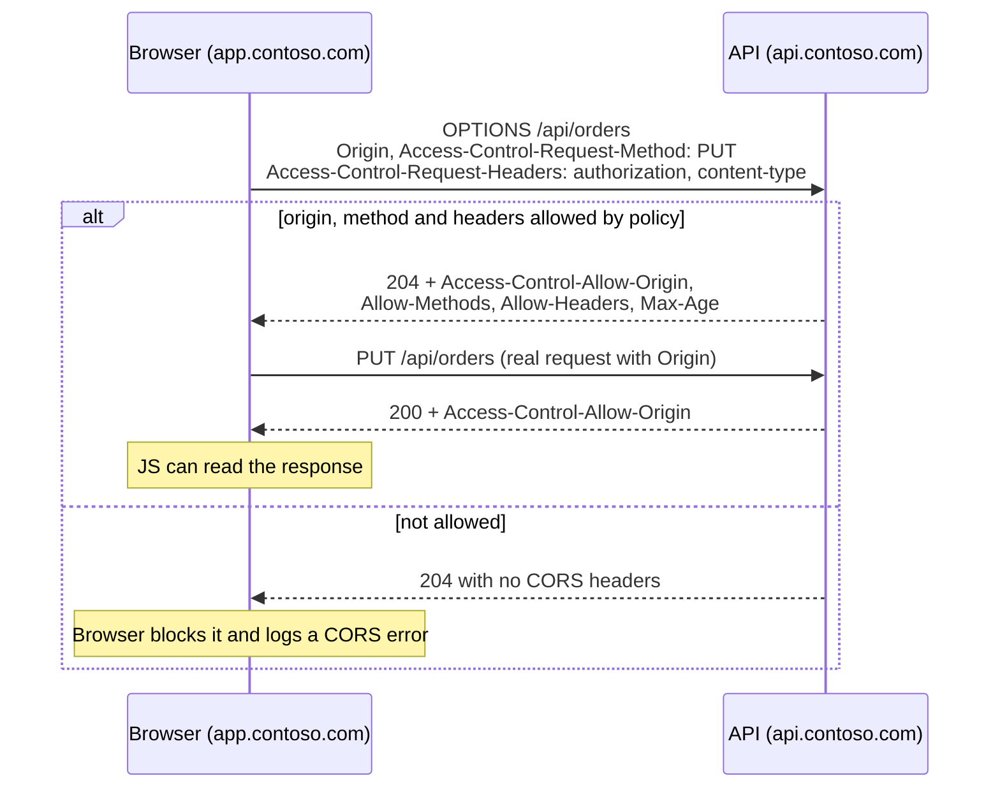

import { Tabs, TabItem, Aside } from '@astrojs/starlight/components';
import QuizBlock from '~/components/QuizBlock.astro';

## Why it matters in interviews

These three topics share one theme: **your API has clients you don't control**. Interviewers ask *"how do you introduce a breaking change?"*, *"where does your Swagger come from in .NET 9+?"* and, almost always for full-stack .NET + Angular candidates, *"your Angular app gets a CORS error; what is happening and how do you fix it?"*. A crisp explanation of the preflight request is a quick win.

## Core idea

### API versioning

Version only for **breaking changes**: removing or renaming a field, changing a type or meaning, making an optional input required, changing status codes or error format. Adding an optional field or a new endpoint is non-breaking, so tell clients to ignore unknown fields.

| Strategy | Example | Pros | Cons |
|---|---|---|---|
| URL segment | `/api/v2/orders` | Visible, easy to test in a browser, cache-friendly, easy routing at gateways | URL is supposed to identify a resource, not a version; every route changes |
| Query string | `/api/orders?api-version=2.0` | Optional, easy default | Easy to forget; some caches ignore query strings |
| Header | `X-Api-Version: 2.0` | Clean URLs | Invisible in links and logs; needs tooling to test; must `Vary` on it for caching |
| Media type | `Accept: application/json;v=2` | Most "RESTful" | Hardest for clients; rarely used |

URL segment is the most common choice in practice (Azure and many public APIs use a query string `api-version`). Whatever you choose, be consistent and **support N and N-1** for a published deprecation period.

`Asp.Versioning` (the successor to `Microsoft.AspNetCore.Mvc.Versioning`) provides it: `Asp.Versioning.Http` for minimal APIs, `Asp.Versioning.Mvc` for controllers, and `Asp.Versioning.Mvc.ApiExplorer` to expose versions to OpenAPI. Key options:

- `DefaultApiVersion` + `AssumeDefaultVersionWhenUnspecified`: unversioned old clients keep working.
- `ReportApiVersions`: adds `api-supported-versions` and `api-deprecated-versions` response headers.
- `ApiVersionReader.Combine(...)`: accept several ways of specifying the version.
- Mark old versions **deprecated** (`Deprecated = true` / `HasDeprecatedApiVersion`) before you remove them, and announce a sunset date.

Requests for an unsupported version are rejected with a 4xx, so clients learn quickly rather than getting silently wrong data.

### OpenAPI generation (built in since .NET 9)

From .NET 9 the `webapi` template no longer includes Swashbuckle. `Microsoft.AspNetCore.OpenApi` generates the document itself:

- `builder.Services.AddOpenApi()` registers a document (default name `v1`); call it again with another name for more documents.
- `app.MapOpenApi()` serves it at `/openapi/{documentName}.json`. In .NET 10 the default output is **OpenAPI 3.1**, and YAML is available by mapping a `.yaml` route.
- **Transformers** (document, operation, schema) customise the output: titles, security schemes, servers, examples.
- It is driven by endpoint metadata: `TypedResults`, `Produces<T>()`, `WithName`, `WithSummary`, `[ProducesResponseType]`, `[Description]`. .NET 10 can also pull in XML doc comments.
- It can generate the document at **build time** (via `Microsoft.Extensions.ApiDescription.Server`) so CI can diff it for breaking changes or generate clients.

The UI is separate: **Scalar** (`Scalar.AspNetCore`, `MapScalarApiReference()`), **Swagger UI** (`Swashbuckle.AspNetCore.SwaggerUI` pointed at `/openapi/v1.json`) or ReDoc. Swashbuckle and NSwag still work if a project already uses them. On the Angular side, NSwag or `openapi-generator` turn the document into typed services, which keeps the client in sync with the API contract.

Expose the document and UI only in Development or behind authentication; they are a map of your attack surface.

### CORS

The browser's **same-origin policy** blocks JavaScript on `https://app.contoso.com` from reading responses from `https://api.contoso.com` (different origin = scheme + host + port). **CORS** is the server telling the browser which cross-origin callers are allowed. Important consequences:

- CORS is enforced **by the browser only**. Postman, curl and other servers ignore it. It is not an authentication or authorization mechanism.
- The server still receives and processes "simple" cross-origin requests; CORS only decides whether the browser lets JavaScript **read** the response.

A request is **simple** (no preflight) only if it is GET, HEAD or POST, uses only safe headers, and has `Content-Type` of `text/plain`, `application/x-www-form-urlencoded` or `multipart/form-data`. A typical Angular call with `Content-Type: application/json` or an `Authorization` header is **not** simple, so the browser sends a **preflight** first:



Response headers that matter:

| Header | Meaning |
|---|---|
| `Access-Control-Allow-Origin` | The allowed origin (or `*`) |
| `Access-Control-Allow-Methods` / `-Headers` | What the actual request may use (preflight response) |
| `Access-Control-Allow-Credentials: true` | Browser may send cookies and expose the response; requires an explicit origin, never `*` |
| `Access-Control-Max-Age` | How long the browser can cache the preflight |
| `Access-Control-Expose-Headers` | Response headers JS may read beyond the safe list (e.g. `X-Total-Count`, `Location`) |

## Code

**Versioning (minimal APIs and controllers)**

<Tabs>
  <TabItem label="Minimal APIs">

```csharp
builder.Services.AddApiVersioning(o =>
{
    o.DefaultApiVersion = new ApiVersion(1, 0);
    o.AssumeDefaultVersionWhenUnspecified = true;
    o.ReportApiVersions = true; // api-supported-versions header
    o.ApiVersionReader = ApiVersionReader.Combine(
        new UrlSegmentApiVersionReader(),
        new HeaderApiVersionReader("X-Api-Version"));
})
.AddApiExplorer(o =>
{
    o.GroupNameFormat = "'v'VVV";        // v1, v2: used as OpenAPI document groups
    o.SubstituteApiVersionInUrl = true;
});

var orders = app.NewVersionedApi("Orders");

var v1 = orders.MapGroup("/api/v{version:apiVersion}/orders").HasDeprecatedApiVersion(1.0);
v1.MapGet("/{id:int}", (int id) => TypedResults.Ok(new OrderV1(id, "Pending")));

var v2 = orders.MapGroup("/api/v{version:apiVersion}/orders").HasApiVersion(2.0);
v2.MapGet("/{id:int}", (int id) =>
    TypedResults.Ok(new OrderV2(id, new OrderStatus("Pending", DateTime.UtcNow))));
```

  </TabItem>
  <TabItem label="Controllers">

```csharp
[ApiController]
[ApiVersion(1.0, Deprecated = true)]
[ApiVersion(2.0)]
[Route("api/v{version:apiVersion}/customers")]
public sealed class CustomersController : ControllerBase
{
    [HttpGet("{id:int}")]
    [MapToApiVersion(1.0)]
    public IActionResult GetV1(int id) => Ok(new { id, name = "Asha Rao" });

    [HttpGet("{id:int}")]
    [MapToApiVersion(2.0)]
    public IActionResult GetV2(int id) => Ok(new { id, firstName = "Asha", lastName = "Rao" });
}
```

  </TabItem>
</Tabs>

**OpenAPI document and Scalar UI**

```csharp
builder.Services.AddOpenApi("v1", o =>
{
    o.AddDocumentTransformer((doc, context, ct) =>
    {
        doc.Info.Title = "Orders API";
        doc.Info.Version = "v1";
        return Task.CompletedTask;
    });
});
builder.Services.AddOpenApi("v2");

if (app.Environment.IsDevelopment())
{
    app.MapOpenApi();               // /openapi/v1.json, /openapi/v2.json
    app.MapScalarApiReference();    // /scalar
}
```

**CORS policy for an Angular SPA**

```csharp
builder.Services.AddCors(o => o.AddPolicy("spa", p => p
    .WithOrigins("https://app.contoso.com", "http://localhost:4200") // exact, no trailing slash
    .WithMethods("GET", "POST", "PUT", "DELETE")
    .WithHeaders("Content-Type", "Authorization", "X-Api-Version")
    .WithExposedHeaders("X-Total-Count", "api-supported-versions")
    .AllowCredentials()
    .SetPreflightMaxAge(TimeSpan.FromMinutes(10))));

var app = builder.Build();
app.UseCors("spa");          // after UseRouting (if explicit), before auth and output cache
app.UseAuthentication();
app.UseAuthorization();
```

In local development you can avoid CORS altogether with the Angular dev-server proxy, so the browser only ever talks to `localhost:4200`:

```json
{
  "/api": { "target": "https://localhost:7001", "secure": false, "changeOrigin": true }
}
```

## Interview Q&A

<details>
<summary>Which versioning strategy would you pick and why?</summary>

URL segment for a public or partner API: it is explicit, visible in logs, easy to test and easy to route at a gateway (Azure API Management, AWS API Gateway). Header versioning keeps URLs clean and suits internal APIs with generated clients. Either way: version only on breaking changes, support N and N-1, mark old versions deprecated with a sunset date, and report supported versions in headers.
</details>

<details>
<summary>What counts as a breaking change?</summary>

Removing or renaming fields or endpoints, changing a field's type or meaning, making an optional input required, tightening validation, changing status codes or the error format, and changing default sort or paging behaviour. Adding optional fields or new endpoints is not breaking, as long as clients ignore unknown properties.
</details>

<details>
<summary>How is OpenAPI generated in .NET 9 and 10 compared with earlier versions?</summary>

Earlier templates used Swashbuckle to generate the document and serve Swagger UI. Since .NET 9, `Microsoft.AspNetCore.OpenApi` generates the document natively (`AddOpenApi` / `MapOpenApi`), with document, operation and schema transformers for customization; .NET 10 emits OpenAPI 3.1 by default and supports YAML. The UI is a separate choice: Scalar, Swagger UI or ReDoc.
</details>

<details>
<summary>Explain a CORS preflight. Why does my GET with an Authorization header trigger one?</summary>

Before a non-simple cross-origin request, the browser sends `OPTIONS` with `Origin`, `Access-Control-Request-Method` and `Access-Control-Request-Headers`. The server answers with the allowed origin, methods, headers and max-age; if they match, the browser sends the real request. `Authorization` is not a CORS-safelisted header, so any request carrying it is non-simple, even a GET. `Access-Control-Max-Age` lets the browser cache the preflight result.
</details>

<details>
<summary>Why can't you combine AllowAnyOrigin with AllowCredentials?</summary>

The CORS spec forbids `Access-Control-Allow-Origin: *` together with credentials, because it would let any website make authenticated calls with the user's cookies and read the result. ASP.NET Core throws when building such a policy. List explicit origins, or use `SetIsOriginAllowed` with a strict check (never `_ => true`).
</details>

<details>
<summary>The Angular app shows a CORS error, but the request works in Postman. How do you debug it?</summary>

Postman ignores CORS, so the server is reachable. In the browser's Network tab, check the OPTIONS request and its response headers. Common causes: origin not in the policy (exact match, scheme and port included, no trailing slash); `UseCors` missing or placed after `UseAuthorization`, so the preflight (which never carries a token) fails authorization; a missing allowed header such as `Authorization`; credentials with a wildcard origin; or the real request failing with a 500 whose error response lacks CORS headers, which the browser reports as a CORS error. Server logs reveal the last one.
</details>

<details>
<summary>Does CORS protect my API from other servers or attackers?</summary>

No. CORS relaxes the browser's same-origin policy; it doesn't restrict non-browser clients. Anyone can call your API with curl. Protection comes from authentication, authorization, rate limiting and input validation. CORS helps against a malicious website using a victim's browser to read your API responses.
</details>

<details>
<summary>Why should you not expose Swagger/Scalar in production?</summary>

It documents every endpoint, parameter and model, which helps attackers map the attack surface, and "try it out" invites probing. Expose it only in Development, behind authentication, or publish the document to an internal developer portal such as Azure API Management.
</details>

## Pitfalls

<Aside type="caution" title="Common mistakes">

- **Versioning every small change** instead of evolving additively, ending with v1-v7 to maintain.
- **Removing a version without a deprecation period** or without telling clients via headers and docs.
- **Header versioning behind a cache without `Vary`**, so v1 and v2 responses get mixed.
- **Origin with a trailing slash or wrong port** (`http://localhost:4200/`): it never matches.
- **`AllowAnyOrigin()` "to make it work"** in production, or `SetIsOriginAllowed(_ => true)` with credentials.
- **`UseCors` after `UseAuthorization`**: preflights carry no token, so they can fail authorization (often a 401 or 405) before CORS answers them.
- **Forgetting `WithExposedHeaders`**, so Angular can't read `X-Total-Count` or `Location`.
- **Treating CORS as security** for a public API.

</Aside>

## Related

- [REST API design](../rest-api-design/)
- [Request pipeline & middleware](../middleware-pipeline/)
- [Web attacks (CSRF, XSS)](../../security/web-attacks/)
- [Angular HTTP & interceptors](../../angular/http-interceptors/)

## Quick quiz

<QuizBlock section="aspnet" topic="versioning-openapi-cors" />
