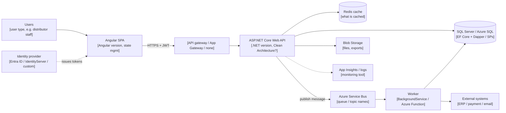

import { Aside } from '@astrojs/starlight/components';

## Why it matters in interviews

*"Explain your current project"* is the single most common question in .NET interviews at 3-4 years, at both service and product companies. It often takes 15-20 minutes of a technical round, because everything you say opens a drill-down. The interviewer is checking:

- **Do you understand the whole system**, or only the tickets you were assigned? Can you draw it?
- **What did *you* do?** Ownership, decisions and trade-offs, not the team's achievements.
- **Depth on demand.** When they point at any box on your diagram, can you go two levels deeper (why Service Bus, how is auth done, what indexes, how is it deployed)?
- **Engineering judgement.** Do you know the system's weaknesses and what you would change?

A strong walkthrough is the best way to steer a technical interview onto ground you know well.

## The 5-minute structure

| Minute | Block | Content |
|---|---|---|
| 0:00-0:45 | **Business context** | What the product does, who uses it, scale (users, tenants, orders/day, data size) |
| 0:45-2:00 | **Architecture** | Draw or describe the diagram: client, API, data, async processing, hosting, integrations |
| 2:00-3:00 | **Your role** | Modules you own, team size, your responsibilities beyond coding |
| 3:00-4:15 | **Hardest problem** | One technical challenge in mini-STAR form, with a metric |
| 4:15-5:00 | **Reflection** | Results, what you learned, what you would change with hindsight |

Stop at 5 minutes and ask: *"Shall I go deeper into any part?"* That hands control back and signals you can go deeper.

## Architecture diagram template

Adapt this to your real system: rename boxes, delete what you do not use, add what is missing. Practise drawing it on a whiteboard or in an online tool in under 90 seconds.



Talk through it **in the direction a request flows**: "A user in the Angular app does X, the request goes to Y, which does Z." That is easier to follow than describing boxes one by one.

Have a one-liner ready for each box: *what it is, why it was chosen, one detail*. For AWS shops, swap in the equivalents (Service Bus to SQS/SNS, Blob Storage to S3, App Insights to CloudWatch/X-Ray); see [Azure/AWS mapping](../../system-design/azure-aws-mapping/).

## Fill-in template

```text
CONTEXT
"[Product] is a [B2B/B2C] [domain] application used by [who] to [do what].
We have about [N] [tenants/users/orders per day], and [one scale fact,
e.g. the largest table has N million rows]."

ARCHITECTURE
"The front end is [Angular version] with [state approach]. It calls
[N] ASP.NET Core [version] APIs, structured as [layers / Clean Architecture /
vertical slices]. Data is in [SQL Server / Azure SQL] accessed via [EF Core /
Dapper / stored procedures]. Long-running work like [example] goes through
[queue] to [worker]. Auth is [JWT from IdP]. We deploy on [hosting] through
[CI/CD tool], and monitor with [tool]."

MY ROLE
"The team is [N] developers, [N] QA, [PO/manager]. I own [modules].
Beyond coding I [code reviews / design docs / on-call / mentoring /
client calls / release management]."

HARDEST PROBLEM
"The hardest problem was [problem]. It mattered because [business impact].
I [investigated how], found [root cause], and [solution + trade-off].
Result: [metric before → after]."

REFLECTION
"If I were starting again I would [change, e.g. introduce the outbox pattern /
split the import worker / add integration tests earlier], because [reason]."
```

## Sample answer

<Aside type="tip" title="Sample: replace with your own project">
Fictional but plausible. Match its level of specificity with your real system.
</Aside>

```text
CONTEXT (45 s)
"TradeLink is a multi-tenant B2B SaaS that about 300 distributors use to manage
orders from their retailers: order capture, pricing rules, invoicing and dispatch.
We process roughly 40,000 orders a day, and the Orders table has about 60 million rows."

ARCHITECTURE (75 s)
"The front end is an Angular 17 app using standalone components and signals.
It talks to a modular ASP.NET Core 8 API, organised in Clean Architecture layers
with MediatR. Data is in Azure SQL; we use EF Core for writes and Dapper for the
heavy search queries. Anything slow, like bulk imports, invoice PDFs and ERP sync,
goes onto Azure Service Bus and is processed by worker services. Users sign in
through Entra ID and the API validates JWTs with tenant claims. We deploy to Azure
App Service with Azure DevOps pipelines and use Application Insights for monitoring."

MY ROLE (60 s)
"I'm one of five developers. I own order search and the bulk import module, and
I do most of the back-end code reviews. I also write the design notes for features
in my area and I'm in the on-call rotation one week a month."

HARDEST PROBLEM (75 s)
"Order search was timing out for our five biggest tenants, around 2.8 seconds p95
and some 30-second timeouts. Using Query Store and the execution plans, I found
OFFSET paging scanning millions of rows plus a non-sargable date filter. I added a
composite index on TenantId, Status and CreatedAt with included columns, rewrote the
filter, and moved the grid to keyset pagination, which needed a small Angular change
to use a 'load more' cursor instead of page numbers. p95 dropped to under 400 ms and
the timeouts disappeared."

REFLECTION (45 s)
"If I could change one thing, I'd add a transactional outbox. Today we save the
order and then publish to Service Bus, so a crash between the two can lose a message.
We patched it with a reconciliation job, but the outbox is the proper fix."
```

## Prepare these numbers

Interviewers love numbers, and vague answers here hurt. Know them before the interview, approximately and honestly:

| Metric | Your value |
|---|---|
| Users / tenants / requests per day | `[N]` |
| Biggest table row count, DB size | `[N rows]`, `[N GB]` |
| Team size and composition | `[N dev, N QA]` |
| Deployment frequency, sprint length | `[weekly / per sprint]` |
| Key latency or performance numbers | `[p95 before → after]` |
| Test coverage or test types | `[unit/integration %]` |

## Do / Don't

| Do | Don't |
|---|---|
| Start with what the business does | Start with "we used .NET Core and Angular" |
| Draw the diagram and follow a request through it | Describe folder structure or class names |
| Say "I" for your decisions, "we" for team work | Claim the whole architecture if you joined after it was built |
| Mention a trade-off you made and why | Present every choice as obviously correct |
| Admit known weaknesses and how you would fix them | Pretend the system has no problems |
| Keep confidential names out (client, revenue) | Share internal client names or proprietary data |

## Pitfalls

<Aside type="caution" title="Common mistakes">
- **No business context.** Jumping into tech without saying what the product does makes everything after it hard to follow.
- **Buzzwords you cannot back up.** If "microservices", "Kubernetes" or "CQRS" appear in your walkthrough, you will be asked why, how and what went wrong.
- **Not knowing parts outside your module.** You do not need to have built auth or CI/CD, but you must be able to explain how they work in your system.
- **No numbers.** "It became faster" is weak. "p95 from 2.8 s to 400 ms" is memorable.
- **Running 15 minutes uninterrupted.** Five minutes, then hand control back.
- **Different stories in different rounds.** Keep your diagram and numbers consistent across rounds; interviewers compare notes.
</Aside>

## Follow-up questions to expect

<details>
<summary>"Why did you choose [Service Bus / Redis / EF Core / Angular] here?"</summary>

Answer with the requirement that drove it, the alternative considered, and the trade-off: "We needed retries and dead-lettering for imports, so a queue rather than fire-and-forget. We picked Service Bus over RabbitMQ because we were already on Azure and did not want to run a broker." If it was decided before you joined, say so, then give your view of it.
</details>

<details>
<summary>"How does authentication and authorisation work end to end?"</summary>

Walk the token: login at the IdP, Angular stores and attaches the token via an interceptor, the API validates signature, issuer, audience and expiry, then policies check roles and tenant claims. Mention how tenant isolation is enforced in queries (e.g. an EF Core global query filter). See [auth & tokens](../../security/authn-authz-tokens/).
</details>

<details>
<summary>"How is it deployed? What happens when you merge a PR?"</summary>

Describe the pipeline stages: build, unit tests, publish artifact, deploy to dev/QA, approvals, production (slots or blue-green), DB migrations step, rollback plan. See [CI/CD](../../testing-devops/ci-cd/).
</details>

<details>
<summary>"What happens if the worker crashes halfway through an import?"</summary>

Talk about idempotency (processing each row or batch keyed by an id so retries do not duplicate), message lock and retry, dead-letter queue and alerting, and how the user sees progress. See [reliability patterns](../../microservices/reliability-patterns/).
</details>

<details>
<summary>"How would this system handle 10x the load?"</summary>

This turns the walkthrough into a mini system design. Identify the bottleneck first (usually the database), then: read replicas or caching for reads, scaling out stateless APIs, partitioning or archiving large tables, more worker instances. Use the [system design framework](../../system-design/interview-framework/) and [scaling fundamentals](../../system-design/scaling-fundamentals/).
</details>

<details>
<summary>"What would you change if you could rebuild it?"</summary>

Have one or two concrete, reasoned answers (outbox, better test coverage, splitting a module, moving to a managed service). Avoid "rewrite it in microservices" unless you can justify it with a real problem.
</details>

<details>
<summary>"What was a bug that took you the longest to find?"</summary>

A good chance to use your [production incident STAR story](../star-stories/). Focus on how you narrowed it down: logs, correlation ids, reproducing locally, bisecting.
</details>

## Related

- [Tell me about yourself](../tell-me-about-yourself/)
- [STAR story bank](../star-stories/)
- [System design interview framework](../../system-design/interview-framework/)
- [Observability in production](../../testing-devops/observability/)
