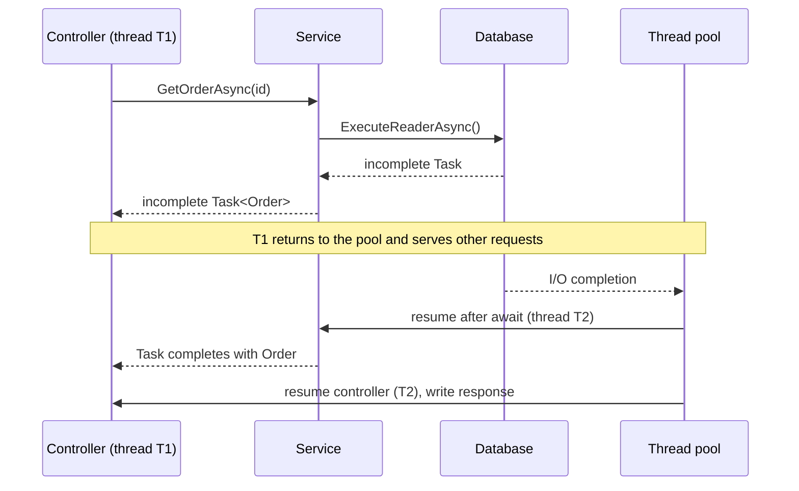
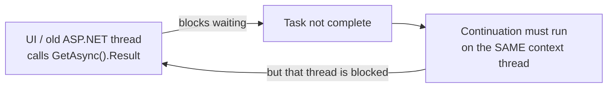

import { Tabs, TabItem, Aside } from '@astrojs/starlight/components';
import QuizBlock from '~/components/QuizBlock.astro';

## Why it matters in interviews

Almost every .NET interview at 3–4 years asks some version of *"what actually happens when you `await`?"*, *"why does this code deadlock?"* or *"Task vs ValueTask?"*. Interviewers use async to check whether you understand threads, I/O and the request pipeline, not just syntax.

## Core idea

`async`/`await` lets a method **give its thread back while waiting for I/O**, then resume later. No thread sits blocked while a database query or HTTP call is in flight. That is why async scales a web server: the same small thread pool can serve thousands of concurrent requests.

The compiler rewrites an `async` method into a **state machine**. Each `await` is a possible suspension point:

1. Call the awaited operation and get a `Task` back.
2. If the task is already complete, continue synchronously (no suspension, no allocation of a continuation).
3. Otherwise, store local variables in the state machine, register the rest of the method as a **continuation**, and **return an incomplete `Task` to the caller**.
4. When the I/O completes, the continuation is scheduled, either on the captured `SynchronizationContext` (UI apps, old ASP.NET) or on a thread-pool thread (ASP.NET Core, console).



<Aside type="note" title="No thread is waiting">
For true I/O (sockets, files, DB drivers) there is **no thread** blocked during the wait. The OS signals completion through I/O completion ports and a pool thread picks the continuation up. `Task.Run` is different: it **uses** a pool thread for CPU work.
</Aside>

### Task vs ValueTask

| | `Task` / `Task<T>` | `ValueTask` / `ValueTask<T>` |
|---|---|---|
| Type | Reference type (heap allocation) | Struct wrapping a result **or** a `Task` **or** an `IValueTaskSource` |
| Best for | General use, public APIs | Hot paths that **usually complete synchronously** (cache hits, buffered reads) |
| Can await many times? | Yes | **No.** Await exactly once |
| Can `.Result` before completion? | Blocks (bad, but works) | Undefined behaviour |
| Combinators (`WhenAll`) | Directly | Call `.AsTask()` first |

Default to `Task`. Reach for `ValueTask` only when profiling shows allocation pressure on a hot path.

### ConfigureAwait(false)

`await task` captures the current `SynchronizationContext` and resumes on it. In WPF/WinForms that means the UI thread, and in classic ASP.NET (System.Web) it means the request context. `ConfigureAwait(false)` says *"I don't need to come back to that context"*.

- **Library code**: use `ConfigureAwait(false)` so callers with a context can't deadlock you, and to skip a needless context switch.
- **ASP.NET Core app code**: there is no `SynchronizationContext`, so it has no effect. Most teams omit it in app code.
- **UI code** that touches controls after the await: do **not** use it.

### The classic deadlock



Blocking on async code with `.Result`, `.Wait()` or `.GetAwaiter().GetResult()` while holding a single-threaded context means the continuation can never run. The fix is **async all the way**: make the caller `async` and `await`. `ConfigureAwait(false)` inside the library is a mitigation, not the fix.

## Code

<Tabs syncKey="lang">
  <TabItem label="C#">
```csharp
public class OrderService(IOrderRepository repo, IHttpClientFactory http, ILogger<OrderService> log)
{
    // Async all the way + cancellation flowing from the request.
    public async Task<OrderDto> GetAsync(int id, CancellationToken ct)
    {
        var order = await repo.FindAsync(id, ct)
                    ?? throw new NotFoundException($"Order {id}");

        // Start independent I/O concurrently, then await both.
        var client = http.CreateClient("pricing");
        var priceTask = client.GetFromJsonAsync<Price>($"/prices/{order.Sku}", ct);
        var stockTask = repo.GetStockAsync(order.Sku, ct);
        await Task.WhenAll(priceTask, stockTask);

        return new OrderDto(order.Id, priceTask.Result!, stockTask.Result); // safe: both completed
    }

    // ValueTask: usually served from cache synchronously.
    private readonly ConcurrentDictionary<string, decimal> _cache = new();
    public ValueTask<decimal> GetRateAsync(string currency, CancellationToken ct) =>
        _cache.TryGetValue(currency, out var rate)
            ? ValueTask.FromResult(rate)
            : new ValueTask<decimal>(LoadRateAsync(currency, ct));

    private async Task<decimal> LoadRateAsync(string currency, CancellationToken ct)
    {
        var rate = await repo.GetRateAsync(currency, ct).ConfigureAwait(false);
        _cache[currency] = rate;
        return rate;
    }
}
```
  </TabItem>
  <TabItem label="TypeScript">
```ts
// Same ideas in Angular/TypeScript: promises are eager, await yields to the event loop.
async function getOrder(id: number, signal: AbortSignal): Promise<OrderDto> {
  const order = await fetch(`/api/orders/${id}`, { signal }).then((r) => r.json());

  // Run independent calls concurrently (like Task.WhenAll).
  const [price, stock] = await Promise.all([
    fetch(`/api/prices/${order.sku}`, { signal }).then((r) => r.json()),
    fetch(`/api/stock/${order.sku}`, { signal }).then((r) => r.json()),
  ]);
  return { id: order.id, price, stock };
}

const ctrl = new AbortController(); // ~ CancellationTokenSource
getOrder(42, ctrl.signal);
ctrl.abort(); // ~ cts.Cancel()
```
  </TabItem>
</Tabs>

**Cancellation with a timeout**

```csharp
using var cts = CancellationTokenSource.CreateLinkedTokenSource(requestAborted);
cts.CancelAfter(TimeSpan.FromSeconds(5));
try
{
    await service.ProcessAsync(cts.Token);
}
catch (OperationCanceledException) when (!requestAborted.IsCancellationRequested)
{
    // Our own 5 s timeout fired, not the client disconnecting.
    return Results.StatusCode(StatusCodes.Status504GatewayTimeout);
}
```

**Streaming results with `IAsyncEnumerable<T>`**

```csharp
public async IAsyncEnumerable<Order> StreamAsync([EnumeratorCancellation] CancellationToken ct = default)
{
    await foreach (var row in db.Orders.AsAsyncEnumerable().WithCancellation(ct))
        yield return row;
}
```

## Interview Q&A

<details>
<summary>Does `await` create a new thread?</summary>

No. `await` does not create threads. For I/O-bound work no thread is used during the wait. The continuation later runs on a thread-pool thread or the captured context. Only `Task.Run`, `Parallel`, or explicit `Thread` use additional threads for CPU work.
</details>

<details>
<summary>What is the difference between `Task.Run` and an async method?</summary>

An async method runs synchronously on the caller's thread until its first incomplete `await`. `Task.Run` queues a delegate to the thread pool. Use `Task.Run` to offload **CPU-bound** work from a UI thread. Avoid it in ASP.NET Core request code: it just swaps one pool thread for another and adds overhead.
</details>

<details>
<summary>Why is `async void` dangerous? When is it allowed?</summary>

The caller can't await it, so it can't know when it finishes. Exceptions are raised on the `SynchronizationContext` and typically **crash the process** instead of being caught. It is only acceptable for **event handlers** (e.g. `button_Click`). Everything else should return `Task`.
</details>

<details>
<summary>`Task.WhenAll` vs awaiting tasks one by one?</summary>

Awaiting one by one runs the operations **sequentially** if you start each after the previous finishes. Starting all tasks first and then `await Task.WhenAll(...)` runs them **concurrently**, so total time ≈ the slowest one. `WhenAll` throws the first exception when awaited, while `task.Exception` holds all of them as an `AggregateException`.
</details>

<details>
<summary>How do `.Result` and `await` differ in exception handling?</summary>

`.Result` and `.Wait()` wrap failures in `AggregateException`. `await` unwraps and rethrows the **first** inner exception with its original stack trace. `.GetAwaiter().GetResult()` also unwraps, but still blocks.
</details>

<details>
<summary>What happens to an exception in a task nobody awaits?</summary>

It is stored on the task. When the task is garbage-collected, `TaskScheduler.UnobservedTaskException` is raised. Since .NET 4.5 this no longer crashes the process by default, so the error is silently lost. That is why fire-and-forget needs explicit try/catch and logging, or a background queue.
</details>

<details>
<summary>How would you run a background job from a controller without blocking the response?</summary>

Don't `Task.Run` and forget inside the request: the scope (and `DbContext`) is disposed when the request ends, and errors are lost. Push work to a `Channel<T>` consumed by a `BackgroundService`, or a durable queue (Hangfire, Azure Service Bus) if it must survive restarts.
</details>

<details>
<summary>Is `async` code always faster?</summary>

No. Each async method has state-machine overhead, and a single request isn't faster. The win is **scalability**: threads aren't blocked on I/O, so the server handles more concurrent requests with the same pool. For pure CPU work, async adds overhead with no benefit.
</details>

## Pitfalls

<Aside type="caution" title="Common mistakes">
- **Sync-over-async**: `.Result`, `.Wait()`, `GetAwaiter().GetResult()` in request code leads to thread-pool starvation, and to deadlocks under a SynchronizationContext.
- **`async void`** outside event handlers. Exceptions crash the process.
- **Forgetting to pass `CancellationToken`** down to EF Core / HttpClient calls, so work continues after the client disconnects.
- **Awaiting a `ValueTask` twice** or storing it in a field.
- **Sequential awaits** of independent I/O when `Task.WhenAll` would halve latency.
- **`Task.Run` in ASP.NET Core** request handlers "to make it async". It adds overhead and gains nothing.
- **Running multiple queries on the same `DbContext` concurrently** with `WhenAll`. `DbContext` isn't thread-safe; use separate contexts.
</Aside>

## Related

- [Threading & synchronization](../threading/)
- [Garbage collection & IDisposable](../memory-gc/)
- [ASP.NET Core request pipeline](../../aspnet/middleware-pipeline/)
- [Background services](../../aspnet/background-services/)

## Quick quiz

<QuizBlock section="csharp" topic="async-await" />
