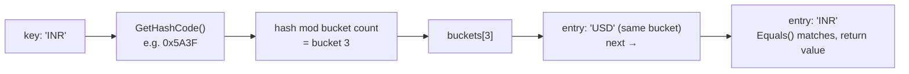
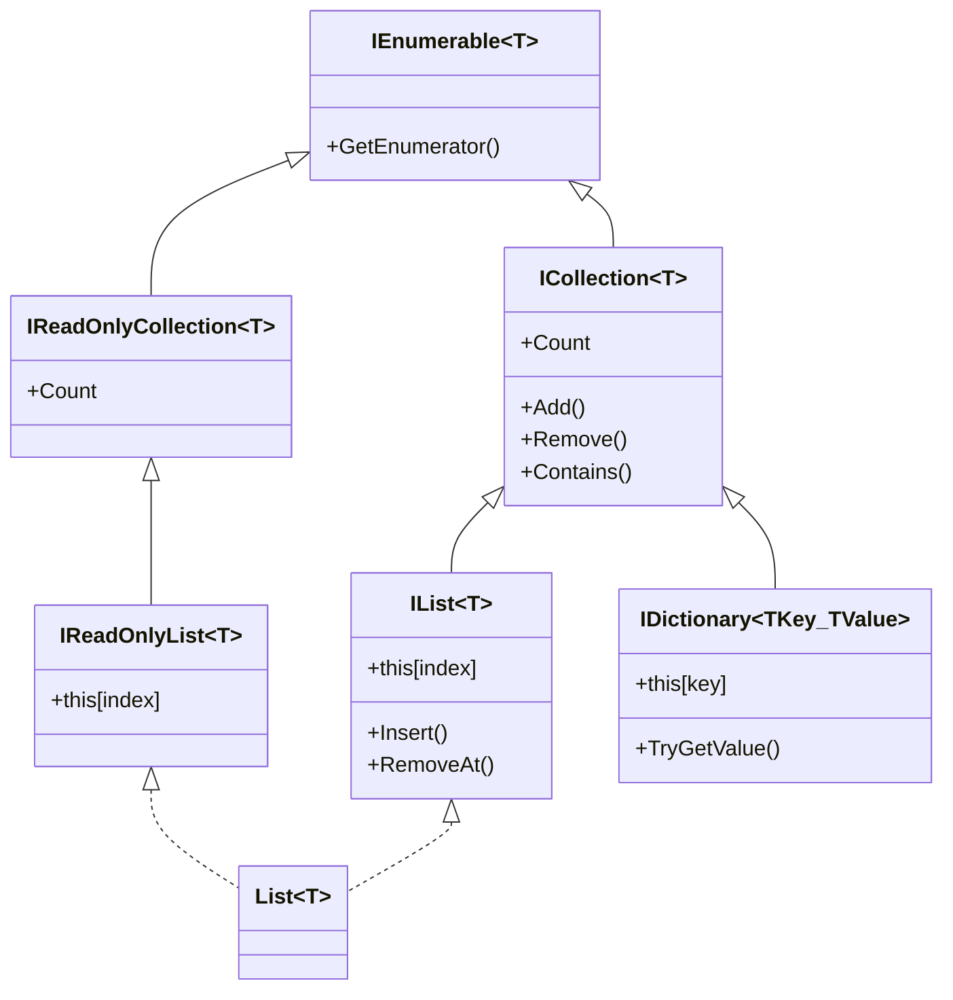

import { Tabs, TabItem, Aside } from '@astrojs/starlight/components';
import QuizBlock from '~/components/QuizBlock.astro';

## Why it matters in interviews

Choosing the right collection is a daily decision, and interviewers test it directly (*"how does `Dictionary` work internally?"*, *"`IEnumerable` vs `IList` as a return type?"*) and indirectly in every coding round (*"can you make this O(n)?"* usually means "use a `HashSet`"). Generics questions check whether you understand constraints and the classic covariance puzzle: why can a `List<string>` be an `IEnumerable<object>` but not a `List<object>`?

## Core idea

### Pick the collection by access pattern

| Collection | Underlying structure | Lookup | Add | Remove | Ordered? | Use when |
|---|---|---|---|---|---|---|
| `T[]` | Contiguous array | O(1) by index | n/a (fixed) | n/a | Insertion | Fixed size, hot paths |
| `List<T>` | Resizable array | O(1) index, O(n) search | O(1) amortized at end, O(n) insert | O(n) | Insertion | Default ordered list |
| `Dictionary<K,V>` | Hash table | O(1) average | O(1) average | O(1) | No guarantee | Key-based lookup |
| `HashSet<T>` | Hash table | O(1) `Contains` | O(1) | O(1) | No | Uniqueness, fast membership |
| `Queue<T>` | Circular array | Peek O(1) | O(1) | Dequeue O(1) | FIFO | Work queues, BFS |
| `Stack<T>` | Array | Peek O(1) | Push O(1) | Pop O(1) | LIFO | Undo, DFS, parsing |
| `LinkedList<T>` | Doubly linked list | O(n) | O(1) at a known node | O(1) at a known node | Insertion | Frequent middle inserts with node refs (LRU) |
| `SortedDictionary<K,V>` | Red-black tree | O(log n) | O(log n) | O(log n) | By key | Sorted, frequent inserts |
| `SortedList<K,V>` | Two sorted arrays | O(log n) | O(n) | O(n) | By key | Sorted, mostly read, less memory |
| `SortedSet<T>` | Red-black tree | O(log n) | O(log n) | O(log n) | Sorted | Ordered unique items, ranges |
| `PriorityQueue<T,P>` | Binary min-heap | Peek O(1) | O(log n) | Dequeue O(log n) | By priority | Scheduling, top-k, Dijkstra |

`List<T>` grows by **doubling** its internal array when full, so `Add` is amortized O(1) but occasionally O(n). If you know the size, pass a capacity: `new List<Order>(count)`.

### How Dictionary works



1. Compute `key.GetHashCode()` (or the supplied `IEqualityComparer<T>`), map it to a bucket.
2. Walk that bucket's chain, comparing with `Equals`.
3. When the entries array is full, resize to roughly double (a prime size) and rehash every entry, which is why `new Dictionary<K,V>(capacity)` helps for big loads.

Consequences you should mention: lookup is O(1) **only with a good hash**. If `GetHashCode` returns a constant, every key lands in one bucket and lookup degrades to O(n). **Never mutate a key** after inserting it: its hash changes and the entry becomes unreachable. Equal objects **must** return equal hash codes. Use records or `HashCode.Combine` for composite keys, and pass `StringComparer.OrdinalIgnoreCase` for case-insensitive string keys.

### The interface hierarchy



**Parameters**: accept the *least* you need (`IEnumerable<T>` if you only iterate, `IReadOnlyCollection<T>` if you need `Count`). **Return values**: return something honest and specific, such as `IReadOnlyList<T>` for a materialized result, so callers don't re-enumerate a lazy query by accident. Returning `IEnumerable<T>` from a repository that is secretly an `IQueryable` is a classic trap (see [LINQ](../linq/)).

### Concurrent, immutable and frozen collections

| Family | Examples | Thread-safe? | Use |
|---|---|---|---|
| Concurrent | `ConcurrentDictionary`, `ConcurrentQueue`, `ConcurrentBag`, `BlockingCollection` | Yes, with fine-grained locking / lock-free | Shared mutable state across threads, in-process caches |
| Immutable | `ImmutableList`, `ImmutableDictionary`, `ImmutableArray` | Yes (never changes) | Snapshots, functional updates; "modify" returns a new instance sharing structure |
| Frozen (.NET 8+) | `FrozenDictionary`, `FrozenSet` | Yes (read-only) | Build once at startup, read millions of times; slower to create, fastest to read |
| Read-only wrappers | `ReadOnlyCollection<T>`, `AsReadOnly()` | No | A read-only **view**; the underlying list can still change |

`ConcurrentDictionary.GetOrAdd(key, factory)` is atomic for the **insert**, but the factory **can run more than once** under contention. Wrap the value in `Lazy<T>` if the factory is expensive or has side effects. For producer/consumer pipelines prefer `Channel<T>` (see [Threading](../threading/)).

### Generics

Generics give **type safety** and **no boxing** for value types. The CLR keeps generics at run time (reified, unlike Java's type erasure): each value-type instantiation (`List<int>`, `List<double>`) gets its own specialized native code, while reference-type instantiations share one copy.

**Constraints** tell the compiler what `T` can do:

| Constraint | Meaning |
|---|---|
| `where T : class` / `class?` | Reference type (non-nullable / nullable) |
| `where T : struct` | Non-nullable value type |
| `where T : notnull` | Any non-nullable type |
| `where T : unmanaged` | Struct with no references (for `Span`, pointers, interop) |
| `where T : new()` | Has a public parameterless constructor |
| `where T : BaseEntity` | Derives from a class |
| `where T : IComparable<T>` | Implements an interface (incl. static abstract members, e.g. `INumber<T>`) |
| `where T : allows ref struct` (C# 13) | Anti-constraint: `T` may be a `ref struct` like `Span<T>` |

### Covariance and contravariance

Variance only applies to **generic interfaces and delegates**, and only for **reference types**.

- **Covariance** (`out T`): a producer of `Derived` can be used as a producer of `Base`. `IEnumerable<out T>`, `IReadOnlyList<out T>`, `Func<out TResult>`. So `IEnumerable<object> x = new List<string>();` is fine: you can only read.
- **Contravariance** (`in T`): a consumer of `Base` can be used as a consumer of `Derived`. `Action<in T>`, `IComparer<in T>`. An `Action<object>` can be assigned to `Action<string>`.
- **Invariant**: `List<T>`, `IList<T>`, `Dictionary<K,V>`, because they both read and write `T`. If `List<string>` were a `List<object>`, you could `Add(42)` to a list of strings.
- **Arrays are covariant, unsafely**: `object[] arr = new string[2]; arr[0] = 1;` compiles but throws `ArrayTypeMismatchException` at run time.

## Code

```csharp
namespace Catalog;

public sealed record ProductKey(string Sku, string Region); // value equality: safe dictionary key

public sealed class PriceIndex(IEnumerable<Price> prices)
{
    // Built once, read on every request.
    private readonly FrozenDictionary<ProductKey, decimal> _bySku =
        prices.ToFrozenDictionary(p => new ProductKey(p.Sku, p.Region), p => p.Amount);

    public bool TryGet(string sku, string region, out decimal amount) =>
        _bySku.TryGetValue(new ProductKey(sku, region), out amount);
}

public sealed record Price(string Sku, string Region, decimal Amount);

public static class Dedup
{
    // O(n) duplicate detection with a HashSet instead of O(n^2) nested loops.
    public static IReadOnlyList<T> Duplicates<T>(IEnumerable<T> items, IEqualityComparer<T>? comparer = null)
    {
        var seen = new HashSet<T>(comparer);
        var dupes = new List<T>();
        foreach (var item in items)
            if (!seen.Add(item)) dupes.Add(item); // Add returns false if already present
        return dupes;
    }
}
```

**A generic repository-style constraint and a generic math method**

```csharp
using System.Numerics;

public abstract class Entity { public Guid Id { get; init; } = Guid.NewGuid(); }

public interface IRepository<T> where T : Entity
{
    Task<T?> FindAsync(Guid id, CancellationToken ct);
}

public static class MathEx
{
    public static T Sum<T>(IEnumerable<T> values) where T : INumber<T>
    {
        var total = T.Zero;
        foreach (var v in values) total += v;
        return total;
    }
}
```

**Safe removal while iterating**

```csharp
var ids = new List<int> { 1, 2, 3, 4 };
// foreach (var id in ids) if (id % 2 == 0) ids.Remove(id); // InvalidOperationException
ids.RemoveAll(id => id % 2 == 0);                            // [1, 3]
```

## Interview Q&A

<details>
<summary>How does `Dictionary<TKey,TValue>` achieve O(1) lookup, and when does it degrade?</summary>

It hashes the key to a bucket and compares entries in that bucket with `Equals`. With a good hash function buckets are short, so lookup is O(1) on average. A poor `GetHashCode` (many collisions) degrades it to O(n). Mutating a key after insertion makes it unfindable because its bucket was chosen from the old hash.
</details>

<details>
<summary>`IEnumerable<T>` vs `ICollection<T>` vs `IList<T>`?</summary>

`IEnumerable<T>` only supports iteration (and may be lazy). `ICollection<T>` adds `Count`, `Add`, `Remove`, `Contains`. `IList<T>` adds index access and `Insert`/`RemoveAt`. Their read-only counterparts are `IReadOnlyCollection<T>` and `IReadOnlyList<T>`. Accept the narrowest interface, return a specific, materialized one.
</details>

<details>
<summary>`List<T>` vs `LinkedList<T>`: when is a linked list actually better?</summary>

Rarely. `List<T>` is contiguous memory, cache-friendly, and O(1) indexed. `LinkedList<T>` wins only when you hold node references and insert or remove in the middle often, as in an LRU cache (dictionary of nodes plus a linked list). Otherwise its per-node allocations and pointer chasing make it slower.
</details>

<details>
<summary>`SortedDictionary` vs `SortedList`?</summary>

Both keep keys sorted with O(log n) lookup. `SortedDictionary` is a red-black tree: O(log n) inserts and removes, more memory per item. `SortedList` uses two sorted arrays: less memory, index access, but O(n) inserts. Use `SortedList` for data that is built once and read often.
</details>

<details>
<summary>Is `ConcurrentDictionary.GetOrAdd` fully thread-safe?</summary>

The dictionary state is, and only one value wins. But the value factory runs **outside** the lock and may be invoked by several threads for the same key; losers' values are discarded. If creation is expensive or must happen once, store `Lazy<T>` values.
</details>

<details>
<summary>Why can you assign `List<string>` to `IEnumerable<object>` but not to `List<object>`?</summary>

`IEnumerable<out T>` is covariant: it only produces `T`, so reading strings as objects is safe. `List<T>` is invariant because it also accepts `T` (`Add`), and adding an `int` to what is really a list of strings would break type safety.
</details>

<details>
<summary>Immutable vs read-only vs frozen collections?</summary>

`ReadOnlyCollection<T>` is a read-only **view** over a list that someone else can still change. `ImmutableList<T>` can never change; "mutations" return new instances that share structure, good for snapshots shared across threads. `FrozenDictionary` is built once and optimized for read speed at the cost of creation time: ideal for lookup tables loaded at startup.
</details>

<details>
<summary>What does `where T : new()` allow, and what are its limits?</summary>

It lets generic code call `new T()`. It only works with a public parameterless constructor and can't pass arguments. For anything richer, take a `Func<T>` factory or use DI.
</details>

## Pitfalls

<Aside type="caution" title="Common mistakes">
- Modifying a collection inside `foreach` over it: `InvalidOperationException`. Use `RemoveAll`, iterate a copy, or a reverse `for` loop.
- `list.Contains` inside a loop (O(n²)). Build a `HashSet<T>` first.
- Mutable objects as dictionary keys, or overriding `Equals` without `GetHashCode`.
- `dict[key]` for possibly missing keys (throws `KeyNotFoundException`). Use `TryGetValue`.
- Sharing `List<T>` or `Dictionary<K,V>` across threads with writes. They are not thread-safe.
- Expecting `Dictionary` to preserve insertion order. It often appears to, but it is not guaranteed.
- Using array covariance (`object[] = string[]`) and getting `ArrayTypeMismatchException`.
</Aside>

## Related

- [LINQ](../linq/)
- [Threading & Synchronization](../threading/)
- [Hashing Patterns](../../dsa/hashing/)
- [Big-O & Complexity Analysis](../../dsa/big-o/)

## Quick quiz

<QuizBlock section="csharp" topic="collections-generics" />
