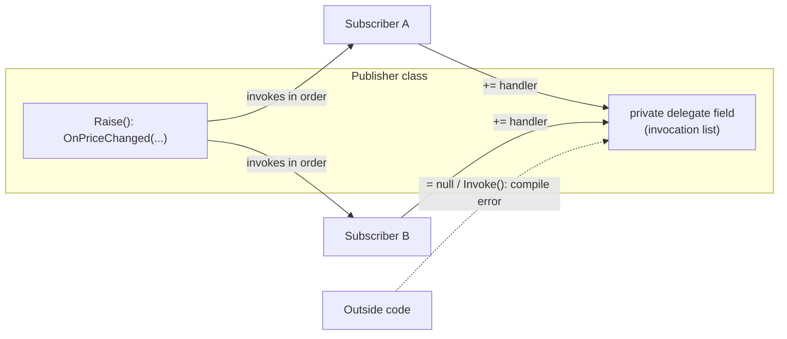
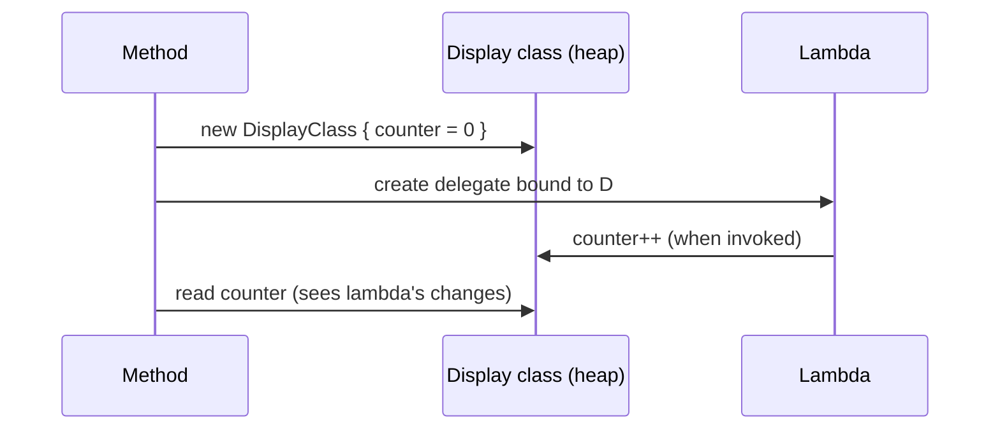

import { Tabs, TabItem, Aside } from '@astrojs/starlight/components';
import QuizBlock from '~/components/QuizBlock.astro';

## Why it matters in interviews

Delegates are everywhere in modern .NET even if you never write the `delegate` keyword: LINQ lambdas, minimal API handlers (`app.MapGet("/", () => ...)`), middleware (`app.Use(async (ctx, next) => ...)`), DI factories, Polly policies. Interviewers ask *"delegate vs event?"*, *"what is a closure?"*, and love the **captured loop variable** "what does this print" puzzle. Knowing how closures compile also explains a whole class of memory and concurrency bugs.

## Core idea

A **delegate** is a type-safe **reference to a method** (plus, for instance methods, the target object). It is like a function pointer, but it knows the signature and keeps the target alive.

When you declare `delegate decimal PriceRule(decimal price);`, the compiler generates a **sealed class** deriving from `System.MulticastDelegate` with an `Invoke` method matching the signature. Calling `rule(100m)` is just `rule.Invoke(100m)`.

### Built-in delegate types

| Type | Signature | Example |
|---|---|---|
| `Action` / `Action<T1..T16>` | Returns `void` | `Action<string> log = Console.WriteLine;` |
| `Func<T1..T16, TResult>` | Returns `TResult` (last type argument) | `Func<int, int, int> add = (a, b) => a + b;` |
| `Predicate<T>` | `T → bool` | `list.FindAll(x => x > 5)` |
| `EventHandler` / `EventHandler<TEventArgs>` | `(object? sender, TEventArgs e)` | Standard event signature |
| `Comparison<T>` | `(T, T) → int` | `list.Sort((a, b) => a.Total.CompareTo(b.Total))` |

Custom delegate types are still useful when the name documents intent, or when you need `ref`/`out` parameters (which `Func`/`Action` can't express).

### Multicast delegates

Every delegate can hold an **invocation list**. `+=` combines (creating a new delegate, since delegates are immutable), `-=` removes the **last** matching entry.

- Invocation runs the handlers **in order, synchronously**.
- For non-void delegates, the result is the **last** handler's return value; the others are lost.
- If a handler **throws**, the remaining handlers **don't run**.
- Use `GetInvocationList()` to call each one individually (collect results, isolate failures).

Removal uses **delegate equality** (same method and same target). Two separately written but identical lambdas are different methods, so `-= () => ...` with a new lambda removes nothing. Store the delegate in a variable or use a named method if you need to unsubscribe.

### Events vs delegates

An **event** is a delegate field wrapped with **access control**: outside code can only `+=` and `-=`. Only the declaring class can **raise** it or reset it.



| | Public delegate field | `event` |
|---|---|---|
| Outside code can subscribe (`+=`) | Yes | Yes |
| Outside code can **overwrite** (`=`) all subscribers | Yes (dangerous) | No |
| Outside code can **invoke** it | Yes | No |
| Can appear in an interface | As a property | Yes |
| Accessors | n/a | `add`/`remove` (customizable) |

The compiler generates thread-safe `add`/`remove` accessors (using `Interlocked.CompareExchange`) and a private backing field.

### The .NET event pattern

- Signature: `EventHandler<TEventArgs>`, i.e. `(object? sender, TEventArgs e)`.
- Event args: an immutable class or record (deriving from `EventArgs` is conventional but not required since .NET Framework 4.5).
- Raise through a `protected virtual void OnXxx(TEventArgs e)` method, so derived classes can hook in.
- Raise with `Xxx?.Invoke(this, e)`. The null-conditional reads the field **once**, so there is no race between the null check and the call.

Events are **in-process and synchronous**. For decoupling across services you want a message broker (see [Event-Driven Design](../../microservices/event-driven-design/)); for in-process domain events many teams use a mediator. Events are also the classic **memory leak**: the publisher holds references to subscribers ([GC page](../memory-gc/)).

### Lambdas and closures

A **lambda** (`x => x * 2`) is an anonymous function that converts to a delegate type, or to an `Expression<TDelegate>` (see [LINQ](../linq/)). Since C# 10 lambdas have a **natural type**: `var f = (int x) => x * 2;` infers `Func<int, int>`. `static` lambdas (C# 9) can't capture anything, which guarantees no hidden allocation.

A **closure** is a lambda that **captures** outer variables. The compiler hoists captured locals into a generated **display class** on the heap; the lambda and the enclosing method both use that same instance. So captures are **by variable, not by value**: later changes are visible to the lambda, and the lambda's changes are visible outside.



### The captured loop variable

```csharp
var actions = new List<Action>();
for (int i = 0; i < 3; i++) actions.Add(() => Console.Write(i));
foreach (var a in actions) a();         // 333: one shared i, which ended at 3

actions.Clear();
foreach (var i in new[] { 0, 1, 2 }) actions.Add(() => Console.Write(i));
foreach (var a in actions) a();         // 012: foreach gets a fresh variable per iteration (C# 5+)
```

A `for` loop declares **one** variable for the whole loop, so every closure shares it. `foreach` has had a fresh variable per iteration since C# 5. Fix for `for`: copy to a local inside the loop (`var copy = i;`).

### Local functions

A local function is a named method declared inside another method.

| | Lambda | Local function |
|---|---|---|
| Recursion | Awkward (declare variable first) | Natural |
| Generics, `ref`/`out`, `params` | Limited | Full method features |
| Allocation | Delegate (+ display class if capturing) | **No allocation** unless converted to a delegate; captured state can live in a struct |
| `static` to forbid captures | Yes (C# 9) | Yes (C# 8) |
| Use | Passing behaviour as an argument | Helpers, iterator/async argument validation |

## Code

```csharp
namespace Pricing;

public sealed record PriceChangedEventArgs(string Sku, decimal OldPrice, decimal NewPrice);

public class PriceList
{
    private readonly Dictionary<string, decimal> _prices = [];
    public event EventHandler<PriceChangedEventArgs>? PriceChanged;

    public void SetPrice(string sku, decimal price)
    {
        _prices.TryGetValue(sku, out var old);
        _prices[sku] = price;
        if (old != price) OnPriceChanged(new PriceChangedEventArgs(sku, old, price));
    }

    protected virtual void OnPriceChanged(PriceChangedEventArgs e) => PriceChanged?.Invoke(this, e);
}

// Strategy via delegates instead of a class hierarchy.
public sealed class Checkout(IEnumerable<Func<decimal, decimal>> rules)
{
    public decimal Apply(decimal amount) => rules.Aggregate(amount, (acc, rule) => rule(acc));
}
```

```csharp
var list = new PriceList();
EventHandler<PriceChangedEventArgs> handler = (_, e) =>
    Console.WriteLine($"{e.Sku}: {e.OldPrice} -> {e.NewPrice}");

list.PriceChanged += handler;
list.SetPrice("BOOK-1", 499m);     // prints
list.PriceChanged -= handler;      // works: same delegate instance

var checkout = new Checkout([p => p * 0.9m, p => p - 50m]);
Console.WriteLine(checkout.Apply(1000m)); // 850.0
```

**Calling each handler safely**

```csharp
public static void RaiseSafely(EventHandler? evt, object sender, ILogger log)
{
    if (evt is null) return;
    foreach (EventHandler h in evt.GetInvocationList())
    {
        try { h(sender, EventArgs.Empty); }
        catch (Exception ex) { log.LogError(ex, "Subscriber {Method} failed", h.Method.Name); }
    }
}
```

## Interview Q&A

<details>
<summary>What is a delegate?</summary>

A type-safe object that references a method (and its target instance). The compiler turns each delegate type into a class deriving from `MulticastDelegate` with an `Invoke` method. Delegates enable callbacks, strategies, LINQ, events and every minimal API handler.
</details>

<details>
<summary>What is the difference between an event and a delegate?</summary>

An event is a delegate with restricted access: outside the declaring class you can only `+=`/`-=`. Only the owner can invoke it or clear it. With a public delegate field, any caller could overwrite all subscribers with `=` or fire it. Events also get compiler-generated thread-safe add/remove accessors.
</details>

<details>
<summary>`Func` vs `Action` vs `Predicate`?</summary>

`Action<...>` returns `void`; `Func<..., TResult>` returns a value (last type argument); `Predicate<T>` is a `T → bool` delegate, used by older `List<T>` methods like `FindAll` and `RemoveAll`. LINQ uses `Func<T,bool>` instead of `Predicate<T>`, and they are not implicitly convertible to each other.
</details>

<details>
<summary>What does a multicast `Func<int>` return?</summary>

The return value of the **last** delegate in the invocation list; earlier results are discarded. If you need every result, iterate `GetInvocationList()` and invoke each one.
</details>

<details>
<summary>What is a closure and how is it implemented?</summary>

A lambda or local function that captures variables from its enclosing scope. The compiler moves captured variables into a heap-allocated display class shared by the method and the lambda, so capture is by reference to the variable. This extends the lifetime of captured objects (a possible leak) and allocates (a cost in hot paths), and shared captured state is not thread-safe.
</details>

<details>
<summary>Why does the `for` loop closure print `333`?</summary>

All three lambdas capture the same `i` variable, which is 3 when the loop exits and the lambdas run. `foreach` creates a new variable per iteration (since C# 5), so it prints `012`. Fix the `for` version by copying `i` to a local inside the loop body.
</details>

<details>
<summary>Why might `-=` fail to unsubscribe a lambda?</summary>

Removal compares delegates by method and target. A new lambda expression creates a different method (and usually a different target), so it matches nothing and the original handler stays subscribed. Keep the handler in a field or use a named method.
</details>

<details>
<summary>When would you use a local function instead of a lambda?</summary>

For a helper used only inside one method, especially recursion, or to validate arguments eagerly in an iterator or async method while the real work lives in the local function. Local functions avoid delegate allocation when called directly, and `static` local functions guarantee no captures.
</details>

## Pitfalls

<Aside type="caution" title="Common mistakes">
- Capturing a `for` loop variable in a closure, then running it later (or on another thread).
- Unsubscribing with a fresh lambda; nothing is removed and the subscriber leaks.
- Exposing a public delegate field instead of an `event`.
- Assuming a multicast `Func` returns all results, or that one throwing handler won't stop the rest.
- `async void` event handlers that throw: the exception can't be caught by the raiser (see [Async/Await](../async-await/)).
- Closures in hot paths capturing large objects or `this`, causing allocations and longer lifetimes. Use `static` lambdas where possible.
- Raising events with `if (Evt != null) Evt(...)` across threads; use `Evt?.Invoke(...)`.
</Aside>

## Related

- [LINQ](../linq/)
- [Memory, GC & IDisposable](../memory-gc/)
- [Async/Await Deep Dive](../async-await/)
- [Behavioral Patterns (Observer, Strategy)](../../patterns/behavioral-patterns/)

## Quick quiz

<QuizBlock section="csharp" topic="delegates-events" />
