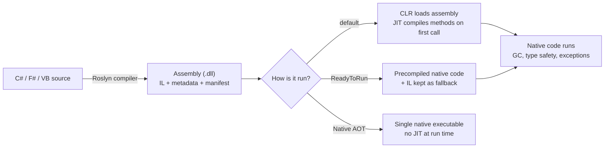

import { Tabs, TabItem, Aside } from '@astrojs/starlight/components';
import QuizBlock from '~/components/QuizBlock.astro';

## Why it matters in interviews

This is the warm-up question in many .NET loops: *"What happens when you run a C# program?"*, *"What is the CLR?"*, *"Framework vs Core?"*. A textbook answer gets you through; a 3-4 year answer adds **tiered JIT, ReadyToRun vs Native AOT trade-offs, why you would pick LTS, and what you actually did when migrating from .NET Framework**. It also sets up later questions on GC, reflection and startup performance.

## Core idea

C# is not compiled straight to machine code. The compiler (Roslyn) emits **IL** (Intermediate Language) plus **metadata** into an assembly (`.dll`). At run time the **CLR** (Common Language Runtime) loads the assembly, verifies types, and the **JIT** compiler turns each method's IL into native code the first time it is called.



### What the CLR provides

| Service | What it does |
|---|---|
| JIT compilation | IL to native code, per method, on first call |
| Garbage collector | Allocates and frees managed memory ([details](../memory-gc/)) |
| Type system (CTS) | One type model shared by all .NET languages |
| Type safety & verification | No arbitrary pointer arithmetic in safe code; array bounds checks |
| Exception handling | Structured, cross-language exceptions with stack traces |
| Thread management | Thread pool, synchronization primitives |
| Assembly loading | `AssemblyLoadContext` resolves and loads dependencies |

**CTS vs CLS**: the **Common Type System** defines every type the runtime understands (classes, structs, enums, delegates, `uint`...). The **Common Language Specification** is the *subset* that all languages must support, so a library marked `[assembly: CLSCompliant(true)]` avoids, for example, public `uint` parameters that some languages can't consume. **BCL** (Base Class Library) is the standard library: `System`, `System.Collections.Generic`, `System.IO`, `System.Net.Http` and so on.

### JIT, tiered compilation and PGO

A naive JIT has a trade-off: optimize hard (slow startup) or compile fast (slow steady state). Modern .NET does both with **tiered compilation**:

1. **Tier 0**: compile quickly with minimal optimization, so the app starts fast.
2. Methods that get hot (called about 30 times, or loops detected via **On-Stack Replacement**) are queued for **Tier 1**, a fully optimized recompile on a background thread.
3. **Dynamic PGO** (on by default since .NET 8) instruments Tier 0 code, records which types and branches actually occur, and uses that to devirtualize interface calls and inline hot paths in Tier 1.

That is why benchmarks need warm-up (BenchmarkDotNet handles it) and why the first request to an API is slower than the hundredth.

### JIT vs ReadyToRun vs Native AOT

| | JIT (default) | ReadyToRun (R2R) | Native AOT |
|---|---|---|---|
| When native code is produced | At run time | At publish, JIT still available | At publish, no JIT |
| Startup | Slowest | Faster | Fastest |
| Steady-state speed | Best (tiering + PGO) | Same after re-JIT of hot code | Good, no dynamic PGO |
| Size | Small IL | Larger (IL + native) | Single file, trimmed |
| Reflection / dynamic code | Everything works | Everything works | Limited: no `Reflection.Emit`, trimming warnings |
| Typical use | Web APIs, services | Desktop apps, faster cold start | Serverless (Azure Functions / AWS Lambda), CLI tools, containers that scale to zero |

Native AOT requires your dependencies to be trim- and AOT-compatible. Libraries that rely on runtime reflection (older serializers, some DI/mapping libraries) produce warnings or fail. This is why **source generators** (System.Text.Json source-gen, the minimal API Request Delegate Generator) matter: see [Reflection & source generators](../reflection-attributes/).

### .NET Framework vs modern .NET

| | .NET Framework 4.8.x | .NET (Core) 5+ through 10 |
|---|---|---|
| Platforms | Windows only | Windows, Linux, macOS, containers, ARM64 |
| Status | Maintenance only, shipped with Windows | Active, yearly release every November |
| Web stack | ASP.NET (System.Web), WebForms, WCF server | ASP.NET Core (Kestrel, minimal APIs) |
| Deployment | Machine-wide install, GAC | Framework-dependent or self-contained, side by side |
| App isolation | AppDomains | One AppDomain; `AssemblyLoadContext` for plugins |
| Performance | Frozen | Large gains each release (Span, PGO, GC regions) |

**Release cadence**: one major version every November. **Even = LTS** (3 years of support), **odd = STS**. STS support was extended from 18 to **24 months** starting with .NET 9, so .NET 8 (LTS) and .NET 9 (STS) both reach end of support in November 2026. **.NET 10 (Nov 2025) is the current LTS** with C# 14; **.NET 11** (C# 15) is STS and ships in November 2026.

<Aside type="tip" title="What to say about version choice">
Product teams usually stay on LTS (.NET 10) and upgrade every two years. Teams that like new features and have good test coverage may ride STS. Either way, upgrading is usually a target-framework bump plus fixing breaking changes, not a rewrite. Framework to .NET (Core) is the big migration.
</Aside>

### Assemblies, SDK and NuGet

- An **assembly** is the unit of deployment and versioning: IL, metadata (every type and member), a **manifest** (name, version, references) and optional resources. The `.csproj` produces one assembly.
- **SDK vs runtime**: the SDK (`dotnet build`, `dotnet test`, compilers) is for developers; the runtime (or ASP.NET Core runtime) is what servers need.
- **Framework-dependent** deployment needs the runtime installed; **self-contained** bundles it (bigger, but no install). Both can be single-file.
- **NuGet** is the package manager. `PackageReference` brings **transitive** dependencies automatically. For multi-project solutions, **Central Package Management** (`Directory.Packages.props`) pins versions in one place, and `dotnet list package --vulnerable` audits them (restore also warns on known vulnerabilities).

## Code

**A modern project file and central package versions**

```xml
<!-- Api.csproj -->
<Project Sdk="Microsoft.NET.Sdk.Web">
  <PropertyGroup>
    <TargetFramework>net10.0</TargetFramework>
    <Nullable>enable</Nullable>
    <ImplicitUsings>enable</ImplicitUsings>
    <TieredPGO>true</TieredPGO>               <!-- default since .NET 8 -->
    <PublishReadyToRun>false</PublishReadyToRun>
  </PropertyGroup>
  <ItemGroup>
    <PackageReference Include="Serilog.AspNetCore" /> <!-- version comes from Directory.Packages.props -->
  </ItemGroup>
</Project>
```

**Publishing options**

```bash
# Framework-dependent (needs the ASP.NET Core runtime on the server or in the base image)
dotnet publish -c Release

# Self-contained for Linux, ReadyToRun for faster cold start
dotnet publish -c Release -r linux-x64 --self-contained -p:PublishReadyToRun=true

# Native AOT (project must set <PublishAot>true</PublishAot> and be trim-safe)
dotnet publish -c Release -r linux-x64
```

**Seeing the runtime from code**

```csharp
using System.Runtime.InteropServices;

Console.WriteLine(RuntimeInformation.FrameworkDescription); // ".NET 10.0.x"
Console.WriteLine(RuntimeInformation.OSDescription);
Console.WriteLine(System.Runtime.CompilerServices.RuntimeFeature.IsDynamicCodeSupported); // false under Native AOT
```

## Interview Q&A

<details>
<summary>What happens, step by step, when you run a C# console app?</summary>

Roslyn compiled the source to IL plus metadata in a `.dll`. `dotnet app.dll` (or the apphost `.exe`) starts the host, which locates the runtime, creates the CLR, and loads the assembly. The CLR finds `Main`, the JIT compiles it to native code (Tier 0), and execution starts. Every other method is JIT-compiled lazily on first call; hot methods are later recompiled at Tier 1 using PGO data.
</details>

<details>
<summary>Why compile to IL at all instead of directly to machine code?</summary>

IL is CPU- and OS-neutral, so one `.dll` runs on x64, ARM64, Windows or Linux. The JIT can optimize for the **actual** machine (CPU instruction sets such as AVX-512) and the **actual** workload (PGO). Metadata also enables reflection, cross-language interop and verification. The cost is startup time, which R2R and Native AOT address.
</details>

<details>
<summary>When would you choose Native AOT, and what breaks?</summary>

For fast cold start and small memory: serverless functions, CLI tools, containers that scale from zero. You lose the JIT, so anything that generates code at run time (`Reflection.Emit`, some dynamic proxies) won't work, and trimming can remove types only reached via reflection. You fix that with source generators (System.Text.Json `JsonSerializerContext`) and by checking trim/AOT warnings at publish. EF Core and some libraries have limited or experimental AOT support, so check before committing.
</details>

<details>
<summary>What is the difference between ReadyToRun and Native AOT?</summary>

ReadyToRun precompiles IL to native code but **keeps the IL and the JIT**. Startup improves, hot methods can still be re-JITted with Tier 1 optimizations, and reflection works normally. Native AOT produces a standalone native binary with **no JIT and no IL**, so startup is fastest but dynamic features are restricted.
</details>

<details>
<summary>.NET Framework vs .NET Core vs .NET 10?</summary>

.NET Framework (last version 4.8.1) is Windows-only and in maintenance. .NET Core was the cross-platform rewrite; from version 5 it became just ".NET", the single forward platform. .NET 10 is the current LTS release. In a migration I'd use the .NET Upgrade Assistant, move to SDK-style projects, replace System.Web/WCF server code with ASP.NET Core / gRPC or CoreWCF, and swap `ConfigurationManager` for the options pattern.
</details>

<details>
<summary>LTS vs STS: which would you pick for a new production API?</summary>

LTS (.NET 10 now): 3 years of patches, fewer forced upgrades, which suits most product and service companies. STS gets 24 months and brings features earlier. I'd pick STS only if we needed a specific feature and had CI good enough to upgrade every year.
</details>

<details>
<summary>What is an assembly, and how is it different from a namespace?</summary>

An assembly is a physical file and the unit of deployment, versioning and `internal` visibility. A namespace is just a logical naming prefix; one assembly can contain many namespaces, and one namespace can span many assemblies (`System.Collections.Generic` types live in several).
</details>

<details>
<summary>Why is the first request to an ASP.NET Core API slower than later ones?</summary>

Cold start: assemblies load, methods are JIT-compiled at Tier 0, DI containers build, EF Core builds its model, connection pools open. Mitigations: ReadyToRun, warm-up requests or health checks before taking traffic, EF compiled models, and keeping instances warm (Azure App Service "Always On", AWS provisioned concurrency for Lambda).
</details>

## Pitfalls

<Aside type="caution" title="Common mistakes">
- Saying **"the JIT compiles the whole app at startup"**. It compiles per method, on first call.
- Benchmarking without warm-up, so you measure Tier 0 code. Use BenchmarkDotNet.
- Turning on **Native AOT** without checking trim warnings; reflection-based code fails only at run time.
- Calling .NET Framework and .NET "the same with a new name". Different runtime, web stack and deployment model.
- Leaving production on an **out-of-support** version (.NET 6, 7, and from November 2026 .NET 8/9). No security patches.
- Letting package versions drift between projects. Use Central Package Management and lock down transitive vulnerabilities.
</Aside>

## Related

- [Memory, GC & IDisposable](../memory-gc/)
- [Reflection, Attributes & Source Generators](../reflection-attributes/)
- [Compilers & Runtimes](../../fundamentals/compilers-runtimes/)
- [Hosting Model & Program.cs](../../aspnet/hosting-startup/)

## Quick quiz

<QuizBlock section="csharp" topic="dotnet-platform" />
