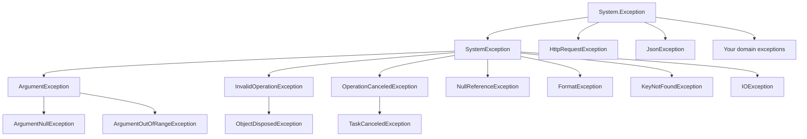

import { Tabs, TabItem, Aside } from '@astrojs/starlight/components';
import QuizBlock from '~/components/QuizBlock.astro';

## Why it matters in interviews

The classics: *"`throw` vs `throw ex`?"*, *"does `finally` run if I `return` from `try`?"*, *"when would you create a custom exception?"* and *"are exceptions expensive?"*. At 3-4 years you are also expected to have an opinion on **where** exceptions should be caught (rarely, at boundaries) and when not to use them at all (expected business failures).

## Core idea

An exception is an object describing a failure that the current method **cannot handle**. Throwing it abandons normal flow: the runtime looks up the call stack for a matching `catch`, running `finally` blocks on the way. If none matches, the process crashes (in ASP.NET Core, the server catches it at the top of the request pipeline and returns a 500).

### Hierarchy



Derive custom exceptions from `Exception` (or a meaningful built-in such as `InvalidOperationException`). `ApplicationException` was meant as the base for app exceptions but Microsoft's guidance now says not to use it: it adds nothing.

### How throw and catch work: the two-pass model

When an exception is thrown, the runtime does **two passes** over the stack:

1. **Search pass**: walk up the frames looking for a `catch` whose type matches *and* whose `when` filter (if any) returns `true`. Nothing has been unwound yet.
2. **Unwind pass**: run every `finally` (and `using` `Dispose`) between the throw point and the chosen handler, then execute the `catch`.

That ordering is why **exception filters** are more than syntax sugar: the filter runs *before* the stack is unwound, so a debugger or crash dump still sees the original frames, and a filter that returns `false` leaves the exception completely untouched for outer handlers.

```csharp
try
{
    await client.GetStringAsync(url, ct);
}
catch (HttpRequestException ex) when (ex.StatusCode == HttpStatusCode.NotFound)
{
    return null; // only 404s are handled here; 500s keep propagating
}
catch (Exception ex) when (LogAndContinue(ex)) // returns false: log without catching
{
}
```

### `finally` semantics

- `finally` runs whether `try` completes normally, returns, or throws, and whether or not a `catch` handled the exception.
- A `return` inside `try` evaluates the return value **first**, then runs `finally`. Changing a local `int` in `finally` does not change what is returned; mutating a returned *object* (adding to a list) does show up, because only the reference was copied.
- If `finally` throws, its exception **replaces** the original one, which is lost. Keep cleanup code non-throwing.
- `finally` does not run if the process dies: `Environment.FailFast`, a `StackOverflowException` (cannot be caught in .NET), or the process being killed.

### `throw` vs `throw ex` vs wrapping

| Form | Stack trace | Use when |
|---|---|---|
| `throw;` | Preserved: points to the original throw site | You logged or partially handled and want it to keep propagating |
| `throw ex;` | **Reset** to the current line; original frames lost | Practically never (analyzer CA2200 flags it) |
| `throw new XException("context", ex);` | New exception; original kept in `InnerException` | Adding context or translating to an abstraction-appropriate type |
| `ExceptionDispatchInfo.Capture(ex).Throw()` | Preserved, even on another thread or later | Rethrowing a stored exception (what `await` does internally) |

### Async and aggregate exceptions

A faulted `Task` stores its exception(s). `await` rethrows the **first** inner exception with its original stack trace, while `.Wait()` / `.Result` throw an `AggregateException` wrapping them. After `await Task.WhenAll(a, b)` throws, `whenAllTask.Exception.InnerExceptions` still holds all failures. Cancellation surfaces as `OperationCanceledException` (or the derived `TaskCanceledException`); treat it as normal flow, not an error to log at Error level.

### Cost and when not to throw

Throwing is expensive relative to a normal return: the runtime allocates the exception, captures a stack trace, and walks and unwinds frames. Exception handling was rewritten in .NET 9 and is considerably faster than before, but it is still microseconds rather than nanoseconds, and a flood of exceptions shows up in CPU profiles and logs. The `try` block itself is essentially free when nothing throws.

Rules of thumb:

- **Exceptions are for exceptional, unexpected situations**: violated preconditions, a database that is down, a bug.
- **Expected outcomes are not exceptional**: invalid user input, "order not found", "insufficient stock" in a checkout flow. Use `TryParse`-style APIs, `bool` + `out`, or a **Result** type that carries success or a typed error. See the Result pattern in [Enterprise Patterns](../../patterns/enterprise-patterns/).
- **Never use exceptions for control flow** such as breaking out of loops.
- **Validate arguments with guard helpers**: `ArgumentNullException.ThrowIfNull(order)`, `ArgumentException.ThrowIfNullOrWhiteSpace(name)`, `ArgumentOutOfRangeException.ThrowIfNegativeOrZero(qty)`.

### Where to catch

Catch an exception only where you can **do something useful**: retry, fall back, translate, or add context. Everywhere else, let it bubble to a single global handler that logs it once and converts it to a response. In ASP.NET Core that is `UseExceptionHandler` with an `IExceptionHandler` producing ProblemDetails; see [Global Error Handling](../../aspnet/error-handling/). A `catch (Exception) { }` that swallows silently is the worst outcome: the failure disappears from logs.

## Code

**A custom exception with useful data**

```csharp
namespace Shop.Domain;

public sealed class InsufficientStockException(string sku, int requested, int available)
    : Exception($"Only {available} of {sku} left, {requested} requested.")
{
    public string Sku { get; } = sku;
    public int Requested { get; } = requested;
    public int Available { get; } = available;
}
```

Since .NET 8 the old `[Serializable]` attribute and `(SerializationInfo, StreamingContext)` constructor are obsolete (`BinaryFormatter` is gone), so a modern custom exception is just a class with a clear name, a message and strongly typed properties. Create one when callers need to **catch it specifically** or a global handler needs to **map it** (for example to HTTP 409); otherwise reuse a built-in type.

**Exceptions vs a Result for expected failures**

<Tabs syncKey="lang">
  <TabItem label="C#">
```csharp
public sealed record Result<T>(T? Value, string? Error)
{
    public bool IsSuccess => Error is null;
    public static Result<T> Ok(T value) => new(value, null);
    public static Result<T> Fail(string error) => new(default, error);
}

public async Task<Result<Order>> PlaceOrderAsync(PlaceOrder cmd, CancellationToken ct)
{
    ArgumentNullException.ThrowIfNull(cmd);                 // programmer error: throw

    var stock = await inventory.GetAvailableAsync(cmd.Sku, ct);
    if (stock < cmd.Quantity)                               // expected business case: Result
        return Result<Order>.Fail($"Only {stock} left");

    var order = Order.Create(cmd);
    await db.SaveChangesAsync(ct);                          // DB down: let it throw
    return Result<Order>.Ok(order);
}
```
  </TabItem>
  <TabItem label="TypeScript">
```ts
// TS has no checked exceptions either; discriminated unions play the Result role.
type Result<T> = { ok: true; value: T } | { ok: false; error: string };

async function placeOrder(cmd: PlaceOrder): Promise<Result<Order>> {
  const stock = await inventory.getAvailable(cmd.sku);
  if (stock < cmd.quantity) return { ok: false, error: `Only ${stock} left` };
  return { ok: true, value: await orders.create(cmd) };
}
```
  </TabItem>
</Tabs>

## Interview Q&A

<details>
<summary>What is the difference between `throw` and `throw ex`?</summary>

`throw;` rethrows the current exception and keeps its original stack trace. `throw ex;` throws the same object but resets the stack trace to the current line, so you lose where it really failed. Use `throw;`, or wrap with `throw new X("context", ex)` to add information while keeping the original as `InnerException`.
</details>

<details>
<summary>If `try` contains `return x;` and `finally` sets `x = 2`, what is returned?</summary>

The original value. The return value is evaluated and stored before `finally` runs, so reassigning the local has no effect. If `x` is a reference to a mutable object and `finally` mutates the object, the caller sees the mutation. You also cannot `return` from inside a `finally` block in C#.
</details>

<details>
<summary>What are exception filters and why are they better than catch-and-rethrow?</summary>

`catch (Ex e) when (condition)` only catches if the condition is true. The filter runs during the search pass, before any unwinding, so when it returns `false` the exception continues untouched with its full stack and the debugger breaks at the original throw. A catch-check-rethrow unwinds first and adds noise. Filters are also a neat place to log without catching (`when (Log(e))` returning `false`).
</details>

<details>
<summary>When should you create a custom exception?</summary>

When callers or a global handler need to distinguish it, for example to catch `ConcurrencyConflictException` and retry, or map `NotFoundException` to 404. Give it a name ending in `Exception`, a useful message and typed properties. If a built-in type (`ArgumentException`, `InvalidOperationException`) describes it, reuse that instead.
</details>

<details>
<summary>Are exceptions expensive? Should you avoid try/catch for performance?</summary>

Entering a `try` block costs essentially nothing. *Throwing* is the expensive part: allocation, stack-trace capture and stack unwinding. So the advice is not "avoid try/catch" but "don't throw on hot, expected paths". Use `TryParse`, `TryGetValue`, or a Result type for outcomes you expect regularly.
</details>

<details>
<summary>Does `catch (Exception)` catch everything?</summary>

It catches all managed exceptions, but some cannot be meaningfully handled: `StackOverflowException` terminates the process, and `Environment.FailFast` skips handlers entirely. Catching `Exception` broadly is fine at a top-level boundary that logs and returns a 500. Deep in business code it hides bugs. Also, catch blocks are checked in order, so `catch (Exception)` before `catch (ArgumentException)` is a compile error (CS0160).
</details>

<details>
<summary>How do exceptions behave with async code and `Task.WhenAll`?</summary>

The exception is stored in the returned `Task`. `await` rethrows the first inner exception with its stack trace preserved; `.Result` / `.Wait()` throw `AggregateException`. With `WhenAll`, keep a reference to the combined task and read `.Exception.InnerExceptions` to see every failure. Exceptions in `async void` methods cannot be caught by the caller.
</details>

<details>
<summary>How do you handle exceptions globally in an ASP.NET Core API?</summary>

Register an `IExceptionHandler` (or `UseExceptionHandler`) plus `AddProblemDetails()`. The handler logs once with correlation id, maps known domain exceptions to status codes (404, 409, 422) and returns a ProblemDetails body without leaking stack traces in production. Controllers then contain no try/catch boilerplate.
</details>

## Pitfalls

<Aside type="caution" title="Common mistakes">

- **`throw ex;`** destroys the original stack trace. Use `throw;`.
- **Swallowing**: `catch (Exception) { }` or catch-and-return-null hides real failures.
- **Logging and rethrowing at every layer**: the same error appears five times in the logs. Log once, at the boundary.
- **Exceptions for validation or "not found"** on hot paths: slow and noisy. Use Result or Try-patterns.
- **Throwing from `finally` or `Dispose`**: replaces and loses the original exception.
- **Logging `OperationCanceledException` as an error** when the client simply disconnected.

</Aside>

## Related

- [Global Error Handling in ASP.NET Core](../../aspnet/error-handling/)
- [Async/Await Deep Dive](../async-await/)
- [Enterprise Patterns (Result pattern)](../../patterns/enterprise-patterns/)
- [Garbage collection & IDisposable](../memory-gc/)

## Quick quiz

<QuizBlock section="csharp" topic="exceptions" />
