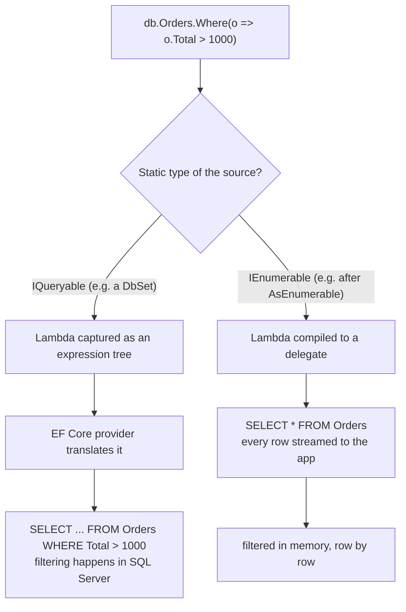

import { Tabs, TabItem, Aside } from '@astrojs/starlight/components';
import QuizBlock from '~/components/QuizBlock.astro';

## Why it matters in interviews

LINQ is used in every .NET codebase, so interviewers test it two ways: **concepts** (*"deferred execution?"*, *"`IEnumerable` vs `IQueryable`?"*) and **live coding** (*"group these orders by customer and return the top 3 by total"*). The deeper questions are about bugs you have probably shipped: a query that runs twice, an EF Core query that pulls the whole table into memory, or `First()` throwing in production.

## Core idea

LINQ (Language Integrated Query) is a set of **extension methods** over sequences plus optional **query syntax**. There are two providers that matter:

- **LINQ to Objects**: extension methods on `IEnumerable<T>` in `System.Linq.Enumerable`. They take **delegates** (`Func<T,bool>`) and run in memory.
- **LINQ to a provider** (EF Core, OData, Cosmos DB): extension methods on `IQueryable<T>` in `System.Linq.Queryable`. They take **expression trees** (`Expression<Func<T,bool>>`), which the provider **translates** (to SQL, for EF Core).

### Query syntax vs method syntax

Both compile to the same method calls. Query syntax is translated by the compiler into `Where`, `Select`, `SelectMany`, `Join`, `GroupBy`, `OrderBy` calls.

<Tabs syncKey="linq-syntax">
  <TabItem label="Method syntax">

```csharp
var bigSpenders = orders
    .Where(o => o.Total > 1000)
    .OrderByDescending(o => o.Total)
    .Select(o => new { o.Customer, o.Total });
```

  </TabItem>
  <TabItem label="Query syntax">

```csharp
var bigSpenders =
    from o in orders
    where o.Total > 1000
    orderby o.Total descending
    select new { o.Customer, o.Total };
```

  </TabItem>
</Tabs>

Method syntax is more common and covers every operator (`Take`, `Distinct`, `Any` have no query keywords). Query syntax reads better for **joins and `let`**, and for multiple `from` clauses.

### Deferred vs immediate execution

A LINQ query is a **recipe**, not a result. Building it does nothing; **enumerating** it runs it. Each enumeration runs it **again**.

| Deferred (lazy, return a sequence) | Immediate (execute now) |
|---|---|
| `Where`, `Select`, `SelectMany`, `Take`, `Skip`, `Distinct`, `OrderBy`, `GroupBy`, `Join`, `Concat`, `Zip`, `Chunk` | `ToList`, `ToArray`, `ToDictionary`, `ToHashSet`, `Count`, `Sum`, `Max`, `Average`, `First`, `Single`, `Any`, `All`, `Aggregate`, `foreach` |

Deferred operators are further split into **streaming** (`Where`, `Select`: yield one item at a time) and **non-streaming** (`OrderBy`, `GroupBy`, `Reverse`: must read the whole source before yielding the first item).

```csharp
var source = new List<int> { 1, 2, 3 };
var query = source.Where(n => n > 1);  // nothing runs yet
source.Add(4);
Console.WriteLine(string.Join(",", query)); // 2,3,4: runs now, sees the added item
```

Streaming means items flow through the whole pipeline **one at a time**, not stage by stage:

```csharp
var trace = new[] { 1, 2, 3 }
    .Where(i => { Console.Write($"W{i} "); return i % 2 == 1; })
    .Select(i => { Console.Write($"S{i} "); return i; });
foreach (var t in trace) Console.Write($"[{t}] ");
// W1 S1 [1] W2 W3 S3 [3]
```

### IEnumerable vs IQueryable



| | `IEnumerable<T>` | `IQueryable<T>` |
|---|---|---|
| Namespace / methods | `System.Linq.Enumerable` | `System.Linq.Queryable` |
| Lambda becomes | `Func<T,bool>` delegate | `Expression<Func<T,bool>>` tree |
| Executes | In memory, in your process | Translated by the provider (SQL) |
| Good for | In-memory collections, after data is loaded | Building database queries |
| Danger | Calling it on a DbSet too early loads everything | Untranslatable methods throw at run time |

The switch is decided by the **static type**. `IQueryable<T>` inherits `IEnumerable<T>`, so `AsEnumerable()`, assigning to an `IEnumerable<T>` variable, or a repository method returning `IEnumerable<T>` silently switches the rest of the chain to in-memory LINQ.

### Expression trees

An expression tree is **code as data**: an object graph (`BinaryExpression`, `MemberExpression`, `ConstantExpression`...) describing the lambda. Providers walk it to generate SQL; you can also build them by hand for dynamic filters, or `Compile()` them into delegates. Libraries such as AutoMapper's `ProjectTo` and the specification pattern rely on them.

```csharp
Expression<Func<Order, bool>> expr = o => o.Total > 1000;
Console.WriteLine(expr.Body);       // (o.Total > 1000)
Func<Order, bool> compiled = expr.Compile();
```

### Operators worth knowing

| Group | Operators | Notes |
|---|---|---|
| Filtering | `Where`, `OfType<T>` | |
| Projection | `Select`, `SelectMany` | `SelectMany` flattens a sequence of sequences |
| Element | `First`, `FirstOrDefault`, `Single`, `SingleOrDefault`, `Last`, `ElementAt` | `First` throws on empty; `Single` throws on empty **or** more than one |
| Quantifiers | `Any`, `All`, `Contains` | `Any()` stops at the first item; prefer it over `Count() > 0` |
| Ordering | `OrderBy`, `ThenBy`, `Order` (.NET 7) | `OrderBy` is a stable sort |
| Grouping | `GroupBy`, `ToLookup`, `CountBy` / `AggregateBy` (.NET 9) | `GroupBy` is deferred, `ToLookup` immediate |
| Joining | `Join` (inner), `GroupJoin`, `LeftJoin` / `RightJoin` (.NET 10), `Zip` | Before .NET 10, left join = `GroupJoin` + `SelectMany` + `DefaultIfEmpty` |
| Sets | `Distinct`, `DistinctBy`, `Union`, `Intersect`, `Except` (and `...By` versions, .NET 6) | |
| Partitioning | `Take`, `Skip`, `TakeWhile`, `Chunk` (.NET 6) | |
| Aggregation | `Count`, `Sum`, `Min`/`Max`, `MinBy`/`MaxBy` (.NET 6), `Average`, `Aggregate` | |

## Code

**Typical interview task: top customers**

```csharp
namespace Sales;

public sealed record Order(int Id, string Customer, DateOnly Date, decimal Total);

public static class Reports
{
    public static IReadOnlyList<(string Customer, decimal Spent, int Orders)> TopCustomers(
        IEnumerable<Order> orders, int top) =>
        orders
            .GroupBy(o => o.Customer)
            .Select(g => (Customer: g.Key, Spent: g.Sum(o => o.Total), Orders: g.Count()))
            .OrderByDescending(x => x.Spent)
            .ThenBy(x => x.Customer)
            .Take(top)
            .ToList();                              // materialize once

    // SelectMany: flatten order lines; Join: match to products.
    public static IEnumerable<string> LineDescriptions(
        IEnumerable<(int OrderId, string[] Skus)> orders, IEnumerable<(string Sku, string Name)> products) =>
        from o in orders
        from sku in o.Skus                          // SelectMany
        join p in products on sku equals p.Sku      // inner join
        select $"{o.OrderId}: {p.Name}";
}
```

**EF Core: keep it `IQueryable` until the end, project to a DTO**

```csharp
public sealed record OrderSummary(int Id, string Customer, decimal Total);

public async Task<List<OrderSummary>> GetRecentAsync(AppDbContext db, DateOnly since, CancellationToken ct) =>
    await db.Orders
        .AsNoTracking()
        .Where(o => o.Date >= since)                       // SQL WHERE
        .OrderByDescending(o => o.Date)
        .Select(o => new OrderSummary(o.Id, o.Customer.Name, o.Total)) // only needed columns
        .Take(50)
        .ToListAsync(ct);                                  // executes here
```

**Multiple enumeration bug and fix**

```csharp
IEnumerable<Order> pending = db.Orders.Where(o => o.Status == Status.Pending); // a query, not data

if (pending.Any())                       // query 1
    foreach (var o in pending)           // query 2 (results may differ!)
        Notify(o);

var list = await db.Orders.Where(o => o.Status == Status.Pending).ToListAsync(ct); // one query
foreach (var o in list) Notify(o);
```

## Interview Q&A

<details>
<summary>What is deferred execution, and why does it matter?</summary>

A query isn't executed when defined, only when enumerated (`foreach`, `ToList`, `Count`, `First`...). It matters because the query sees the source's state at enumeration time, runs again on every enumeration (repeated DB calls or side effects), and exceptions inside lambdas surface at enumeration, not where the query was written.
</details>

<details>
<summary>`IEnumerable` vs `IQueryable`?</summary>

`IEnumerable<T>` LINQ runs in memory using delegates. `IQueryable<T>` captures expression trees that a provider like EF Core translates to SQL, so filtering, paging and projection happen in the database. Switching to `IEnumerable<T>` too early (e.g. a repository returning `IEnumerable<T>` and the caller adding `.Where`) pulls all rows into memory first.
</details>

<details>
<summary>`First` vs `FirstOrDefault` vs `Single` vs `SingleOrDefault`?</summary>

`First` returns the first match and throws if none. `FirstOrDefault` returns `default` (null for references) if none. `Single` throws if there are zero **or more than one** matches, so use it when uniqueness is an invariant (lookup by primary key). In EF Core `Single` generates `TOP(2)` to detect duplicates, `First` generates `TOP(1)`.
</details>

<details>
<summary>What is `SelectMany` used for?</summary>

Flattening: each element maps to a sequence, and the results are concatenated into one sequence. Examples: all order lines across orders, all roles across users, or the cross join produced by two `from` clauses in query syntax.
</details>

<details>
<summary>How do you do a left join in LINQ?</summary>

On .NET 10, `LeftJoin(inner, outerKey, innerKey, resultSelector)` exists directly (EF Core 10 translates it). Before that: `GroupJoin` followed by `SelectMany(..., DefaultIfEmpty())`, or in query syntax `join ... into g from x in g.DefaultIfEmpty()`. In EF Core, navigation properties usually make explicit joins unnecessary.
</details>

<details>
<summary>Why is `Count() > 0` worse than `Any()`?</summary>

`Any()` stops at the first element; `Count()` may enumerate everything (unless the source is an `ICollection<T>`, where it uses the `Count` property). Against EF Core, `Any()` becomes `EXISTS`, which is cheaper than `COUNT(*)`.
</details>

<details>
<summary>What happens if EF Core can't translate part of your LINQ query?</summary>

Since EF Core 3.0 it throws an `InvalidOperationException` ("could not be translated") instead of silently evaluating in memory. The exception is the final `Select` projection, which may call client methods. Fix by rewriting with translatable constructs, or deliberately switch to memory with `AsEnumerable()` **after** filtering in SQL.
</details>

<details>
<summary>What are expression trees, and where have you used them?</summary>

Data structures representing code (`Expression<Func<T,bool>>`) that can be inspected, translated or compiled. EF Core uses them to generate SQL. I have used them for dynamic filters built from query-string parameters and for the specification pattern, where a `Criteria` expression is reused across repositories.
</details>

## Pitfalls

<Aside type="caution" title="Common mistakes">
- **Multiple enumeration** of a deferred query (the IDE warns "possible multiple enumeration"). Materialize once with `ToList()`.
- **`ToList()` too early** on a `DbSet`, then filtering in memory.
- Repositories returning `IEnumerable<T>` that hide a lazy `IQueryable<T>`, or that already loaded everything.
- Side effects inside `Select`/`Where`; they run every enumeration, lazily, possibly never.
- Using `First()` where data may be missing, or `Single()` without a uniqueness guarantee.
- `OrderBy(a).OrderBy(b)` instead of `OrderBy(a).ThenBy(b)`: the second call makes `b` the **primary** key (in EF Core the first ordering is effectively discarded). Use `ThenBy` for secondary keys.
- Heavy LINQ in tight hot loops: delegates and enumerators allocate. Profile, then use plain loops or `Span<T>` if needed.
- Calling methods EF Core can't translate inside `Where` and getting run-time exceptions.
</Aside>

## Related

- [Collections & Generics](../collections-generics/)
- [Delegates, Events & Lambdas](../delegates-events/)
- [Querying & the N+1 Problem](../../data/efcore-querying/)
- [C# Coding Round](../../dsa/csharp-coding-round/)

## Quick quiz

<QuizBlock section="csharp" topic="linq" />
