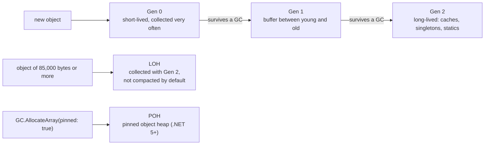
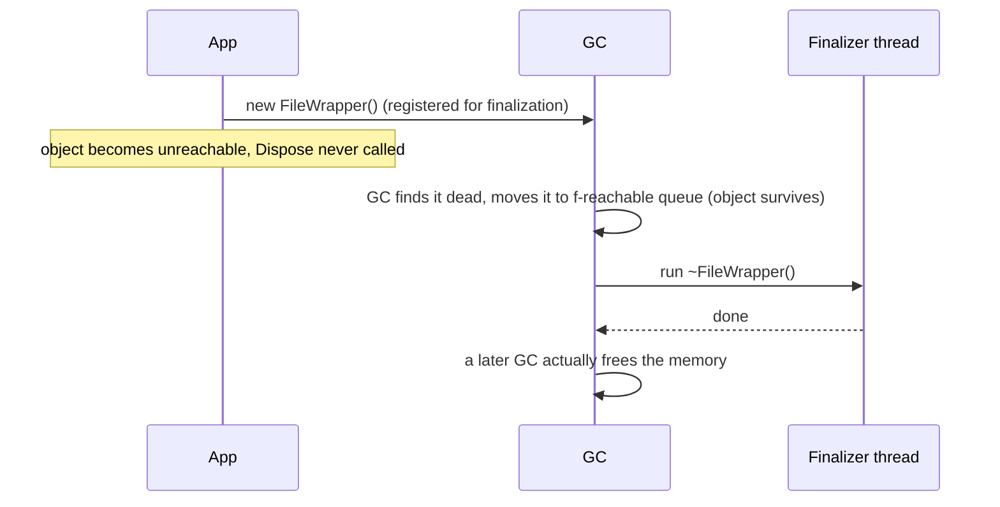

import { Tabs, TabItem, Aside } from '@astrojs/starlight/components';
import QuizBlock from '~/components/QuizBlock.astro';

## Why it matters in interviews

*"How does the GC work?"*, *"Dispose vs Finalize?"* and *"have you ever debugged a memory leak?"* come up in most senior-leaning .NET rounds. A strong answer connects the theory (generations, roots, LOH) to practice: **why `using` matters for DB connections, why a long-lived event subscription leaks, and which tools you open when memory climbs in production.**

## Core idea

The .NET GC is a **tracing, generational, compacting** collector. You allocate with `new`; the GC frees objects that are no longer **reachable** from a **root**.

**Roots** include: local variables and parameters in active stack frames (and CPU registers), static fields, GC handles (pinned objects, `GCHandle`), and the finalization queue.

A collection runs in phases:

1. **Mark**: start from roots, follow every reference, mark reachable objects.
2. **Sweep / plan**: everything unmarked is garbage.
3. **Compact**: slide surviving objects together and update references, so allocation stays a fast pointer bump and memory doesn't fragment.

Allocation in .NET is therefore **cheap** (bump a pointer in the current allocation context); the cost is paid later, in collections, and is proportional to **surviving** objects, not dead ones.

### Generations

The **generational hypothesis**: most objects die young. So the heap is split, and young objects are collected often and cheaply.



| Heap | What lives there | Collected | Notes |
|---|---|---|---|
| Gen 0 | New small objects | Very often, cheap | Most objects die here |
| Gen 1 | Survivors of one GC | Often | Buffer before Gen 2 |
| Gen 2 | Long-lived objects | Rarely, expensive ("full GC") | Background GC does most of it concurrently |
| LOH | Objects of 85,000 bytes or more (big arrays, big strings) | With Gen 2 | Not compacted by default, so fragmentation; use `ArrayPool<T>` |
| POH | Explicitly pinned arrays | With Gen 2 | Keeps pinned buffers from fragmenting Gen 0 |

A Gen 1 collection also collects Gen 0; a Gen 2 collection collects everything (including LOH and POH).

### Workstation vs server GC

| | Workstation | Server |
|---|---|---|
| Heaps / GC threads | One heap, collects on the triggering thread | One heap and GC thread **per core** |
| Optimized for | Low latency, low memory (desktop apps) | Throughput (web servers) |
| Default for | Console, desktop | **ASP.NET Core** apps |

Both default to **background (concurrent)** Gen 2 collections, so app threads keep running during most of a full GC. Since .NET 9, Server GC uses **DATAS** (Dynamic Adaptation To Application Sizes) by default, which grows and shrinks the number of heaps with load. That matters in containers where memory limits are tight.

### Finalizers vs IDisposable

The GC only knows about **managed memory**. File handles, sockets, DB connections and native memory are **unmanaged resources**, and the GC doesn't know when they are scarce.

- **`IDisposable.Dispose()`**: deterministic cleanup that **you** call, usually via `using`. This is the main mechanism.
- **Finalizer** (`~MyType()`): a safety net the GC calls *eventually* if you forgot to dispose. Objects with finalizers are expensive: at allocation they are registered in the **finalization queue**; when found dead they are moved to the **f-reachable queue**, survive that GC (promoted a generation), wait for the single **finalizer thread**, and are only reclaimed in a later GC.



In practice: **you almost never write a finalizer**. Wrap native handles in a `SafeHandle` (which has the finalizer for you) and implement plain `IDisposable`. If you do implement `Dispose` on a type with a finalizer, call `GC.SuppressFinalize(this)` so the GC skips the finalization step.

### IAsyncDisposable

When cleanup is I/O (flushing a stream, closing a network connection), implement `IAsyncDisposable` and consume it with `await using`. `DbContext`, `Utf8JsonWriter`, `Stream` and ASP.NET Core's DI scopes support it.

### Weak references

`WeakReference<T>` lets you point to an object **without keeping it alive**: useful for caches of expensive but recreatable data, or for observers that shouldn't prolong a subscriber's life. `ConditionalWeakTable<TKey,TValue>` attaches data to objects without leaking them. For normal caching, prefer `IMemoryCache` with size limits and expirations.

### Common managed memory leaks

A "leak" in .NET means something is **still reachable** that you think is dead:

| Leak | Why | Fix |
|---|---|---|
| Event subscription to a long-lived publisher | Publisher's delegate holds a reference to the subscriber | Unsubscribe (`-=`) in `Dispose`; weak events |
| Static collections / caches that only grow | Statics are roots | Bounded `IMemoryCache` with expiry / size limit |
| Timers not disposed | `System.Threading.Timer` callbacks keep the target alive | Dispose timers; `PeriodicTimer` in a `BackgroundService` |
| Captive dependency (scoped/transient captured by singleton) | The singleton keeps them for the app's lifetime | Correct DI lifetimes, scope validation |
| Closures capturing large objects | Lambda keeps the whole captured variable alive | Capture only what you need |
| Undisposed `IDisposable`s (streams, `HttpResponseMessage`, CTS with timers) | Native handles and buffers held until finalization | `using` / `await using` |

## Code

**The Dispose pattern for a type that owns other disposables**

```csharp
namespace Reports;

public sealed class ReportWriter(string path) : IDisposable, IAsyncDisposable
{
    private readonly FileStream _stream = File.Create(path);
    private bool _disposed;

    public async Task WriteAsync(ReadOnlyMemory<byte> data, CancellationToken ct)
    {
        ObjectDisposedException.ThrowIf(_disposed, this);
        await _stream.WriteAsync(data, ct);
    }

    public void Dispose()
    {
        if (_disposed) return;
        _stream.Dispose();
        _disposed = true;
    }

    public async ValueTask DisposeAsync()
    {
        if (_disposed) return;
        await _stream.DisposeAsync();
        _disposed = true;
    }
}
```

```csharp
// Usage: disposed at the end of the scope, even if an exception is thrown
await using var writer = new ReportWriter("out.csv");
await writer.WriteAsync("id,total\n"u8.ToArray(), CancellationToken.None);
```

Because the class is `sealed` and owns only managed wrappers (`FileStream` has its own `SafeHandle`), it needs **no finalizer** and no `Dispose(bool)` overload. The full `protected virtual Dispose(bool disposing)` pattern is for unsealed base classes or types that directly own native handles.

**The event-subscription leak and its fix**

```csharp
public sealed class PriceWidget : IDisposable
{
    private readonly PriceFeed _feed;   // singleton, lives for the whole app
    public PriceWidget(PriceFeed feed)
    {
        _feed = feed;
        _feed.PriceChanged += OnPriceChanged;   // feed now references this widget
    }
    private void OnPriceChanged(object? sender, decimal price) { /* update UI */ }

    public void Dispose() => _feed.PriceChanged -= OnPriceChanged; // without this, never collected
}

public sealed class PriceFeed
{
    public event EventHandler<decimal>? PriceChanged;
    public void Publish(decimal price) => PriceChanged?.Invoke(this, price);
}
```

**Avoiding LOH allocations with pooling**

```csharp
using System.Buffers;

byte[] buffer = ArrayPool<byte>.Shared.Rent(1024 * 1024); // may return a larger array
try
{
    int read = await stream.ReadAsync(buffer.AsMemory(0, 1024 * 1024), ct);
    Process(buffer.AsSpan(0, read));
}
finally
{
    ArrayPool<byte>.Shared.Return(buffer);
}
```

## Interview Q&A

<details>
<summary>Explain how the .NET garbage collector works.</summary>

It is a tracing, generational, compacting collector. On a GC it marks everything reachable from roots (stack locals, statics, GC handles), treats the rest as garbage, and compacts survivors. Objects start in Gen 0; survivors are promoted to Gen 1 then Gen 2, which is collected rarely. Large objects (85,000 bytes or more) go to the LOH, which is collected with Gen 2 and not compacted by default.
</details>

<details>
<summary>Dispose vs Finalize?</summary>

`Dispose` is deterministic: you call it (via `using`) to release unmanaged resources now. A finalizer is non-deterministic, runs on the finalizer thread whenever the GC finds the object dead, and makes the object survive an extra GC. Implement `IDisposable` for cleanup; rely on `SafeHandle` for the finalizer safety net; call `GC.SuppressFinalize` in `Dispose` if your type has a finalizer.
</details>

<details>
<summary>What does `using` compile to?</summary>

A `try/finally` that calls `Dispose()` in the `finally` (with a null check for reference types). `await using` does the same with `await DisposeAsync()`. The `using var x = ...;` declaration form disposes at the end of the enclosing scope, in reverse order of declaration.
</details>

<details>
<summary>Should you call `GC.Collect()`?</summary>

Almost never. It forces a full blocking collection, promotes survivors prematurely, and usually hurts throughput. Legitimate cases are rare: benchmarks or tests that measure memory, or after a one-off huge workload in a batch app. If you think you need it, you probably have a leak or a pooling problem.
</details>

<details>
<summary>How would you investigate memory growing in a production ASP.NET Core API?</summary>

Confirm the trend first with `dotnet-counters` (GC heap size, Gen 2 count, LOH size, allocation rate) or Application Insights / Azure Monitor metrics (AWS: CloudWatch). Take two heap snapshots some time apart with `dotnet-gcdump` (or a full `dotnet-dump`) and compare them in Visual Studio or PerfView to see which types grow and **what roots keep them alive**. Typical culprits: static caches, event subscriptions, singletons holding scoped services, undisposed timers or `HttpResponseMessage`.
</details>

<details>
<summary>Why is the Large Object Heap a problem, and how do you avoid it?</summary>

LOH objects are only collected in Gen 2 and, by default, not compacted, so repeated large allocations cause fragmentation and expensive full GCs. Avoid allocating big buffers per request: use `ArrayPool<T>`, `RecyclableMemoryStream`, streaming instead of buffering whole files, and `Span<T>` slicing instead of copying. You can request a one-off LOH compaction via `GCSettings.LargeObjectHeapCompactionMode`.
</details>

<details>
<summary>Workstation vs server GC: which one does ASP.NET Core use?</summary>

Server GC by default: one heap and GC thread per core for throughput. In memory-constrained containers, DATAS (default with Server GC since .NET 9) adapts the heap count. You can switch with `<ServerGarbageCollection>` or `<ConcurrentGarbageCollection>` in the project file if measurements justify it.
</details>

<details>
<summary>Can a .NET app have a memory leak if the GC is automatic?</summary>

Yes. The GC frees only unreachable objects. If something reachable (a static list, a long-lived event, a singleton) keeps a reference, the object stays alive forever. Unmanaged leaks also happen when native resources aren't disposed.
</details>

## Pitfalls

<Aside type="caution" title="Common mistakes">
- Writing finalizers for types that only hold managed objects. It slows the GC and does nothing useful.
- Forgetting `using` on `SqlConnection`, `FileStream`, `HttpResponseMessage`, `CancellationTokenSource` with `CancelAfter`.
- Creating a new `HttpClient` per request and disposing it. That causes socket exhaustion; use `IHttpClientFactory` (see [Performance & Resilience](../../aspnet/performance-resilience/)).
- Subscribing to events of long-lived objects without unsubscribing.
- Unbounded static `Dictionary` caches. Use `IMemoryCache` with expirations and size limits.
- Allocating large arrays or strings per request (LOH churn). Pool or stream.
- Calling `GC.Collect()` to "fix" memory instead of finding the root.
</Aside>

## Related

- [Value vs Reference Types](../value-reference-types/)
- [Strings, StringBuilder & Span](../strings-span/)
- [Delegates, Events & Lambdas](../delegates-events/)
- [Dependency Injection (captive dependencies)](../../aspnet/dependency-injection/)

## Quick quiz

<QuizBlock section="csharp" topic="memory-gc" />
