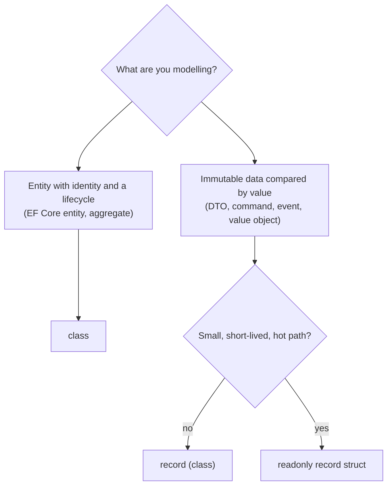

import { Tabs, TabItem, Aside } from '@astrojs/starlight/components';
import QuizBlock from '~/components/QuizBlock.astro';

## Why it matters in interviews

Interviewers use new language features as a proxy for *"is this person keeping up?"*. Expect *"record vs class?"*, *"what does `with` do?"*, *"explain primary constructors"*, a switch-expression or pattern-matching snippet to read, and lately *"what's new in C# 14?"*. With .NET 11 / C# 15 shipping in November 2026, union types are the likely conversation starter.

## Core idea

Modern C# keeps moving in three directions: **less ceremony** (top-level statements, file-scoped namespaces, primary constructors, collection expressions), **data-oriented modelling** (records, `init`, `required`, pattern matching, unions), and **performance without unsafe code** (spans, `params ReadOnlySpan<T>`, interpolation handlers).

### Version map

| C# | .NET | Headline features |
|---|---|---|
| 9 | 5 | Records, `init` setters, top-level statements, relational and logical patterns (`>`, `and`, `or`, `not`), target-typed `new()` |
| 10 | 6 (LTS) | `record struct`, global usings, file-scoped namespaces, extended property patterns, interpolated string handlers |
| 11 | 7 | `required` members, raw string literals, list patterns, generic math (static abstract interface members), generic attributes, `file` types |
| 12 | 8 (LTS) | Primary constructors for classes and structs, collection expressions, alias any type, default lambda parameters |
| 13 | 9 | `params` collections, `System.Threading.Lock`, `ref struct` in async/iterators, partial properties |
| 14 | 10 (LTS) | Extension members, `field` keyword, null-conditional assignment, first-class span conversions, `nameof(List<>)`, partial constructors and events |
| 15 | 11 | Union types, closed hierarchies, collection expression arguments |

### Records

A `record` is a class (or `record struct` a struct) where the compiler generates **value-based equality** (`Equals`, `GetHashCode`, `==`), a readable `ToString()`, `Deconstruct`, and a copy constructor used by `with`. Positional records also generate `init`-only properties from the parameter list.

```csharp
public record Money(decimal Amount, string Currency);

var a = new Money(10m, "EUR");
var b = new Money(10m, "EUR");
a == b;                              // True: compares Amount and Currency
var c = a with { Amount = 20m };     // non-destructive copy (shallow)
Console.WriteLine(c);                // Money { Amount = 20, Currency = EUR }
```

Equality is **member-wise using each member's own `Equals`**. A record with a `List<string>` property compares the lists by reference, so two records with equal-looking lists are *not* equal. `with` is a **shallow** copy: both records share the same list.



Records are a great fit for DTOs, API contracts, CQRS commands, domain events and value objects. They are a poor fit for EF Core entities, because EF tracks entities by identity and value equality and `with` copies confuse change tracking.

### `init` and `required`

`init` setters can only be assigned during object initialisation, giving immutability without long constructors. `required` (C# 11) forces callers to set the member in the object initialiser, a compile-time error otherwise. A constructor marked `[SetsRequiredMembers]` tells the compiler it sets them all.

```csharp
public class CreateCustomer
{
    public required string Name { get; init; }
    public required string Email { get; init; }
    public string? Phone { get; init; }
}
var cmd = new CreateCustomer { Name = "Ann", Email = "ann@example.com" }; // omit Email: CS9035
```

### Pattern matching and switch expressions

Patterns test the *shape* of a value. The building blocks: type (`is Order o`), constant (`null`, `"Paid"`), relational (`> 1000`), logical (`and`, `or`, `not`), property (`{ Status: "Paid" }`, extended `{ Customer.Country: "IN" }`), positional (`(0, 0)`), and list patterns (`[first, .., last]`).

```csharp
static string Classify(Order o) => o switch
{
    { Lines.Count: 0 }                 => "empty",
    { Total: > 1000, Status: "Paid" }  => "big paid",
    { Status: "Paid" or "Shipped" }    => "in progress",
    null                               => throw new ArgumentNullException(nameof(o)),
    _                                  => "other"
};

if (input is not null and { Length: > 0 }) { /* ... */ }
int[] nums = [1, 2, 3, 4];
var shape = nums is [1, .., var last] ? $"ends with {last}" : "no";  // "ends with 4"
```

Arms are tested **top to bottom**; the compiler warns when an arm is unreachable or when the switch is not exhaustive (and a non-exhaustive switch expression throws `SwitchExpressionException` at runtime when nothing matches).

### Less ceremony

- **Top-level statements**: `Program.cs` without `class Program` / `Main`. One file per project.
- **File-scoped namespaces**: `namespace Shop.Orders;` removes one level of indentation.
- **Global and implicit usings**: `global using` applies to the whole project; `<ImplicitUsings>enable</ImplicitUsings>` adds the common ones per SDK.
- **Collection expressions** (C# 12): `int[] a = [1, 2, 3];`, `List<string> empty = [];`, spread with `[..first, ..second]`. The target type decides what gets built, and the compiler picks an efficient construction.
- **`params` collections** (C# 13): `params ReadOnlySpan<T>` or `params IEnumerable<T>` instead of only arrays. With a span, calls like `Sum(1, 2, 3)` need no heap allocation.

### Primary constructors (C# 12)

```csharp
public sealed class OrderService(IOrderRepository repo, ILogger<OrderService> log)
{
    public Task<Order?> FindAsync(int id, CancellationToken ct)
    {
        log.LogDebug("Finding {OrderId}", id);
        return repo.FindAsync(id, ct);
    }
}
```

On a **class or struct**, the parameters are in scope for the whole body. If a member uses one, the compiler captures it in a hidden **mutable** field; it does not create a property, and nothing stops you reassigning it. That is the main difference from a **record**, where positional parameters become public `init` properties. Teams that want `readonly` either assign to an explicit field (`private readonly IOrderRepository _repo = repo;`) or rely on an analyzer. Primary constructors are the idiomatic way to write DI-heavy services today.

### C# 14 (.NET 10)

**Extension members** generalise extension methods with an `extension` block: extension **properties**, and **static** extension members that appear on the type itself.

```csharp
public static class StringExtensions
{
    extension(string s)                       // instance members, receiver named s
    {
        public bool IsBlank => string.IsNullOrWhiteSpace(s);
        public string[] SplitCsv() => s.Split(',', StringSplitOptions.TrimEntries);
    }

    extension(string)                         // static members: called as string.Dash
    {
        public static string Dash => "-";
    }
}
// "  ".IsBlank == true;  "a, b".SplitCsv() is ["a", "b"];  string.Dash == "-"
```

**`field` keyword**: access the compiler-generated backing field inside an auto-property accessor, so you can add logic without declaring a field.

```csharp
public string Name { get; set => field = value.Trim(); } = "";
```

Also in C# 14: **null-conditional assignment** (`customer?.Email = email;` assigns only when `customer` is not null), **first-class span conversions** (arrays convert implicitly to `Span<T>`/`ReadOnlySpan<T>`), `nameof(List<>)` with unbound generics, lambda parameter modifiers without types (`(text, out result) => int.TryParse(text, out result)`), partial constructors and events, and user-defined compound assignment operators.

### C# 15 (.NET 11): union types and closed hierarchies

C# has long lacked a way to say *"this value is exactly one of these types"*. Teams emulate it with an abstract base record plus a `_ => throw` discard arm, or libraries like OneOf. C# 15 adds **union types**: a type whose value is one of a fixed set of case types, and the compiler knows the set, so a `switch` over all cases is **exhaustive without a discard**. Adding a case later turns every non-exhaustive switch into a compile-time warning instead of a runtime bug.

```csharp
public record Cat(string Name);
public record Dog(string Name, bool GoodBoy);

public union Pet(Cat, Dog);              // syntax per the .NET 11 release; verify against current docs

string Describe(Pet pet) => pet switch
{
    Cat c => $"{c.Name} ignores you",
    Dog d => $"{d.Name} wants a walk",   // no '_' arm needed: all cases handled
};
```

**Closed hierarchies** apply the same idea to classes: marking a base type `closed` means it can only be derived from within its own assembly, so the compiler knows every subtype and can check exhaustiveness. Unions suit "one of several unrelated types" (an API result that is `Success` or `ValidationError` or `NotFound`), while closed hierarchies suit a family of related subclasses. C# 15 also lets collection expressions pass **arguments** to the collection being built, such as a capacity or comparer.

## Code

A typical .NET 10 feature using several of these together:

```csharp
namespace Shop.Orders;

public sealed record PlaceOrder(int CustomerId, IReadOnlyList<OrderLine> Lines);
public sealed record OrderLine(string Sku, int Quantity, decimal UnitPrice);

public sealed class OrderPricing(IDiscountPolicy discounts)
{
    public decimal Total(PlaceOrder cmd)
    {
        var subtotal = cmd.Lines.Sum(l => l.Quantity * l.UnitPrice);
        return cmd switch
        {
            { Lines: [] } => 0m,
            { Lines.Count: > 10 } => subtotal * 0.9m,
            _ when discounts.IsVip(cmd.CustomerId) => subtotal * 0.95m,
            _ => subtotal
        };
    }
}

public interface IDiscountPolicy { bool IsVip(int customerId); }
```

## Interview Q&A

<details>
<summary>What is the difference between a record and a class?</summary>

Both are reference types (unless `record struct`). A record gets compiler-generated value equality, `ToString`, `Deconstruct` and `with` support, and positional parameters become `init` properties. A class uses reference equality by default. Use records for immutable data compared by value (DTOs, events, value objects) and classes for entities with identity and behaviour.
</details>

<details>
<summary>What does `with` do, and is it a deep copy?</summary>

It creates a new record by calling the compiler-generated copy constructor, then applies the listed `init` assignments. It is a **shallow** copy: reference-type members such as lists are shared between the original and the copy.
</details>

<details>
<summary>Two records have the same values, including a `List<string>` with the same items. Are they equal?</summary>

No. Record equality compares each member with its own `Equals`, and `List<T>` uses reference equality. Use an immutable collection with value semantics you implement yourself, or override `Equals` on the record, if you need deep equality.
</details>

<details>
<summary>How are primary constructors on classes different from those on records?</summary>

On a record, positional parameters generate public `init` properties plus equality and deconstruction. On a class or struct, they are just parameters in scope for the body. If used by members, the compiler captures them in hidden mutable fields; no property is created. They suit DI injection in services.
</details>

<details>
<summary>`init` vs `required` vs constructor parameters?</summary>

`init` makes a property settable only during construction. `required` makes the compiler insist the caller sets it in the object initialiser. Constructor parameters enforce values too, but long constructors are hard to read and every new field is a breaking change. `required init` gives immutable, self-documenting construction.
</details>

<details>
<summary>What are extension members in C# 14?</summary>

An `extension(Receiver r) { ... }` block inside a static class lets you declare extension properties, extension methods and static extension members that appear on the type itself (`string.Dash`). Existing `this`-parameter extension methods keep working and are source- and binary-compatible with the new syntax.
</details>

<details>
<summary>What problem do union types in C# 15 solve?</summary>

They let a type say "exactly one of these cases", checked by the compiler. A switch over a union is exhaustive without a discard arm, so adding a new case surfaces every place that doesn't handle it at compile time. Previously you used an abstract base type plus `_ => throw`, or a library such as OneOf, which pushes the check to runtime.
</details>

<details>
<summary>Should EF Core entities be records?</summary>

Usually not. EF Core tracks entities by reference identity and mutates them; value equality makes two different rows with the same values compare equal, and `with` creates untracked copies. Use classes for entities, and records for DTOs, commands, events and owned value objects.
</details>

## Pitfalls

<Aside type="caution" title="Common mistakes">

- **Assuming `with` deep-copies**: nested lists and objects are shared.
- **Records with mutable collections** then relying on value equality or using them as dictionary keys.
- **Thinking primary-constructor parameters are `readonly` fields**: they are mutable captured state and do not become properties.
- **Capturing a primary-constructor parameter and also copying it to a property**: the compiler warns (CS9124) because the value is stored twice and can diverge.
- **Order of switch arms**: a broad pattern above a specific one makes the specific arm unreachable (compiler error for switch expressions).
- **Non-exhaustive switch expressions** throw `SwitchExpressionException` at runtime; heed the warning.

</Aside>

## Related

- [Value vs Reference Types](../value-reference-types/)
- [OOP in C#](../oop-csharp/)
- [Strings, StringBuilder & Span](../strings-span/)
- [Enterprise Patterns (Result pattern)](../../patterns/enterprise-patterns/)

## Quick quiz

<QuizBlock section="csharp" topic="modern-csharp" />
