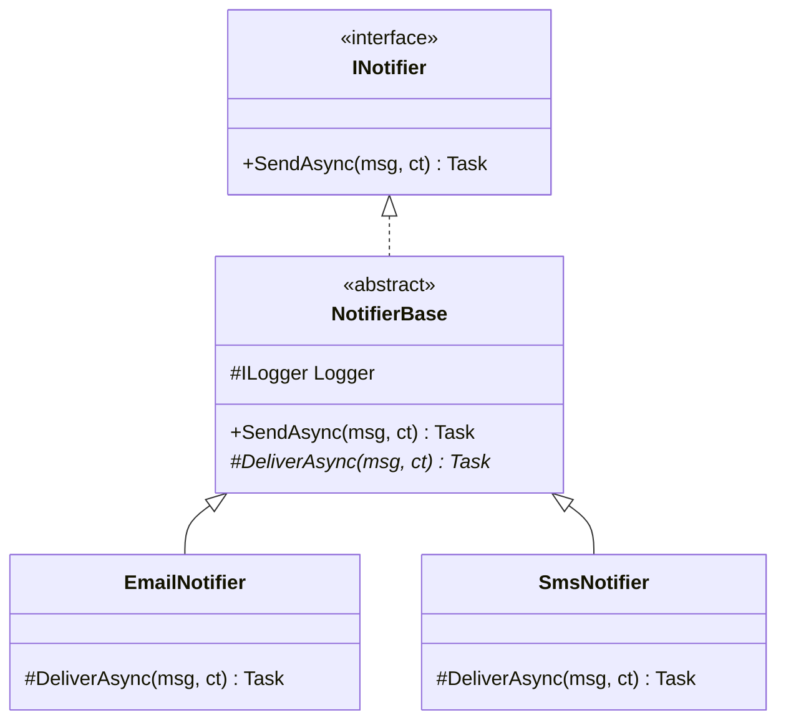

import { Tabs, TabItem, Aside } from '@astrojs/starlight/components';
import QuizBlock from '~/components/QuizBlock.astro';

## Why it matters in interviews

*"Abstract class vs interface?"* is probably the single most asked C# question. At 3-4 years the interviewer expects you to go past the definition: default interface methods blurred the line, so **why** would you still choose one or the other? Expect "what does this print" questions on `override` vs `new`, constructor order, and access modifiers like `protected internal`. The language-agnostic version is in [OOP Concepts](../../fundamentals/oop-concepts/); this page is the C# specifics.

## Core idea

### The four pillars, in C# terms

| Pillar | Meaning | C# mechanism | Real example |
|---|---|---|---|
| Encapsulation | Hide state, expose behaviour, protect invariants | `private` fields, properties, `init`, methods that validate | `Order.AddLine()` validates quantity; `Lines` exposed as `IReadOnlyList<T>` |
| Abstraction | Expose *what*, hide *how* | Interfaces, abstract classes | `IPaymentGateway` hides Stripe vs Razorpay |
| Inheritance | Reuse and specialize a base type | `: BaseClass`, `virtual`/`override` | `BaseApiController`, `DbContext` subclasses |
| Polymorphism | One call, behaviour chosen by the runtime type | Virtual dispatch, interfaces; overloading is compile-time | `INotifier.Send()` for email, SMS, push |

**Compile-time polymorphism** is method overloading (resolved by the compiler from argument types). **Run-time polymorphism** is virtual dispatch: the CLR looks up the method in the object's **method table** (v-table) at call time.

### Abstract class vs interface



| | Abstract class | Interface |
|---|---|---|
| Purpose | Shared **base implementation** for closely related types ("is-a") | A **contract / capability** any type can sign up for ("can-do") |
| Multiple | A class inherits **one** | A class implements **many** |
| State | Instance fields, constructors | No instance fields or constructors (static fields allowed) |
| Members | Any access modifier | Public by default; since C# 8 can have private/protected members and bodies |
| Implementation | Abstract and concrete members | Default interface methods (C# 8), static abstract members (C# 11) |
| Structs | Can't inherit | Can implement |
| Versioning | Add a concrete method freely | Adding a member breaks implementers, unless it has a default body |

**How to answer "which one?"**: use an **interface** for the abstraction consumers depend on (DI, mocking, multiple implementations). Add an **abstract base class** behind it when implementations share real code or state (logging, retry, template method). That is the diagram above: consumers inject `INotifier`, implementations extend `NotifierBase`.

**Default interface methods (DIM)** let you add a member to a published interface without breaking implementers. They are only callable **through the interface type** and can't access instance state (there is none). Use them for library evolution, not as a substitute for base classes.

**Static abstract members** (C# 11) let an interface require static members, such as operators. That is what powers **generic math** (`INumber<T>`): `T.Zero`, `a + b` inside generic code.

### virtual, override, new, sealed

- `virtual`: a base method that derived classes **may** override.
- `abstract`: no body, derived non-abstract classes **must** override.
- `override`: replaces the base implementation in the v-table. Calls through a base-typed reference reach the override.
- `new` (hiding): declares an **unrelated** method with the same name. Which one runs depends on the **compile-time type** of the variable. Usually a smell; the compiler warns (CS0108) if you hide without `new`.
- `sealed` on a class: no further inheritance (also lets the JIT devirtualize calls). `sealed override` on a method: stop overriding further down.

```csharp
Base b = new Derived();
b.Virt();   // "Derived.Virt"  (override: runtime type wins)
b.Hide();   // "Base.Hide"     (new: compile-time type wins)
((Derived)b).Hide(); // "Derived.Hide"
```

### Access modifiers

| Modifier | Visible to |
|---|---|
| `public` | Everyone |
| `private` | Same type only (default for members) |
| `protected` | Same type and derived types |
| `internal` | Same assembly (default for top-level types) |
| `protected internal` | Same assembly **OR** derived types anywhere |
| `private protected` | Derived types **AND** in the same assembly |
| `file` (C# 11) | Same source file (types only), common in source generators |

### Static classes, constructors and partial

- A **static class** can't be instantiated or inherited and holds only static members: helpers, extension methods. The **static constructor** runs once per type, lazily, before first use; if it throws, the type is unusable for the life of the process (`TypeInitializationException`).
- **Constructor chaining**: `: this(...)` calls another constructor of the same class, `: base(...)` calls the base constructor. With **primary constructors** (C# 12) on classes, other constructors must chain to the primary one via `this(...)`. Primary constructor parameters are captured as private state, not public properties (unlike records).
- **Initialization order** for `new Derived()`: derived field initializers → base field initializers → base constructor body → derived constructor body. So a **virtual call from a base constructor** runs the override before the derived constructor body has set its fields.
- **partial** splits a type across files (generated code + your code, e.g. EF scaffolding, source generators). Partial methods, partial properties (C# 13) and partial constructors and events (C# 14) let a generator declare a member that you or it implements.

## Code

```csharp
namespace Notifications;

public interface INotifier
{
    Task SendAsync(string to, string message, CancellationToken ct);
}

// Template method: shared logging/validation, specific delivery.
public abstract class NotifierBase(ILogger logger) : INotifier
{
    protected ILogger Logger { get; } = logger;

    public async Task SendAsync(string to, string message, CancellationToken ct)
    {
        ArgumentException.ThrowIfNullOrWhiteSpace(to);
        Logger.LogInformation("Sending via {Channel} to {To}", Channel, to);
        await DeliverAsync(to, message, ct);
    }

    protected abstract string Channel { get; }
    protected abstract Task DeliverAsync(string to, string message, CancellationToken ct);
}

public sealed class EmailNotifier(ILogger<EmailNotifier> logger, IEmailClient client)
    : NotifierBase(logger)
{
    protected override string Channel => "email";
    protected override Task DeliverAsync(string to, string message, CancellationToken ct) =>
        client.SendAsync(to, "Notification", message, ct);
}
```

**Encapsulation with an invariant**

```csharp
public class Order
{
    private readonly List<OrderLine> _lines = [];
    public IReadOnlyList<OrderLine> Lines => _lines;
    public decimal Total => _lines.Sum(l => l.Price * l.Quantity);

    public void AddLine(string sku, int quantity, decimal price)
    {
        ArgumentOutOfRangeException.ThrowIfNegativeOrZero(quantity);
        _lines.Add(new OrderLine(sku, quantity, price));
    }
}

public record OrderLine(string Sku, int Quantity, decimal Price);
```

**Constructor order trap**

```csharp
class Parent
{
    public Parent() { Console.WriteLine("Parent ctor"); Init(); }
    protected virtual void Init() => Console.WriteLine("Parent.Init");
}

class Child : Parent
{
    private readonly string _initialized = "field";
    private readonly string? _fromCtor;
    public Child() { _fromCtor = "ctor"; Console.WriteLine("Child ctor"); }
    protected override void Init() => Console.WriteLine($"Child.Init {_initialized} {_fromCtor ?? "null"}");
}
// new Child() prints: Parent ctor / Child.Init field null / Child ctor
```

## Interview Q&A

<details>
<summary>Abstract class vs interface, now that interfaces can have default methods?</summary>

Interfaces still can't hold instance state or constructors, and a class can implement many of them, so they remain the tool for contracts and DI. Abstract classes hold shared state and code for a family of related types and can enforce a template. Default interface methods exist mainly so library authors can add members without breaking implementers. My rule: depend on interfaces, share code with an abstract base behind them, and prefer composition when the "is-a" relationship is weak.
</details>

<details>
<summary>What is the difference between `override` and `new`?</summary>

`override` replaces the v-table slot, so the derived method runs even when called through a base reference. `new` hides the base method with an unrelated one; which runs depends on the variable's compile-time type. Hiding is rarely what you want and breaks polymorphism.
</details>

<details>
<summary>Why shouldn't you call virtual methods from a constructor?</summary>

The override runs before the derived constructor body, so it sees fields that haven't been set yet (only field initializers have run). This causes null references and half-initialized state. Use a factory method or an explicit initialization step instead.
</details>

<details>
<summary>What is the difference between `protected internal` and `private protected`?</summary>

`protected internal` is a union: anything in the same assembly, or derived classes in any assembly. `private protected` is an intersection: only derived classes that are also in the same assembly. The latter is useful for a base class whose extension points shouldn't leak to other assemblies.
</details>

<details>
<summary>Why mark classes `sealed`?</summary>

It states intent (not designed for inheritance), prevents fragile subclassing, and lets the JIT devirtualize and inline calls, a small but free performance win. Many teams seal by default and unseal deliberately. Analyzers can flag classes that could be sealed.
</details>

<details>
<summary>Static class vs singleton?</summary>

A static class has no instance, can't implement interfaces, can't be injected or mocked, and its state is global for the process. A singleton (ideally registered as a DI singleton, not a hand-written static `Instance`) is an object: it implements interfaces, can be replaced in tests, and its lifetime is managed. Use static classes only for stateless helpers and extension methods. See [Creational Patterns](../../patterns/creational-patterns/).
</details>

<details>
<summary>Can you give an example of polymorphism from a real project?</summary>

A payment flow injecting `IEnumerable<IPaymentProvider>` and picking one by `provider.Supports(method)`: card, UPI and wallet implementations each override `ChargeAsync`. Adding a new provider means a new class plus a DI registration, with no change to the checkout service. That is polymorphism serving the Open/Closed principle (see [SOLID](../../patterns/solid/)).
</details>

<details>
<summary>Composition vs inheritance?</summary>

Inheritance couples the child to the parent's implementation and gives one shot at a base class. Composition (holding an `IRetryPolicy` or `IClock` and delegating to it) is more flexible and easier to test. Use inheritance for genuine "is-a" hierarchies with shared behaviour; otherwise compose.
</details>

## Pitfalls

<Aside type="caution" title="Common mistakes">
- Saying **"interfaces can't have implementation"**. Not true since C# 8.
- Using `new` to "override" a non-virtual method, then being surprised by base-typed calls.
- Calling virtual methods from constructors.
- Deep inheritance hierarchies (`BaseController` → `BaseCrudController` → ...) that make every change risky.
- Exposing `List<T>` publicly so callers bypass your invariants; expose `IReadOnlyList<T>` and mutation methods.
- Static classes holding mutable state, which is shared across all requests and not thread-safe.
- Expecting primary constructor parameters on a class to become public properties. Only records do that.
</Aside>

## Related

- [OOP Concepts (language-agnostic)](../../fundamentals/oop-concepts/)
- [SOLID Principles](../../patterns/solid/)
- [Value vs Reference Types](../value-reference-types/)
- [Modern C# (9 → 15)](../modern-csharp/)

## Quick quiz

<QuizBlock section="csharp" topic="oop-csharp" />
