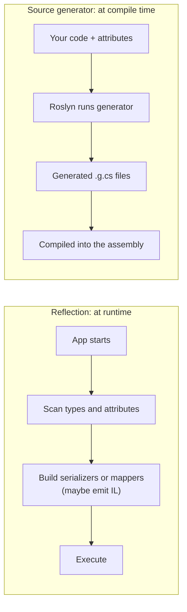

import { Tabs, TabItem, Aside } from '@astrojs/starlight/components';
import QuizBlock from '~/components/QuizBlock.astro';

## Why it matters in interviews

You use reflection every day without writing it: DI containers, model binding, EF Core, serializers, AutoMapper and test frameworks are built on it. Interviewers ask *"what is reflection and why is it slow?"*, *"how do custom attributes work?"* and, increasingly, *"what are source generators and why does Native AOT care?"*. A good answer connects the three: attributes are metadata, reflection reads it at runtime, source generators read it at compile time.

## Core idea

Every .NET assembly carries **metadata** describing its types, members, signatures and attributes alongside the IL. **Reflection** is the runtime API for reading that metadata and acting on it: inspecting a type's properties, creating instances of a type you only know by name, invoking methods, reading attributes.

### The main types

| API | What it gives you |
|---|---|
| `typeof(Order)` | `Type` for a type known at compile time |
| `obj.GetType()` | The **runtime** type of an instance (a derived type if `obj` is a subclass) |
| `Type.GetType("Ns.Order, Shop")` / `assembly.GetTypes()` | Types discovered by name or by scanning |
| `type.GetProperties()`, `GetMethods()`, `GetFields(BindingFlags...)` | `PropertyInfo`, `MethodInfo`, `FieldInfo` (members are all `MemberInfo`) |
| `prop.GetValue(obj)`, `method.Invoke(obj, args)` | Late-bound access and calls |
| `Activator.CreateInstance(type)` | New instance without `new T()` at compile time |
| `member.GetCustomAttribute<T>()`, `IsDefined(...)` | Attributes applied to a member |

`GetProperties()` does not guarantee any particular order, and by default returns only public instance and static members; pass `BindingFlags` to change that. `o.GetType() == typeof(Customer)` is an *exact* type check, whereas `o is Customer` also matches subclasses.

### Attributes

An attribute is a class deriving from `System.Attribute` whose constructor arguments must be **compile-time constants** (literals, `typeof`, enums, arrays of those). Applying `[Sensitive]` does not run any code: the compiler serialises the constructor call into metadata. The attribute object is only created when someone asks for it via reflection, and each `GetCustomAttribute` call constructs a **new instance**.

```csharp
[AttributeUsage(AttributeTargets.Property, AllowMultiple = false, Inherited = true)]
public sealed class SensitiveAttribute : Attribute;

[AttributeUsage(AttributeTargets.Class)]
public sealed class ValidatorAttribute<TValidator> : Attribute where TValidator : class; // generic attribute, C# 11

[Validator<CustomerValidator>]
public class Customer
{
    public int Id { get; set; }
    [Sensitive] public string CardNumber { get; set; } = "";
}
```

Attributes are inert labels; something must read them. ASP.NET Core reads `[HttpGet]`, `[Authorize]` and `[FromBody]` at startup to build endpoints, EF Core reads `[Key]` and `[MaxLength]` when building the model, and validation reads `[Required]` per request.

### Why reflection is slow, and how to make it fast

A direct property read compiles to a JIT-inlined field access. `prop.GetValue(obj)` must check the target type, box value-type results, and go through an invoker. A member **lookup** by string name (`GetProperty("Name")`) is slower still. On .NET 10, a cached `PropertyInfo.GetValue` is still several times slower than a direct call, while a cached delegate is close to direct speed. Reflection also defeats inlining and static analysis.

Practical rules:

1. **Do the lookup once and cache it** (static field, static generic class, `ConcurrentDictionary<Type, ...>`).
2. **Turn hot calls into delegates**: `methodInfo.CreateDelegate<Func<Customer, string>>()` or a compiled expression tree.
3. **Use `[UnsafeAccessor]`** (.NET 8+) to reach a private field or method with no reflection at all; it is resolved by the JIT and works with Native AOT.
4. **Move the work to compile time** with a source generator.

### Source generators

A source generator is a Roslyn component that runs **during compilation**, inspects your code (syntax and semantic model, including attributes) and **adds new C# source files** to the compilation. It cannot modify existing code, which is why generated features are declared as `partial` members you complete.



| | Reflection | Source generator |
|---|---|---|
| When it runs | Runtime, on every app start (and possibly per call) | Build time, once |
| Startup cost | Scanning and warm-up | None |
| Errors | Runtime exceptions | Compile-time diagnostics |
| Trimming / Native AOT | Often breaks or needs annotations | Safe: everything is ordinary code |
| Debuggable | Opaque | Generated code is visible in the IDE |
| Flexibility | Can handle types not known at build time (plugins) | Only types in the compilation |

Generators you already use in .NET 10: **System.Text.Json** (`JsonSerializerContext`), **`[LoggerMessage]`** for high-performance logging, **`[GeneratedRegex]`**, the **configuration binder** and **minimal API request delegate** generators (used automatically for Native AOT), and libraries such as Mapperly (mapping) and source-generated mediators.

### Trimming and Native AOT

**Trimming** removes code the build cannot prove is used, to shrink the app. **Native AOT** compiles everything to native code ahead of time: no JIT at runtime, so no `Reflection.Emit` and no generating code at runtime. Both rely on **static analysis**, and reflection driven by strings or by `Type` values computed at runtime is invisible to it. The trimmer may remove the property you look up by name, so it fails only in the published app.

The toolchain reports this as warnings: IL2026 for calling a method marked `[RequiresUnreferencedCode]`, IL3050 for `[RequiresDynamicCode]`, IL2057 / IL2072 and friends for unanalysable `Type` flows. You fix them by annotating (`[DynamicallyAccessedMembers(DynamicallyAccessedMemberTypes.PublicProperties)]` on a `Type` parameter tells the trimmer to keep those members), or better, by switching to a source-generated path. Set `<IsAotCompatible>true</IsAotCompatible>` in a library to surface these warnings during normal builds.

## Code

**Cached reflection: masking `[Sensitive]` properties in audit logs**

```csharp
namespace Shop.Auditing;

public static class AuditFormatter<T>
{
    // Static generic class: the reflection below runs once per T, not per call.
    private static readonly (string Name, bool Sensitive, Func<T, object?> Get)[] Props =
        typeof(T).GetProperties(BindingFlags.Public | BindingFlags.Instance)
            .Where(p => p.CanRead && p.GetIndexParameters().Length == 0)
            .Select(p => (p.Name,
                          p.IsDefined(typeof(SensitiveAttribute)),
                          (Func<T, object?>)(x => p.GetValue(x))))
            .ToArray();

    public static string Format(T item) =>
        string.Join(", ", Props.Select(p => $"{p.Name}={(p.Sensitive ? "***" : p.Get(item))}"));
}
// AuditFormatter<Customer>.Format(c) -> "Id=1, Name=Ann, CardNumber=***"
```

**Plugin-style discovery with `Activator`, and `[UnsafeAccessor]`**

```csharp
var exporters = typeof(IExportHandler).Assembly.GetTypes()
    .Where(t => t is { IsClass: true, IsAbstract: false } && typeof(IExportHandler).IsAssignableFrom(t))
    .Select(t => (IExportHandler)Activator.CreateInstance(t)!)
    .ToList();   // in ASP.NET Core you would register these in DI instead (e.g. Scrutor scanning)

public static class WalletAccess
{
    // Reads/writes a private field without reflection; AOT-friendly (.NET 8+)
    [UnsafeAccessor(UnsafeAccessorKind.Field, Name = "_balance")]
    public static extern ref decimal Balance(Wallet wallet);
}
```

**Consuming source generators**

```csharp
public static partial class Log
{
    [LoggerMessage(Level = LogLevel.Information, Message = "Order {OrderId} placed for {Total}")]
    public static partial void OrderPlaced(ILogger logger, int orderId, decimal total);
}

public static partial class Patterns
{
    [GeneratedRegex(@"^[A-Z]{2}-\d{4}$")]
    public static partial Regex Sku();   // regex compiled to C# at build time
}
```

**Writing a minimal incremental generator** (lives in a `netstandard2.0` project referencing `Microsoft.CodeAnalysis.CSharp`, added to the app as an analyzer):

```csharp
[Generator]
public sealed class ToStringGenerator : IIncrementalGenerator
{
    public void Initialize(IncrementalGeneratorInitializationContext context)
    {
        var classes = context.SyntaxProvider.ForAttributeWithMetadataName(
            "Shop.GenerateToStringAttribute",
            predicate: static (node, _) => node is ClassDeclarationSyntax,
            transform: static (ctx, _) =>
            {
                var type = (INamedTypeSymbol)ctx.TargetSymbol;
                var props = type.GetMembers().OfType<IPropertySymbol>()
                    .Where(p => p.DeclaredAccessibility == Accessibility.Public)
                    .Select(p => $"{p.Name} = {{{p.Name}}}");
                return (Ns: type.ContainingNamespace.ToDisplayString(), type.Name, Body: string.Join(", ", props));
            });

        context.RegisterSourceOutput(classes, static (spc, m) =>
            spc.AddSource($"{m.Name}.ToString.g.cs",
                $"namespace {m.Ns};\npartial class {m.Name}\n{{\n" +
                $"    public override string ToString() => $\"{m.Name} {{{{ {m.Body} }}}}\";\n}}\n"));
    }
}
```

Incremental generators cache each pipeline step, so the IDE only re-runs the generator when relevant code changes. The older `ISourceGenerator` interface is deprecated for that reason.

## Interview Q&A

<details>
<summary>What is reflection and where have you seen it used?</summary>

Reading type metadata and working with members at runtime: listing properties, creating instances, invoking methods, reading attributes. Frameworks rely on it heavily: DI containers find constructors, MVC discovers controllers and binds models, EF Core builds its model, serializers and AutoMapper map properties, xUnit finds `[Fact]` methods. In app code I mostly use it for assembly scanning at startup and for generic cross-cutting helpers such as audit formatting.
</details>

<details>
<summary>Why is reflection slow, and how do you reduce the cost?</summary>

Late binding means runtime type checks, boxing of value types and argument arrays, and string-based lookups, and the JIT cannot inline anything. Mitigate by caching `Type`/`PropertyInfo` lookups, converting hot calls to delegates (`CreateDelegate`, compiled expression trees), using `[UnsafeAccessor]` for private access, or replacing it with a source generator. Reflection at startup is fine; reflection per request in a hot path is what hurts.
</details>

<details>
<summary>How do custom attributes work? When is the attribute's constructor called?</summary>

The compiler stores the attribute's constructor arguments and named properties in metadata. Nothing runs at compile time or when the type loads. The constructor runs only when code calls `GetCustomAttribute(s)`, and each call creates new instances. That's why arguments must be compile-time constants, and why attributes do nothing unless a framework or your code reads them.
</details>

<details>
<summary>`typeof(T)` vs `GetType()` vs `is`?</summary>

`typeof(T)` is resolved at compile time for a known type. `obj.GetType()` returns the actual runtime type, possibly a subclass. `obj is T` checks compatibility, so it is true for subclasses and implemented interfaces, while `obj.GetType() == typeof(T)` is an exact match only.
</details>

<details>
<summary>What is a source generator and how does it differ from reflection?</summary>

A Roslyn plugin that runs during compilation, inspects your code and adds new source files. It does at build time what reflection-based libraries do at startup, so you get no runtime scanning cost, compile-time errors, debuggable output and trimming/AOT compatibility. It can't modify existing code (hence `partial`) and only sees types in the compilation, so runtime plugins still need reflection.
</details>

<details>
<summary>Why does Native AOT have problems with reflection?</summary>

AOT and trimming decide what to keep through static analysis. Reflection by string name or computed `Type` hides dependencies, so members can be trimmed away. Native AOT also has no JIT, so anything that emits IL at runtime (`Reflection.Emit`, some expression compilation paths, `MakeGenericType` over value types) is unavailable or falls back to slower paths. The fix is annotations (`[DynamicallyAccessedMembers]`) or source generators, guided by the IL2xxx/IL3xxx warnings.
</details>

<details>
<summary>How would you access a private field in a unit test or legacy integration?</summary>

First ask whether the design should expose it differently. If not: `typeof(T).GetField("_x", BindingFlags.NonPublic | BindingFlags.Instance)` works but is slow and breaks under trimming. On .NET 8+, `[UnsafeAccessor]` declares an `extern` method that the runtime binds to the private member: fast, AOT-safe, and checked at first call.
</details>

## Pitfalls

<Aside type="caution" title="Common mistakes">

- **Repeating `GetProperty("Name")` or `GetCustomAttribute` per call** in a hot path instead of caching.
- **Assuming `GetProperties()` returns declaration order**: it is not guaranteed; sort explicitly if order matters.
- **Reflection-based code that works in Debug but fails after trimming or Native AOT publish.** Treat IL2xxx/IL3xxx warnings as errors.
- **Using reflection to bypass encapsulation** in production code, coupling yourself to private implementation details that can change in any release.
- **Expecting attributes to "do" something** without code that reads them.
- **Heavy work in a source generator's syntax predicate**: keep it cheap and filter with `ForAttributeWithMetadataName`, or the IDE slows down.

</Aside>

## Related

- [JSON Serialization (source-generated contexts)](../serialization/)
- [.NET Platform, CLR & JIT](../dotnet-platform/)
- [Dependency Injection (assembly scanning)](../../aspnet/dependency-injection/)
- [Logging & Observability (LoggerMessage)](../../aspnet/logging-observability/)

## Quick quiz

<QuizBlock section="csharp" topic="reflection-attributes" />
