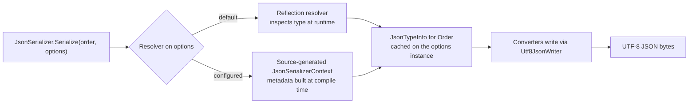

import { Tabs, TabItem, Aside } from '@astrojs/starlight/components';
import QuizBlock from '~/components/QuizBlock.astro';

## Why it matters in interviews

Every API you have built serialises JSON, so interviewers probe for experience: *"System.Text.Json or Newtonsoft, and why?"*, *"why is this property null after deserialisation?"*, *"how do you serialise enums as strings?"*, *"how do you handle a polymorphic payload?"*. Strong answers mention the web defaults, custom converters, reusing options, and source generation for performance and Native AOT.

## Core idea

**System.Text.Json (STJ)** is the built-in serializer since .NET Core 3.0 and the default in ASP.NET Core, `HttpClient` JSON extensions, SignalR and gRPC JSON transcoding. It works directly on **UTF-8 bytes** (`Utf8JsonReader`/`Utf8JsonWriter`), is designed around spans and pooled buffers, and is **strict by default**. **Newtonsoft.Json (Json.NET)** is the older community library: very flexible and lenient, slower and more allocation-heavy, and still common in legacy code.

### How STJ works internally



The first time a type is serialised with a given `JsonSerializerOptions` instance, STJ builds a `JsonTypeInfo` (which properties, getters, setters, constructor, converters) and **caches it on that options instance**. Options become immutable after first use. Creating `new JsonSerializerOptions()` per call throws the cache away and rebuilds metadata every time; analyzer CA1869 flags this. Keep options in a `static readonly` field or use the instance ASP.NET Core configures.

### Defaults you must know

| Behaviour | `JsonSerializer` default | Web defaults (`JsonSerializerOptions.Web`, ASP.NET Core, `HttpClient` JSON) |
|---|---|---|
| Property names written | As declared (PascalCase) | camelCase |
| Property name matching on read | **Case-sensitive** | Case-insensitive |
| Numbers in quotes (`"42"`) | Rejected | Allowed |
| Enums | Numbers | Numbers (add `JsonStringEnumConverter`) |
| Comments, trailing commas | Rejected | Rejected |
| Fields | Ignored (use `IncludeFields` or `[JsonInclude]`) | Ignored |
| Non-public setters | Ignored (use `[JsonInclude]`) | Ignored |
| Reference cycles | `JsonException` ("possible object cycle") | Same |
| Duplicate property in input | Last one wins | Last one wins (reject with `AllowDuplicateProperties = false`, .NET 10) |

The single most common bug: a console app or test uses `JsonSerializer.Deserialize<T>(json)` with default options on camelCase JSON from an API, and every property comes back `null` or `0` because matching is case-sensitive. Pass `JsonSerializerOptions.Web`.

Useful knobs: `PropertyNamingPolicy` (`CamelCase`, `SnakeCaseLower`, `KebabCaseLower`), `DefaultIgnoreCondition = WhenWritingNull`, `ReferenceHandler.IgnoreCycles` (or better, DTOs without cycles), `NumberHandling`, `UnmappedMemberHandling.Disallow`, and attributes `[JsonPropertyName]`, `[JsonIgnore]`, `[JsonInclude]`, `[JsonRequired]`. Since .NET 9, `RespectNullableAnnotations` rejects `null` for non-nullable reference properties and `RespectRequiredConstructorParameters` rejects missing constructor parameters. .NET 10 adds `JsonSerializerOptions.Strict`, a preset that turns on these checks, disallows unmapped and duplicate properties, and keeps matching case-sensitive.

### STJ vs Newtonsoft

| | System.Text.Json | Newtonsoft.Json |
|---|---|---|
| Ships with .NET | Yes | NuGet package |
| Performance | Faster, fewer allocations, UTF-8 native | Slower, string/char based |
| Strictness | Strict by default, opt-in leniency | Lenient by default |
| Polymorphism | Opt-in, attribute allow-list (`[JsonDerivedType]`) | `TypeNameHandling` (type names in JSON; dangerous with untrusted input) |
| DOM | `JsonDocument` (read-only), `JsonNode` (mutable) | `JObject` / `JToken`, LINQ to JSON |
| Native AOT / trimming | Supported via source generation | Reflection-based; not AOT-friendly |
| Extensibility | `JsonConverter<T>`, contract customisation (`TypeInfoResolver` modifiers) | Very rich: contract resolvers, converters, many settings |

**Choose STJ** for new code. **Keep Newtonsoft** where you depend on features STJ deliberately lacks or a large legacy surface relies on its leniency; in ASP.NET Core, `AddNewtonsoftJson()` switches MVC to it. Migrating is mostly about matching defaults (casing, enums, null handling, number handling) and porting custom converters.

### Polymorphic serialization

By default STJ serialises the **declared** type: a `Shape` variable holding a `Circle` writes only `Shape`'s properties. To round-trip a hierarchy, opt in on the base type with an explicit allow-list:

```csharp
[JsonPolymorphic(TypeDiscriminatorPropertyName = "$type")]
[JsonDerivedType(typeof(Circle), "circle")]
[JsonDerivedType(typeof(Square), "square")]
public abstract record Shape;
public sealed record Circle(double Radius) : Shape;
public sealed record Square(double Side) : Shape;

// Serialize<Shape[]>: [{"$type":"circle","Radius":1},{"$type":"square","Side":2}]
// Deserialize<Shape>("{\"$type\":\"square\",\"Side\":3}") -> Square { Side = 3 }
```

The discriminator is written only when serialising through the base type. When deserialising, it must be the **first** property unless you set `AllowOutOfOrderMetadataProperties = true` (.NET 9+). The allow-list is the security win over Newtonsoft's `TypeNameHandling.Auto`, where JSON can name arbitrary .NET types to instantiate (an insecure deserialisation risk).

### Source generation

`[JsonSerializable]` on a partial `JsonSerializerContext` makes the STJ source generator emit the `JsonTypeInfo` metadata (and, for simple cases, the serialisation logic) at **compile time**. Benefits: no reflection warm-up on startup, lower memory, and it is **required for Native AOT and trimmed apps**. The trade-off: every root type must be listed, and some reflection-only features are unavailable. See [Reflection, Attributes & Source Generators](../reflection-attributes/).

## Code

**Custom converter**: day-first `dd/MM/yyyy` dates from a legacy partner API

```csharp
namespace Shop.Json;

public sealed class DayMonthYearConverter : JsonConverter<DateOnly>
{
    private const string Format = "dd/MM/yyyy";

    public override DateOnly Read(ref Utf8JsonReader reader, Type typeToConvert, JsonSerializerOptions options) =>
        DateOnly.ParseExact(reader.GetString()!, Format, CultureInfo.InvariantCulture);

    public override void Write(Utf8JsonWriter writer, DateOnly value, JsonSerializerOptions options) =>
        writer.WriteStringValue(value.ToString(Format, CultureInfo.InvariantCulture));
}

// Apply per property, or globally via options.Converters.Add(new DayMonthYearConverter())
public sealed record PartnerInvoice([property: JsonConverter(typeof(DayMonthYearConverter))] DateOnly Due);
```

**Source-generated context wired into ASP.NET Core**

```csharp
[JsonSourceGenerationOptions(JsonSerializerDefaults.Web, UseStringEnumConverter = true)]
[JsonSerializable(typeof(ProductDto))]
[JsonSerializable(typeof(List<ProductDto>))]
[JsonSerializable(typeof(Shape))]
public partial class AppJsonContext : JsonSerializerContext;

// Program.cs: minimal APIs
builder.Services.ConfigureHttpJsonOptions(o =>
    o.SerializerOptions.TypeInfoResolverChain.Insert(0, AppJsonContext.Default));

// Controllers have their own options:
builder.Services.AddControllers().AddJsonOptions(o =>
    o.JsonSerializerOptions.Converters.Add(new JsonStringEnumConverter()));

// Direct use, no reflection: strongly typed JsonTypeInfo
var json = JsonSerializer.Serialize(product, AppJsonContext.Default.ProductDto);
var back = JsonSerializer.Deserialize(json, AppJsonContext.Default.ProductDto);
```

**Reusing options in services**

```csharp
public sealed class PartnerClient(HttpClient http)
{
    private static readonly JsonSerializerOptions Options = new(JsonSerializerDefaults.Web)
    {
        DefaultIgnoreCondition = JsonIgnoreCondition.WhenWritingNull,
        Converters = { new JsonStringEnumConverter(), new DayMonthYearConverter() }
    };

    public Task<PartnerInvoice?> GetInvoiceAsync(string id, CancellationToken ct) =>
        http.GetFromJsonAsync<PartnerInvoice>($"/invoices/{id}", Options, ct);
}
```

## Interview Q&A

<details>
<summary>System.Text.Json or Newtonsoft for a new project?</summary>

System.Text.Json: built in, faster with fewer allocations, secure by default (opt-in polymorphism), and the only practical option for Native AOT via source generation. I'd keep Newtonsoft only where a legacy codebase depends on its leniency or a feature STJ lacks, and migrate gradually with converters and matching options.
</details>

<details>
<summary>Why are all properties null after `JsonSerializer.Deserialize<T>(json)`?</summary>

Most likely a casing mismatch: default options match property names case-sensitively, so camelCase JSON doesn't bind to PascalCase properties. Use `JsonSerializerOptions.Web` (or `PropertyNameCaseInsensitive = true`). Other causes: properties with private setters or fields (ignored unless `[JsonInclude]`), or the JSON wraps the object in an envelope.
</details>

<details>
<summary>How do you serialise enums as strings?</summary>

Add `JsonStringEnumConverter`, globally in options (`AddJsonOptions` for controllers, `ConfigureHttpJsonOptions` for minimal APIs) or per type with `[JsonConverter(typeof(JsonStringEnumConverter<Status>))]`. The generic `JsonStringEnumConverter<TEnum>` is the AOT-friendly version; with source generation you can also set `UseStringEnumConverter = true` on the context.
</details>

<details>
<summary>Why should `JsonSerializerOptions` be reused?</summary>

Type metadata (`JsonTypeInfo`) is computed on first use and cached on the options instance. A new instance per call recomputes it each time, which is dramatically slower and allocates heavily. Store options in a static field or inject the configured `IOptions<JsonOptions>`.
</details>

<details>
<summary>How does polymorphic serialization work in STJ?</summary>

Opt in on the base type with `[JsonPolymorphic]` and one `[JsonDerivedType(typeof(Derived), "discriminator")]` per subtype. Serialising through the base type writes a `$type` discriminator, and deserialising reads it to pick the subtype. Only listed types can be created, unlike Newtonsoft's `TypeNameHandling`, which lets the payload choose any type and has caused remote-code-execution vulnerabilities.
</details>

<details>
<summary>What is a `JsonSerializerContext` and when do you need one?</summary>

A partial class that the STJ source generator fills with metadata for the types listed in `[JsonSerializable]`. It removes runtime reflection: faster startup, less memory, and it is required for Native AOT and trimming. In ASP.NET Core you register it in the resolver chain; in code you pass `Context.Default.MyType` to the serializer.
</details>

<details>
<summary>How do you handle a self-referencing EF Core graph that throws "possible object cycle"?</summary>

Best fix: don't serialise entities; project to DTOs that have no back-references. Quick fixes are `ReferenceHandler.IgnoreCycles` (writes `null` for the repeated reference) or `ReferenceHandler.Preserve` (adds `$id`/`$ref` metadata that most clients don't understand).
</details>

<details>
<summary>How would you write a custom converter?</summary>

Derive from `JsonConverter<T>`, implement `Read` using the forward-only `Utf8JsonReader` (passed by `ref`) and `Write` using `Utf8JsonWriter`, then register it in `options.Converters` or with `[JsonConverter]` on a property or type. Typical uses: legacy date formats, value objects serialised as a primitive (`Money` as `"10.00 EUR"`), or tolerant parsing of a partner's inconsistent fields.
</details>

## Pitfalls

<Aside type="caution" title="Common mistakes">

- **`new JsonSerializerOptions()` per call**: kills performance (CA1869).
- **Configuring `AddJsonOptions` and expecting minimal APIs to pick it up** (or vice versa): controllers and minimal APIs have separate options.
- **Serialising EF Core entities directly**: cycles, lazy-loading surprises, and leaking internal columns. Use DTOs.
- **`object` or `dynamic` properties**: deserialise as `JsonElement`, not the CLR type you expected.
- **Missing discriminator first in polymorphic JSON** from a third party: enable `AllowOutOfOrderMetadataProperties`.
- **`decimal` and dates**: be explicit about formats and time zones; prefer `DateTimeOffset` or UTC `DateTime` in contracts.
- **Newtonsoft `TypeNameHandling.Auto/All` on untrusted input**: an insecure-deserialisation vulnerability.

</Aside>

## Related

- [Reflection, Attributes & Source Generators](../reflection-attributes/)
- [Controllers, Minimal APIs & Model Binding](../../aspnet/controllers-minimal-apis/)
- [REST API design](../../aspnet/rest-api-design/)
- [Modern C# (records)](../modern-csharp/)

## Quick quiz

<QuizBlock section="csharp" topic="serialization" />
