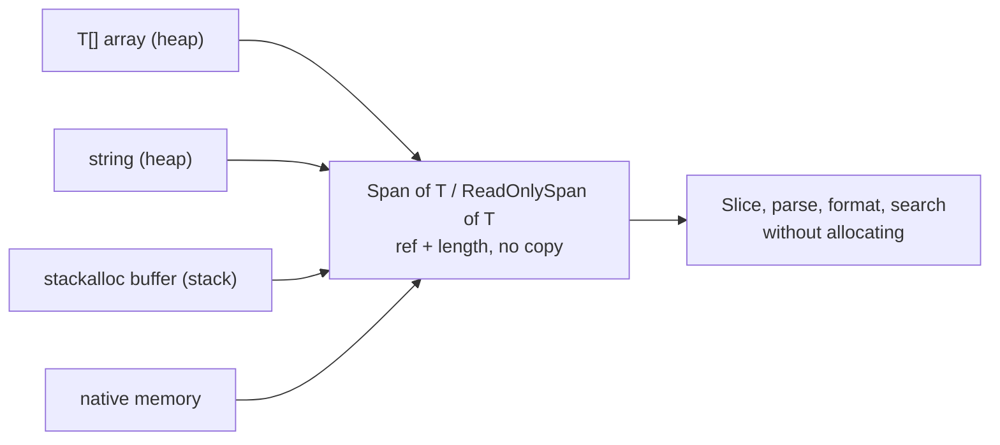

import { Tabs, TabItem, Aside } from '@astrojs/starlight/components';
import QuizBlock from '~/components/QuizBlock.astro';

## Why it matters in interviews

*"Why are strings immutable?"*, *"when do you use StringBuilder?"* and *"what is `Span<T>`?"* show up in nearly every C# round, often followed by a code-reading question about `==` vs `ReferenceEquals`. Comparison and culture bugs (the Turkish "i") are a favourite for checking real-world experience, and `Span<T>` / `ArrayPool` are how you answer *"how would you reduce allocations in this hot path?"*.

## Core idea

### Immutability

`string` is a reference type whose contents **never change** after creation. Every "modification" (`ToUpper`, `Replace`, `+`, `Substring`) returns a **new** string. Benefits: strings are inherently thread-safe, safe to use as dictionary keys (the hash cannot change under you), and can be shared and interned. The cost: building a string piece by piece in a loop allocates a new string each time.

```csharp
var s = "Hello";
s.ToUpper();          // result discarded: s is still "Hello"
s = s.ToUpper();      // now s refers to a new string "HELLO"
```

Although `string` is a reference type, `==` and `Equals` are overridden to compare **contents** (ordinal, case-sensitive). Only `ReferenceEquals`, or `==` on variables typed as `object`, compares references.

### Interning

The runtime keeps an **intern pool**: one shared instance per distinct string literal. The compiler also folds constant expressions, so `"hel" + "lo"` becomes the literal `"hello"` at compile time.

```csharp
string a = "hello";
string b = "hel" + "lo";            // constant-folded: same interned literal
string c = "hel";
string d = c + "lo";                // built at runtime: new object

ReferenceEquals(a, b);              // True
ReferenceEquals(a, d);              // False
a == d;                             // True  (content comparison)
ReferenceEquals(a, string.Intern(d)); // True
```

Strings built at runtime are not interned unless you call `string.Intern`, and interned strings are never collected: they live until the process ends. In practice you rarely intern manually; it only helps when a very large number of identical strings stay in memory for a long time.

### Concatenation and StringBuilder

| Scenario | Best tool | Why |
|---|---|---|
| A few known pieces | `+` or `$"..."` | Compiles to one `string.Concat` or an interpolation handler: one final allocation |
| Joining a collection | `string.Join(", ", items)` | Computes total length, allocates once |
| Appending in a loop of unknown size | `StringBuilder` | Mutable internal chunk buffers; one final string from `ToString()` |
| Fixed-length output built char by char | `string.Create(length, state, ...)` | Writes straight into the new string's memory |

`s += x` inside a loop is O(n²): each iteration copies everything built so far. `StringBuilder` keeps a linked list of `char[]` chunks, growing by adding chunks rather than copying, and only copies once in `ToString()`. Pass a capacity if you know the approximate size. For three or four concatenations, `StringBuilder` is slower than `+`.

### Comparison and culture

| API | Default comparison |
|---|---|
| `==`, `Equals(string)`, `string.Equals(a, b)` | Ordinal, case-sensitive |
| `Dictionary<string, T>`, `HashSet<string>` | Ordinal, case-sensitive (pass a `StringComparer` to change) |
| `CompareTo`, `string.Compare`, `OrderBy` on strings | **Current culture** |
| `StartsWith(string)`, `EndsWith(string)`, `IndexOf(string)` | **Current culture** |
| `ToUpper()`, `ToLower()` | **Current culture** |

Culture-sensitive operations exist for *displaying and sorting text for humans*. For identifiers, keys, file paths, headers, JSON property names and anything protocol-like, use **`StringComparison.Ordinal`** or **`OrdinalIgnoreCase`**. The classic bug: under Turkish culture (`tr-TR`), `"file".ToUpper()` returns `"FİLE"` (dotted capital İ), so a check like `cmd.ToUpper() == "FILE"` fails. Ordinal comparisons are also faster because they compare raw UTF-16 code units.

```csharp
var roles = new HashSet<string>(StringComparer.OrdinalIgnoreCase) { "Admin" };
roles.Contains("ADMIN");                                          // True
path.EndsWith(".json", StringComparison.OrdinalIgnoreCase);       // not culture-dependent
```

### `Span<T>` and `Memory<T>`

`Span<T>` is a **view over contiguous memory**: a reference plus a length. It can point at an array, part of a string (`ReadOnlySpan<char>`), a `stackalloc` buffer or native memory, and slicing it allocates nothing.



`Span<T>` is a **`ref struct`**, which means it can only live on the stack. It cannot be a field of a class, be boxed, be captured by a lambda, or be held across an `await` (since C# 13 you may use spans inside async methods and iterators, just not across an `await`/`yield`). When you need to store the buffer or use it across an `await`, use **`Memory<T>`** (a regular struct) and call `.Span` when you actually process it.

| | `Span<T>` | `Memory<T>` |
|---|---|---|
| Kind | `ref struct` (stack only) | Regular struct |
| Store in a field / use across `await` | No | Yes |
| Can wrap `stackalloc` | Yes | No |
| Typical use | Synchronous parsing and formatting | Async I/O buffers (`Stream.ReadAsync(Memory<byte>)`) |

C# 14 adds **first-class span conversions**: arrays convert implicitly to `Span<T>` / `ReadOnlySpan<T>`, and spans convert to `ReadOnlySpan<T>`, including for extension-method receivers and generic inference. Most BCL APIs (`int.Parse`, `TryFormat`, `Encoding`, `MemoryExtensions.Split`) already have span overloads.

### `stackalloc` and `ArrayPool<T>`

- **`stackalloc`** allocates a buffer on the current stack frame: zero GC cost, freed automatically on return. Only for **small, bounded** sizes (a few hundred bytes up to roughly 1 KB). Large or user-controlled sizes risk a `StackOverflowException`, which kills the process.
- **`ArrayPool<T>.Shared`** rents reusable arrays for larger temporary buffers. `Rent(n)` may return a **larger** array than requested, so track the real length. Always `Return` in `finally`, never use the array after returning it, and pass `clearArray: true` for sensitive data.

### Raw string literals and interpolation handlers

Raw string literals (C# 11) start with three or more quotes and need no escaping, which suits JSON, SQL and regex. Leading indentation up to the closing quotes is removed. With `$$`, interpolation holes use `{{ }}` so single braces stay literal:

```csharp
var json = $$"""
    { "id": {{order.Id}}, "tags": ["new"] }
    """;
```

**Interpolated string handlers** (C# 10) changed how `$"..."` compiles. Instead of `string.Format` with boxed arguments, the compiler calls a handler (`DefaultInterpolatedStringHandler`) that appends each part into a pooled buffer, formatting value types without boxing. APIs can accept their own handler type: `StringBuilder.Append($"...")` writes directly into the builder, and `Debug.Assert(cond, $"...")` skips formatting entirely when the condition holds.

## Code

**Zero-copy parsing, `stackalloc` and `string.Create`**

```csharp
namespace Shop.Text;

public static class Formatting
{
    // "2026-11-02" -> parts parsed without allocating substrings
    public static DateOnly ParseIsoDate(ReadOnlySpan<char> s) =>
        new(int.Parse(s[..4]), int.Parse(s.Slice(5, 2)), int.Parse(s[8..]));

    // Small fixed-size buffer on the stack; one allocation for the result
    public static string FormatOrderNumber(int id)
    {
        Span<char> buffer = stackalloc char[16];
        "ORD-".CopyTo(buffer);
        id.TryFormat(buffer[4..], out int written, "D8");
        return new string(buffer[..(4 + written)]);   // "ORD-00004521"
    }

    // Writes straight into the new string's memory: "************1111"
    public static string MaskCard(string number) =>
        string.Create(number.Length, number, static (span, src) =>
        {
            span.Fill('*');
            src.AsSpan(src.Length - 4).CopyTo(span[^4..]);
        });
}
```

**`ArrayPool` with `Memory<T>` across `await`**

```csharp
public static async Task<long> CountLinesAsync(Stream stream, CancellationToken ct)
{
    byte[] buffer = ArrayPool<byte>.Shared.Rent(81_920);
    try
    {
        long lines = 0;
        int read;
        // Memory<byte> can cross the await; Span is used only synchronously
        while ((read = await stream.ReadAsync(buffer.AsMemory(), ct)) > 0)
            lines += buffer.AsSpan(0, read).Count((byte)'\n');
        return lines;
    }
    finally
    {
        ArrayPool<byte>.Shared.Return(buffer);
    }
}
```

On a real project, the place this pays off is high-throughput code: parsing large CSV imports, custom JSON converters, middleware reading headers, or logging hot paths. For ordinary CRUD controllers, readable `string` code is the right default; reach for spans after a profiler shows allocation pressure.

## Interview Q&A

<details>
<summary>Why are strings immutable in .NET?</summary>

Immutability makes strings thread-safe without locks, keeps hash codes stable for dictionary keys, allows interning and safe sharing of literals, and avoids defensive copying (a method can't change a string you passed it). The trade-off is that every modification allocates a new string, which is why `StringBuilder` exists.
</details>

<details>
<summary>When should you use `StringBuilder` instead of `+`?</summary>

When concatenating in a loop or an unknown number of times, because `+=` in a loop copies the whole string every iteration (O(n²)). For a fixed handful of pieces, `+` or interpolation compiles to a single `string.Concat` and is faster than a builder. For joining a collection use `string.Join`.
</details>

<details>
<summary>`a == b` is true but `ReferenceEquals(a, b)` is false. How?</summary>

`string` overloads `==` to compare contents. Two strings with the same characters can be separate objects, for example one literal and one built at runtime by concatenation or read from a file. Literals and compile-time constant expressions are interned, so two identical literals *are* the same object.
</details>

<details>
<summary>Ordinal vs culture-sensitive comparison: which should you use?</summary>

Ordinal (optionally `OrdinalIgnoreCase`) for anything machine-facing: keys, identifiers, paths, headers, protocol values. It is faster and culture-independent. Culture-sensitive comparison only for sorting or displaying text to users. Be explicit: pass a `StringComparison` or `StringComparer`, because some APIs (`CompareTo`, `StartsWith(string)`, `ToUpper()`) default to the current culture.
</details>

<details>
<summary>What is `Span<T>` and what are its restrictions?</summary>

A stack-only `ref struct` that represents a contiguous region of memory (array, string, stack or native) as a reference plus length. Slicing it is free. Because it may point to the stack, it can't be stored on the heap: no class fields, no boxing, no lambda capture, no use across `await`. Use `Memory<T>` when you need any of those.
</details>

<details>
<summary>When would you use `stackalloc` vs `ArrayPool`?</summary>

`stackalloc` for small, bounded temporary buffers (formatting a number, a short key): free and automatically released, but a large size can overflow the stack. `ArrayPool<T>.Shared` for larger or variable-sized buffers: reused arrays, but you must return them and remember that `Rent` can give you a bigger array than you asked for. A common pattern uses `stackalloc` below a threshold and rents above it.
</details>

<details>
<summary>What changed with interpolated string handlers?</summary>

Before C# 10, `$"..."` compiled to `string.Format`, boxing value-type arguments and parsing a format string at runtime. Now the compiler emits calls to a handler that appends literal parts and typed values directly into a pooled buffer, avoiding boxing. Custom handlers let APIs like `StringBuilder.Append` write into their own buffer or skip formatting when the result isn't needed.
</details>

<details>
<summary>Why shouldn't you use `$"..."` in `ILogger` calls?</summary>

`logger.LogInformation($"Order {id} placed")` formats the string even when Information is disabled, and it loses structured logging: the sink gets one flat string instead of an `OrderId` property you can query. Use a message template: `logger.LogInformation("Order {OrderId} placed", id)`, or the `[LoggerMessage]` source generator for hot paths.
</details>

## Pitfalls

<Aside type="caution" title="Common mistakes">

- **Ignoring the return value** of `Replace`, `Trim` or `ToUpper` and expecting the original string to change.
- **`ToUpper()`/`ToLower()` for case-insensitive comparison**: allocates and is culture-sensitive. Use `OrdinalIgnoreCase`.
- **Culture-default `CompareTo` / `StartsWith`** on identifiers or file extensions.
- **`+=` in a loop** building large strings.
- **`stackalloc` with an unbounded size** (from user input or a file): stack overflow crashes the process.
- **Using a rented array after `Return`**, or assuming `Rent(n).Length == n`.
- **Interpolating into log messages or SQL**: loses structured logging, and string-built SQL invites SQL injection. Use parameters.

</Aside>

## Related

- [Value vs Reference Types](../value-reference-types/)
- [Memory, GC & IDisposable](../memory-gc/)
- [Modern C# (9 → 15)](../modern-csharp/)
- [Logging & Observability](../../aspnet/logging-observability/)

## Quick quiz

<QuizBlock section="csharp" topic="strings-span" />
